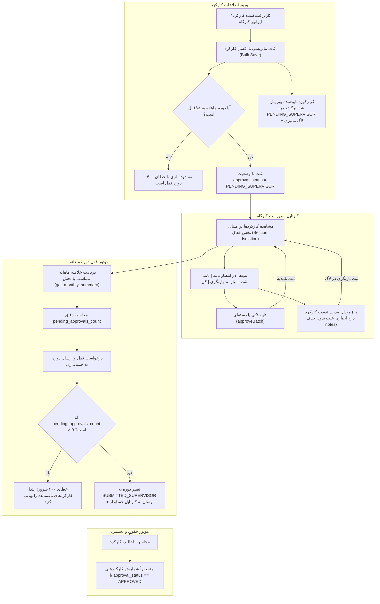

# طرح جامع، بازنویسی‌شده و عمیق ممیزی چرخه گردش‌کار کارکرد و واقعی‌سازی قفل دوره (Attendance Workflow Audit & Period Lock Realization v2.0)

<div dir="rtl" align="right">

## ۱. خلاصه اجرایی و فلسفه معماری (Executive Summary)

این طرح بر اساس تحلیل جامع ریشه‌ای و بازبینی موشکافانه کل چرخه کارکرد، خزانه‌داری، حقوق و دستمزد و کارتابل‌های پنج‌سطحی بازنویسی شده است. هدف طرح، تبدیل فرآیند صوری تایید کارکرد سرپرست و قفل دوره ماهانه به یک سیستم واقعی، استاندارد، ایمن و غیرمخرب است.

با بررسی عمیق پایگاه کد، **۸ چالش و نقص اساسی** شناسایی و در این طرح حل شده‌اند:
1. **تداخل وضعیت حضور با تایید:** فیلد `DailyAttendance.status` صرفاً نوع فیزیکی حضور (`PRESENT_10H`, `ABSENT`, `LEAVE`) را نگه می‌دارد و فیلد مستقل چرخه تایید وجود نداشت.
2. **تب‌های خالی کارتابل سرپرست:** فیلترهای فرانت‌اند بر روی رشته‌های ناموجود `approved` و `pending_supervisor` مقایسه می‌کردند.
3. **تایید صوری و تخریب یادداشت‌ها:** تاییدیه به رشته `notes` الحاق می‌شد و عودت با `window.prompt` کل توضیحات قبلی را رونویسی و نابود می‌کرد.
4. **کد مرده در قفل دوره:** متغیر `pending_approvals: summaryRes?.is_locked ? 0 : 0` هاردکد برابر صفر بود و هشدار سرور هیچ‌گاه کار نمی‌کرد.
5. **ارسال اشتباه شناسه پروژه به عنوان انبار:** در قفل دوره، `project_id` به عنوان `warehouse_id` فرستاده می‌شد که ناقض قاعده ۶ (جداسازی پرسنل از انبار) بود.
6. **شکاف محاسباتی موتور حقوق (`payroll_engine.py`):** موتور حقوق بدون چک کردن وضعیت تایید کارکرد، ساعات کارکرد تاییدنشده یا عودت‌داده‌شده را مستقیماً در فیش حقوقی محاسبه می‌کرد!
7. **نادیده گرفته شدن بخش فعال در خلاصه ماهانه:** اندپوینت `monthly-summary` و متد کلاینت `getAttendanceMonthlySummary` پارامتر `section_id` را فیلتر نمی‌کردند و داده‌های بخش فعال ایزوله نبودند.
8. **امکان دور زدن و ویرایش کارکرد در دوره‌های بسته:** در صورت ثبت نهایی دوره توسط سرپرست، کنترل سخت‌گیرانه‌ای برای جلوگیری از تغییر ماتریسی یا اکسل روزهای گذشته وجود نداشت.

---

## ۲. معماری جامع و جریان داده (End-to-End Architectural Flow)



---

## ۳. تغییرات ساختار مدل‌های پایگاه داده (Data Model Specifications)

### ۱. مدل `DailyAttendance` در [models.py](file:///e:/warehouse%20project/backend/personnel/models.py#L2020)
* **افزودن گزینه‌های وضعیت تایید:**
  ```python
  APPROVAL_STATUS_CHOICES = (
      ('DRAFT', 'پیش‌نویس اولیه'),
      ('PENDING_SUPERVISOR', 'در انتظار بررسی و تایید سرپرست'),
      ('APPROVED', 'تایید نهایی سرپرست کارگاه'),
      ('REVISION_REQUIRED', 'عودت داده‌شده جهت اصلاح و بازنگری'),
  )
  ```
* **افزودن فیلدهای پایگاه داده:**
  * `approval_status`: فیلد `CharField(max_length=25, choices=APPROVAL_STATUS_CHOICES, default='PENDING_SUPERVISOR', db_index=True)`
  * `supervisor_approved_by`: کلید خارجی `ForeignKey(User, null=True, blank=True, on_delete=models.SET_NULL, related_name='approved_daily_attendances')`
  * `supervisor_approved_at`: فیلد `DateTimeField(null=True, blank=True)`
  * `revision_reason`: فیلد متنی `TextField(null=True, blank=True)`
  * `revision_requested_by`: کلید خارجی `ForeignKey(User, null=True, blank=True, on_delete=models.SET_NULL, related_name='revised_daily_attendances')`
  * `revision_requested_at`: فیلد `DateTimeField(null=True, blank=True)`
* **استراتژی مایگریشن داده‌های تاریخی (Data Migration):**
  * رکوردهای متصل به دوره‌های قفل‌شده (`status__in=['LOCKED', 'FINALIZED', 'PAID']`) به صورت خودکار مقدار `approval_status='APPROVED'` دریافت می‌کنند.
  * رکوردهای متعلق به دوره‌های جاری یا باز مقدار `approval_status='PENDING_SUPERVISOR'` دریافت می‌کنند.

### ۲. مدل `MonthlyWorkPeriod` در [models.py](file:///e:/warehouse%20project/backend/personnel/models.py#L1834)
* **افزودن فیلدهای اسکوپ سازمانی بدون نقض انبار:**
  * `project`: کلید خارجی `ForeignKey(FinancialProject, null=True, blank=True, on_delete=models.SET_NULL, related_name='monthly_work_periods')`
  * `section`: کلید خارجی `ForeignKey(ProjectSection, null=True, blank=True, on_delete=models.SET_NULL, related_name='monthly_work_periods')`
* **اصلاح اعتبارسنجی یکتایی:** پشتیبانی از یکتایی دوره در سطح `[company, section, year_month]` یا `[company, project, year_month]`.

---

## ۴. فازهای تفصیلی پیاده‌سازی (Detailed Execution Phases)

### 🔹 فاز ۱: لایه دیتابیس، مایگریشن و سریالایزرها (Backend Core)
1. **ویرایش مدل `DailyAttendance`:** درج فیلدهای `approval_status`, `supervisor_approved_by`, `supervisor_approved_at`, `revision_reason`, `revision_requested_by`, `revision_requested_at`.
2. **ویرایش مدل `MonthlyWorkPeriod`:** افزودن فیلدهای `project` و `section`.
3. **تولید مایگریشن و اجرای آن:** اجرای `makemigrations` و `migrate` با مقداردهی ایمن داده‌های گذشته.
4. **به‌روزرسانی `DailyAttendanceSerializer`:** افزودن فیلدهای جدید وضعیت تایید و عناوین فارسی (`approval_status_display`).
5. **به‌روزرسانی `MonthlyWorkPeriodSerializer`:** اکسپوز کردن فیلدهای پروژه، بخش و شمارنده کارکردهای معلق.

### 🔹 فاز ۲: قوانین تجاری، محاسبات حقوق و ایمن‌سازی کارکرد (Backend Engine & Logic)
1. **ایمن‌سازی ثبت و ویرایش کارکرد در `DailyAttendanceViewSet`:**
   - در `bulk_save_matrix` و `bulk_save_monthly_grid`:
     - بررسی وضعیت دوره: اگر دوره در وضعیت‌های `['SUBMITTED_SUPERVISOR', 'SUBMITTED_ACCOUNTANT', 'READY_TO_PAY', 'PAID', 'LOCKED']` باشد، ویرایش بدون مجوز ادمین بلافاصله با خطای ۴۰۰ مسدود گردد.
     - ابطال تاییدیه در صورت ویرایش (State Invalidation): در صورت تغییر ساعات یا وضعیت رکوردی که قبلاً `APPROVED` بوده، وضعیت آن به `PENDING_SUPERVISOR` برگردد و لاگ ممیزی در `AttendanceAuditLog` با فیلد `approval_status` ثبت شود.
2. **اصلاح موتور محاسبه حقوق ([payroll_engine.py](file:///e:/warehouse%20project/backend/personnel/payroll_engine.py)):**
   - در خط ۱۲۶، اعمال شرط `approval_status='APPROVED'` روی کوئری `DailyAttendance`، به طوری که رکوردهای در انتظار یا عودت‌داده‌شده وارد محاسبات مالی حقوق نشوند.
3. **ارتقای اندپوینت `monthly-summary`:**
   - پشتیبانی از فیلتر بر اساس `section_id` و `project_id` علاوه بر `warehouse_id`.
   - محاسبه دقیق و ارسال فیلد `pending_approvals_count = attendances.exclude(approval_status='APPROVED').count()`.
   - ارسال سرجمع کارکردهای نیازمند بررسی، تاییدشده و نیازمند بازنگری.
4. **اکشن‌های کارتابل سرپرست در `cartable_views.py`:**
   - پشتیبانی از `model: 'attendance'` در `SupervisorCartableAPIView.post()`:
     - اکشن `approve`: تنظیم `approval_status = 'APPROVED'`، ثبت کاربر و زمان تایید و لاگ در `AttendanceAuditLog`.
     - اکشن `reject` یا `revision`: دریافت اجباری پارامتر `reason`، تنظیم `approval_status = 'REVISION_REQUIRED'`، ذخیره در `revision_reason`، بدون دستکاری یا حذف فیلد `notes`، و ثبت لاگ ممیزی.
     - بررسی دسترسی بخش: اطمینان از اینکه سرپرست جاری در `UserSectionAssignment` دسترسی فعال به بخش آن کارکرد را دارد (دفاع BOLA / Section Isolation).
5. **سد اعتبارسنجی سروری قفل دوره در `cartable_views.py`:**
   - در اکشن `approve` برای `model: 'period'`، قبل از انتقال به `SUBMITTED_SUPERVISOR`:
     - جستجوی کارکردهای ثبت‌شده در آن دوره ماهانه و آن بخش/پروژه.
     - در صورت وجود رکوردی با `approval_status != 'APPROVED'`، صدور خطای قطعی `HTTP 400 Bad Request` با پیام: «امکان قفل و ارسال دوره وجود ندارد. تعداد X کارکرد در انتظار تایید سرپرست باقی مانده است.»
   - ایجاد یا بازیابی دوره با انتساب به `section_id` و `project_id` واقعی به جای قرار دادن شناسه پروژه در `warehouse_id`.

### 🔹 فاز ۳: ارتقای کامپوننت کارتابل کارکرد سرپرست در فرانت‌اند (`supervisor-attendance`)
1. **اصلاح تب‌ها و فیلترهای نمایش:**
   - تب «⏳ نیازمند بررسی»: `it.approval_status === 'PENDING_SUPERVISOR' || it.approval_status === 'DRAFT' || !it.approval_status`
   - تب «✅ تایید شده»: `it.approval_status === 'APPROVED'`
   - تب «⚠️ نیازمند بازنگری»: `it.approval_status === 'REVISION_REQUIRED'`
   - تب «📋 کل کارکردها»: نمایش همه اقلام همراه با شمارنده‌های دقیق در کپسول هدر.
2. **تفکیک بصری نشان‌های حضور و تایید در جدول:**
   - ستون وضعیت حضور: نمایش برچسب‌های رنگی استاندارد (حاضر کامل ۱۰ ساعت، نیمه‌وقت، مرخصی و...).
   - ستون وضعیت تایید: نمایش بج کوچک تایید سرپرست، در انتظار یا عودت‌داده‌شده با قابلیت نمایش تولتیپ علت عودت.
3. **طراحی مودال مدرن و ارگونومیک عودت کارکرد:**
   - حذف کامل `window.prompt` قدیمی.
   - پیاده‌سازی مودال اختصاصی با پس‌زمینه محو (`backdrop-blur`)، فیلد متنی `textarea` برای درج دقیق علت عودت، دکمه‌های انصراف و ثبت عودت، و بازخورد لحظه‌ای.
4. **تایید تکی و دسته‌ای ساختاریافته:**
   - فراخوانی متد رسمی کارتابل `postCartableAction('supervisor', { action: 'approve', model: 'attendance', id: item.id })`.
   - در تایید دسته‌ای: فراخوانی تجمیعی و به‌روزرسانی ردیف‌ها و شمارنده‌ها بدون رفرش کل صفحه.

### 🔹 فاز ۴: ارتقای کامپوننت قفل دوره ماهانه در فرانت‌اند (`supervisor-period-lock`)
1. **ارتقای سرویس API فرانت‌اند (`personnel-api.service.ts`):**
   - افزودن پارامترهای اختیاری `sectionId?: number` و `projectId?: number` به متد `getAttendanceMonthlySummary`.
2. **اتصال شمارنده زنده و ایزوله به بخش:**
   - ارسال `section_id: this.selectedSectionId` در فراخوانی خلاصه ماهانه.
   - خواندن مقدار واقعی `pending_approvals = summaryRes?.pending_approvals_count ?? 0`.
3. **ارگونومی و کنترل سد قفل دوره:**
   - غیرفعال‌سازی دکمه قفل دوره در صورت `pending_approvals > 0`.
   - نمایش بنر هشدار واضح در بالای کارت: «⚠️ امکان قفل دوره وجود ندارد: تعداد X کارکرد تاییدنشده در این بخش وجود دارد. [مشاهده کارکردها ◀]».
4. **اصلاح پارامترهای ارسالی قفل دوره:**
   - ارسال `section_id: this.selectedSectionId` و `project_id: this.selectedSection?.project_id` به همراه `year_month` به جای ارسال مقدار در قالب `warehouse_id`.

### 🔹 فاز ۵: تست‌های جامع، رگرسیون و راستی‌آزمایی بیلد (Quality Assurance)
1. **سوئیت آزمون اختصاصی بک‌اند (`test_attendance_approval_workflow.py`):**
   - آزمون تایید تکی، تایید دسته‌ای و عودت با لاگ ممیزی.
   - آزمون بازگشت وضعیت به در انتظار در صورت تغییر رکورد تاییدشده.
   - آزمون سد قفل دوره (مسدودسازی قفل در حضور کارکرد معلق با خطای ۴۰۰).
   - آزمون محاسبه حقوق منحصراً برای کارکردهای تاییدشده در `payroll_engine`.
   - آزمون امنیت BOLA و عدم امکان تایید کارکرد بخش‌های غیرمجاز.
2. **سوئیت آزمون‌های DOM فرانت‌اند با Vitest:**
   - راستی‌آزمایی فیلتر تب‌ها، شمارنده‌ها، باز شدن مودال عودت و عملکرد دکمه تایید.
   - راستی‌آزمایی رفتار مسدودکننده دکمه قفل دوره در حضور اقلام معلق.
3. **تست‌های رگرسیون کل ماژول پرسنل:**
   - اجرای `test_company_multitenant`, `test_role_based_cartables`, `test_cartable_multitenant`.
4. **اجرای بیلد نهایی پروژه فرانت‌اند:**
   - اجرای `npm run build` با خروجی Exit code 0.

---

## ۵. جدول مقایسه‌ای پیش و پس از اجرای طرح بازنویسی‌شده

| بخش / فرآیند | وضعیت فعلی (دارای نقص) | وضعیت پس از اجرای طرح بازنویسی‌شده |
| :--- | :--- | :--- |
| **وضعیت کارکرد** | یک فیلد واحد `status` برای نوع حضور فیزیکی | دو فیلد کاملاً مستقل: `status` (حضور) و `approval_status` (چرخه تایید) |
| **تب‌های کارتابل** | مقایسه با مقادیر ناموجود که منجر به خالی بودن تب‌ها می‌شد | فیلتر دقیق بر اساس `approval_status` سرور و پر شدن صحیح لیست‌ها |
| **تایید و عودت** | الحاق متن به `notes` یا رونویسی و حذف یادداشت قبلی با `prompt` | اکشن ساختاریافته کارتابل، مودال زیبا، لاگ در `AttendanceAuditLog` و حفظ کامل یادداشت‌ها |
| **ویرایش مجدد** | اگر کارکرد تاییدشده ویرایش می‌شد، تاییدیه همچنان معتبر می‌ماند | ابطال خودکار تاییدیه (`PENDING_SUPERVISOR`) و اجبار به تایید مجدد قبل از قفل دوره |
| **قفل دوره ماهانه** | شمارنده صفر هاردکد شده و عدم ممانعت از قفل دوره ناقص | محاسبه دقیق سروری `pending_approvals_count` و سد امنیتی نفوذناپذیر در بک‌اند و فرانت‌اند |
| **اسکوپ دوره کارکرد** | ارسال `project_id` به عنوان `warehouse_id` | انتساب مستقیم و تفکیک‌شده به `section_id` و `project_id` و حفظ استقلال از انبار |
| **محاسبه حقوق** | جمع زدن تمام کارکردها حتی موارد پیش‌نویس، تاییدنشده یا عودتی | فیلتر قطعی کارکردهای `approval_status == 'APPROVED'` در موتور حقوق |
| **ایزولاسیون سرپرست** | عدم چک کردن بخش کارکرد در زمان تایید کارتابل | اعتبارسنجی تطابق بخش کارکرد با `UserSectionAssignment` سرپرست (دفاع BOLA) |

---

## ۶. ماتریس کامل فایل‌های تحت تاثیر و نیازمند ویرایش

| ردیف | مسیر فایل | لایه | شرح دقیق تغییرات |
| :---: | :--- | :---: | :--- |
| **۱** | [backend/personnel/models.py](file:///e:/warehouse%20project/backend/personnel/models.py) | دیتابیس | افزودن `approval_status` و ۵ فیلد ممیزی سرپرست به `DailyAttendance`، و فیلدهای بخش/پروژه به `MonthlyWorkPeriod` |
| **۲** | [backend/personnel/serializers.py](file:///e:/warehouse%20project/backend/personnel/serializers.py) | سریالایزر | اکسپوز فیلدهای وضعیت تایید در `DailyAttendanceSerializer` و سازگاری سریالایزرهای ماتریسی |
| **۳** | [backend/personnel/views.py](file:///e:/warehouse%20project/backend/personnel/views.py) | کنترلر / API | پشتیبانی از `section_id` در `monthly-summary`، محاسبه `pending_approvals_count`، ابطال تاییدیه در ویرایش، و قفل ویرایش دوره‌های بسته |
| **۴** | [backend/personnel/cartable_views.py](file:///e:/warehouse%20project/backend/personnel/cartable_views.py) | کارتابل | تایید و عودت کارکرد در `SupervisorCartableAPIView.post` با لاگ ممیزی، سد امنیتی قفل دوره، و تطبیق دوره با بخش/پروژه |
| **۵** | [backend/personnel/payroll_engine.py](file:///e:/warehouse%20project/backend/personnel/payroll_engine.py) | موتور حقوق | فیلتر منحصراً کارکردهای `approval_status='APPROVED'` در محاسبه ناخالص و ساعات کارکرد پرسنل |
| **۶** | [personnel-api.service.ts](file:///e:/warehouse%20project/frontend/src/app/core/api/personnel-api.service.ts) | سرویس فرانت‌اند | افزودن پارامتر `section_id` و `project_id` به متد `getAttendanceMonthlySummary` و اصلاح اینترفیس خروجی |
| **۷** | [supervisor-attendance.ts](file:///e:/warehouse%20project/frontend/src/app/components/finance/supervisor/supervisor-attendance/supervisor-attendance.ts) | کامپوننت | فیلتر تب‌ها بر اساس `approval_status`، اتصال تایید و عودت به کارتابل، مودال عودت و حفظ یادداشت‌ها |
| **۸** | [supervisor-attendance.html](file:///e:/warehouse%20project/frontend/src/app/components/finance/supervisor/supervisor-attendance/supervisor-attendance.html) | قالب فرانت‌اند | نمایش ستون‌های تفکیک‌شده حضور و تایید، مودال ارگونومیک عودت کارکرد |
| **۹** | [supervisor-period-lock.ts](file:///e:/warehouse%20project/frontend/src/app/components/finance/supervisor/supervisor-period-lock/supervisor-period-lock.ts) | کامپوننت | اتصال `pending_approvals` به شمارنده واقعی بخش، غیرفعال‌سازی قفل، و ارسال پارامترهای صحیح بخش/پروژه |
| **۱۰** | [supervisor-period-lock.html](file:///e:/warehouse%20project/frontend/src/app/components/finance/supervisor/supervisor-period-lock/supervisor-period-lock.html) | قالب فرانت‌اند | دکمه غیرفعال قفل در صورت وجود کارکرد معلق و بنر راهنمای بصری ارگونومیک |
| **۱۱** | `backend/personnel/test_attendance_approval_workflow.py` | آزمون بک‌اند | سوئیت تست اختصاصی جامع برای کلیه سناریوهای تایید، عودت، ممیزی، سد قفل و حقوق |

</div>
