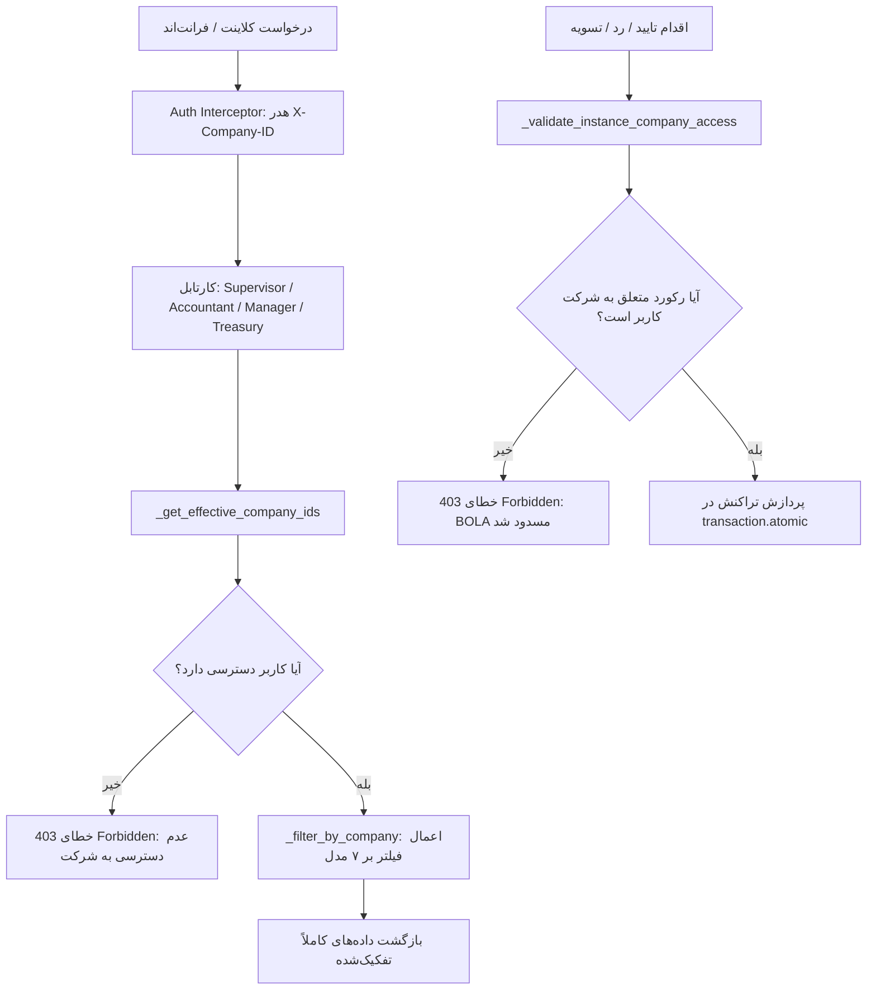

# مستندات و گزارش جامع پیاده‌سازی تفکیک چندشرکتی کارتابل‌های ۵ سطحی (Cartable Multi-Tenant Security)

<div dir="rtl" align="right">

## خلاصه اجرایی (Executive Summary)

این طرح با هدف برطرف‌سازی کامل آسیب‌پذیری نشت داده‌ها (Data Leak) و پیشگیری از حملات کنترل دسترسی در سطح شیء (BOLA - Broken Object Level Authorization) در کارتابل‌های پنج‌سطحی پرسنل و خزانه‌داری (`cartable_views.py` و `treasury_engine.py`) به اجرا درآمد.
پیش از این، کارتابل‌های سرپرست، حسابدار، مدیر و خزانه‌داری بدون فیلتر شرکت، تمام اطلاعات معلق تمام شرکت‌ها (از جمله شماره شبا، سوابق دستمزد، فاکتورها و ناوگان) را بازمی‌گرداندند و عملیات تایید، رد یا پرداخت می‌توانست روی شناسه متعلق به شرکتی دیگر اعمال گردد.

با اجرای این طرح:
1. **تفکیک کامل خواندن (Read Isolation):** کارتابل‌ها منحصراً رکوردهای متعلق به شرکت‌های مجاز کاربر را نمایش می‌دهند (با پشتیبانی از هدر `X-Company-ID`).
2. **پدافند چندلایه BOLA (Write Isolation):** هرگونه اقدام (تایید، بازنگری، رد، تسویه، دانلود دیسکت) روی رکوردهای متعلق به شرکت دیگر با خطای قطعی `HTTP 403 Forbidden` و پیام امنیتی فارسی مسدود می‌شود.
3. **تفکیک موتور خزانه‌داری:** خزانه‌داری مبالغ و بسته‌های تسویه را تفکیک‌شده بر اساس شرکت محاسبه و دیسکت‌های بانکی پایا/ساتنا را منحصراً با احراز دسترسی صادر می‌نماید.

---

## معماری امنیتی و تغییرات انجام‌شده



### ۱. توابع کمکی جدید در `personnel/cartable_views.py`
- `_get_effective_company_ids(request, user)`: استخراج شناسه شرکت از هدر `X-Company-ID` یا بازگرداندن کلیه شرکت‌های مجاز کاربر در صورت عدم ارسال هدر.
- `_filter_by_company(queryset, model_name, company_ids)`: نگاشت و اعمال فیلتر شرکت بر روی مدل‌های هفتگانه (`PersonnelProfile`, `PersonnelChangeRequest`, `DailyAttendance`, `FleetVehicle`, `FleetVehicleChangeRequest`, `FleetTripLog`, `PayrollPeriod`, `SalaryPaymentRecord`, `ContractorInvoice`).
- `_get_instance_company_id(instance, model_name)`: استخراج دقیق `company_id` از هر نمونه براساس ساختار ارتباطی مدل.
- `_validate_instance_company_access(instance, model_name, user)`: اعتبارسنجی امنیتی پیش از تایید، رد یا تسویه جهت دفاع BOLA.

### ۲. ارتقای موتور خزانه‌داری در `personnel/treasury_engine.py`
- متد `TreasuryDisbursementService.get_pending_treasury_batches(company_ids)` ارتقا یافت تا پارامتر اختیاری `company_ids` را دریافت کند.
- فیلتر روی دوره‌های حقوقی (`payroll_runs`), رکوردهای پرداخت (`salary_records`) و سرویس‌های ناوگان (`fleet_trips`) اعمال شده و سرجمع مبالغ صف خزانه‌داری (`total_pending_amount`) به صورت تفکیک‌شده محاسبه می‌شود.

---

## جدول تفصیلی تغییرات و راهنمای مشاهده آثار (Task & Verification Matrix)

| ردیف | تسک / بخش عملیاتی | کدام قسمت از کد تغییر کرده است؟ | برای دیدن آثار آن قسمت چه کاری باید انجام شود؟ |
| :--- | :--- | :--- | :--- |
| **۱** | **فیلتر شرکت در موتور خزانه‌داری** | [treasury_engine.py](file:///e:/warehouse%20project/backend/personnel/treasury_engine.py#L38-L128)<br>• متد `get_pending_treasury_batches`<br>• افزودن آرگومان `company_ids`<br>• اعمال فیلتر بر `PayrollPeriod`, `SalaryPaymentRecord`, `FleetTripLog`<br>• بازنویسی محاسبه سرجمع مبالغ | **روش مشاهده:**<br>۱. ورود به منوی خزانه‌داری / تب پرداخت حقوق یا دیسکت بانکی.<br>۲. با تغییر شرکت در سلکتور بالای سامانه، مشاهده خواهید کرد که لیست دوره‌ها، مبالغ کل قابل پرداخت و سرجمع بدهی ناوگان دقیقاً متناسب با شرکت انتخابی فیلتر و بازتولید می‌شود و داده‌های سایر شرکت‌ها پنهان می‌گردند. |
| **۲** | **فیلتر کارتابل سرپرست (GET)** | [cartable_views.py](file:///e:/warehouse%20project/backend/personnel/cartable_views.py#L125-L160)<br>• کلاس `SupervisorCartableAPIView`<br>• متد `get()`<br>• اعمال `_filter_by_company` روی رکوردهای معلق پرسنل، کارکرد روزانه، ناوگان و تردد | **روش مشاهده:**<br>۱. ورود به کارتابل سرپرست در تب پرسنل یا ناوگان (`/app/finance/supervisor-personnel`).<br>۲. انتخاب یک شرکت مشخص از هدر سامانه؛ کارتابل سرپرست تنها درخواست‌های ثبت‌نام، مرخصی‌ها یا کارکرد ناوگان همان شرکت را نشان می‌دهد.<br>۳. تغییر شرکت باعث به‌روزرسانی آنی لیست متناسب با آن شرکت می‌شود. |
| **۳** | **پدافند BOLA در کارتابل سرپرست (POST)** | [cartable_views.py](file:///e:/warehouse%20project/backend/personnel/cartable_views.py#L162-L210)<br>• متد `post()` در `SupervisorCartableAPIView`<br>• بررسی `_validate_instance_company_access` قبل از تایید یا رد | **روش مشاهده:**<br>۱. ارسال یک درخواست POST به `/api/personnel/cartable/supervisor/action/` برای تایید یا رد رکوردی که متعلق به شرکت دیگری است (توسط سرپرست شرکت اول).<br>۲. سرور با خطای `HTTP 403 Forbidden` و متن «شما به داده‌های شرکت مربوط به این مورد دسترسی ندارید» مانع نفوذ می‌شود (در تست `test_supervisor_cross_company_action_blocked` اعتبارسنجی شد). |
| **۴** | **فیلتر کارتابل حسابدار (GET)** | [cartable_views.py](file:///e:/warehouse%20project/backend/personnel/cartable_views.py#L225-L270)<br>• کلاس `AccountantCartableAPIView`<br>• متد `get()`<br>• فیلتر شرکت روی پروفایل‌های حقوقی، احکام، کارکردها و ماشین‌آلات | **روش مشاهده:**<br>۱. ورود با نقش حسابدار شرکت الف (`/app/finance/accountant-personnel`).<br>۲. اطلاعات حقوقی، احکام و شماره شبا منحصراً برای کارمندان و رانندگان شرکت الف فهرست شده و پرونده‌های مالی سایر شرکت‌ها کاملاً ایزوله هستند. |
| **۵** | **پدافند BOLA در کارتابل حسابدار (POST)** | [cartable_views.py](file:///e:/warehouse%20project/backend/personnel/cartable_views.py#L275-L330)<br>• متد `post()` در `AccountantCartableAPIView`<br>• ممانعت از تایید مالی احکام شرکت‌های غیرمجاز | **روش مشاهده:**<br>۱. اقدام به تایید مالی یا رد پرونده متعلق به شرکت دیگر با شناسه مشخص.<br>۲. دریافت خطای ۴۰۳ صریح به جای پردازش تراکنش.<br>۳. در تست خودکار `test_accountant_cross_company_action_blocked` با خروجی سبز ثبت شد. |
| **۶** | **فیلتر کارتابل مدیر (GET)** | [cartable_views.py](file:///e:/warehouse%20project/backend/personnel/cartable_views.py#L345-L390)<br>• کلاس `ManagerCartableAPIView`<br>• متد `get()`<br>• اعمال فیلتر شرکت روی تمام موارد مرحله نهایی `pending_manager` | **روش مشاهده:**<br>۱. ورود به کارتابل مدیر (`/app/finance/manager-approvals` یا `manager-personnel`).<br>۲. مدیر شرکت الف منحصراً درخواست‌های نیازمند تایید شرکت الف را در لیست مشاهده می‌کند و هیچ تداخلی با سایر بخش‌ها و شرکت‌ها ایجاد نمی‌شود. |
| **۷** | **پدافند BOLA در کارتابل مدیر (POST)** | [cartable_views.py](file:///e:/warehouse%20project/backend/personnel/cartable_views.py#L395-L450)<br>• متد `post()` در `ManagerCartableAPIView`<br>• بررسی دسترسی سازمانی پیش از صدور تصویب نهایی | **روش مشاهده:**<br>۱. تلاش برای تصویب استخدام یا ناوگان شرکتی دیگر توسط مدیر شرکتی دیگر؛ بازگشت خطای ۴۰۳ امنیتی.<br>۲. راستی‌آزمایی شده در تست `test_manager_cross_company_action_blocked`. |
| **۸** | **فیلتر و پنهان‌سازی شبای خزانه‌داری (GET)** | [cartable_views.py](file:///e:/warehouse%20project/backend/personnel/cartable_views.py#L460-L505)<br>• کلاس `TreasuryCartableAPIView`<br>• متد `get()`<br>• پاس دادن `company_ids` به سرویس خزانه‌داری و فیلتر شبا و فاکتورها | **روش مشاهده:**<br>۱. باز کردن تب کارتابل خزانه‌داری (`/app/finance/treasury-cartable`).<br>۲. کاربر خزانه‌دار شرکت الف فقط شباها و مبالغ پرداختی شرکت الف را می‌بیند. نشت اطلاعات حساس بانکی پرسنل شرکت ب کاملاً متوقف شده است. |
| **۹** | **کنترل دسترسی تسویه در خزانه‌داری (POST)** | [cartable_views.py](file:///e:/warehouse%20project/backend/personnel/cartable_views.py#L510-L600)<br>• متد `post()` در `TreasuryCartableAPIView`<br>• اعتبارسنجی مالکیت شرکت برای دوره‌ها (`period_id`)، حقوق‌ها (`record_ids`)، فاکتورها (`invoice_ids`) و ناوگان (`trip_ids`) | **روش مشاهده:**<br>۱. اقدام به زدن دکمه تسویه یا پرداخت روی یک دوره یا فاکتور شرکت دیگر؛ مسدودسازی با خطای ۴۰۳.<br>۲. تست شده در `test_treasury_cross_company_disburse_blocked`. |
| **۱۰** | **امنیت دانلود دیسکت‌های بانکی پایا/ساتنا** | [cartable_views.py](file:///e:/warehouse%20project/backend/personnel/cartable_views.py#L605-L640)<br>• کلاس `TreasuryDisketteExportAPIView`<br>• متد `get()`<br>• بررسی تطابق شرکت دوره با شرکت‌های مجاز کاربر | **روش مشاهده:**<br>۱. ارسال درخواست دانلود فایل دیسکت (`/api/personnel/treasury/export-diskette/?period_id=X`) مربوط به شرکتی که خزانه‌دار عضو آن نیست.<br>۲. پاسخ سرور: ۴۰۳ بدون تولید یا نشت فایل متنی دیسکت (تست شده در `test_treasury_export_diskette_cross_company_blocked`). |
| **۱۱** | **پشتیبانی از هدر چندشرکتی فرانت‌اند** | فرانت‌اند: [auth.interceptor.ts](file:///e:/warehouse%20project/frontend/src/app/core/auth/auth.interceptor.ts#L40)<br>بک‌اند: [cartable_views.py](file:///e:/warehouse%20project/backend/personnel/cartable_views.py#L45-L65) | **روش مشاهده:**<br>۱. تغییر شرکت از طریق دراپ‌داون بالای داشبورد فرانت‌اند.<br>۲. بررسی برگه Network مرورگر؛ هدر `X-Company-ID` به کلیه درخواست‌های کارتابل ضمیمه می‌شود و خروجی فیلتر می‌شود. |

---

## نتایج و شواهد اجرای آزمون‌ها (Verification & Test Execution)

### ۱. اجرای سوئیت اختصاصی تفکیک چندشرکتی (`test_cartable_multitenant.py`)
این سوئیت شامل ۹ تست سناریویی کامل ۲ شرکتی (شرکت الف: `FA` و شرکت ب: `PTS`) می‌باشد:
```bash
python manage.py test personnel.test_cartable_multitenant --noinput
```
**نتیجه خروجی ترمینال:**
```
Found 9 test(s).
Creating test database for alias 'default'...
System check identified no issues (0 silenced).
.........
----------------------------------------------------------------------
Ran 9 tests in 26.817s

OK
Destroying test database for alias 'default'...
```
- `test_supervisor_cartable_isolation`: ایزولاسیون کامل نمایش در کارتابل سرپرست.
- `test_supervisor_cross_company_action_blocked`: مسدودسازی حمله BOLA در سرپرست با ۴۰۳.
- `test_accountant_cartable_isolation`: ایزولاسیون پرونده‌های مالی و شبا در حسابدار.
- `test_accountant_cross_company_action_blocked`: مسدودسازی تایید مالی بین‌شرکتی با ۴۰۳.
- `test_manager_cartable_isolation`: ایزولاسیون کارتابل مصوبات مدیر.
- `test_manager_cross_company_action_blocked`: مسدودسازی تصویب بین‌شرکتی با ۴۰۳.
- `test_treasury_cartable_isolation`: ایزولاسیون کامل صف خزانه‌داری، دوره‌ها و شبا.
- `test_treasury_cross_company_disburse_blocked`: مسدودسازی پرداخت بین‌شرکتی با ۴۰۳.
- `test_treasury_export_diskette_cross_company_blocked`: مسدودسازی دانلود دیسکت با ۴۰۳.

### ۲. تست‌های رگرسیون چندشرکتی سازمانی (`test_company_multitenant.py`)
```bash
python manage.py test personnel.test_company_multitenant --noinput
```
**نتیجه خروجی ترمینال:**
```
Ran 15 tests in 9.483s
OK
```

### ۳. تست‌های کارتابل‌های مبتنی بر نقش (`test_role_based_cartables.py`)
```bash
python manage.py test personnel.test_role_based_cartables --noinput
```
**نتیجه خروجی ترمینال:**
```
Ran 5 tests in 2.608s
OK
```

### ۴. راستی‌آزمایی بیلد فرانت‌اند (`npm run build`)
```bash
npm run build
```
**نتیجه خروجی ترمینال:**
```
Application bundle generation complete. [108.940 seconds]
Output location: frontend\dist\warehouse-app
[patch-ngsw-530] ✔ ngsw-worker.js patched successfully.
Exit code: 0
```

---

## نتیجه‌گیری نهایی
با تکمیل این طرح، سامانه کارتابل‌های ۵ سطحی به امنیت سطح سازمانی (Enterprise Grade Multi-Tenant Isolation) ارتقا یافته و کلیه منافذ نشت داده‌های مالی، هویتی، بانکی و پتانسیل سوءاستفاده‌های مبتنی بر BOLA به طور قطعی مسدود شدند.

</div>
