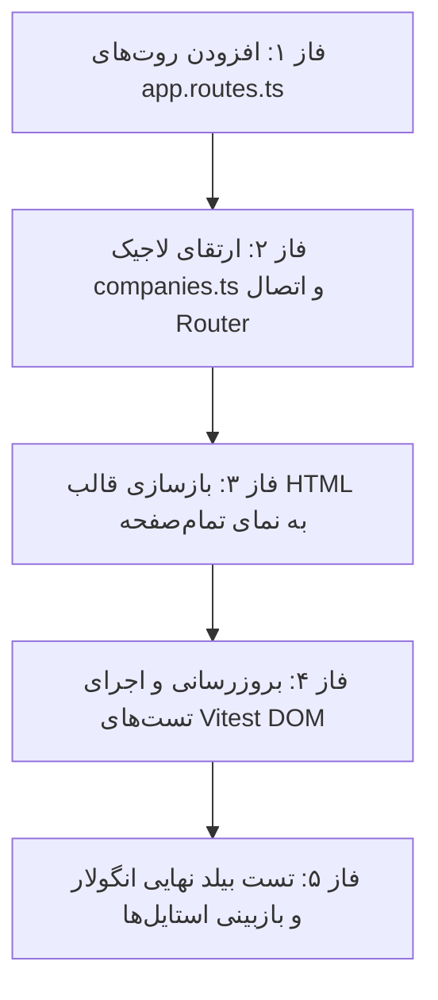

# طرح جامع مهندسی: تبدیل استودیوی شناسنامه حقوقی شرکت‌ها به نمای تمام‌صفحه با آدرس‌دهی مستقل URL

<div dir="rtl" align="right">

> [!IMPORTANT]
> **هدف طرح:** ارتقای استودیوی شناسنامه حقوقی و مدارک شرکت‌ها از یک مودال محدود و فشرده به یک نمای کاری تمام‌صفحه و مستقل (First-Class Full-Screen View) در دل مرکز عملیات (`/app/operations`) به همراه آدرس‌دهی اختصاصی برای هر شرکت و ساب‌تب‌های هفت‌گانه (`/app/operations/companies/:id?tab=...`).

---

## ۱. جدول ماتریس تغییرات فایل‌ها (File Changes Matrix)

| ردیف | مسیر فایل | نقش و نوع تغییر | هدف مهندسی |
| :---: | :--- | :---: | :--- |
| ۱ | `src/app/app.routes.ts` | پیکربندی روتینگ (Routing Config) | افزودن مسیرهای `/app/operations/companies/:id` و `/app/operations/companies/new` |
| ۲ | `src/app/components/operations/companies/companies.ts` | لاجیک کامپوننت (Component Logic) | تزریق `ActivatedRoute` و `Router`، مدیریت `viewMode`، همگام‌سازی دوطرفه پارامترهای روت و کوئری با تب‌ها |
| ۳ | `src/app/components/operations/companies/companies.html` | ساختار قالب (Template Layout) | تفکیک نمای لیست (`viewMode === 'list'`) و نمای تمام‌صفحه استودیو (`viewMode === 'studio'`) با هدر چسبان استاندارد |
| ۴ | `src/app/components/operations/companies/companies.css` | استایل‌دهی (Styles) | بهینه‌سازی فاصله‌ها، هدر استیکی و اسکرول نرم برای نمای تمام‌صفحه |
| ۵ | `src/app/components/operations/companies/companies.dom.spec.ts` | تست‌های واحد دام (DOM Unit Tests) | افزودن روت‌های شبیه‌سازی‌شده و اعتبارسنجی ناوبری URL و جابجایی بین لیست و استودیو |

---

## ۲. معماری آدرس‌دهی URL و ناوبری (Routing & Navigation Architecture)

### ۲.۱. ساختار آدرس‌ها (URL Patterns)
1. **فهرست شرکت‌ها (List View):**
   - آدرس: `/app/operations/companies`
   - عملکرد: نمایش جدول، کارت‌ها، جستجوی زنده، آمار و دکمه‌های اکسل و ثبت شرکت.
2. **استودیوی شناسنامه شرکت موجود (Existing Company Studio):**
   - آدرس: `/app/operations/companies/:id`
   - مثال: `/app/operations/companies/1` (پیش‌فرض تب هویت)
   - همراه با تب فعال: `/app/operations/companies/1?tab=documents`
3. **استودیوی ثبت شرکت جدید (New Company Registration):**
   - آدرس: `/app/operations/companies/new`
   - عملکرد: فرم ایجاد شرکت با فیلدهای خام در قالب نمای کامل.

### ۲.۲. نگاشت ساب‌تب‌های هفت‌گانه در URL
```
?tab=identity          -> ۱. مشخصات هویتی و ثبتی
?tab=fiscal_insurance  -> ۲. تنظیمات مالی، مالیاتی و کارگاهی
?tab=treasury          -> ۳. خزانه‌داری و حساب‌های بانکی
?tab=governance        -> ۴. ارکان، هیئت‌مدیره و صاحبان امضا
?tab=documents         -> ۵. بایگانی اسناد و مدارک رسمی
?tab=access            -> ۶. دسترسی کاربران
?tab=gdrive            -> ۷. گوگل درایو (Google Drive)
```

> [!TIP]
> **مزیت کلیدی Deep-Linking:** هر تب دارای آدرس مستقیم خواهد بود؛ با زدن `F5` یا ارسال لینک به مدیر/حسابدار، دقیقاً همان صفحه و همان تب با بارگذاری مجدد زنده باز می‌شود. دکمه بازگشت مرورگر (`Alt + راست`) نیز کاربر را به طور خودکار به فهرست شرکت‌ها برمی‌گرداند.

---

## ۳. کدهای دقیق و تغییرات تفکیکی (Detailed Code Implementations)

### ۳.۱. فایل روتینگ سراسری: `src/app/app.routes.ts`

```typescript
// مسیر: src/app/app.routes.ts (بخشی از بخش children ماژول /app/operations)
{
  path: 'app/operations',
  component: OperationsLayoutComponent,
  canActivate: [AuthGuard, OperationsGuard],
  canActivateChild: [AuthGuardChild, OperationsGuardChild],
  children: [
    { path: 'cockpit', component: OperationsCockpitComponent, data: { reuse: true } },
    { path: 'snapshots', component: SettingsBackupTabComponent, data: { reuse: true } },
    { path: 'backup', redirectTo: 'snapshots', pathMatch: 'full' },
    { path: 'users', component: Users, data: { reuse: true } },
    
    // ─── مدیریت شرکت‌ها و استودیوی شناسنامه ───
    { path: 'companies', component: CompaniesManagementComponent, data: { reuse: true } },
    { path: 'companies/new', component: CompaniesManagementComponent, data: { reuse: false } },
    { path: 'companies/:id', component: CompaniesManagementComponent, data: { reuse: false } },
    
    { path: 'health', component: HealthDashboardComponent, data: { appScope: 'operations', reuse: false } },
    { path: 'audit', component: Audit, data: { appScope: 'security', reuse: true } },
    { path: 'sync-monitor', component: OperationsSyncMonitorComponent, data: { reuse: true } },
    { path: 'rbac-governance', component: OperationsRbacGovernanceComponent, data: { reuse: true } },
    { path: '', redirectTo: 'cockpit', pathMatch: 'full' }
  ]
}
```

---

### ۳.۲. فایل منطق کامپوننت: `src/app/components/operations/companies/companies.ts`

#### الف) افزودن ایمپورت‌ها و سرویس‌های ناوبری
```typescript
import { Router, ActivatedRoute } from '@angular/router';

// در بدنه کلاس CompaniesManagementComponent:
private route = inject(ActivatedRoute);
private router = inject(Router);

// حالت نمای فعال: 'list' (فهرست شرکت‌ها) یا 'studio' (استودیوی تمام‌صفحه)
viewMode: 'list' | 'studio' = 'list';
```

#### ب) گوش دادن به تغییرات پارامترهای روت و کوئری در `ngOnInit`
```typescript
ngOnInit(): void {
  // بارگذاری داده‌های پایه شرکت‌ها و کاربران
  this.loadCompanies();
  this.loadSystemUsers();
  this.setupSearch();
  this.setupRealtimeSync();

  // شنود هوشمند آدرس URL جهت تشخیص حالت لیست یا استودیو
  this.route.paramMap.pipe(takeUntil(this.destroy$)).subscribe(params => {
    const idParam = params.get('id');
    const isNew = this.router.url.includes('/companies/new');

    if (idParam) {
      const companyId = Number(idParam);
      this.viewMode = 'studio';
      this.initStudioForCompany(companyId);
    } else if (isNew) {
      this.viewMode = 'studio';
      this.initStudioForNew();
    } else {
      this.viewMode = 'list';
      this.companyModal.isOpen = false;
    }
    this.cdr.markForCheck();
  });

  // شنود تغییر تب فعال در QueryParams (?tab=...)
  this.route.queryParamMap.pipe(takeUntil(this.destroy$)).subscribe(queryParams => {
    const tabParam = queryParams.get('tab');
    if (tabParam && ['identity', 'fiscal_insurance', 'treasury', 'governance', 'documents', 'access', 'gdrive'].includes(tabParam)) {
      this.activeModalTab = tabParam as any;
      this.cdr.markForCheck();
    }
  });
}
```

#### ج) متدهای جدید بارگذاری و راه‌اندازی استودیو
```typescript
// راه‌اندازی استودیو برای شرکت موجود
private initStudioForCompany(companyId: number): void {
  const existing = this.companies.find(c => c.id === companyId);
  if (existing) {
    this.populateStudioData(existing);
  } else {
    // در صورت رفرش مستقیم صفحه، اطلاعات شرکت از API فراخوانی می‌شود
    this.isLoading = true;
    this.api.getById(companyId).subscribe({
      next: (comp) => {
        this.isLoading = false;
        this.populateStudioData(comp);
      },
      error: () => {
        this.isLoading = false;
        this.toast.error('شرکت مورد نظر یافت نشد.');
        this.router.navigate(['/app/operations/companies']);
      }
    });
  }
}

// راه‌اندازی استودیو برای ثبت شرکت جدید
private initStudioForNew(): void {
  this.companyModal = {
    isOpen: true,
    isEdit: false,
    isSubmitting: false,
    data: this.getEmptyCompanyData(),
    errors: {}
  };
  this.activeModalTab = 'identity';
  this.cdr.markForCheck();
}
```

#### د) هدایت به روت‌ها در تعاملات کاربر
```typescript
// کلیک روی دکمه «ثبت شرکت حقوقی جدید»
openCreateModal(): void {
  this.router.navigate(['/app/operations/companies/new']);
}

// کلیک روی ویرایش یا مشاهده شناسنامه شرکت
openEditModal(company: Company): void {
  this.router.navigate(['/app/operations/companies', company.id], {
    queryParams: { tab: this.activeModalTab || 'identity' }
  });
}

// تغییر ساب‌تب در استودیو
setModalTab(tab: 'identity' | 'fiscal_insurance' | 'treasury' | 'governance' | 'documents' | 'access' | 'gdrive'): void {
  this.activeModalTab = tab;
  this.router.navigate([], {
    relativeTo: this.route,
    queryParams: { tab },
    queryParamsHandling: 'merge',
    replaceUrl: true
  });
}

// خروج یا بازگشت به فهرست شرکت‌ها
closeCompanyModal(): void {
  this.router.navigate(['/app/operations/companies']);
}
```

---

### ۳.۳. فایل قالب HTML: `src/app/components/operations/companies/companies.html`

#### ساختار دو لایه (Dual-View Workspace Layout)
```html
<div class="space-y-6 select-none" dir="rtl">

  <!-- ═══════════════════════════════════════════════════════════════════════ -->
  <!-- بخش ۱: نمای فهرست شرکت‌ها (نمایش تنها هنگام viewMode === 'list')        -->
  <!-- ═══════════════════════════════════════════════════════════════════════ -->
  <ng-container *ngIf="viewMode === 'list'">
    <!-- هدر استیکی فرماندهی، کارت‌های آمار، جدول شرکت‌ها و عملیات اکسل (کدهای موجود بدون تغییر حفظ می‌شوند) -->
    ...
  </ng-container>

  <!-- ═══════════════════════════════════════════════════════════════════════ -->
  <!-- بخش ۲: استودیوی تمام‌صفحه شناسنامه حقوقی (viewMode === 'studio')       -->
  <!-- ═══════════════════════════════════════════════════════════════════════ -->
  <div *ngIf="viewMode === 'studio'" class="w-full flex flex-col gap-4 animate-in fade-in duration-200">
    
    <!-- هدر چسبان فرماندهی استودیو (Unified Sticky Command Center Header) -->
    <div class="sticky top-0 z-30 bg-slate-50/95 backdrop-blur-md pt-1 pb-2">
      <div class="bg-white p-3 md:p-3.5 rounded-2xl border border-slate-200 shadow-xs flex flex-col md:flex-row md:items-center justify-between gap-3">
        
        <!-- سمت راست: دکمه بازگشت، نشان و نام شرکت -->
        <div class="flex items-center gap-3">
          <button
            type="button"
            (click)="closeCompanyModal()"
            class="flex items-center gap-1.5 px-3 py-2 rounded-xl bg-slate-100 hover:bg-slate-200 text-slate-700 text-xs font-black transition-all cursor-pointer shadow-xs active:scale-95"
            title="بازگشت به فهرست شرکت‌ها">
            <svg appIcon="arrow-right" class="w-4 h-4"></svg>
            <span>بازگشت به فهرست</span>
          </button>

          <div class="w-px h-6 bg-slate-200"></div>

          <div class="flex items-center gap-2.5">
            <div class="w-10 h-10 rounded-xl bg-indigo-50 border border-indigo-100 text-indigo-600 flex items-center justify-center font-bold text-lg overflow-hidden shrink-0">
              
              <span *ngIf="!companyModal.data.logo">🏢</span>
            </div>
            <div>
              <div class="flex items-center gap-2">
                <h2 class="text-sm md:text-base font-black text-slate-800">
                  {{ companyModal.isEdit ? companyModal.data.name : 'ثبت شرکت حقوقی جدید' }}
                </h2>
                <span *ngIf="companyModal.isEdit" class="text-[10px] font-mono font-bold px-2 py-0.5 rounded-md bg-indigo-50 text-indigo-700 border border-indigo-200/60">
                  {{ companyModal.data.code }}
                </span>
              </div>
              <p class="text-[11px] text-slate-500 font-medium mt-0.5">
                استودیوی شناسنامه حقوقی، کارگاه بیمه، خزانه‌داری، هیئت‌مدیره، اسناد و گوگل‌درایو
              </p>
            </div>
          </div>
        </div>

        <!-- سمت چپ: دکمه ذخیره، رفرش و وضعیت همگام‌سازی -->
        <div class="flex items-center gap-2">
          <button
            type="button"
            (click)="saveCompanyData()"
            [disabled]="companyModal.isSubmitting"
            class="flex items-center gap-2 px-4 py-2 rounded-xl bg-indigo-600 hover:bg-indigo-700 text-white text-xs font-black shadow-xs transition-all cursor-pointer active:scale-95 disabled:opacity-50">
            <svg *ngIf="!companyModal.isSubmitting" appIcon="check" class="w-4 h-4"></svg>
            <span *ngIf="companyModal.isSubmitting" class="w-4 h-4 border-2 border-white border-t-transparent rounded-full animate-spin"></span>
            <span>{{ companyModal.isSubmitting ? 'در حال ذخیره...' : 'ذخیره مشخصات' }}</span>
          </button>
        </div>

      </div>

      <!-- نوار ساب‌تب‌های ۷گانه در ظرف پیل استاندارد (Subtab Enclosed Pill Navigation) -->
      <div class="mt-2 flex bg-slate-100/90 p-1 rounded-xl border border-slate-200/80 overflow-x-auto w-full scrollbar-none items-center gap-1">
        <button
          type="button"
          (click)="setModalTab('identity')"
          [ngClass]="activeModalTab === 'identity' ? 'bg-white text-indigo-700 shadow-xs font-black' : 'text-slate-600 hover:text-slate-900 font-bold'"
          class="px-3.5 py-2 rounded-lg text-xs flex items-center gap-2 transition-all cursor-pointer whitespace-nowrap">
          <span>🏛️</span>
          <span>۱. مشخصات هویتی و ثبتی</span>
        </button>

        <button
          type="button"
          (click)="setModalTab('fiscal_insurance')"
          [ngClass]="activeModalTab === 'fiscal_insurance' ? 'bg-white text-indigo-700 shadow-xs font-black' : 'text-slate-600 hover:text-slate-900 font-bold'"
          class="px-3.5 py-2 rounded-lg text-xs flex items-center gap-2 transition-all cursor-pointer whitespace-nowrap">
          <span>⚖️</span>
          <span>۲. مالیات و کارگاه بیمه</span>
        </button>

        <button
          type="button"
          (click)="setModalTab('treasury')"
          [ngClass]="activeModalTab === 'treasury' ? 'bg-white text-indigo-700 shadow-xs font-black' : 'text-slate-600 hover:text-slate-900 font-bold'"
          class="px-3.5 py-2 rounded-lg text-xs flex items-center gap-2 transition-all cursor-pointer whitespace-nowrap">
          <span>💳</span>
          <span>۳. حساب‌های بانکی و شبا</span>
          <span class="text-[10px] font-mono font-bold px-1.5 py-0.5 rounded-md bg-slate-200/70 text-slate-700">{{ companyBankAccounts.length }}</span>
        </button>

        <button
          type="button"
          (click)="setModalTab('governance')"
          [ngClass]="activeModalTab === 'governance' ? 'bg-white text-indigo-700 shadow-xs font-black' : 'text-slate-600 hover:text-slate-900 font-bold'"
          class="px-3.5 py-2 rounded-lg text-xs flex items-center gap-2 transition-all cursor-pointer whitespace-nowrap">
          <span>👥</span>
          <span>۴. هیئت‌مدیره و امضا</span>
          <span class="text-[10px] font-mono font-bold px-1.5 py-0.5 rounded-md bg-slate-200/70 text-slate-700">{{ companyBoardMembers.length }}</span>
        </button>

        <button
          type="button"
          (click)="setModalTab('documents')"
          [ngClass]="activeModalTab === 'documents' ? 'bg-white text-indigo-700 shadow-xs font-black' : 'text-slate-600 hover:text-slate-900 font-bold'"
          class="px-3.5 py-2 rounded-lg text-xs flex items-center gap-2 transition-all cursor-pointer whitespace-nowrap">
          <span>📁</span>
          <span>۵. بایگانی اسناد و مدارک</span>
          <span class="text-[10px] font-mono font-bold px-1.5 py-0.5 rounded-md bg-slate-200/70 text-slate-700">{{ companyDocuments.length }}</span>
        </button>

        <button
          type="button"
          (click)="setModalTab('access')"
          [ngClass]="activeModalTab === 'access' ? 'bg-white text-indigo-700 shadow-xs font-black' : 'text-slate-600 hover:text-slate-900 font-bold'"
          class="px-3.5 py-2 rounded-lg text-xs flex items-center gap-2 transition-all cursor-pointer whitespace-nowrap">
          <span>🔐</span>
          <span>۶. دسترسی کاربران</span>
          <span class="text-[10px] font-mono font-bold px-1.5 py-0.5 rounded-md bg-slate-200/70 text-slate-700">{{ studioAccesses.length }}</span>
        </button>

        <button
          type="button"
          (click)="setModalTab('gdrive')"
          [ngClass]="activeModalTab === 'gdrive' ? 'bg-white text-indigo-700 shadow-xs font-black' : 'text-slate-600 hover:text-slate-900 font-bold'"
          class="px-3.5 py-2 rounded-lg text-xs flex items-center gap-2 transition-all cursor-pointer whitespace-nowrap">
          <span>☁️</span>
          <span>۷. گوگل درایو</span>
        </button>
      </div>
    </div>

    <!-- بدنه اصلی کارت محتوای استودیو (تمام‌صفحه با فضای تنفس کامل و بدون اسکرول فشرده) -->
    <div class="bg-white rounded-3xl border border-slate-200/80 shadow-sm p-4 md:p-6 min-h-[650px]">
      <!-- محتوای تب‌های هفت‌گانه (هویت، مالی، شبا، هیئت مدیره، مدارک، دسترسی، گوگل‌درایو) عیناً در این فضا قرار می‌گیرند -->
      ...
    </div>

  </div>

</div>
```

---

## ۴. مراحل اجرایی، راستی‌آزمایی و تست (Execution & Verification Plan)



### ۴.۱. مراحل دقیق تست
1. **تست باز شدن استودیو با URL مستقیم:**
   - تست باز شدن مسیر `/app/operations/companies/1?tab=treasury` و لود شدن حساب‌های بانکی و اعتبارسنجی شبا.
2. **تست تغییر تب‌ها:**
   - بررسی تغییر کوئری‌پارامتر در آدرس‌بار هنگام کلیک روی هر یک از ۷ تب.
3. **تست دکمه بازگشت (Back Navigation):**
   - کلیک روی «بازگشت به فهرست» و بازگشت به نمای لیست بدون رفرش کل صفحه.
4. **تست فرم ثبت شرکت جدید:**
   - تست مسیر `/app/operations/companies/new` و ایجاد شرکت با موفقیت.
5. **اجرای تست‌های Vitest:**
   - اجرای `npm run test:fast` برای اطمینان از پاس شدن کامل `companies.dom.spec.ts`.

</div>
