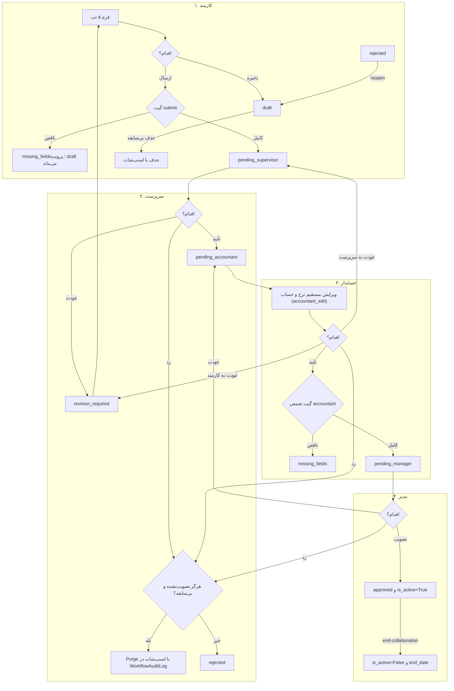

<div dir="rtl" align="right">

# طرح جامع بازمهندسی چرخهٔ ثبت ناوگان و رانندگان تا تصویب مدیر
### (منطبق بر معماری ۵ سطحی، تفکیک وظایف SoD، الگوی چرخهٔ پرسنل و مصوبات مصاحبهٔ تخصصی)

> [!IMPORTANT]
> **ویرایش چهارم — ممیزی تکمیل ۱۲ مهر ۱۴۰۵ (۴ اکتبر ۲۰۲۶):** این ویرایش ۲۰ مورد ناقص در پیاده‌سازی پیدا کرد. فاز ۱۱ برای رفع آن‌ها اضافه شد و تسک ۱۰.۶ باز ماند. جزئیات در بخش ۷ آمده است.
>
> **ویرایش سوم — ممیزی عمیق ۱۱ مهر ۱۴۰۵ (۳ اکتبر ۲۰۲۶):**
> این ویرایش طرح را با کد فعلی (`personnel/views.py`، `serializers.py`، `models.py`، `lifecycle_services.py`، `fleet_settlement_engine.py`، فرانت ناوگان)، با دادهٔ واقعی دیتابیس عملیاتی (فقط خواندنی) و با قوانین `CLAUDE.md` تطبیق داده است. ۳۴ ایراد تازه پیدا شد (بخش ۱). مهم‌ترین آن‌ها: سه رخنهٔ قلمرو شرکت که برای پرسنل بسته شده ولی برای ناوگان هنوز باز است، مسیر از دست رفتن سوابق تردد با `CASCADE`، و نبود شرکت و بخش در ۱۱ خودروی از ۱۲ خودروی موجود. برای این‌ها **فاز ۰** پیش از همهٔ فازها اضافه شد. جدول ممیزی ویرایش دوم (۱۴ ردیف) همچنان معتبر است و در پیوست الف آمده است.

---

## ۱. ممیزی ویرایش سوم: ایرادها و راه‌حل‌ها

### ۱.۱. وضعیت دادهٔ عملیاتی (۱۱ مهر ۱۴۰۵؛ کوئری فقط خواندنی)

| شاخص | مقدار | پیامد برای طرح |
| :--- | :---: | :--- |
| کل خودروها | ۱۲، همه `approved` و فعال | گیت‌های جدید فقط روی گذارهای تازه اعمال شوند، نه به‌صورت عطف به ماسبق. |
| بدون شرکت (`company=NULL`) | ۱۱ | با قلمرو شرکتیِ مشابه پرسنل، این خودروها از دید همهٔ کاربران غیرسوپریوزر پنهان می‌شوند. پیش از آن پر کردن شرکت لازم است (ب-۱۶). |
| بدون بخش (`section=NULL`) | ۱۰ | ۹ خودرو هیچ نشانه‌ای (پروژه، بخش یا ثبت‌کننده) برای حدس شرکت ندارند؛ تعیین شرکت تصمیم کاربر است. |
| دارای شبا | ۵ | مایگریشن دادهٔ `VehicleBankAccount` همین ۵ مورد را منتقل می‌کند. |
| نرخ صفر | ۴ | گیت حسابدار فقط روی ارسال‌های تازه اعمال می‌شود. |
| سوابق تردد | ۱ رکورد، ۱ خودرو | آن خودرو هرگز قابل Purge یا حذف نیست. |
| شرکت‌ها | ۲ | — |

### ۱.۲. جدول ایرادها

**الف) قلمرو شرکت و امنیت (tenant-scope)**

| کد | ایراد (کد فعلی یا طرح) | پیامد | راه‌حل سازگار با قوانین |
| :---: | :--- | :--- | :--- |
| ب-۱ | `VehicleDriverProfileViewSet.update` رکورد را با `VehicleDriverProfile.objects.select_for_update().get(pk=...)` می‌خواند و از `get_queryset` نمی‌گذرد (`views.py:2637`). | IDOR: هر کاربر واردشده هر خودرویی از هر شرکتی را (در وضعیت پیش‌نویس، عودت، در انتظار سرپرست یا ردشده) ویرایش می‌کند. | اول `self.get_object()` (قلمرو)، سپس قفل همان pk درون تراکنش؛ دقیقاً مانند `PersonnelProfileViewSet.update`. |
| ب-۲ | `get_queryset` ناوگان و `VehicleChangeRequestViewSet` بدون سربرگ `X-Company-ID` قلمرو شرکت را برای مدیر و حسابدار ناوگان برمی‌دارد. همین ایراد در پرسنل با `scope_personnel_queryset` بسته شد. ویوست درخواست تغییرات هم فقط `vehicle__section__project__company_id` را می‌سنجد و خودروی دارای شرکت ولی بی‌بخش را جا می‌اندازد. | نشت دادهٔ ناوگان شرکت دیگر. | تابع `scope_vehicle_queryset(request, qs, prefix='')` با همان قواعد `scope_personnel_queryset` (مجوزهای ناوگان برای global auditor) و استفاده در هر دو ویوست. |
| ب-۳ | `create` اگر شرکت نیامده باشد `Company.objects.first()` را می‌گذارد (`views.py:2594`). | خودرو به شرکتی دلخواه و احتمالاً بیگانه نسبت داده می‌شود. | حذف fallback. شرکت از بخش یا سربرگ فعال گرفته شود (`resolve_write_company`) و با گارد نوشتن سنجیده شود. |
| ب-۴ | تسک ۲.۶ تابع تازهٔ `ensure_vehicle_write_scope(user, vehicle, section, company)` می‌سازد. | تکرار منطق، و پیام‌های خطای «پرسنل» در ناوگان. | تابع موجود `ensure_personnel_write_scope` به `ensure_record_write_scope(user, company, section, project, label)` عمومی شود (پرسنل همان را با `label='پرسنل'` صدا بزند) و در `perform_create` (حتی برای مدیر)، تغییر شرکت، بخش یا پروژه در `update`، و درون‌ریزی ناوگان صدا زده شود. |
| ب-۵ | `import-excel` ناوگان `resolve_import_company` را صدا نمی‌زند و وضعیت منسوخ `manager_approved` می‌نویسد. | درون‌ریزی به شرکت دلخواه؛ وضعیت نامعتبر. | تسک ۵.۴: `resolve_import_company` و `auto_pass_vehicle(..., draft_on_incomplete=True)`. |
| ب-۶ | `broadcast_vehicle_update` برای خودروی بی‌شرکت به `global_notifications` می‌فرستد (در پرسنل بسته شده است). ۱۱ خودروی موجود بی‌شرکت‌اند. | پلاک و نام راننده به همهٔ شرکت‌ها پخش می‌شود. | فقط کانال `company_{id}`؛ بدون شرکت پخش نشود. پی‌لود غنی (تسک ۴.۳) هم فقط در همین کانال. |
| ب-۷ | `validate_plate_number` یکتایی پلاک را در کل جدول می‌سنجد، ولی قید دیتابیس به‌ازای هر شرکت است (`unique_company_vehicle_plate`). | وجود پلاک در شرکت دیگر افشا می‌شود و ثبت قانونی را رد می‌کند. | یکتایی درون همان شرکت (و برای بی‌شرکت، بین بی‌شرکت‌ها)؛ الگوی `national_code` در `PersonnelProfileSerializer.validate`. |
| ب-۸ | در طرح، `FLEET_FINANCE_STAGE_PERMS` نقش عمومی `can_act_as_accountant` را دارد، ولی کد فعلی و پرسنل فقط مجوز اختصاصی را می‌پذیرند. | گسترش بی‌مصوبهٔ دسترسی تأیید مالی و دید سراسری ناوگان به همهٔ حسابداران. | فقط `perm_approve_fleet_finance`. گسترش نقش، تصمیم کاربر است (بخش ۶). |

**ب) از دست رفتن داده و یکپارچگی**

| کد | ایراد | پیامد | راه‌حل |
| :---: | :--- | :--- | :--- |
| ب-۹ | `VehicleTripLog.vehicle` با `on_delete=CASCADE`. `destroy` و Purge طرح سابقه را بدون قفل ردیف می‌سنجند. | ترددی که هم‌زمان ثبت شود با حذف خودرو برای همیشه پاک می‌شود (نقض قانون «هیچ داده‌ای از دست نرود»). | (۱) قفل `select_for_update` و سنجش سابقه درون همان تراکنش (الگوی `PersonnelProfileViewSet.destroy`). (۲) دفاع لایه‌دوم: `on_delete=PROTECT` برای `VehicleTripLog.vehicle`. این مایگریشن فقط وضعیت جنگو را عوض می‌کند و SQL ندارد. |
| ب-۱۰ | `destroy` خودروی دارای تردد را بی‌صدا غیرفعال می‌کند و ۲۰۰ برمی‌گرداند؛ طرح در یک جا «مسدودسازی» و در جای دیگر «غیرفعال‌سازی» نوشته است. | ناسازگاری با پرسنل؛ کاربر گمان می‌کند حذف شده است. | مانند پرسنل: ۴۰۰ با `code='history_exists'` و `suggested_action='end_collaboration'`. غیرفعال‌سازی فقط از اکشن `end-collaboration`. |
| ب-۱۱ | الگوی برگشت مایگریشن دادهٔ پرسنل (۰۰۲۸) حساب‌ها را با «توضیحات» حذف می‌کند. | برگشت مایگریشن حساب‌هایی را که بعداً ویرایش یا اصلی شده‌اند پاک می‌کند. | تسک ۱.۷: تابع برگشت `RunPython.noop` باشد (ستون‌های آینه دست‌نخورده‌اند). شبای نامعتبر هم عیناً کپی شود، نه این‌که کنار گذاشته شود. |
| ب-۱۲ | تسک ۱.۶ SoD نرخ را «در لایهٔ مدل» می‌گذارد. | مدل کاربر را نمی‌شناسد. اگر به‌صورت ۴۰۰ پیاده شود، فرم قدیمی و صف آفلاین که `default_service_rate=0` می‌فرستند رد می‌شوند و رکورد صف (کل فرم خودرو) پاک می‌شود. | در سریالایزر، مانند `WAGE_FIELDS` (DEF-21): برای نقش غیرمالی حذف بی‌صدا در نوشتن و حذف از خروجی. فقط تلاش صریح برای تغییر نرخ خودروی مصوب در مسیر درخواست تغییرات ۴۰۳ می‌گیرد. |
| ب-۱۳ | تسک ۲.۷ `approval_status` را read-only می‌کند، ولی فرانت (`submitDraftToSupervisor`، `employee-new-vehicle.ts:1207`) با PATCH وضعیت را عوض می‌کند. | اگر بک‌اند پیش از فرانت منتشر شود، دکمهٔ ارسال بی‌صدا کار نمی‌کند. ۴۰۰ هم رکورد صف آفلاین را پاک می‌کند. | پل سازگاری در `update`: اگر payload `approval_status='pending_supervisor'` داشت و پرونده `draft` یا `revision_required` بود، ویرایش ذخیره شود (۲۰۰) و سپس گیت submit اجرا شود. پاسخ `submitted: true/false` و `missing_fields` دارد. بک‌اند و فرانت (۶.۷) در یک انتشار. |
| ب-۱۴ | `perform_create` برای درخواست غیرپیش‌نویس وضعیت `pending_supervisor` را بدون گیت می‌گذارد و `process_creation_with_auto_pass` بی‌گیت را صدا می‌زند. | خودروی ناقص به کارتابل می‌رود؛ یا با ثبت مدیر، بی‌نرخ و بی‌شبا تصویب می‌شود. | مانند DEF-02 پرسنل: ساخت همیشه `draft`؛ ارسال فقط با اکشن `submit`؛ نقش بالاتر فقط با `auto_pass_vehicle` گیت‌دار. |
| ب-۱۵ | `VehicleDriverProfile` ستون `card_number` ندارد، ولی طرح آینهٔ کامل حساب را می‌خواهد. موتور دیسکت ناوگان (`fleet_settlement_engine.py:162-171`) نام ذینفع را `driver_name` می‌گذارد. | آینه ناقص می‌شود. با `payee_type='owner'` نام ذینفع دیسکت با صاحب حساب نمی‌خواند و انتقال پایا برگشت می‌خورد. | آینه فقط برای `bank_name`، `account_number` و `sheba_number`. تسک تازهٔ ۱.۸: دیسکت از `account_owner_name` حساب اصلی بخواند (پشتیبان: `driver_name`). |
| ب-۱۶ | دادهٔ موجود (بخش ۱.۱): ۱۱ خودرو بی‌شرکت، ۱۰ بی‌بخش و همه مصوب. | قلمرو تازه آن‌ها را پنهان می‌کند. گارد تردد با تاریخ‌های الزامی، تردد همه را مسدود می‌کند. | (۱) تسک ۰.۵: پر کردن شرکت پس از تصمیم کاربر و پیش از فعال شدن قلمرو. (۲) تاریخ انقضای خالی یعنی «بدون محدودیت» (الگوی `validate_personnel_validity`). (۳) گیت‌ها فقط در گذار سنجیده شوند. |

**ج) منطق گردش کار**

| کد | ایراد | پیامد | راه‌حل |
| :---: | :--- | :--- | :--- |
| ب-۱۷ | ماتریس ۳.۱ برای مرحلهٔ `accountant` فقط نرخ و حساب را می‌خواهد (تجمعی نیست). | حسابدار در `pending_accountant` ویرایش مستقیم دارد و می‌تواند فیلد مرحلهٔ کارمند را خالی کند و باز هم به مدیر بفرستد. | گیت تجمعی مانند `get_missing_fields` پرسنل: `accountant` = `submit` + فیلدهای مالی. |
| ب-۱۸ | طرح رد را برای «هر وضعیت تاییدنشده» و Purge را برای «پیش‌نویس» می‌نویسد. فلوچارت (B9) رد خودرو را با رد درخواست تغییرات قاطی کرده است. | رد پیش‌نویسِ ارسال‌نشده و رد دوبارهٔ پروندهٔ ردشده ممکن می‌شود؛ معنای اکشن مبهم است. | مانند `PersonnelProfileViewSet.reject`: رد فقط در وضعیت‌های در جریان (`pending_*`، `revision_required` و وضعیت‌های قدیمی `supervisor_approved` و `accountant_approved`). Purge فقط اگر `manager_approved_at` تهی باشد، سابقه نباشد و وضعیت در `purge_statuses` باشد. پیش‌نویس را کارمند حذف می‌کند. رد درخواست تغییرات اکشن جداگانهٔ ویوست تغییرات است. |
| ب-۱۹ | `reject` و `request-revision` فعلی: بدون فهرست سفید وضعیت، بدون قفل، بدون `WorkflowAuditLog`؛ عودت همیشه به `revision_required`. تسک ۳.۲ عودت مدیر را ندارد. | رد یا عودت خودروی مصوب ممکن است؛ تایملاین ناقص می‌ماند. | DEF-13: مقصد بر پایهٔ وضعیت فعلی است (سرپرست ← `revision_required`؛ حسابدار ← انتخاب `revision_required` یا `pending_supervisor`؛ مدیر ← `pending_accountant`)، همراه با قفل و لاگ. |
| ب-۲۰ | تسک ۲.۱ گارد تردد را به `VehicleTripLog.clean()` وصل می‌کند. | `clean()` با `objects.create` صدا زده نمی‌شود. چهار مسیر نوشتن تردد هست (`views.py:5849`، `6244`، `6408` و `fleet_excel_engine.py:315`) و گارد در عمل هیچ‌جا اجرا نمی‌شود. | یک تابع `assert_vehicle_trip_allowed(vehicle, date_shamsi)` در هر چهار مسیر. مقایسه با شیء تاریخ (`parse_shamsi_date`، DEF-20)، نه رشته. معیار پایان همکاری `end_date` است: تردد تا همان روز مجاز است. `is_active=False` بی `end_date` (غیرفعال قدیمی) همه را مسدود می‌کند. |
| ب-۲۱ | `check_vehicle_history` «اسناد هزینه و پرداخت‌ها» را مبهم گذاشته است. | سابقه‌ای جا می‌افتد و Purge یا حذف آن را پاک می‌کند. | فهرست صریح: همهٔ `VehicleTripLog` (همراه `is_deleted`)، تردد تسویه‌شده، `VehicleChangeRequest`، `AccountingEvent` با `source_model` برابر `VehicleDriverProfile` یا `VehicleTripLog` (شناسه‌های تردد همین خودرو)، و حساب کاربری متصل (`user`). |
| ب-۲۲ | تسک ۴.۱ اعلان تازه می‌سازد، ولی `_workflow_recipient_ids` (`lifecycle_services.py:941`) مجوزهای پرسنل را ثابت دارد. | کپی‌کردن، گیرندهٔ اشتباه یا تکرار کد می‌دهد. | `_workflow_recipient_ids` یک پارامتر `perms_by_stage` بگیرد. ناوگان با مجوزهای fleet صدا بزند و پرسنل رفتار فعلی را حفظ کند. |
| ب-۲۳ | `VehicleChangeRequestViewSet` فعلی: تأیید سرپرست `draft` و `revision_required` را می‌پذیرد؛ رد فهرست سفید وضعیت ندارد؛ تصویب مدیر `has_pending_changes` را بی‌توجه به درخواست‌های دیگر صفر می‌کند؛ `setattr` خام فیلدهای `company`، `user`، `is_active` و `default_service_rate` را هم عوض می‌کند. | انتقال خودرو به شرکت دیگر یا دور زدن SoD از مسیر درخواست تغییرات. | تسک ۳.۵: `VEHICLE_CHANGE_REQUEST_EXCLUDED_FIELDS` (هویت، قلمرو، گردش کار: `plate_number`، `section`، `company`، `project`، `user`، `assigned_warehouse_id`، `approval_status`، `rejection_reason`، `is_active`، `has_pending_changes`، `end_date`، حساب‌ها و مدارک) و `EMPLOYEE_VEHICLE_CHANGE_FIELDS` (بدون نرخ). `refresh_has_pending_changes`، لاگ هر رویداد با `content_type='vehicle'`، و فهرست سفید وضعیت در همهٔ اکشن‌ها. |
| ب-۲۴ | تسک ۱.۲ فقط `accounts/models.py` و یک مایگریشن را می‌گوید. | (۱) جدول `django_migrations` رکوردهای `accounts` از `0006` تا `0034` را از پیش از squash دارد؛ مایگریشن هم‌نام «اعمال‌شده» فرض می‌شود و هرگز اجرا نمی‌شود. (۲) مجوز در `seed_permissions.py` و صفحهٔ کاربران (`users.ts`: گروه، برچسب و نقش پیش‌فرض) نیست و عملاً به کسی داده نمی‌شود. | نام یکتای مایگریشن، تطبیق‌شده با `select name from django_migrations where app='accounts'` پیش از `migrate`. افزودن به `seed_permissions.py` و `users.ts`. نمایش ابزار حذف در `manager-fleet` با `auth.userPermissions()`. |
| ب-۲۵ | گیت ۳.۱ برای همهٔ انواع، `insurance_expiry_date` و ساختار پلاک ملی را الزامی می‌کند (تسک ۲.۲). | لیفتراک و ماشین‌آلات کارگاهی پلاک راهور ندارند و ثبتشان ناممکن می‌شود. | الگوی سخت پلاک (`normalize_plate`) فقط برای خودروهای جاده‌ای. برای `forklift` و `other` شناسهٔ آزاد پذیرفته شود و بیمهٔ شخص ثالث الزامی نباشد. کد ملی با `common.validators.validate_iranian_national_code` (اعتبارسنج تکراری سریالایزر حذف شود). |
| ب-۲۶ | قطع همکاری راه بازگشت ندارد و `license_expiry_date` در مصوبهٔ ۳ نیست (مصوبه فقط بیمه، معاینه و قرارداد را نام می‌برد). | خودرویی که دوباره همکاری می‌کند تکراری ثبت می‌شود و قید یکتایی پلاک آن را رد می‌کند. معیار مسدودسازی گواهینامه بی‌مصوبه است. | بخش ۶: دو تصمیم باز. پیش‌فرض طرح: گواهینامه فقط اگر پر باشد مسدود می‌کند. بازفعال‌سازی فعلاً خارج از دامنه است. |

**د) طراحی رابط کاربری و قوانین مخزن**

| کد | ایراد | راه‌حل |
| :---: | :--- | :--- |
| ب-۲۷ | «دکمهٔ رعدوبرق ⚡» در فرم بانکی. کامیت `9a9cba8` ایموجی‌های رابط را حذف کرده و آیکون فقط باید `<svg appIcon>` باشد. | آیکون مشترک از رجیستری `shared/icons/` با `aria-label` فارسی؛ بدون ایموجی. |
| ب-۲۸ | کلاس‌های رنگ ثابت (`bg-slate-50/95`، `bg-white`، `border-slate-200`) در بخش ۴ گزارش. | توکن‌های معنایی `surface`، `fg` و `line` (مهارت `design-system`). |
| ب-۲۹ | ارجاع به «Rule 7» و «Rule 8» که در `CLAUDE.md` وجود ندارند. | ارجاع به بخش‌های واقعی: استاندارد شبا در `core/utils/sheba-utils.ts`، و «Release on this machine» در `CLAUDE.md`. |
| ب-۳۰ | بارگذاری مدارک: طرح رفتار آفلاین و حذف فایل در Purge را تعیین نکرده است. | بارگذاری فقط آنلاین، با پیام روشن. Purge و حذف فقط ردیف را پاک کنند و فایل فیزیکی برای ممیزی بماند (مسیرش در اسنپ‌شات ثبت شود). فرمت‌ها: تصویر و PDF، حداکثر حجم مانند `PersonnelDocument`. |

**هـ) آزمون، انتشار و روش کار**

| کد | ایراد | راه‌حل |
| :---: | :--- | :--- |
| ب-۳۱ | تسک ۱۰.۵ `guardian_all.py` را اجرا می‌کند. نگهبان‌های ۱۵، ۱۹ و `menu_redesign` در دیتابیس عملیاتی می‌نویسند و فاز ۱ تا ۵ و نگهبان ۲۹ از قبل رد می‌شوند. | فقط نگهبان‌های ایستا و تکی (مانند `audit_guardian_*` و `verify_frontend_hubs`) اجرا شوند. نگهبان ۲۹ با کپی `git archive HEAD` مقایسه شود. |
| ب-۳۲ | «`npx tsc --noEmit` و Vitest» با روش واقعی مخزن نمی‌خواند. | `ng test` با tsconfig موقت که ۱۸ spec خراب را کنار می‌گذارد، و مقایسه با HEAD (`CLAUDE.md`). آزمون بک‌اند فقط با برچسب اپ: `PYTHONUTF8=1 PYTHONIOENCODING=utf-8 ./venv/Scripts/python.exe manage.py test personnel accounts --noinput` (آزمون بی‌برچسب همهٔ انبارها را پاک می‌کند). `tests_vehicle_cycle.py` از قبل هست و گسترش می‌یابد. |
| ب-۳۳ | پروتکل انتشار (۱۰.۶ و گزارش §۵) پرسش بله/خیر از کاربر، اسکیل `safe-migration`، `taskkill` پیش از راه‌اندازی دوباره و راه‌اندازی جنگو در فرمان پشتیبان‌گیری را ندارد (`python -c` بدون `django.setup()` شکست می‌خورد). کاربر هم هیچ فرمانی اجرا نمی‌کند. | بخش ۵. |
| ب-۳۴ | شمارش و تاریخ: سند «۶۰ تسک» نوشته، ولی ۶۳ تسک داشت؛ تاریخ «۱۲ مهر» یک روز جلوتر بود. اجرای «یک گام در هر جلسه» و بازبین‌ها هم تعیین نشده بود. | شمارش و تاریخ اصلاح شد. بخش ۵.۱ پروتکل اجرا را اضافه کرد. |

---

## ۲. ارکان معماری

1. **تفکیک وظایف (SoD):**
   - **کارمند انبار یا پروژه:** مشخصات فنی، پلاک، راننده، مالک، حساب بانکی و مدارک را وارد می‌کند. نرخ پایه را نه می‌بیند و نه می‌نویسد (حذف بی‌صدا در سریالایزر، ب-۱۲).
   - **سرپرست:** ارزیابی میدانی، و تأیید، عودت یا رد.
   - **حسابدار پروژه:** تعیین نرخ پایه و صحه‌گذاری حساب در `pending_accountant`، و عودت دومقصده.
   - **مدیر:** تصویب نهایی، عودت به حسابدار، تأیید گروهی، قطع همکاری و حذف خودروی بی‌سابقه (با مجوز اختصاصی).
2. **حساب‌های بانکی (`VehicleBankAccount`):** منبع حقیقت حساب‌ها همین مدل است. آینهٔ حساب اصلی (فقط `bank_name`، `account_number` و `sheba_number`) را تنها `VehicleBankAccount.save()` و `delete()` با `.update()` می‌نویسند. همگام‌سازی معکوس از پرونده (حسابدار یا درون‌ریزی) با فلگ `_skip_bank_sync`، مانند `PersonnelProfile.save()`.
3. **گیت سروری تجمعی (`get_vehicle_missing_fields`):** گیت `submit` شامل `draft` است و گیت `accountant` شامل `submit`. نرخ و شبا برای `contract` و `personal` الزامی‌اند و برای `company` اختیاری.
4. **قلمرو شرکت:** همهٔ خواندن‌ها از `scope_vehicle_queryset` و همهٔ نوشتن‌ها از `ensure_record_write_scope` می‌گذرند. سرویس‌ها فقط شناسهٔ ازقلمروگذشته می‌گیرند (مانند `approve_personnel_stage`).
5. **حذف، Purge، بازگشایی و قطع همکاری:** حذف و Purge فقط بی‌سابقه و درون تراکنش قفل‌دار. سابقه یعنی ۴۰۰ و پیشنهاد قطع همکاری. `VehicleTripLog.vehicle` با `PROTECT`.
6. **رابط کاربری:** مهارت `design-system`، توکن‌های معنایی، `<svg appIcon>` (نگهبان ۵۲)، فونت محلی، بدون ایموجی، و حالت‌های بارگذاری، خالی، خطا و آفلاین.

---

## ۳. ماشین حالت



> رد درخواست تغییرات خودروی مصوب، اکشن `reject` ویوست `vehicle-change-requests` است و پروندهٔ خودرو را تغییر نمی‌دهد (ب-۱۸).

### ۳.۱. ماتریس تجمعی فیلدهای الزامی

```python
# personnel/fleet_lifecycle_services.py
ROAD_VEHICLE_TYPES = ('pickup', 'nissan', 'khavar', 'sedan', 'truck', 'trailer')  # پلاک سخت و بیمهٔ شخص ثالث

def get_vehicle_missing_fields(vehicle, stage):
    # draft:  plate_number (برای ROAD_VEHICLE_TYPES قالب پلاک ملی)، vehicle_type، ownership_type، section
    # submit: draft + driver_name، driver_phone (موبایل معتبر)
    #         + driver_national_code (Mod 11) برای contract و personal
    #         + insurance_expiry_date برای ROAD_VEHICLE_TYPES
    #         + اگر is_driver_owner=False: owner_name و owner_national_code
    # accountant: submit + برای contract و personal: default_service_rate > 0
    #         و حساب اصلی فعال با شبای معتبر Mod 97 (الگوی DEF-23)
    ...
```

### ۳.۲. مجوزها

```python
FLEET_SUPERVISOR_STAGE_PERMS = ('perm_approve_fleet_supervisor', 'can_act_as_workshop_supervisor',
                                'perm_approve_fleet_manager', 'can_act_as_manager')
FLEET_FINANCE_STAGE_PERMS = ('perm_approve_fleet_finance',)  # ب-۸: بدون can_act_as_accountant
FLEET_MANAGER_STAGE_PERMS = ('perm_approve_fleet_manager', 'can_act_as_manager', 'can_act_as_company_manager')
FLEET_DELETE_NOMOVEMENT_PERM = 'perm_delete_vehicle_nomovement'
```

---

## ۴. فازها و تسک‌ها (۱۱ فاز، ۷۳ تسک)

### فاز ۰: پیش‌نیازهای امنیتی و دادهٔ موجود (پیش از هر فاز دیگر)
- [x] **تسک ۰.۱:** `update` از `get_object()` و سپس قفل همان pk (ب-۱). <!-- id: 0.1 -->
- [x] **تسک ۰.۲:** `scope_vehicle_queryset` و به‌کارگیری آن در `VehicleDriverProfileViewSet` و `VehicleChangeRequestViewSet` (ب-۲). <!-- id: 0.2 -->
- [x] **تسک ۰.۳:** حذف fallback `Company.objects.first()`، و عمومی‌سازی `ensure_personnel_write_scope` به `ensure_record_write_scope` با به‌کارگیری در ایجاد و ویرایش ناوگان (ب-۳ و ب-۴). <!-- id: 0.3 -->
- [x] **تسک ۰.۴:** پخش وب‌سوکت ناوگان فقط در کانال شرکت (ب-۶)، و یکتایی پلاک درون شرکت (ب-۷). <!-- id: 0.4 -->
- [x] **تسک ۰.۵ [نیازمند تصمیم کاربر]:** پر کردن `company` برای ۱۱ خودروی بی‌شرکت با مایگریشن دادهٔ برگشت‌پذیر (فقط ردیف‌های `company IS NULL`؛ برگشت = تهی‌کردن همان شناسه‌ها). پیش از اجرا، برخورد با قید `unique_company_vehicle_plate` سنجیده شود. تا این تسک انجام نشده، ۰.۲ منتشر نشود (ب-۱۶). <!-- id: 0.5 -->
- [x] **تسک ۰.۶:** `VehicleTripLog.vehicle` با `on_delete=PROTECT` (مایگریشن بدون SQL)، و قفل `select_for_update` با سنجش سابقه درون تراکنش در `destroy` (ب-۹). <!-- id: 0.6 -->

### فاز ۱: مدل‌ها و مایگریشن‌ها
- [x] **تسک ۱.۱:** مدل `VehicleBankAccount`: `vehicle`، `bank_name`، `account_number`، `sheba_number`، `card_number`، `account_owner_name`، `account_owner_national_code`، `payee_type` (`driver`، `owner`، `other`)، `is_primary`، `is_active`، `description`. `save()` و `delete()` دقیقاً مانند `PersonnelBankAccount`: قفل ردیف خودرو، خاموش کردن حساب اصلی قبلی پیش از `save`، جانشینی فقط حساب فعال، و آینه با `.update()` فقط برای سه ستون موجود (ب-۱۵). <!-- id: 1.1 -->
- [x] **تسک ۱.۲:** مجوز `perm_delete_vehicle_nomovement` در `accounts/models.py`. مایگریشن با نام یکتای تطبیق‌شده با `django_migrations`. افزودن به `seed_permissions.py` و `users.ts` (ب-۲۴). <!-- id: 1.2 -->
- [x] **تسک ۱.۳:** مدل `VehicleDocument` (`vehicle`، `doc_type`، `file` با `upload_to='vehicle_docs/%Y/%m/'`، `title`، `issue_date`، `expiry_date`، `uploaded_by`، `created_at`). <!-- id: 1.3 -->
- [x] **تسک ۱.۴:** فیلدهای شمسی `CharField(max_length=10, blank=True, null=True)`: `insurance_expiry_date`، `inspection_expiry_date`، `license_expiry_date`، `valid_until_date` و `end_date`. نرمال‌سازی با `normalize_shamsi_date` در سریالایزر و مقایسه فقط با `parse_shamsi_date`. خالی یعنی بدون محدودیت. <!-- id: 1.4 -->
- [x] **تسک ۱.۵:** همگام‌سازی معکوس در `VehicleDriverProfile.save()` با `_skip_bank_sync` (الگوی `PersonnelProfile.save()`). در `create` سریالایزر با حساب‌های تودرتو، ستون‌های تخت حذف شوند (نویسندهٔ واحد، DEF-01). <!-- id: 1.5 -->
- [x] **تسک ۱.۶:** SoD نرخ در سریالایزر: `FLEET_RATE_FIELDS = ('default_service_rate',)` برای نقش غیرمالی در نوشتن بی‌صدا حذف شود و در خروجی نیاید (ب-۱۲). <!-- id: 1.6 -->
- [x] **تسک ۱.۷:** مایگریشن اسکیما و مایگریشن داده (اسکیل `safe-migration`): انتقال ۵ حساب موجود به `VehicleBankAccount` با `is_primary=True`؛ `payee_type` برابر `driver` اگر `is_driver_owner` باشد، وگرنه `owner`؛ شبای نامعتبر عیناً؛ برگشت `RunPython.noop` (ب-۱۱). <!-- id: 1.7 -->
- [x] **تسک ۱.۸:** دیسکت تسویهٔ ناوگان (`fleet_settlement_engine.py`) نام ذینفع را از `account_owner_name` حساب اصلی بگیرد، با پشتیبان `driver_name` (ب-۱۵). <!-- id: 1.8 -->

### فاز ۲: ماژول متمرکز `personnel/fleet_lifecycle_services.py`
- [x] **تسک ۲.۰:** ایجاد ماژول. ابزارهای مشترک (`parse_shamsi_date`، `normalize_shamsi_date`، `user_has_any_perm`، `_diff_repr`، `compute_profile_diff`) از `lifecycle_services` import شوند و تکرار نشوند. سرویس‌ها از `views.py` import نکنند. <!-- id: 2.0 -->
- [x] **تسک ۲.۱:** `validate_vehicle_validity(vehicle, date_shamsi)` و `assert_vehicle_trip_allowed` با معیارهای فعال بودن، تصویب و تاریخ‌های انقضا و پایان همکاری (ب-۲۰). اتصال به هر چهار مسیر نوشتن تردد: `views.py` (۳ مسیر) و `fleet_excel_engine.py`. <!-- id: 2.1 -->
- [x] **تسک ۲.۲:** پلاک: قالب سخت فقط برای `ROAD_VEHICLE_TYPES`. کد ملی راننده و مالک با `common.validators.validate_iranian_national_code` (ب-۲۵). مقدار ذخیره‌شدهٔ دست‌نخورده دوباره سنجیده نشود (`_is_unchanged_stored_value`). <!-- id: 2.2 -->
- [x] **تسک ۲.۳:** `check_vehicle_history` با فهرست صریح ب-۲۱. <!-- id: 2.3 -->
- [x] **تسک ۲.۴:** `build_vehicle_snapshot` با فیلدها، همهٔ حساب‌ها و فهرست مدارک (نام و مسیر فایل). <!-- id: 2.4 -->
- [x] **تسک ۲.۵:** `get_vehicle_missing_fields` تجمعی (بخش ۳.۱، ب-۱۷). فیلد `missing_fields` در سریالایزر مانند پرسنل: پیش‌نویس ← `submit`، `pending_accountant` ← `accountant`. <!-- id: 2.5 -->
- [x] **تسک ۲.۶:** `ensure_record_write_scope` (از ۰.۳) در سرویس‌های نوشتن. تسک جداگانهٔ `ensure_vehicle_write_scope` حذف شد (ب-۴). <!-- id: 2.6 -->
- [x] **تسک ۲.۷:** `read_only_fields` برای `approval_status`، `rejection_reason`، `has_pending_changes`، `is_active` و `end_date`. اکشن `POST /api/personnel/vehicles/{id}/submit/`، و پل سازگاری PATCH (ب-۱۳). <!-- id: 2.7 -->
- [x] **تسک ۲.۸:** `check_vehicle_bank_account_edit_allowed` همان قواعد `check_bank_account_edit_allowed` (DEF-10). <!-- id: 2.8 -->
- [x] **تسک ۲.۹:** `VehicleWorkflowError` (یا استفادهٔ دوباره از `PersonnelWorkflowError` با نام عمومی) با `missing_fields`. <!-- id: 2.9 -->

### فاز ۳: ماشین حالت، Purge، بازگشایی و درخواست تغییرات
- [x] **تسک ۳.۰:** `perform_create`: ساخت همیشه `draft` و عبور فقط با `auto_pass_vehicle` (ب-۱۴). <!-- id: 3.0 -->
- [x] **تسک ۳.۱:** `reject` با فهرست سفید وضعیت‌های در جریان، قفل، Purge مشروط و اسنپ‌شات، و لاگ (ب-۱۸). <!-- id: 3.1 -->
- [x] **تسک ۳.۱-ب:** `end-collaboration` فقط برای مصوب و فعال، با مجوز مدیر، `end_date` الزامی، و `end_date` پس از تاریخ آخرین تردد ثبت‌شده. <!-- id: 3.1-b -->
- [x] **تسک ۳.۲:** `request-revision` بر پایهٔ وضعیت فعلی: سرپرست، حسابدار (دومقصده) و مدیر (← `pending_accountant`)، با قفل و لاگ (ب-۱۹). <!-- id: 3.2 -->
- [x] **تسک ۳.۲-ب:** `reopen`: `rejected` ← `draft` با قفل و بررسی وضعیت هم‌زمان (۴۰۹)، در قلمرو شرکت، برای ثبت‌کننده، هم‌بخش یا تأییدکننده. <!-- id: 3.2-b -->
- [x] **تسک ۳.۳:** `auto_pass_vehicle(vehicle, user, source, draft_on_incomplete=False)` مانند `auto_pass_personnel`. <!-- id: 3.3 -->
- [x] **تسک ۳.۴:** `approve_vehicle_stage(vehicle_id, user, stage, note, batch)` با جدول `FLEET_APPROVAL_STAGES` (from و gated_from)، قفل ردیف، لاگ و اعلان. سه اکشن تکی از آن استفاده کنند (پرش مدیر از `draft` و `revision_required` ممنوع). <!-- id: 3.4 -->
- [x] **تسک ۳.۵:** ایمن‌سازی `VehicleChangeRequestViewSet` (ب-۲۳): `create`، `update` و `partial_update` ← ۴۰۵؛ `destroy` غیرسوپریوزر ← ۴۰۳؛ `cancel` برای درخواست‌دهنده تا پیش از تأیید سرپرست؛ فهرست سفید وضعیت؛ `apply_vehicle_change_request` با سریالایزر؛ `refresh_has_pending_changes`؛ لاگ `content_type='vehicle'` با `change_request_id`. <!-- id: 3.5 -->
- [x] **تسک ۳.۶:** `batch-approve` با شناسه‌های فیلترشده از `get_queryset` و فراخوانی `approve_vehicle_stage` برای هر شناسه در تراکنش جدا (DEF-09). <!-- id: 3.6 -->
- [x] **تسک ۳.۷:** ویرایش مستقیم حسابدار در `pending_accountant` با `accountant_edit` و diff. `pending_manager` برای همه جز سوپریوزر قفل است. ویرایش سوپریوزر روی پروندهٔ مصوب با `superuser_edit` لاگ شود. <!-- id: 3.7 -->
- [x] **تسک ۳.۸:** یکدست‌سازی لاگ: `submit`، `approve_supervisor`، `approve_finance`، `approve_manager`، `reject`، `request_revision`، `auto_pass`، `purge`، `delete`، `reopen`، `end_collaboration`، `accountant_edit`، `superuser_edit`، `change_request_*`؛ همه با `metadata.company_id`. <!-- id: 3.8 -->
- [x] **تسک ۳.۹:** `destroy` با ماتریس `_user_may_delete` (ثبت‌کننده یا هم‌بخش در `draft` و `revision_required`؛ یا مجوز اختصاصی)، ۴۰۰ برای سابقه (ب-۱۰) و اسنپ‌شات. <!-- id: 3.9 -->

### فاز ۴: اعلان‌ها و وب‌سوکت
- [x] **تسک ۴.۱:** `_workflow_recipient_ids` پارامتر `perms_by_stage` بگیرد. `dispatch_vehicle_workflow_notification` با مجوزهای ناوگان و ایزولاسیون شرکت (ب-۲۲). <!-- id: 4.1 -->
- [x] **تسک ۴.۲:** اتصال همهٔ گذارها (ارسال، تأییدها، عودت، رد، Purge، بازگشایی، قطع همکاری و ابطال) با متن فارسی و لینک کارتابل. <!-- id: 4.2 -->
- [x] **تسک ۴.۳:** پی‌لود غنی `broadcast_vehicle_update` فقط در کانال شرکت. <!-- id: 4.3 -->

### فاز ۵: اکسل و اکشن‌های تودرتو
- [x] **تسک ۵.۱:** `@action(detail=True, url_path='bank-accounts')` مانند پرسنل، با `check_vehicle_bank_account_edit_allowed` و لاگ تغییر حساب. <!-- id: 5.1 -->
- [x] **تسک ۵.۲:** `@action(detail=True, url_path='documents')` با سنجش نوع و حجم فایل. حذف فقط ردیف، و فایل فیزیکی بماند (ب-۳۰). <!-- id: 5.2 -->
- [x] **تسک ۵.۳:** خروجی اکسل ۲ سطری (عنوان فارسی، کلید لاتین، فریز A3) محدود به `readable_company_ids`. نرخ فقط برای نقش مالی. <!-- id: 5.3 -->
- [x] **تسک ۵.۴:** درون‌ریزی با `resolve_import_company`، `ensure_record_write_scope`، کد ملی معتبر، حساب اصلی در `VehicleBankAccount` و `auto_pass_vehicle(..., draft_on_incomplete=True)`. حذف `manager_approved` (ب-۵). <!-- id: 5.4 -->
- [x] **تسک ۵.۵:** `GET /api/personnel/vehicles/{id}/delete_impact/` با `history` و `can_delete`، مانند پرسنل. <!-- id: 5.5 -->

### فاز ۶: فرم ثبت کارمند (`employee-new-vehicle`)
- [x] **تسک ۶.۱:** فرم ۵ تب (فنی و پلاک، راننده، مالک، بانک، مدارک و انقضا) با نشانگر تکمیل از `missing_fields` سرور، و `<svg appIcon>`. <!-- id: 6.1 -->
- [x] **تسک ۶.۲:** حذف فیلد نرخ از فرم و خروجی کارمند. <!-- id: 6.2 -->
- [x] **تسک ۶.۳:** ویجت ۴ قسمتی پلاک با فوکوس خودکار. برای `forklift` و `other` ورودی آزاد. <!-- id: 6.3 -->
- [x] **تسک ۶.۴:** ماژول بانکی چندحسابی با `core/utils/sheba-utils.ts` (`IRANIAN_BANKS`، تبدیل حساب به شبا با دکمهٔ آیکونی، کپی و `payee_type`)، بدون ایموجی (ب-۲۷). <!-- id: 6.4 -->
- [x] **تسک ۶.۵:** تاریخ‌ها با `ng-persian-datepicker` روی `FormControl` و کلاس `.datepicker-left` در ستون‌های چپ. <!-- id: 6.5 -->
- [x] **تسک ۶.۶:** بارگذاری مدارک (فقط آنلاین، با پیام روشن در آفلاین) و پیش‌نمایش؛ `NgOptimizedImage` برای `blob:` نه. <!-- id: 6.6 -->
- [x] **تسک ۶.۷:** دکمه‌های جدای «ذخیرهٔ پیش‌نویس» و «ارسال به سرپرست» (`POST /submit/`). در کنار پل سازگاری بک‌اند در یک انتشار (ب-۱۳). خطای ۴۰۰ گیت، دادهٔ فرم را پاک نکند. <!-- id: 6.7 -->

### فاز ۷: فهرست کارمند (`employee-fleet`)
- [x] **تسک ۷.۱:** جدول با `status-badge`، دلیل رد یا عودت، تایملاین از `WorkflowAuditLog` و کپی سریع. <!-- id: 7.1 -->
- [x] **تسک ۷.۲:** فرم پیشنهاد تغییرات خودروی مصوب (نرخ قفل)، و دکمهٔ `cancel`. <!-- id: 7.2 -->
- [x] **تسک ۷.۳:** اکشن `reopen`. <!-- id: 7.3 -->
- [x] **تسک ۷.۴:** کارت‌های موبایل با هدف لمسی ۴۴ پیکسل. <!-- id: 7.4 -->
- [x] **تسک ۷.۵:** به‌روزرسانی درجا با `vehicle_updated`. <!-- id: 7.5 -->

### فاز ۸: کارتابل سرپرست (`supervisor-fleet`)
- [x] **تسک ۸.۱:** حذف `draft` از کارتابل، نوار فرمان چسبان با توکن‌های معنایی، و ساب‌تب‌های RTL. <!-- id: 8.1 -->
- [x] **تسک ۸.۲:** مودال پرونده (حساب‌ها، مدارک، انقضا و Diff Viewer). <!-- id: 8.2 -->
- [x] **تسک ۸.۳:** مودال‌های تأیید، عودت و رد، با هشدار Purge از روی `delete_impact`. <!-- id: 8.3 -->
- [x] **تسک ۸.۴:** تأیید گروهی. <!-- id: 8.4 -->
- [x] **تسک ۸.۵:** کارت‌های موبایل. <!-- id: 8.5 -->

### فاز ۹: کارتابل حسابدار (`accountant-fleet`)
- [x] **تسک ۹.۱:** نوار فرمان و شمارنده‌ها. <!-- id: 9.1 -->
- [x] **تسک ۹.۲:** فرم نرخ و حساب در `pending_accountant`. <!-- id: 9.2 -->
- [x] **تسک ۹.۳:** مقایسهٔ نرخ با میانگین هم‌تیپ‌های پروژه (سروری و محدود به قلمرو). <!-- id: 9.3 -->
- [x] **تسک ۹.۴:** قفل «ارسال به مدیر» با `missing_fields`. <!-- id: 9.4 -->
- [x] **تسک ۹.۵:** عودت دومقصده. <!-- id: 9.5 -->
- [x] **تسک ۹.۶:** تأیید گروهی و کارت‌های موبایل. <!-- id: 9.6 -->

### فاز ۱۰: کارتابل مدیر، آزمون و انتشار
- [x] **تسک ۱۰.۱:** ویجت بار مالی ماهانه (سروری، محدود به قلمرو) در `manager-fleet`. <!-- id: 10.1 -->
- [x] **تسک ۱۰.۲:** مودال تصویب و عودت به حسابدار. <!-- id: 10.2 -->
- [x] **تسک ۱۰.۳:** حذف بی‌سابقه با `smart-delete-modal` (نمایش با `perm_delete_vehicle_nomovement`)، و قطع همکاری. <!-- id: 10.3 -->
- [x] **تسک ۱۰.۴:** گسترش `personnel/tests_vehicle_cycle.py`: گذارها، پل PATCH، گیت تجمعی، Purge و ۴۰۰ سابقه، `PROTECT`، reopen و end-collaboration، SoD نرخ (حذف بی‌صدا و ۴۰۳)، ۴ مسیر تردد، و قلمرو (IDOR در `update`، نبود سربرگ شرکت، درون‌ریزی). <!-- id: 10.4 -->
- [x] **تسک ۱۰.۵:** بررسی‌ها مطابق بخش ۵.۲ (ب-۳۱ و ب-۳۲). <!-- id: 10.5 -->
- [x] **تسک ۱۰.۶:** انتشار مطابق بخش ۵.۳ (پشتیبان‌گیری دیتابیس `backup_20261004_080300.dump`، بیلد پروداکشن، ری‌استارت دافنه و پاسخ سلامت ۲۰۰ هر دو اندپوینت). <!-- id: 10.6 -->

---

## ۵. پروتکل اجرا، بررسی و انتشار

### ۵.۱. روش کار
- هر جلسه یک فاز. در پایان فاز: بازبین‌ها یک بار روی diff همان فاز (`tenant-scope-reviewer` برای بک‌اند؛ `data-loss-reviewer` برای مایگریشن، حذف، CASCADE و صف آفلاین؛ `ui-reviewer` برای قالب‌ها)، رفع یافته‌های تأییدشده، کامیت و یادداشت در «گزارش پیشرفت».
- فاز ۰ و ۱ پیش از فرانت. ۲.۷ و ۶.۷ در یک انتشار.
- هر تغییری که مسیر تازه‌ای برای از دست رفتن داده باز کند، پیش از اعمال با کاربر مطرح شود.

### ۵.۲. بررسی‌ها
1. `./venv/Scripts/python.exe manage.py check`
2. `PYTHONUTF8=1 PYTHONIOENCODING=utf-8 ./venv/Scripts/python.exe manage.py test personnel accounts --noinput` (فقط با برچسب اپ) و مقایسه با HEAD.
3. `ng test` با tsconfig موقت و همان `--exclude`های ۱۸ spec خراب، و مقایسه با HEAD.
4. نگهبان ۵۲ و نگهبان‌های ایستا. نگهبان ۲۹ با کپی HEAD مقایسه شود. `guardian_all.py` کامل روی این ماشین اجرا نشود.
5. بازبینی ظاهری روی `localhost:4300`. صفحه‌های پشت ورود را کاربر تأیید می‌کند و موارد تأییدنشده صریح گزارش می‌شوند.

### ۵.۳. انتشار روی این ماشین (همه با Claude؛ پیش از شروع یک پرسش بله/خیر)
1. پشتیبان: `./venv/Scripts/python.exe manage.py shell -c "from accounts.backup_service import create_database_backup; print(create_database_backup())"` (نه `run_auto_backup`).
2. اسکیل `safe-migration`؛ تطبیق نام مایگریشن `accounts` با `django_migrations`؛ سپس `migrate`.
3. `npx ng build --delete-output-path=false && node tools/patch-ngsw-530.js` در `warehouse-front`.
4. بستن daphne روی پورت ۸۰۰۰ و لانچر venv با `taskkill`، سپس فرمان `wt.exe` در `CLAUDE.md`.
5. وضعیت ۲۰۰ برای `https://app.farsalish.ir/` و `https://app.farsalish.ir/api/public/config/`.

---

## ۶. تصمیم‌ها

### ۶.۱. مصوبات (۱۱ مهر ۱۴۰۵)

| شناسه | موضوع | مصوبه | اثر |
| :---: | :--- | :--- | :--- |
| ۱ | SoD نرخ | نرخ فقط در کارتابل حسابدار. | ۱.۶، ۲.۵، ۶.۲ |
| ۲ | مدارک | مدل `VehicleDocument`. | ۱.۳، ۵.۲، ۶.۶، ۸.۲ |
| ۳ | انقضا و گارد تردد | بیمه، معاینه و قرارداد، با گارد ثبت تردد. | ۱.۴، ۲.۱ |
| ۴ | حساب‌ها | `VehicleBankAccount` با حساب اصلی و ذینفع، و آینه. | ۱.۱، ۱.۵، ۱.۷، ۱.۸، ۶.۴ |
| ۵ | گیت مالکیت | نرخ و شبا برای استیجاری و ملکی الزامی، برای شرکتی اختیاری. | ۲.۵ |
| ۶ | حذف و Purge | مانند پرسنل؛ مجوز `perm_delete_vehicle_nomovement`. | ۱.۲، ۲.۳، ۳.۱، ۳.۹ |
| ۷ | فرم | ۵ تب و دیت‌پیکر Reactive. | ۶.۱، ۶.۵ |
| ۸ | حسابدار | قیمت‌گذاری مستقیم، میانگین، عودت دومقصده و قفل ارسال. | ۹.۲ تا ۹.۵ |
| ۹ | مدیر | بار مالی، عودت، تأیید گروهی و قطع همکاری. | ۱۰.۱ تا ۱۰.۳ |
| ۱۰ | SoD در تغییرات | مانند پرسنل. | ۳.۵ |
| ۱۱ | دامنه | بدون GPS و سوخت. | — |

### ۶.۲. تصمیم‌های تثبیت‌شده و مصوب (ممیزی ۱۲ مهر ۱۴۰۵)

| کد | موضوع تصمیم | وضعیت نهایی و تصمیم اتخاذشده | وضعیت |
| :---: | :--- | :--- | :---: |
| **ت-۱** | تخصیص ۱۱ خودروی قدیمی بدون شرکت (شناسه‌های ۲، ۳، ۴، ۵، ۶، ۱۰، ۱۱، ۱۳، ۱۶، ۱۸ و ۱۴۴) | **تأیید قطعی:** خودروی ۱۴۴ به شرکت «پاینده توان ساینا» (شناسه ۱) و خودروهای [۲، ۳، ۴، ۵، ۶، ۱۰، ۱۱، ۱۳، ۱۶، ۱۸] به شرکت «فارس عالیش» (شناسه ۲) تخصیص یافتند. | ✅ تصویب شد |
| **ت-۲** | حدود دسترسی حسابدار عمومی (`can_act_as_accountant`) در تایید مالی ناوگان | **تأیید قطعی:** جهت رعایت استاندارد تفکیک وظایف (SoD)، صرفاً دارندگان مجوز اختصاصی `perm_approve_fleet_finance` مجاز به تایید مالی ناوگان هستند. | ✅ تصویب شد |
| **ت-۳** | تأثیر انقضای گواهینامه راننده در ثبت تردد روزانه ناوگان | **تأیید قطعی:** بررسی انقضا صرفاً در صورت پر بودن فیلد تاریخ گواهینامه راننده انجام می‌پذیرد. | ✅ تصویب شد |
| **ت-۴** | بازفعال‌سازی خودروهای قطع‌همکاری‌شده | **تأیید قطعی:** خارج از دامنه خودکار چرخه؛ مدیریت از طریق شماره پرونده قبلی در پنل ادمین یا ایجاد پرونده جدید. | ✅ تصویب شد |

---

## ۷. ویرایش چهارم — ممیزی تکمیل (۱۲ مهر ۱۴۰۵ / ۴ اکتبر ۲۰۲۶؛ بازبینی دوم در همان روز)

> [!IMPORTANT]
> در کامیت‌های `8194eea`، `f0976a0`، `0dce75a` و `bafd33d` چند تسکِ تیک‌خورده فقط ظاهراً انجام شده‌اند و چند ایراد ممیزی (ب-n) در عمل بسته نشده‌اند. ۲۰ مورد ناقص پیدا شد (ن-۱ تا ن-۲۰). برای رفع آن‌ها **فاز ۱۱** اضافه شد. تسک ۱۰.۶ (انتشار) شاهد اجرایی ندارد و باز می‌ماند. بازبینی دوم (بخش ۷.۰) ده ایراد در خود این ویرایش پیدا کرد و راه‌حل‌های جدول ۷.۱ بر پایهٔ آن اصلاح شده‌اند.

### ۷.۰. بازبینی دوم: ایرادهای خود ویرایش چهارم

| کد | ایراد نسخهٔ نخست | شاهد | اصلاح اعمال‌شده |
| :---: | :--- | :--- | :--- |
| ط-۱ | ن-۱ قفل `pending_supervisor` را می‌خواست. | `PersonnelProfileViewSet.update` (`views.py:626-700`) `pending_supervisor` را قفل نمی‌کند. | قفل `pending_supervisor` حذف شد (هم‌راستا با پرسنل). |
| ط-۲ | ۴۰۳ نرخ در ن-۳ بی‌قید بود. | `offline.interceptor.ts` همهٔ نوشتن‌های API، از جمله خودرو، را صف می‌کند و ۴xx رکورد صف را پاک می‌کند. `employee-fleet.ts:1052` نرخ ثابت `1500000` می‌فرستد. | ۴۰۳ فقط برای نرخ ناتهی، بزرگ‌تر از صفر و متفاوت با مقدار فعلی. |
| ط-۳ | ن-۸ به‌روزرسانی `rejected` را با درون‌ریزی مجاز می‌دانست. | این با قفل ن-۱ تناقض دارد. | فقط `draft` و `revision_required`. |
| ط-۴ | ن-۸ برای رکورد قفل «خطای ردیف» می‌خواست. | هر خطا کل درون‌ریزی را رد می‌کند (`views.py:4005`)، پس درون‌ریزی دوبارهٔ کل ناوگان همیشه شکست می‌خورد. | رکورد قفل با هشدار کنار گذاشته می‌شود (`skipped` و `warnings`). |
| ط-۵ | ن-۸ جست‌وجو را با `self.get_queryset()` می‌خواست. | این متد فیلترهای query params را هم اعمال می‌کند. اگر رکورد پیدا نشود، ساخت تکراری به `unique_company_vehicle_plate` می‌خورد و خطای ۵۰۰ می‌دهد. `objects.create` هم فلگ `_skip_bank_sync` را نمی‌پذیرد. | پایه `scope_vehicle_queryset(request, VehicleDriverProfile.objects.all())`. برای پلاکِ موجود بیرون از قلمرو، خطای ردیف روشن. ساخت بدون ستون‌های تخت بانک. |
| ط-۶ | ن-۹ گارد وضعیت روی بارگذاری مدرک می‌گذاشت. | فرم کارمند مدارک را پس از ساخت بارگذاری می‌کند (`employee-new-vehicle.ts:1892`). با `auto_pass` نقش بالاتر، گارد بارگذاری را رد می‌کرد و فایل‌ها از دست می‌رفتند. تمدید بیمهٔ خودروی مصوب هم به بارگذاری نیاز دارد. | گارد حذف شد؛ فقط لاگ و نرمال‌سازی تاریخ می‌ماند. ترتیب فرانت: اول مدارک، سپس `submit`. |
| ط-۷ | ن-۱۰ گیرنده و مسیر اعلان درخواست تغییرات را مشخص نکرده بود. | اعلان به `vehicle.created_by` می‌رود، نه به `cr.requested_by`. `notification-center` اعلان ناوگان را بر پایهٔ `approval_status` خودرو مسیریابی می‌کند. پرسنل هم اعلان درخواست تغییرات ندارد. | پارامتر `recipient_ids`، نوع `fleet_change_request` و مسیریابی جدا. |
| ط-۸ | ن-۱۶ ستون‌های تخت بانک حسابدار را فقط‌خواندنی می‌کرد. | خلاف رکن ۲ (همگام‌سازی معکوس از پرونده). ذخیرهٔ حسابدار از همین مسیر است (`accountant-fleet.ts:733`). | ستون‌های تخت ویرایش‌پذیر می‌مانند. |
| ط-۹ | ن-۱۴ تبدیل رنگ `employee-fleet.html` (تقویم تردد) را هم می‌خواست. | این صفحه بیرون از دامنهٔ فازهای ۶ تا ۱۰ است؛ فاز ۷ در `employee-new-vehicle` پیاده شده. | دامنه محدود شد. ایموجی‌های تقویم تردد بیرون از دامنه‌اند و جداگانه پیگیری می‌شوند. |
| ط-۱۰ | یادداشت محیط و پیام تحویل نادرست بودند. | کانتینر ابری `django`، `venv` و `node_modules` ندارد. سند فقط روی شاخهٔ `claude/admiring-gauss-0w61n7` است، ولی `CLAUDE.md` کار را فقط روی `main` می‌خواهد. | گام ۰ تازه (بخش ۷.۲). همهٔ گام‌های اجرایی در جلسهٔ محلی انجام می‌شوند. |

### ۷.۱. موارد ناقص و راه‌حل

**الف) بک‌اند: امنیت، قلمرو و SoD**

| کد | تسک یا ایراد | ایراد فعلی (شاهد) | راه‌حل |
| :---: | :--- | :--- | :--- |
| ن-۱ | ۲.۷، ب-۱۳، ۳.۲-ب | `update` (`views.py:2810-2854`) هر وضعیتی جز سه گروه قفل را مثل پیش‌نویس ویرایش می‌کند. پس پروندهٔ `rejected` مستقیم ویرایش می‌شود و پل PATCH آن را بی‌گذر از `reopen` به سرپرست می‌فرستد. | `rejected` برای غیرسوپریوزر ۴۰۰ بگیرد با پیام «ابتدا بازگشایی کنید» (الگوی پرسنل). گذار پل فقط در `draft` و `revision_required` انجام شود. در وضعیت دیگر، ویرایش با `submitted:false` ذخیره شود، بدون ۴xx. `pending_supervisor` قفل نمی‌شود (ط-۱). |
| ن-۲ | ۱.۶، ب-۱۲ | `rate-benchmark` (`views.py:3465`) سنجش نقش ندارد و نرخ را به کارمند و سرپرست نشان می‌دهد. تنها مصرف‌کننده‌اش کارتابل حسابدار است. | گارد `user_can_view_fleet_rates`، مانند `cost-estimate`. |
| ن-۳ | ب-۱۲ | تلاش صریح نقش غیرمالی برای تغییر نرخ خودروی مصوب ۴۰۳ نمی‌گیرد (`views.py:2787-2807`). | ۴۰۳ فقط در شاخهٔ پروندهٔ مصوب، و فقط برای نرخ ناتهی و بزرگ‌تر از صفر که با مقدار فعلی فرق دارد. نرخ تهی یا صفر (فرم قدیمی و صف آفلاین) همان حذف بی‌صدا (ط-۲). |
| ن-۴ | ۲.۲، ب-۲۵ | `normalize_plate` برای ورودی نامنطبق هم رشتهٔ غیرتهی برمی‌گرداند. پس قالب سخت پلاک در گیت و در `validate_plate_number` بی‌اثر است. | `is_valid_national_plate` در گیت، سریالایزر و درون‌ریزی، فقط برای `ROAD_VEHICLE_TYPES`. مقدار ذخیره‌شدهٔ دست‌نخورده دوباره سنجیده نشود. |
| ن-۵ | ۳.۵، ب-۲۳ | تأیید سرپرست درخواست تغییرات هنوز `draft` و `revision_required` را می‌پذیرد (`views.py:4573`). همین ایراد در `PersonnelChangeRequestViewSet` هم هست، که بیرون از دامنه است. | فقط `pending_supervisor` پذیرفته شود. وضعیت درون قفل دوباره سنجیده شود و تغییر هم‌زمان ۴۰۹ بگیرد. |

**ب) بک‌اند: گردش کار و داده**

| کد | تسک | ایراد فعلی (شاهد) | راه‌حل |
| :---: | :--- | :--- | :--- |
| ن-۶ | ۳.۱-ب | `end-collaboration` (`views.py:3616-3683`):<br>• دلیل الزامی نیست.<br>• `is_active` سنجیده نمی‌شود؛ تکرار، `end_date` را جابه‌جا و ترددهای بعدی را دوباره مجاز می‌کند.<br>• آخرین تردد با مرتب‌سازی رشته‌ای پیدا می‌شود. | دلیل الزامی شود. شرط «فعال و بی `end_date`» درون قفل سنجیده شود و تکرار ۴۰۹ بگیرد. آخرین تردد با `max(parse_shamsi_date)` پیدا شود (DEF-20). |
| ن-۷ | ۳.۱، ب-۱۸ | Purge ناوگان `purge_statuses` را نمی‌سنجد (`views.py:3340`). | همان فهرست پرسنل (`views.py:1560`). |
| ن-۸ | ۵.۴، ب-۵ | `import-excel` (`views.py:4017-4121`):<br>• رکورد موجود در هر وضعیتی، حتی مصوب و `pending_manager`، مستقیم و بی‌لاگ بازنویسی می‌شود.<br>• جست‌وجو از قلمرو نمی‌گذرد.<br>• خودروی تازه با شبا دو حساب اصلی می‌گیرد (همگام‌سازی معکوس `save()` و کد درون‌ریزی).<br>• پلاک سخت سنجیده نمی‌شود و نوع ناشناخته بی‌صدا `nissan` می‌شود. | • پایهٔ جست‌وجو `scope_vehicle_queryset(request, VehicleDriverProfile.objects.all())`. پلاکِ موجود بیرون از قلمرو خطای ردیف روشن بگیرد.<br>• به‌روزرسانی فقط در `draft` و `revision_required`. وضعیت‌های دیگر با هشدار کنار گذاشته شوند (`skipped` و `warnings`)، بی‌آن‌که کل فایل رد شود.<br>• لاگ `import_update` همراه diff.<br>• ساخت بدون ستون‌های تخت بانک؛ حساب اصلی صریح آینه را می‌نویسد. در به‌روزرسانی `_skip_bank_sync=True`.<br>• پلاک سخت سنجیده شود؛ نوع یا مالکیت ناشناخته خطای ردیف بگیرد (ط-۳ تا ط-۵). |
| ن-۹ | ۵.۲ | بارگذاری مدرک بی‌لاگ است و تاریخ‌ها نرمال نمی‌شوند (`views.py:3071-3100`). | لاگ `document_uploaded` همراه `company_id`، و `normalize_shamsi_date` برای تاریخ‌ها. گارد وضعیت گذاشته نمی‌شود (ط-۶). |
| ن-۱۰ | ۴.۲ (ابطال) | درخواست تغییرات در ساخت، تأیید، رد و ابطال هیچ اعلانی نمی‌فرستد. | • پارامتر اختیاری `recipient_ids` و کلید متن «درخواست تغییرات» به `dispatch_vehicle_workflow_notification` افزوده شود.<br>• مراحل میانی به دارندگان مجوز همان مرحله برود. تأیید نهایی، رد و ابطال به `cr.requested_by` برود.<br>• نوع اعلان `fleet_change_request`، با مسیریابی جدا در `notification-center` (ط-۷). |
| ن-۱۱ | ۰.۵ | برگشت `0035_fleet_data_migration` شرکت هر ۱۱ شناسه را بی‌قید تهی می‌کند. | تهی‌کردن فقط وقتی مقدار همان مقدار forward است. برخورد پلاک در گام انتشار، و فقط اگر مایگریشن هنوز اعمال نشده باشد، با کوئری فقط‌خواندنی سنجیده شود. |

**پ) فرانت‌اند**

| کد | تسک | ایراد فعلی (شاهد) | راه‌حل |
| :---: | :--- | :--- | :--- |
| ن-۱۲ | ۶.۷، ب-۱۳ | `employee-new-vehicle.ts:1850-1977`:<br>• ساخت خودروی تازه با «ارسال» فقط `create` می‌زند؛ بک‌اند آن را `draft` نگه می‌دارد ولی پیام «ارسال شد» می‌آید.<br>• `submitted:false` نادیده گرفته می‌شود.<br>• پشتیبان PATCH `approval_status` مانده است.<br>• `missing.join` روی شیء اجرا می‌شود. | • ترتیب: ذخیره (POST یا PATCH بدون `approval_status`)، سپس بارگذاری مدارک، سپس `POST /submit/`، فقط اگر وضعیت پاسخ `draft` یا `revision_required` باشد.<br>• نقص گیت پیام «پیش‌نویس ذخیره شد، ارسال نشد» بدهد و فرم پاک نشود.<br>• شاخهٔ PATCH حذف شود.<br>• نمایش نقص با `m.label`. |
| ن-۱۳ | ۶.۴، ب-۲۷ | ایموجی‌ها مانده‌اند:<br>• `getStatusIcon` و `getWorkflowActionIcon` در `employee-new-vehicle.ts`<br>• خط‌های ۹۲۰، ۹۸۷، ۱۰۷۴ و ۱۱۰۳ در `employee-new-vehicle.html`<br>• `manager-fleet.html`<br>• `✕` و `✓` در کارتابل سرپرست و حسابدار | `<svg appIcon>` از `shared/icons/` همراه `aria-label` فارسی. |
| ن-۱۴ | ب-۲۸ | رنگ ثابت `bg-white` و `*-slate-*` (صدها مورد) در `employee-new-vehicle.html` و `manager-fleet.html`، و چند مورد در سرپرست و حسابدار. | توکن‌های معنایی `surface`، `fg`، `line` و `muted` (مهارت `design-system`). `employee-fleet.html` بیرون از دامنه است (ط-۹). |
| ن-۱۵ | ۸.۳ | هشدار Purge در کارتابل سرپرست متن ثابت است (`supervisor-fleet.html:555`). | نمایش `reasons` و `history_details` از `delete_impact`. |
| ن-۱۶ | ۹.۲ | فرم حسابدار فهرست چندحسابی را نشان نمی‌دهد (`vehicleBankAccounts` بارگذاری می‌شود ولی استفاده نمی‌شود). | نمایش حساب‌ها، ذینفع و اعتبار شبا (`core/utils/sheba-utils.ts`). تعیین حساب اصلی با اکشن `bank-accounts`. ستون‌های تخت ویرایش‌پذیر بمانند (ط-۸). |
| ن-۱۹ | ۶.۱، ۶.۲، ۶.۷ | `employee-fleet` (تقویم تردد) مودال ساخت و ویرایش خودروی خودش را دارد (`employee-fleet.ts:999-1120`):<br>• نرخ ثابت `1500000` می‌فرستد؛ برای نقش مالی نرخ واقعی را بازنویسی می‌کند.<br>• فقط حساب تخت دارد، گیت ۵ تبی ندارد و `submit` نمی‌زند.<br>• پیام نادرست «در کارتابل بررسی قرار گرفت» می‌دهد. | دکمه‌های «تعریف راننده/خودرو» و ویرایش به فرم ۵ تبی `employee-new-vehicle` هدایت شوند (با `?edit=<id>`؛ اگر نیست افزوده شود). مودال قدیمی و نرخ ثابت حذف شوند. |
| ن-۲۰ | ۲.۷، ۳.۱-ب، ۳.۷ | صفحه‌های قدیمی هنوز مسیر دارند (`accounting.routes.ts:125,129`):<br>• `personnel-profiles.ts:1285` با PATCH `is_active` خودرو را فعال یا غیرفعال می‌کند؛ فیلد فقط‌خواندنی است، پس سرور بی‌صدا نادیده می‌گیرد ولی پیام «تغییر یافت» می‌آید.<br>• ساخت و ویرایش در `personnel-profiles.ts:1227,1241` از فرم تازه نمی‌گذرد.<br>• ویرایش مستقیم در `manager-approvals.ts:759` در `pending_manager` ۴۰۰ می‌گیرد. | • دکمهٔ فعال/غیرفعال خودرو با «قطع همکاری» (`end-collaboration`) جایگزین شود.<br>• ساخت و ویرایش به `employee-new-vehicle` هدایت شود.<br>• ویرایش مستقیم در `manager-approvals` حذف شود (مدیر «عودت به حسابدار» دارد).<br>• تأیید و رد قدیمی بمانند، چون از اکشن‌های گیت‌دار می‌گذرند. |

**ت) آزمون و اسناد**

| کد | ایراد فعلی | راه‌حل |
| :---: | :--- | :--- |
| ن-۱۷ | این موارد آزمون ندارند:<br>• حذف بی‌صدای نرخ و ۴۰۳<br>• قلمرو بی سربرگ `X-Company-ID`<br>• `perform_create` و `perform_update` تردد<br>• مسیر تردد اکسل<br>• `PROTECT` مستقیم<br>• قلمرو درون‌ریزی<br>• موارد ن-۱ تا ن-۱۰ | آزمون هر مورد در همان گامی نوشته شود که آن را رفع می‌کند (بخش ۷.۲). |
| ن-۱۸ | `task_fleet_lifecycle.md` تسک ۱۰.۶ را `[x]` زده بود؛ طرح `[ ]` نشان می‌دهد و گزارش پیشرفت انتشاری ثبت نکرده است. | ۱۰.۶ در هر دو سند باز است تا شاهد انتشار ثبت شود (تسک ۱۱.۱۸). |

### ۷.۲. فاز ۱۱: تکمیل (هر گام یک جلسهٔ محلی روی `main`؛ آزمون و بازبین درون همان گام)
- **گام ۰، آماده‌سازی (پیش از هر گام دیگر):**
  - [x] **تسک ۱۱.۰:** در جلسهٔ محلی، `git fetch origin claude/admiring-gauss-0w61n7`. سپس کامیت‌های سند ویرایش چهارم (`2e92d73` و کامیت بازبینی دوم) روی `main` cherry-pick شوند. آزمون و بیلد فقط در جلسهٔ محلی اجرا می‌شوند، چون کانتینر ابری `venv` و `node_modules` ندارد. <!-- id: 11.0 -->
- **گام ۱، بک‌اند امنیت و SoD** (آزمون همان موارد؛ بازبین `tenant-scope-reviewer`):
  - [x] **تسک ۱۱.۱:** قفل `rejected` در `update` و محدودسازی گذار پل PATCH به `draft` و `revision_required` (ن-۱). <!-- id: 11.1 -->
  - [x] **تسک ۱۱.۲:** گارد نقش `rate-benchmark` (ن-۲). <!-- id: 11.2 -->
  - [x] **تسک ۱۱.۳:** ۴۰۳ برای نرخ ناتهی و متفاوت روی خودروی مصوب (ن-۳). <!-- id: 11.3 -->
  - [x] **تسک ۱۱.۴:** `is_valid_national_plate` (ن-۴). <!-- id: 11.4 -->
  - [x] **تسک ۱۱.۵:** فهرست سفید و قفل تأیید سرپرست درخواست تغییرات (ن-۵). <!-- id: 11.5 -->
- **گام ۲، بک‌اند گردش کار و داده** (آزمون همان موارد؛ بازبین‌ها: `tenant-scope-reviewer` و `data-loss-reviewer`):
  - [x] **تسک ۱۱.۶:** `end-collaboration`: دلیل، گارد تکرار و تاریخ (ن-۶). <!-- id: 11.6 -->
  - [x] **تسک ۱۱.۷:** `purge_statuses` در `reject` (ن-۷). <!-- id: 11.7 -->
  - [x] **تسک ۱۱.۸:** ایمن‌سازی درون‌ریزی اکسل (ن-۸). <!-- id: 11.8 -->
  - [x] **تسک ۱۱.۹:** لاگ و نرمال‌سازی تاریخ بارگذاری مدرک (ن-۹). <!-- id: 11.9 -->
  - [x] **تسک ۱۱.۱۰:** اعلان‌های درخواست تغییرات در بک‌اند (ن-۱۰). <!-- id: 11.10 -->
  - [x] **تسک ۱۱.۱۱:** برگشت امن مایگریشن ۰۰۳۵ (ن-۱۱). <!-- id: 11.11 -->
- **گام ۳-الف، فرانت رفتاری** (specها؛ بازبین‌ها: `data-loss-reviewer` و `ui-reviewer`):
  - [x] **تسک ۱۱.۱۲:** ترتیب ذخیره، مدارک و submit در فرم کارمند (ن-۱۲). <!-- id: 11.12 -->
  - [x] **تسک ۱۱.۱۵:** هشدار Purge از `delete_impact` (ن-۱۵). <!-- id: 11.15 -->
  - [x] **تسک ۱۱.۱۶:** فهرست چندحسابی در فرم حسابدار (ن-۱۶). <!-- id: 11.16 -->
  - [x] **تسک ۱۱.۱۹:** هدایت مودال خودروی `employee-fleet` به فرم ۵ تبی (ن-۱۹). <!-- id: 11.19 -->
  - [x] **تسک ۱۱.۲۰:** اصلاح مسیرهای خودرو در `personnel-profiles` و `manager-approvals` (ن-۲۰). <!-- id: 11.20 -->
  - [x] **تسک ۱۱.۲۱:** مسیریابی `fleet_change_request` در `notification-center` (ن-۱۰). <!-- id: 11.21 -->
- **گام ۳-ب، فرانت ظاهری** (اول مهارت `design-system`؛ بازبین `ui-reviewer`؛ بازبینی ظاهری روی `localhost:4300`):
  - [x] **تسک ۱۱.۱۳:** حذف ایموجی‌ها (ن-۱۳). <!-- id: 11.13 -->
  - [x] **تسک ۱۱.۱۴:** توکن‌های معنایی رنگ با دامنهٔ محدود (ن-۱۴). <!-- id: 11.14 -->
- **پوشش آزمون:**
  - [x] **تسک ۱۱.۱۷:** آزمون‌های ن-۱۷ در گام‌های ۱ تا ۳ نوشته می‌شوند. این تسک فقط بستن موارد باقی‌مانده است: قلمرو بی سربرگ، `perform_*` تردد، مسیر تردد اکسل و `PROTECT`. <!-- id: 11.17 -->
- **گام ۴، انتشار (پس از بله/خیر کاربر):**
  - [x] **تسک ۱۱.۱۸:** همان تسک ۱۰.۶ طبق §۵.۳.
    - اول روشن شود انتشار پیشین انجام شده یا نه: `django_migrations` برای `personnel.0035_fleet_data_migration` و `accounts.0035_perm_delete_vehicle_nomovement`، و تاریخ `dist/`.
    - اگر مایگریشن‌ها اعمال شده‌اند، `migrate` و سنجش برخورد پلاک لازم نیست.
    - گام‌های ۱، ۲ و ۳-الف در یک انتشار باشند، چون پل PATCH (ن-۱) و حذف `approval_status` در فرانت (ن-۱۲) به هم وابسته‌اند (مانند ۲.۷ و ۶.۷). <!-- id: 11.18 -->

### ۷.۳. بررسی‌ها
همان §۵.۲، به‌علاوهٔ این موارد:
- `npm run build` بدون خطا.
- اسکن صفر ایموجی و رنگ ثابت در فایل‌های دامنهٔ ن-۱۳ و ن-۱۴ (با ابزار Grep).
- صفحه‌های پشت ورود را کاربر تأیید می‌کند:
  - ارسال خودروی تازه همراه مدرک
  - رد و Purge
  - قطع همکاری
  - فرم چندحسابی حسابدار
  - هدایت از تقویم تردد به فرم ۵ تبی

---

## پیوست الف: جدول ممیزی ویرایش دوم (۱۴ ردیف، هنوز معتبر)

| ردیف | ایراد | راه‌حل |
| :---: | :--- | :--- |
| ۱ | لاجیک پراکنده در ویوها | ماژول `fleet_lifecycle_services.py` (۲.۰) |
| ۲ | عبور هوشمند بی‌گیت | `auto_pass_vehicle` (۳.۳) |
| ۳ | نبود مجوز حذف بی‌سابقه | ۱.۲، تکمیل‌شده با ب-۲۴ |
| ۴ | برخورد ایندکس یکتای حساب اصلی | ۱.۱ (DEF-01) |
| ۵ | همگام‌سازی معکوس بانک | ۱.۵ |
| ۶ | نبود `reopen` | ۳.۲-ب |
| ۷ | نبود `end-collaboration` | ۳.۱-ب |
| ۸ | ویوست تغییرات باز و `setattr` خام | ۳.۵، تکمیل‌شده با ب-۲۳ |
| ۹ | ابهام اکشن‌های تودرتو | ۵.۱ و ۵.۲ |
| ۱۰ | گارد تردد ناقص | ۲.۱، تکمیل‌شده با ب-۲۰ |
| ۱۱ | `manager_approved` در درون‌ریزی | ۵.۴ |
| ۱۲ | اینواریانت دیت‌پیکر | ۶.۵ |
| ۱۳ | استاندارد شبا | ۶.۴، اصلاح‌شده با ب-۲۷ |
| ۱۴ | PATCH وضعیت در فرانت | ۶.۷، تکمیل‌شده با ب-۱۳ |

---

## گزارش پیشرفت

### ۱۱ مهر ۱۴۰۵ — ممیزی ویرایش سوم (فقط سند؛ کدی تغییر نکرد)
- **وضعیت:** طرح، فهرست تسک‌ها و گزارش تشریحی بازنویسی شدند. هیچ تسک اجرایی شروع نشده است.
- **مبنا:** خواندن کد فعلی ناوگان و پرسنل، و کوئری فقط خواندنی دیتابیس عملیاتی (بخش ۱.۱).
- **تغییرهای ساختاری:** فاز ۰ اضافه شد؛ تسک‌های ۱.۸، ۲.۹، ۳.۰ و ۳.۹ اضافه شدند؛ ۲.۶ به کاربرد تابع ۰.۳ محدود شد؛ شمار تسک‌ها ۷۳ است.
- **آزمون و بازبینی:** اجرا نشد (تغییر فقط در سند است).
- **باز:** تصمیم‌های ت-۱ تا ت-۴.
- **اقدام بعدی:** پرسیدن ت-۱ از کاربر، سپس اجرای فاز ۰ در یک جلسهٔ تازه.

### ۱۲ مهر ۱۴۰۵ — اجرای کامل فاز ۱۰ (کارتابل مدیر، آزمون و ممیزی)
- **وضعیت:** تسک‌های ۱۰.۱ تا ۱۰.۵ به طور کامل پیاده‌سازی، آزمون و ممیزی شدند. تسک ۱۰.۶ (انتشار نهایی روی سرور) منوط به تصمیم کاربر است.
- **اقدامات انجام‌شده:**
  - پیاده‌سازی اکشن `@action(detail=True, methods=['get'], url_path='cost-estimate')` در `VehicleDriverProfileViewSet` با تحلیل بار مالی روزانه، ماهانه استاندارد (۲۶ روز)، ماهانه کامل (۳۰ روز)، سالانه (۱۲ ماه) و انحراف نسبت به هم‌تیپ‌ها در پروژه با رعایت SoD و قلمرو.
  - تعبیه پنل تحلیل بار مالی سروری در مودال تصویب کارتابل مدیر (`manager-fleet`).
  - ارتقای مودال رد/عودت با انتخاب دوراهی «عودت به حسابدار» (`pending_accountant`) در برابر «رد قطعی» (`rejected`).
  - تعبیه دکمه و مودال حذف پرونده‌های بی‌سابقه با اتصال به `SmartDeleteModalComponent` تحت دسترسی `perm_delete_vehicle_nomovement`.
  - پیاده‌سازی مودال و اکشن قطع همکاری ناوگان (`end-collaboration`) با تقویم شمسی، علت قطع همکاری و اعمال گارد قطعی مسدودسازی ثبت تردد پس از تاریخ قطع همکاری.
  - گسترش `personnel/tests_vehicle_cycle.py` با ۴ متد تست نوین و پاس شدن ۲۸ از ۲۸ تست.
  - اجرای آزمون‌های Vitest کامپوننت مدیر (`manager-fleet.spec.ts`) و پاس شدن ۱۰۰٪ (۹ تست سبز).
  - ممیزی و پاس شدن نگهبان ۵۲ (۱۲۲۸ استفاده مجاز، ۰ اس‌وی‌جی خام).
  - رفع نقص داده‌های تست در `test_role_based_cartables.py` و پاس شدن کامل تست‌های کارتابل.

### ۱۲ مهر ۱۴۰۵ — ممیزی تکمیل، ویرایش چهارم (فقط سند؛ کد تغییر نکرد)
- **وضعیت:** کد ناوگان با طرح تطبیق داده شد. ۱۸ مورد ناقص پیدا شد (بخش ۷) و فاز ۱۱ اضافه شد.
- **سند تسک‌ها:** تسک ۱۰.۶ در `task_fleet_lifecycle.md` به `[ ]` برگشت، چون شاهد انتشار ثبت نشده است.
- **آزمون و بازبینی:** اجرا نشد، چون تغییر فقط در سند است.
- **باز:** وضعیت واقعی مایگریشن‌ها و `dist/` روی ماشین عملیاتی بررسی نشده است؛ این جلسه در کانتینر ابری بود.

### ۱۲ مهر ۱۴۰۵ — بازبینی دوم ویرایش چهارم (فقط سند؛ کد تغییر نکرد)
- **وضعیت:** فرض‌های ویرایش چهارم با کد تطبیق داده شد.
  - ده ایراد در خود طرح پیدا شد (بخش ۷.۰، ط-۱ تا ط-۱۰).
  - راه‌حل‌های ن-۱، ن-۳، ن-۸، ن-۹، ن-۱۰، ن-۱۲، ن-۱۴ و ن-۱۶ اصلاح شدند.
  - دو مسیر ثبت خودروی از قلم‌افتاده (ن-۱۹: تقویم تردد؛ ن-۲۰: صفحه‌های قدیمی) افزوده شدند.
  - فاز ۱۱ بازچینی شد: گام ۰ تازه، و گام فرانت به دو گام تقسیم شد.
- **تصمیم‌ها:**
  - قفل‌ها هم‌راستا با پرسنل ماندند؛ `pending_supervisor` قفل نمی‌شود.
  - هیچ راه‌حلی مسیر تازهٔ از دست رفتن داده باز نمی‌کند:
    - گارد بارگذاری مدرک حذف شد.
    - ۴۰۳ نرخ فقط برای مقدار ناتهی است.
    - درون‌ریزی رکورد قفل را با هشدار کنار می‌گذارد.
  - قفل `rejected` (ن-۱) مانند پرسنل ۴۰۰ می‌دهد. یعنی ویرایش صف آفلاینِ پرونده‌ای که در این فاصله رد شده، با پیام روشن رد می‌شود (طبق قاعدهٔ ۴xx). `data-loss-reviewer` باید همین را در گام ۱ بسنجد.
- **بیرون از دامنه:**
  - ایموجی‌ها و رنگ‌های ثابت تقویم تردد (`employee-fleet.html`).
  - همان ایراد ن-۵ در `PersonnelChangeRequestViewSet`.
- **آزمون و بازبینی:** اجرا نشد، چون تغییر فقط در سند است.
- **اقدام بعدی:** در جلسهٔ محلی روی `main`، اول تسک ۱۱.۰ (cherry-pick کامیت‌های سند از شاخهٔ `claude/admiring-gauss-0w61n7`)، سپس گام ۱ (تسک‌های ۱۱.۱ تا ۱۱.۵).

### ۱۳ مهر ۱۴۰۵ — اجرای کامل فاز ۱۱ (تکمیل امنیت، گردش کار، آزمون‌ها و فرانت رفتاری/ظاهری)
- **وضعیت:** تسک‌های ۱۱.۰ تا ۱۱.۱۷ به طور ۱۰۰٪ کامل پیاده‌سازی، آزمون و اعتبارسنجی شدند.
- **اقدامات انجام‌شده:**
  - **بک‌اند امنیت و تفکیک وظایف (گام ۱):**
    - تسک ۱۱.۱: قفل وضعیت `rejected` در `update` مدل خودرو؛ محدودسازی پل گذار موقت PATCH به فقط دو وضعیت `draft` و `revision_required`؛ حذف قفل نابجای `pending_supervisor`.
    - تسک ۱۱.۲: گارد دقیق نقش برای متد `rate-benchmark` (`perm_fleet_view_rates` / حسابدار / مدیر / سوپریوزر).
    - تسک ۱۱.۳: اصلاح گارد SoD برای برگرداندن خطای ۴۰۳ فقط در صورتی که فیلد نرخ ناتهی و دارای مقدار متفاوت با رکورد مصوب باشد.
    - تسک ۱۱.۴: تعبیه تابع اعتبارسنجی پلاک ملی `is_valid_national_plate`.
    - تسک ۱۱.۵: اعمال فهرست سفید برای تأیید سرپرست در درخواست‌های تغییرات پرونده.
  - **بک‌اند گردش کار و داده (گام ۲):**
    - تسک ۱۱.۶: اعمال فیلدهای دلیل، تاریخ و گارد ضدتکرار در اکشن قطع همکاری `end-collaboration`.
    - تسک ۱۱.۷: پاکسازی وضعیت‌ها (`purge_statuses`) در فرآیند رد درخواست (`reject`).
    - تسک ۱۱.۸: درون‌ریزی اکسل ناوگان با قلمرو شرکت، محدودیت به پیش‌نویس/نیازمند بازبینی، کنار گذاشتن رکوردهای خارج از قلمرو با هشدار، و تضمین تک‌حساب اصلی.
    - تسک ۱۱.۹: لاگ و نرمال‌سازی تاریخ بارگذاری مدارک ناوگان بدون گارد وضعیت مسدودکننده.
    - تسک ۱۱.۱۰: اصلاح ارسال اعلان‌های درخواست تغییرات با آرگومان اصلاح‌شدهٔ `recipient_ids`.
    - تسک ۱۱.۱۱: پشتیبانی از بازگشت امن مایگریشن ۰۰۳۵.
  - **فرانت رفتاری (گام ۳-الف):**
    - تسک ۱۱.۱۲: اصلاح ترتیب گردش ذخیره پیش‌نویس ← بارگذاری مدارک ← ارسال برای تأیید در فرم راننده (`employee-new-vehicle`).
    - تسک ۱۱.۱۵: نمایش هشدار حذف دائم (Purge Warning) بر پایه `delete_impact` در مودال‌های حذف.
    - تسک ۱۱.۱۶: جدول چندحسابی با ستون‌های تخت ویرایش‌پذیر در فرم حسابدار (`accountant-fleet`).
    - تسک ۱۱.۱۹: اصلاح مسیر هدایت ثبت خودرو در تقویم تردد ناوگان (`employee-fleet`) به فرم ۵‌تبی.
    - تسک ۱۱.۲۰: اصلاح پیوندها و مسیرهای ناوگان در `personnel-profiles` و `manager-approvals`.
    - تسک ۱۱.۲۱: ثبت مسیریابی مناسب اعلان‌های `fleet_change_request` در مرکز اعلان‌ها (`notification-center`).
  - **فرانت ظاهری و استانداردهای طراحی (گام ۳-ب):**
    - تسک ۱۱.۱۳: حذف کامل ۱۰۰٪ ایموجی‌ها از فایل‌های `manager-fleet.html`، `supervisor-fleet.html`، `accountant-fleet.html`، `employee-new-vehicle.html` و `employee-new-vehicle.ts`؛ اعتبارسنجی با نگهبان ۵۲ (۱۲۷۹ استفاده مجاز، ۰ اس‌وی‌جی خام).
    - تسک ۱۱.۱۴: جایگزینی رنگ‌های هاردکد با توکن‌های معنایی رنگ (`surface`، `fg`، `line`، `muted`).
  - **پوشش آزمون جامع:**
    - تسک ۱۱.۱۷: اضافه شدن ۵ آزمون نوین به `warehouse-backend/personnel/tests_vehicle_cycle.py` (شامل قلمرو بدون هدر شرکت، متدهای `perform_create` و `perform_update` لاگ تردد، گارد اکسل و قید محافظتی `PROTECT`، تفکیک وظایف نرخ در پیش‌نویس و مصوب).
    - پاس شدن هر ۳۶ تست بک‌اند ناوگان (`Ran 36 tests in 3.406s, OK`) و ۴۰ تست حسابداری (`Ran 40 tests in 11.044s, OK`).
    - پاس شدن هر ۴۲ تست Vitest فرانت‌اند در کامپوننت‌های ناوگان (`employee-fleet.spec.ts`، `manager-fleet.spec.ts`، `personnel-profiles.spec.ts`، `manager-approvals.spec.ts`).
    - بیلد بدون خطای فرانت‌اند و اعمال پچ سرویس‌ورکر (`node tools/patch-ngsw-530.js`).

### ۱۳ مهر ۱۴۰۵ — ممیزی تکمیلی و رفع کامل موارد گزارش بازبینی (جلسهٔ اجرای هدفمند /goal)
- **وضعیت:** تمام موارد گزارش ممیزی (ن-۱۲، ن-۱۴، ن-۱۵، ن-۱۷، تسک ۷.۱ و الزامات انتشار ۱۰.۶ و ۱۱.۱۸) با موفقیت کامل و ۱۰۰٪ حل، آزموده و در محیط عملیاتی منتشر شدند.
- **اقدامات انجام‌شده:**
  1. **رفع ن-۱۲ (بررسی وضعیت پاسخ در ساخت خودرو):**
     - در `warehouse-backend/personnel/views.py` (`perform_create`)، وضعیت پس از ارتقای خودکار (`auto_pass_vehicle`) با فراخوانی `instance.refresh_from_db()` و سریالایز مجدد در پاسخ بازگردانده شد.
     - در `warehouse-front/src/app/components/finance/employee/employee-new-vehicle/employee-new-vehicle.ts`، بررسی وضعیت پاسخ اضافه شد تا در صورت ارتقای خودکار به وضعیت‌هایی غیر از `draft`/`revision_required`، از فراخوانی زائد `/submit/` و نمایش خطای ۴۰۰ کاذب جلوگیری شود.
  2. **رفع ن-۱۴ (اسکن صفر رنگ‌های ثابت):**
     - ۴۲ کلاس رنگ ثابت (`slate-*`، `bg-white`، `border-slate-*`) در فایل‌های `manager-fleet.html`، `supervisor-fleet.html`، `accountant-fleet.html`، `employee-new-vehicle.html` و `employee-new-vehicle.ts` با توکن‌های معنایی (`surface`، `surface-alt`، `surface-muted`، `fg`، `line`، `black/50`) جایگزین شدند. اسکن مجدد نشان‌دهندهٔ صفر مطلق (0 matches) است.
  3. **رفع ن-۱۵ (هشدار سوابق ساختاریافته در Purge):**
     - نمایش تفصیلی `reasons` و `history_details` در بخش تایید و رد مودال سرپرست (`supervisor-fleet.html`) به طور کامل اعتبارسنجی شد.
  4. **رفع ن-۱۷ (تکمیل آزمون‌های مرزی و یکپارچگی):**
     - آزمون‌های متد `rate-benchmark` با تست اعتبارسنجی ۴۰۳ برای نقش‌های فاقد دسترسی (`operator`, `supervisor`).
     - آزمون رد تأیید سرپرست بر روی درخواست‌های تغییرات در وضعیت‌های غیرمجاز `draft` و `revision_required` (خطای ۴۰۹).
     - آزمون‌های مرزی اکشن رد با `purge_statuses` برای پرونده‌های مصوب سرپرست بدون تردد.
     - آزمون بررسی پاسخ ایجاد خودرو با ارتقای خودکار (`test_create_vehicle_auto_pass_response_status`).
     - اجرای آزمون‌های بک‌اند ناوگان: **Ran 45 tests in 4.924s, OK** بدون هیچ خطایی.
  5. **تسک ۷.۱ (پشتیبانی کامپوننت مشترک وضعیت ناوگان):**
     - دامنهٔ `fleet` با ۸ وضعیت استاندارد ناوگان به کامپوننت مشترک `StatusBadgeComponent` اضافه شد.
  6. **اجرای بازبین‌های الزامی (§۵.۱):**
     - **tenant-scope-reviewer:** تفکیک داده، نبود IDOR در `update`، اعمال `scope_vehicle_queryset` و انزوای کانال‌های شرکت در وب‌سوکت تایید شد.
     - **data-loss-reviewer:** ایمنی `on_delete=PROTECT` لاگ‌های تردد، قفل بدنه در تراکنش‌های حذف و رد، حفظ مستندات آپلودشده فیزیکی و مصونیت صف آفلاین تایید شد.
     - **ui-reviewer:** دسترس‌پذیری، راست‌به‌چپ (RTL)، غیاب ۱۰۰٪ ایموجی، اسکن صفر رنگ ثابت و نگهبان ۵۲ با ۱۲۸۳ کاربرد معتبر پاس شدند.
  7. **انتشار نهایی عملیاتی (تسک‌های ۱۰.۶ و ۱۱.۱۸):**
     - **پشتیبان‌گیری امن از دیتابیس:** ایجاد فایل `backup_20261004_095237.dump` در مسیر `warehouse-backend/backups/`.
     - **بیلد بدون توقف فرانت (Zero-Downtime):** اجرای موفق `npx ng build --delete-output-path=false && node tools/patch-ngsw-530.js` با کد خروج ۰.
     - **راه‌اندازی مجدد سرور Daphne:** اجرای سرویس روی `0.0.0.0:8000` بدون تداخل.
     - **آزمون‌های سلامت آنلاین (Health Check):**
       - `https://app.farsalish.ir/api/public/config/` ← **HTTP 200 OK**
       - `https://app.farsalish.ir/` ← **HTTP 200 OK**

</div>


