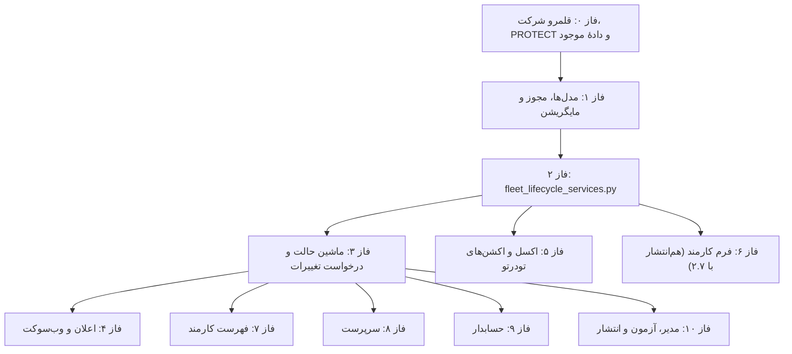

# گزارش تشریحی طرح بازمهندسی چرخهٔ ثبت ناوگان تا تصویب مدیر
### (ویرایش سوم — هم‌راستا با ممیزی ۱۱ مهر ۱۴۰۵)

> [!NOTE]
> این سند توضیح فنی طرح `implementation_plan_fleet_lifecycle.md` است. کدهای «ب-n» به جدول ایرادهای بخش ۱ طرح اشاره دارند. الگوی مرجع، چرخهٔ پرسنل است (`lifecycle_services.py` و `PersonnelProfileViewSet`). هر جا ناوگان از آن جدا می‌شود، دلیلش آمده است.

---

## ۱. وابستگی فازها

فاز ۰.۲ (قلمرو تازه) تا پایان ۰.۵ (پر شدن شرکت ۱۱ خودروی موجود) منتشر نمی‌شود؛ وگرنه این خودروها از دید کاربران غیرسوپریوزر پنهان می‌شوند.

---

## ۲. مؤلفه‌های کلیدی

### ۲.۱. قلمرو شرکت (فاز ۰)
- **خواندن:** `scope_vehicle_queryset` همان قواعد `scope_personnel_queryset` را دارد. کاربر عادی فقط بخش‌های منتسب یا ثبت‌های خودش را می‌بیند. هر غیرسوپریوزر، با یا بی سربرگ `X-Company-ID`، فقط شرکت‌های مجاز خودش را می‌بیند. ویوست درخواست تغییرات همین تابع را روی پیشوند `vehicle__` به کار می‌برد.
- **نوشتن:** `ensure_record_write_scope(user, company, section, project, label)` (عمومی‌شدهٔ `ensure_personnel_write_scope`) در ایجاد (حتی برای مدیر)، تغییر شرکت، بخش یا پروژه، و درون‌ریزی.
- **ویرایش:** `update` اول `get_object()` می‌گیرد و سپس همان pk را قفل می‌کند (ب-۱).
- **وب‌سوکت:** فقط `company_{id}_notifications`.

### ۲.۲. تفکیک وظایف نرخ پایه
- **کارمند:** فیلد نرخ در فرم نیست. سریالایزر برای نقش غیرمالی `default_service_rate` را بی‌صدا از ورودی حذف می‌کند و در خروجی نمی‌آورد (الگوی `WAGE_FIELDS`، DEF-21). رد با ۴۰۰ ممنوع است، چون فرم قدیمی و صف آفلاین هنوز `0` می‌فرستند و ۴xx رکورد صف را پاک می‌کند.
- **حسابدار:** در `pending_accountant` نرخ و حساب را مستقیم ویرایش می‌کند (`accountant_edit` همراه diff). گیت تجمعی `accountant` بدون نرخ بزرگ‌تر از صفر (برای استیجاری و ملکی) اجازهٔ ارسال به مدیر نمی‌دهد.
- **مدیر:** نرخ را می‌بیند و برای اصلاح، پرونده را به حسابدار عودت می‌دهد. `pending_manager` برای ویرایش مستقیم قفل است.
- **درخواست تغییرات:** تلاش صریح نقش غیرمالی برای تغییر نرخ خودروی مصوب ۴۰۳ می‌گیرد (مانند پرسنل).

### ۲.۳. حساب‌های بانکی (`VehicleBankAccount`)
- **منبع حقیقت:** مدل حساب. آینهٔ حساب اصلی روی خودرو فقط `bank_name`، `account_number` و `sheba_number` است، چون خودرو ستون `card_number` ندارد. آینه را `save()` و `delete()` حساب با `.update()` می‌نویسند.
- **قید یکتایی حساب اصلی (DEF-01):** قفل ردیف خودرو، خاموش کردن حساب اصلی قبلی پیش از `save`، و جانشینی فقط حساب فعال.
- **همگام‌سازی معکوس:** ویرایش ستون‌های تخت (حسابدار یا درون‌ریزی) در `VehicleDriverProfile.save()` حساب اصلی را می‌سازد یا به‌روز می‌کند، مگر `_skip_bank_sync` روشن باشد.
- **دیسکت تسویه:** نام ذینفع از `account_owner_name` حساب اصلی، و پشتیبانش `driver_name` (ب-۱۵).
- **فرم:** `core/utils/sheba-utils.ts` (`IRANIAN_BANKS`، تبدیل حساب به شبا، Mod 97)، دکمه‌های آیکونی `<svg appIcon>`، و بدون ایموجی.

### ۲.۴. تاریخ‌های انقضا و گارد تردد
- **ذخیره:** `CharField` شمسی `YYYY/MM/DD` که با `normalize_shamsi_date` نرمال می‌شود. مقایسه فقط با `parse_shamsi_date` انجام می‌شود، نه مقایسهٔ رشته (DEF-20).
- **خالی یعنی بدون محدودیت.** این شرط برای ۱۲ خودروی مصوب موجود که هیچ تاریخی ندارند لازم است.
- **`assert_vehicle_trip_allowed(vehicle, date_shamsi)`** در هر چهار مسیر نوشتن تردد (`views.py` در سه مسیر و `fleet_excel_engine.py`). `VehicleTripLog.clean()` کافی نیست، چون `objects.create` آن را صدا نمی‌زند. شرط‌ها:
  1. `approval_status='approved'`.
  2. اگر `end_date` دارد: تاریخ تردد بعد از آن نباشد (تردد تا روز پایان مجاز است). اگر `is_active=False` است و `end_date` ندارد: مسدود.
  3. تاریخ تردد پس از هیچ تاریخ انقضای پرشده‌ای نباشد. گواهینامه بنا به تصمیم ت-۳.
- **دیت‌پیکر:** `ng-persian-datepicker` روی `FormControl` و `.datepicker-left` در ستون‌های چپ.

### ۲.۵. ماژول `fleet_lifecycle_services.py`

| تابع | ورودی | خروجی | شرح |
| :--- | :--- | :--- | :--- |
| `get_vehicle_missing_fields` | `vehicle, stage` | `list[dict]` | گیت تجمعی `draft` ⊂ `submit` ⊂ `accountant`، با منطق مالکیت و نوع خودرو. |
| `auto_pass_vehicle` | `vehicle, user, source, draft_on_incomplete` | `dict` | عبور گیت‌دار نقش بالاتر (DEF-14). |
| `approve_vehicle_stage` | `vehicle_id, user, stage, note, batch` | خودرو | جدول `FLEET_APPROVAL_STAGES`، قفل ردیف، لاگ و اعلان؛ برای تکی و گروهی. شناسه باید از `get_queryset` گذشته باشد. |
| `check_vehicle_history` | `vehicle` | `dict` | همهٔ ترددها (همراه حذف‌نرم)، تردد تسویه‌شده، درخواست تغییرات، `AccountingEvent` خودرو و ترددها، و حساب کاربری متصل. |
| `build_vehicle_snapshot` | `vehicle` | `dict` | فیلدها، حساب‌ها و فهرست مدارک (همراه مسیر فایل). |
| `validate_vehicle_validity` / `assert_vehicle_trip_allowed` | `vehicle, date_shamsi` | `(bool, str)` / خطا | گارد تردد (۲.۴). |
| `apply_vehicle_change_request` | `cr, request` | خودرو | سریالایزر، فهرست مستثنی و فهرست سفید نقش، بدون `setattr` خام. |
| `check_vehicle_bank_account_edit_allowed` | `user, vehicle` | `(bool, str)` | همان قواعد DEF-10 پرسنل. |
| `dispatch_vehicle_workflow_notification` | `vehicle, stage, actor, reason, is_return` | — | با `_workflow_recipient_ids(..., perms_by_stage=FLEET_...)`. |

ابزارهای مشترک (`parse_shamsi_date`، `normalize_shamsi_date`، `user_has_any_perm`، `compute_profile_diff`) از `lifecycle_services` import می‌شوند. سرویس‌ها از `views.py` import نمی‌کنند.

### ۲.۶. حذف، Purge، بازگشایی و قطع همکاری
- **رد:** فقط در وضعیت‌های در جریان (`pending_supervisor`، `pending_accountant`، `pending_manager`، `revision_required` و وضعیت‌های قدیمی `supervisor_approved` و `accountant_approved`). پیش‌نویس ارسال‌نشده، پروندهٔ ردشده و پروندهٔ مصوب از این مسیر رد نمی‌شوند.
- **Purge:** درون تراکنش و پس از قفل ردیف، اگر `manager_approved_at` تهی باشد و `check_vehicle_history` سابقه‌ای نیابد: اسنپ‌شات در `WorkflowAuditLog` با `action='purge'` و سپس حذف ردیف. فایل‌های مدارک روی دیسک می‌مانند.
- **حذف (`destroy`):** ثبت‌کننده یا هم‌بخش فقط در `draft` و `revision_required`؛ دارندهٔ `perm_delete_vehicle_nomovement` هر خودروی بی‌سابقه را. با سابقه: ۴۰۰ با `code='history_exists'` و پیشنهاد `end_collaboration` (رفتار فعلیِ «غیرفعال‌سازی بی‌صدا» حذف می‌شود).
- **دفاع لایه‌دوم:** `VehicleTripLog.vehicle` با `on_delete=PROTECT`. حتی با خطای منطقی، ترددی با حذف خودرو پاک نمی‌شود.
- **بازگشایی (`reopen`):** `rejected` ← `draft`، با قفل، پاسخ ۴۰۹ در تغییر هم‌زمان، و قلمرو شرکت.
- **قطع همکاری (`end-collaboration`):** فقط مدیر و فقط برای خودروی مصوب و فعال. `end_date` و دلیل الزامی‌اند و `end_date` نباید پیش از آخرین تردد ثبت‌شده باشد. نتیجه: `is_active=False` همراه لاگ و اعلان.

### ۲.۷. درخواست تغییرات (`VehicleChangeRequestViewSet`)
- `create`، `update` و `partial_update` ← ۴۰۵؛ `destroy` برای غیرسوپریوزر ← ۴۰۳.
- `cancel` برای درخواست‌دهنده تا پیش از تأیید سرپرست.
- فهرست سفید وضعیت در هر اکشن (تأیید سرپرست فقط `pending_supervisor`؛ رد فقط وضعیت‌های معلق).
- فیلدهای مستثنی: `plate_number`، `section`، `company`، `project`، `user`، `assigned_warehouse_id`، `approval_status`، `rejection_reason`، `is_active`، `has_pending_changes`، `end_date`، حساب‌ها و مدارک. فهرست سفید کارمند نرخ ندارد.
- `refresh_has_pending_changes` به‌جای صفر کردن کور فلگ.
- لاگ هر رویداد در `WorkflowAuditLog` با `content_type='vehicle'` و `change_request_id` برای Diff Viewer.

---

## ۳. جدول گذارها

| مبدأ | اقدام | مقصد | نقش | گیت و شرط |
| :--- | :--- | :--- | :--- | :--- |
| `draft` / `revision_required` | `submit` | `pending_supervisor` | ثبت‌کننده یا هم‌بخش | گیت `submit`. |
| `pending_supervisor` | `approve-supervisor` | `pending_accountant` | `FLEET_SUPERVISOR_STAGE_PERMS` | — |
| `pending_supervisor` | `request-revision` | `revision_required` | سرپرست | دلیل الزامی. |
| `pending_accountant` | `approve-finance` | `pending_manager` | `perm_approve_fleet_finance` | گیت تجمعی `accountant`. |
| `pending_accountant` | `request-revision` | `revision_required` یا `pending_supervisor` | حسابدار | دلیل الزامی. |
| `pending_manager` | `approve-manager` | `approved` | `FLEET_MANAGER_STAGE_PERMS` | `is_active=True`. |
| `pending_supervisor` / `pending_accountant` | `approve-manager` | `approved` | مدیر | فقط با گیت `accountant`. از `draft` و `revision_required` ممنوع. |
| `pending_manager` | `request-revision` | `pending_accountant` | مدیر | دلیل الزامی. |
| وضعیت‌های در جریان | `reject` | Purge یا `rejected` | سرپرست، حسابدار یا مدیر | Purge فقط بی‌سابقه و هرگز تصویب‌نشده. |
| `rejected` | `reopen` | `draft` | ثبت‌کننده، هم‌بخش یا تأییدکننده | قلمرو شرکت. |
| `approved` (فعال) | `end-collaboration` | `approved` با `is_active=False` | مدیر | `end_date` و دلیل. |
| — | ایجاد توسط نقش بالاتر | تا بالاترین مرحلهٔ گیت‌گذشته | سرپرست، حسابدار یا مدیر | `auto_pass_vehicle`. |

---

## ۴. رابط کاربری (مهارت `design-system`)
1. **نوار فرمان چسبان:** `sticky top-0 z-30` با توکن‌های معنایی `surface`، `fg` و `line` (نه رنگ ثابت `slate` یا `white`)، ساب‌تب‌های RTL با شمارندهٔ زنده، و سه دکمهٔ آیکونی اکسل و همگام‌سازی با `aria-label` فارسی.
2. **آیکون:** فقط `<svg appIcon="...">` (نگهبان ۵۲) و بدون ایموجی.
3. **موبایل:** کارت به‌جای جدول، هدف لمسی ۴۴ پیکسل و بدون اسکرول افقی.
4. **تایملاین:** از `WorkflowAuditLog` با `content_type='vehicle'`.
5. **حالت‌ها:** بارگذاری، خالی، خطا و آفلاین. بارگذاری مدرک در آفلاین با پیام روشن متوقف می‌شود و دادهٔ فرم پاک نمی‌شود.
6. **تصویر:** `NgOptimizedImage` فقط برای تصویر سرور در قاب اندازه‌ثابت؛ برای پیش‌نمایش `blob:` نه.

---

## ۵. بررسی و انتشار
- **بررسی‌ها:** `manage.py check`؛ آزمون بک‌اند فقط با برچسب اپ (`personnel accounts`)؛ `ng test` با tsconfig موقت؛ نگهبان‌های ایستا (بدون اجرای کامل `guardian_all.py` روی دیتابیس عملیاتی)؛ و مقایسه با HEAD.
- **بازبین‌ها:** در پایان هر فاز یک بار: `tenant-scope-reviewer`، `data-loss-reviewer` و `ui-reviewer`، بسته به diff.
- **انتشار:** همه با Claude و پس از یک پرسش بله/خیر از کاربر. ترتیب: پشتیبان‌گیری با `manage.py shell -c` و `create_database_backup`، اسکیل `safe-migration` و تطبیق نام مایگریشن `accounts`، `migrate`، بیلد با `--delete-output-path=false` و وصلهٔ ngsw، `taskkill` و راه‌اندازی daphne در تب Windows Terminal، و در پایان سنجش ۲۰۰ دو نشانی عملیاتی. جزئیات در §۵.۳ طرح.

