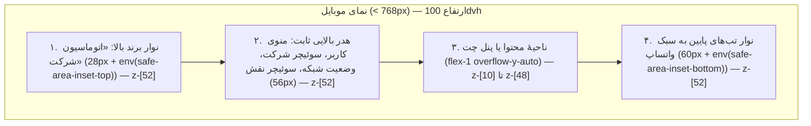

# طرح اجرایی بازطراحی ناوبری موبایل: نوار برند بالا، هدر ثابت همیشگی و نوار تب‌های پایین (سبک واتساپ)

> [!IMPORTANT]
> **هدف کلان طرح:** ارتقای ارگونومی نسخهٔ موبایل (`< 768px` / زیر نقطهٔ شکست `md`) با سه تغییر ساختاری هماهنگ، بدون هیچ‌گونه تغییر در تجربهٔ کاربری نسخهٔ دسکتاپ (`md:` به بالا):
> ۱. افزودن **نوار برند ثابت بالای هدر** با متن `اتوماسیون شرکت` (همراه با پشتیبانی از `safe-area-inset-top`).
> ۲. **ثابت ماندن همیشگی نوار برند و هدر بالایی** در تمام حالات، حتی زمانی که کشوی پیام‌رسان سازمانی (چت) باز است.
> ۳. انتقال ناوبری اصلی موبایل به **نوار تب‌های پایین صفحه (Bottom Navigation Bar)** به سبک واتساپ با چینش توافق‌شده از راست به چپ: **۱. چت ← ۲. اعلان ← ۳. اولین گزینهٔ منو (نام مختصر) ← ۴. دومین گزینهٔ منو (نام مختصر) ← ۵. بیشتر (منوی کامل)** و حذف دکمهٔ تکراری همبرگر (`☰`)، دکمهٔ چت و دکمهٔ اعلان از هدر موبایل.

---

## ۱. معماری چیدمان و لایه‌بندی عمودی در موبایل (Viewport & Z-Index Stack)

در نمای موبایل (`< 768px`)، صفحهٔ اصلی (`#app-screen` در `Layout` و ریشهٔ `OperationsLayoutComponent`) به صورت یک ستون تمام‌قد (`h-[100dvh] overflow-hidden flex flex-col`) با ابعاد و لایه‌بندی زیر تنظیم می‌شود:

### جدول لایه‌بندی (`z-index`) و ابعاد در موبایل

| بخش | ارتفاع در موبایل (`< 768px`) | وضعیت در دسکتاپ (`>= 768px`) | `z-index` | رفتار هنگام باز بودن چت |
| :--- | :--- | :--- | :---: | :--- |
| **نوار برند بالا (`Top Brand Bar`)** | `28px + safe-area-inset-top` | مخفی (`md:hidden`) | `z-[52]` | همیشه ثابت و نمایان در بالاترین نقطه |
| **هدر اصلی (`Top Header`)** | `56px` (فشرده و بدون `☰`، چت و اعلان) | `70px` (کامل، بدون تغییر) | `z-[52]` | همیشه ثابت، نمایان و قابل کلیک بالای چت |
| **کشوی پیام‌رسان (`ChatDrawer`)** | بین هدر بالا (`84px + safe-top`) و نوار پایین (`60px + safe-bottom`) | کشوی کناری `w-[400px]` تمام‌قد (`sm:top-0 sm:bottom-0`) | `z-[48]` | در موبایل زیر هدر و بالای نوار پایین قرار می‌گیرد |
| **نوار تب‌های پایین (`Bottom Nav Bar`)** | `60px + safe-area-inset-bottom` | مخفی (`md:hidden`) | `z-[52]` | در فهرست چت‌ها نمایان؛ **داخل یک گفت‌وگو (`activeConv`) خودکار پنهان می‌شود** |
| **کشوی منوی کامل («بیشتر» / `Sidebar`)** | تمام‌صفحه یا از زیر نوار برند | سایدبار ثابت سمت راست | `z-[55]` | روی همهٔ لایه‌های ناوبری باز می‌شود |
| **پاپ‌اور اعلان‌ها (`Notification Panel`)** | پنل شناور بالای نوار پایین / زیر هدر | دراپ‌داون زیر آیکون زنگوله | `z-[54]` | با زدن تب «اعلان» باز و بسته می‌شود |

---

## ۲. جزئیات طراحی هر یک از اجزا

### ۲.۱. نوار برند ثابت بالای هدر (`Top Brand Bar`)
- **محل قرارگیری:** بالای `<header>` در هر دو پوستهٔ اصلی برنامه ([layout.html](file:///e:/comanager/frontend/src/app/modules/common/components/layout/layout.html) و [operations-layout.html](file:///e:/comanager/frontend/src/app/modules/common/components/operations/operations-layout/operations-layout.html)).
- **نمایش:** فقط در موبایل (`md:hidden`)، با پس‌زمینهٔ سرمه‌ای تیرهٔ سازمانی (`bg-slate-900 text-white border-b border-slate-800/80`) که با سایدبار و تم (`#1e293b`) هماهنگ است.
- **محتوا:**
  - آیکون لوگوی سامانه (`appIcon="logo-mark"` در ابعاد `14×14`) + متن ثابت **`اتوماسیون شرکت`** با فونت `text-[11px] font-black tracking-tight text-slate-100`.
  - در صورت حضور در کانتکست یک انبار مشخص (`store.isWarehouseContext()`)، نام انبار فعال به شکل یک نشان کوچک (`badge`) در سمت چپ همین نوار نمایش داده می‌شود تا نوار اضافی قبلی زیر هدر (`block sm:hidden` در خط ۴۵۰ `layout.html`) نیز ادغام شود و فضای عمودی صفحه هدر نرود.
- **فضای امن آیفون (`Safe Area`):** پدینگ بالای نوار برند (`pt-safe`) وظیفهٔ جبران ناچ (`env(safe-area-inset-top, 0px)`) را بر عهده می‌گیرد؛ بنابراین در موبایل، `.layout-header` دیگر نیازی به تکرار `env(safe-area-inset-top)` ندارد و ارتفاع خالص `56px` خواهد داشت.

### ۲.۲. خلوت‌سازی هدر بالایی در موبایل (`Top Header Decluttering`)
با انتقال «چت»، «اعلان» و «منوی کامل (بیشتر)» به نوار پایین در موبایل:
- دکمهٔ همبرگر موبایل (`☰` با `(click)="openSidebar()"` در `layout.html` و `(click)="toggleMobileMenu()"` در `operations-layout.html`) در موبایل حذف می‌شود (دکمهٔ جمع‌کردن سایدبار دسکتاپ `hidden md:block` دست‌نخورده باقی می‌ماند).
- دکمهٔ پیام‌رسان سازمانی در هدر دارای کلاس `hidden md:flex` می‌شود تا در دسکتاپ سر جای خود بماند و در موبایل فقط در نوار پایین باشد.
- دکمهٔ زنگولهٔ `app-notification-center` در هدر دارای ورودی `[hideTriggerOnMobile]="true"` می‌شود تا آیکون زنگوله در هدر موبایل مخفی شود، اما پنل پاپ‌اور اعلان‌ها همچنان در DOM فعال بماند و با تب «اعلان» در نوار پایین باز و بسته شود.
- در نتیجه، هدر موبایل فقط شامل **منوی کاربر (`app-user-menu`)**، **سوئیچر شرکت (`app-company-switcher`)**، **نشانگر وضعیت شبکه/آفلاین (`app-offline-pending-badge`)** در سمت راست و **سوئیچر نقش/ماژول (`app-role-switcher`)** در سمت چپ خواهد بود که در عرض `360px` بدون هیچ فشردگی یا اسکرول افقی جا می‌شوند.

### ۲.۳. نوار تب‌های پایین به سبک واتساپ (`Mobile Bottom Navigation Bar`)
یک بخش یکپارچه در پوسته با ویژگی‌های زیر ساخته می‌شود:

#### ترتیب و منطق ۵ جایگاه نوار پایین (از راست به چپ در RTL):

| جایگاه (راست به چپ) | عنوان تب در نوار پایین | آیکون (`appIcon`) | نشانگر (`Badge`) | رفتار هنگام کلیک |
| :---: | :--- | :--- | :--- | :--- |
| **۱ (راست‌ترین)** | **چت** | `PLATFORM_ENTITY_ICONS.chat` (`message-square`) | `commService.totalUnreadCount()` (قرمز جهنده در پیام جدید / آبی) | باز/بسته کردن کشوی چت (`toggleChatDrawer()`) و بستن پاپ‌اور اعلان/سایدبار |
| **۲** | **اعلان** | `PLATFORM_ENTITY_ICONS.notifications` (`bell`) | `notifCenter.unreadCount()` (`+99` یا عدد) | باز/بسته کردن پنل اعلان‌ها (`toggleNotifications()`) و بستن چت/سایدبار |
| **۳** | **اولین گزینهٔ منوی فعال** | آیکون همان آیتم منو | — | بستن چت/اعلان و هدایت به مسیر آیتم اول (`switchTab(item.id)`) |
| **۴** | **دومین گزینهٔ منوی فعال** | آیکون همان آیتم منو | — | بستن چت/اعلان و هدایت به مسیر آیتم دوم (`switchTab(item.id)`) |
| **۵ (چپ‌ترین)** | **بیشتر** | `ACTION_ICONS.more` (`more-vertical`) یا `menu` | نقطهٔ نشانگر در صورتی که صفحهٔ فعلی خارج از تب‌های ۳ و ۴ باشد | باز/بسته کردن کشوی منوی کامل (`toggleSidebar()`) |

> [!TIP]
> **منطق جایگزینی هوشمند (Fallback Logic):**
> - اگر کاربر به چت دسترسی نداشته باشد (`!commService.isChatAvailable()`)، جایگاه چت خالی نمی‌ماند بلکه یک گزینهٔ دیگر از منوی فعال نقش (سومین گزینهٔ منو) جایگزین می‌شود تا نوار متوازن بماند.
> - در پوسته‌هایی که کل گزینه‌های منوی آن‌ها کمتر از ۲ مورد است (مانند پوستهٔ محدود `شرکت‌ها` که فقط ۱ یا ۲ گزینه دارد، یا نقش `راهبر تشکیلات` که ۱ گزینه دارد)، فقط همان تعداد گزینهٔ موجود در نوار پایین نمایش داده می‌شود و چیدمان با `flex-1` به صورت متقارن فضا را تقسیم می‌کند.
> - **انتخاب منبع آیتم‌های پویا (جایگاه ۳ و ۴):**
>   - در کانتکست انبار یا سامانهٔ انبارداری: از `primaryNavItems()`
>   - در سامانهٔ مالی (`accounting`): از منوی نقش فعال کاربر (`personaService.activeRole()`، مثلاً کارمند، سرپرست، حسابدار، مدیر، خزانه‌دار، راهبر تشکیلات) و در صورت باز بودن چند نقش، به ترتیب اولویت از `navItems()` قابل دسترس
>   - در پوستهٔ محدود شرکت‌ها (`isCompaniesShell`): گزینهٔ «شرکت‌ها» و در صورت دسترسی، «مدارک شرکت»
>   - در مرکز عملیات (`OperationsLayoutComponent`): ۲ مورد اول از `navItems` (`اتاق فرماندهی` و `پشتیبان‌گیری`)

#### استاندارد ارگونومی و دسترس‌پذیری نوار پایین (طبق قواعد `AGENTS.md` و Guardian 52/55/56):
- هر دکمه دارای حداقل ابعاد لمسی `min-h-[48px] min-w-[56px] flex-1` (بالاتر از حداقل `40×40px` استاندارد WCAG 2.2) و کلاس `.tap-target` است.
- هر دکمه دارای `type="button"`، `title` فارسی و `aria-label` توصیفی (شامل تعداد پیام/اعلان خوانده‌نشده در صورت وجود) و `[attr.aria-current]="isActive ? 'page' : null"` است.
- تب فعال دارای کپسول رنگی ظریف دور آیکون (`bg-indigo-50 text-indigo-600 dark:bg-indigo-950/80 dark:text-indigo-400` به سبک واتساپ مدرن) و متن پررنگ (`font-black text-indigo-700`) و تب‌های غیرفعال دارای `text-slate-600 font-bold` هستند.
- برچسب متنی زیر هر آیکون با سایز `text-[10px] leading-tight truncate max-w-[68px]` نمایش داده می‌شود تا در عرض `360px` (`5 × 72px = 360px`) هرگز اسکرول افقی ایجاد نشود.

---

## ۳. جدول نام‌های مختصر (`shortLabel`) برای گزینه‌های منو

برای اینکه برچسب‌های طولانی منو در فضای `68px` نوار پایین بریده و ناخوانا نشوند، فیلد اختیاری `shortLabel?: string` به اینترفیس `ModuleNavItem` در [module-contract.ts](file:///e:/comanager/frontend/src/app/core/modules/module-contract.ts) و `NavItem` در ماژول‌ها اضافه می‌شود:

### ۳.۱. سامانهٔ انبارداری ([warehouse/nav-items.ts](file:///e:/comanager/frontend/src/app/modules/warehouse/nav-items.ts))

| شناسه (`id`) | عنوان کامل فعلی (`label`) | نام مختصر نوار پایین (`shortLabel`) |
| :--- | :--- | :--- |
| `dashboard` (کلان و انبار) | داشبورد مانیتورینگ کلی / داشبورد انبار | **داشبورد** |
| `users` | کاربران و نقش ها | **کاربران** |
| `projects` | انبارها | **انبارها** |
| `docs` | مدیریت کالا | **کالاها** |
| `dispatch` | تخصیص کالا | **تخصیص** |
| `counter` | کارتابل انبارگردان | **شمارش** |
| `customs` | کارتابل مالی | **مالی انبار** |
| `supervisor` | کارتابل سرپرست | **سرپرست** |
| `manager-review` | بررسی نهایی مدیر | **بررسی مدیر** |
| `count-tracking` | پیگیری وضعیت شمارش | **پیگیری شمارش** |
| `feeding` | مدیریت و تغذیه MT26/49 (به‌زودی) | **تغذیه داده** |
| `audit` | رهگیری تغییرات | **رهگیری** |
| `health` | پایش سلامت سامانه | **سلامت** |
| `reports` | گزارش‌ساز | **گزارش‌ها** |
| `settings` / `wh-settings` | تنظیمات سیستم / تنظیمات انبار | **تنظیمات** |

### ۳.۲. سامانهٔ کارکرد و مالی ([accounting/nav-items.ts](file:///e:/comanager/frontend/src/app/modules/accounting/nav-items.ts))

| شناسه (`id`) | عنوان کامل فعلی (`label`) | نام مختصر نوار پایین (`shortLabel`) |
| :--- | :--- | :--- |
| `projects-and-sections` | پروژه‌ها و بخش‌ها | **پروژه‌ها** |
| `employee-attendance` | کارکرد پرسنل | **کارکرد** |
| `employee-fleet` | تردد ناوگان | **ناوگان** |
| `employee-invoices` / `invoices` | ثبت رسید پرداخت / رسیدهای پرداخت | **رسیدها** |
| `employee-petty-cash` / `supervisor-petty-cash` / `accountant-petty-cash` / `treasurer-petty-cash` | مدیریت تن‌خواه / تایید تن‌خواه / رسیدگی تن‌خواه / تن‌خواه | **تن‌خواه** |
| `employee-new-vehicle` | تعریف خودرو | **خودرو جدید** |
| `employee-new-personnel` | تعریف پرسنل | **پرسنل جدید** |
| `supervisor-personnel` / `accountant-personnel` / `manager-personnel` | پرسنل | **پرسنل** |
| `supervisor-fleet` / `accountant-fleet` / `manager-fleet` | ناوگان | **ناوگان** |
| `supervisor-period-lock` | بستن دوره ماهانه | **بستن دوره** |
| `accountant-payroll` | حقوق و دستمزد | **حقوق** |
| `accountant-diskettes` | دیسکت‌های بیمه و مالیات | **دیسکت‌ها** |
| `accountant-counterparties` | طرف‌حساب‌های مالی | **طرف‌حساب** |
| `profiles` | بانک پرونده‌ها | **پرونده‌ها** |
| `base-settings` | تنظیمات پایه حقوق | **تنظیمات پایه** |
| `manager-reports` | گزارش‌های مدیریتی | **گزارش‌ها** |
| `manager-dashboard` | داشبورد مدیریتی | **داشبورد** |
| `manager-approvals` | کارتابل تاییدات | **تاییدات** |
| `manager-budget` | کنترل بودجه | **بودجه** |
| `treasurer-disbursements` | پرداخت حقوق و ناوگان | **پرداخت‌ها** |
| `treasurer-bank-accounts` | حساب‌های بانکی و صندوق | **حساب بانکی** |
| `treasurer-cheques` | مدیریت چک و اسناد | **چک و اسناد** |
| `treasurer-reconciliation` | مغایرت‌گیری و نقدینگی | **مغایرت‌گیری** |

### ۳.۳. مرکز عملیات ([operations-layout.ts](file:///e:/comanager/frontend/src/app/modules/common/components/operations/operations-layout/operations-layout.ts)) و ماژول نمایشی ([showcase/nav-items.ts](file:///e:/comanager/frontend/src/app/modules/showcase/nav-items.ts))

| شناسه (`id`) | عنوان کامل فعلی (`label`) | نام مختصر نوار پایین (`shortLabel`) |
| :--- | :--- | :--- |
| `cockpit` | اتاق فرماندهی کل | **فرماندهی** |
| `snapshots` | پشتیبانی‌گیری و اسنپ‌شات‌های سرور | **پشتیبان‌گیری** |
| `users` | مدیریت کاربران و نقش‌ها | **کاربران** |
| `companies` | مدیریت شرکت‌ها و هلدینگ | **شرکت‌ها** |
| `health` | ماتریس سلامت و تست همروندی | **سلامت** |
| `audit` | ممیزی امنیتی و ثبت رویدادها | **ممیزی** |
| `sync-monitor` | مانیتورینگ کلاینت‌ها و تداخل | **همگام‌سازی** |
| `overview` (showcase) | ماژول نمایشی / صفحه نمونه | **نمایشی** |

---

## ۴. رفتار کشوی چت در موبایل و هماهنگی با دو نوار ثابت

در حال حاضر در [chat-drawer.component.html](file:///e:/comanager/frontend/src/app/modules/common/components/communications/chat-drawer/chat-drawer.component.html#L9)، پنل چت دارای کلاس `fixed top-0 left-0 bottom-0 pt-safe pb-safe w-full sm:w-[400px] z-50` است که در موبایل روی هدر را می‌پوشاند. تغییرات زیر اعمال می‌شود:

1. **ثبت وضعیت گفت‌وگوی فعال در سرویس (`CommunicationService`):**
   - یک سیگنال `public hasActiveConversation = signal<boolean>(false)` در [communication.service.ts](file:///e:/comanager/frontend/src/app/core/services/communication.service.ts) تعریف می‌شود و با `activeConv` در `ChatDrawerComponent` همگام می‌شود تا پوستهٔ `Layout` و `OperationsLayoutComponent` بدانند کاربر در «فهرست گفت‌وگوها» است یا «داخل یک گفت‌وگو».
2. **حدود عمودی پنل چت در موبایل (`< 768px`):**
   - متغیرهای CSS سراسری در `:root` (`styles.css`) تعریف می‌شوند:
     - `--mobile-top-chrome-height: calc(84px + env(safe-area-inset-top, 0px))` (مجموع ۲۸ پیکسل نوار برند + ۵۶ پیکسل هدر)
     - `--mobile-bottom-nav-height: calc(60px + env(safe-area-inset-bottom, 0px))`
   - در موبایل (`max-md:`)، `.chat-drawer-panel` به جای `top-0`:
     - از بالا به `top: var(--mobile-top-chrome-height)` مقید می‌شود و دیگر نیازی به `pt-safe` در موبایل ندارد (چون زیر هدر قرار دارد).
     - از پایین، وقتی در **فهرست گفت‌وگوها** هستیم (`!activeConv()`)، به `bottom: var(--mobile-bottom-nav-height)` مقید می‌شود تا نوار تب‌های پایین دیده و لمس شود.
     - وقتی کاربر **وارد یک گفت‌وگو** می‌شود (`activeConv() !== null`)، نوار تب‌های پایین در موبایل پنهان شده و پنل چت تا پایین صفحه (`bottom-0 pb-safe`) باز می‌شود تا کادر تایپ پیام فضای کافی داشته باشد (دقیقاً مشابه واتساپ).
   - در دسکتاپ (`md:` به بالا)، رفتار فعلی کشوی چت (`md:top-0 md:bottom-0 md:w-[400px] md:z-50`) بدون هیچ تغییری حفظ می‌شود.
3. **بک‌دراپ چت (`Backdrop`):**
   - بک‌دراپ تیره در موبایل زیر هدر قرار می‌گیرد (`max-md:top-[var(--mobile-top-chrome-height)]`) تا هدر بالایی هرگز تیره یا غیرفعال نشود.

---

## ۵. مدیریت تداخل با نوارهای شناور پایین صفحه در سایر کامپوننت‌ها

بررسی کدبیس نشان داد ۵ کامپوننت دارای المان‌های `fixed bottom-...` هستند که در موبایل باید بالاتر از نوار تب‌های پایین (`60px`) قرار بگیرند تا روی آن نیفتند:

| ردیف | فایل | وضعیت فعلی | اصلاح لازم در موبایل |
| :---: | :--- | :--- | :--- |
| ۱ | [employee-attendance.html](file:///e:/comanager/frontend/src/app/modules/accounting/components/finance/employee/employee-attendance/employee-attendance.html#L493) | `md:hidden fixed bottom-safe-3 left-3 right-3 z-30` (نوار ثبت سریع کارکرد) | تغییر کلاس به `bottom-nav-offset-3` (`calc(0.75rem + var(--mobile-bottom-nav-height))`) تا دقیقاً بالای نوار تب‌های پایین بنشیند |
| ۲ | [users.html](file:///e:/comanager/frontend/src/app/modules/common/components/users/users.html#L620) | `fixed inset-x-3 bottom-safe-3 sm:inset-x-0 ... z-50` (نوار ذخیرهٔ تغییرات دسترسی) | در موبایل با `max-md:bottom-[calc(0.75rem+var(--mobile-bottom-nav-height))]` بالای نوار پایین قرار می‌گیرد |
| ۳ | [update-bar.component.ts](file:///e:/comanager/frontend/src/app/shared/components/update-bar/update-bar.component.ts) | `fixed inset-x-0 bottom-0 z-[90] pb-safe` | بنر موقت بروزرسانی با `z-[90]` روی نوار پایین می‌آید (رفتار استاندارد بنر سیستمی؛ بدون تداخل دائمی) |
| ۴ | [webpush-bar.component.ts](file:///e:/comanager/frontend/src/app/shared/components/webpush-bar/webpush-bar.component.ts) | `fixed inset-x-0 bottom-0 z-[89] pb-safe` | بنر موقت اعلان مرورگر با `z-[89]` (قابل بستن؛ بدون تداخل دائمی) |
| ۵ | [share-offer-bar.component.ts](file:///e:/comanager/frontend/src/app/shared/components/share-offer-bar/share-offer-bar.component.ts) | `fixed inset-x-0 bottom-0 z-[90] pb-safe` | بنر موقت نصب/اشتراک با `z-[90]` (قابل بستن؛ بدون تداخل دائمی) |

---

## ۶. فهرست دقیق فایل‌های هدف (ایجاد و ویرایش)

| فاز | فایل | نوع تغییر | شرح دقیق اقدام |
| :---: | :--- | :---: | :--- |
| **فاز ۱** | [module-contract.ts](file:///e:/comanager/frontend/src/app/core/modules/module-contract.ts) | ویرایش | افزودن فیلد اختیاری `shortLabel?: string` به `ModuleNavItem` |
| **فاز ۱** | [warehouse/nav-items.ts](file:///e:/comanager/frontend/src/app/modules/warehouse/nav-items.ts) | ویرایش | افزودن `shortLabel` به `NavItem` و تمام ۲۵ آیتم منوی کلان و انبار |
| **فاز ۱** | [accounting/nav-items.ts](file:///e:/comanager/frontend/src/app/modules/accounting/nav-items.ts) | ویرایش | افزودن `shortLabel` به `NavItem` و تمام ۳۶ آیتم منوی نقش‌های مالی |
| **فاز ۱** | [showcase/nav-items.ts](file:///e:/comanager/frontend/src/app/modules/showcase/nav-items.ts) | ویرایش | افزودن `shortLabel` به ۲ آیتم ماژول نمایشی |
| **فاز ۲** | [communication.service.ts](file:///e:/comanager/frontend/src/app/core/services/communication.service.ts) | ویرایش | افزودن سیگنال `hasActiveConversation = signal<boolean>(false)` برای اطلاع پوسته از ورود به صفحهٔ گفت‌وگو |
| **فاز ۲** | [chat-drawer.component.ts](file:///e:/comanager/frontend/src/app/modules/common/components/communications/chat-drawer/chat-drawer.component.ts) | ویرایش | همگام‌سازی `activeConv` با `commService.hasActiveConversation` در زمان باز/بسته شدن گفت‌وگو و دراور |
| **فاز ۲** | [chat-drawer.component.html](file:///e:/comanager/frontend/src/app/modules/common/components/communications/chat-drawer/chat-drawer.component.html) | ویرایش | تنظیم موقعیت عمودی پنل و بک‌دراپ چت در موبایل (`max-md:`) زیر نوار برند و هدر، و بالای نوار تب‌های پایین (وقتی گفت‌وگویی باز نیست) |
| **فاز ۲** | [notification-center.component.ts](file:///e:/comanager/frontend/src/app/shared/components/notification-center/notification-center.component.ts) | ویرایش | افزودن ورودی `hideTriggerOnMobile = input<boolean>(false)` برای مخفی کردن زنگولهٔ هدر در موبایل و تنظیم موقعیت پاپ‌اور موبایل بالای نوار پایین |
| **فاز ۳** | [styles.css](file:///e:/comanager/frontend/src/styles.css) و [layout.css](file:///e:/comanager/frontend/src/app/modules/common/components/layout/layout.css) | ویرایش | تعریف متغیرهای `--mobile-top-chrome-height` و `--mobile-bottom-nav-height`، اصلاح `.layout-header` در موبایل و کلاس کمکی `.bottom-nav-offset-3` |
| **فاز ۳** | [layout.ts](file:///e:/comanager/frontend/src/app/modules/common/components/layout/layout.ts) و [layout.html](file:///e:/comanager/frontend/src/app/modules/common/components/layout/layout.html) | ویرایش | افزودن نوار برند بالای هدر (`اتوماسیون شرکت`)، حذف `☰` و چت و زنگوله از هدر موبایل، محاسبهٔ واکنشی `mobileBottomNavDynamicItems` و رندر نوار تب‌های پایین در موبایل |
| **فاز ۳** | [operations-layout.ts](file:///e:/comanager/frontend/src/app/modules/common/components/operations/operations-layout/operations-layout.ts) و [operations-layout.html](file:///e:/comanager/frontend/src/app/modules/common/components/operations/operations-layout/operations-layout.html) | ویرایش | همگام‌سازی کامل پوستهٔ مرکز عملیات با نوار برند بالا، هدر ثابت خلوت‌شده، کامپوننت اعلان و نوار تب‌های پایین موبایل |
| **فاز ۴** | [employee-attendance.html](file:///e:/comanager/frontend/src/app/modules/accounting/components/finance/employee/employee-attendance/employee-attendance.html) و [users.html](file:///e:/comanager/frontend/src/app/modules/common/components/users/users.html) | ویرایش | تنظیم فاصلهٔ نوارهای شناور پایین صفحه در موبایل نسبت به نوار تب‌های پایین |
| **فاز ۴** | [layout-modular.dom.spec.ts](file:///e:/comanager/frontend/src/app/modules/common/components/layout/layout-modular.dom.spec.ts) و [operations-layout.dom.spec.ts](file:///e:/comanager/frontend/src/app/modules/common/components/operations/operations-layout/operations-layout.dom.spec.ts) | ویرایش | افزودن تست‌های واحد DOM (Type 1 Vitest) برای نوار برند بالا، نوار تب‌های پایین، نام‌های مختصر، باز شدن چت زیر هدر و پنهان شدن نوار پایین داخل گفت‌وگو |

---

## ۷. معیارهای پذیرش و راستی‌آزمایی (Verification Checklist)

1. **تست‌های نگهبان (Guardians):**
   - اجرای `python scripts/e2e/guardian_56_change_integrity.py` (خروجی `0` بدون حذف ناخواستهٔ هندلرها یا تگ‌های نامتوازن).
   - اجرای `python scripts/e2e/guardian_52_icon_registry.py` و `python scripts/e2e/guardian_55_clickable_ergonomics.py` (تأیید ثبت آیکون‌ها و ارگونومی دکمه‌ها).
   - اجرای `python scripts/e2e/guardian_54_module_independence.py` و `python scripts/e2e/guardian_57_front_module_fence.py`.
2. **تست‌های واحد DOM (Type 1 — Vitest):**
   - اجرای تست‌های `layout.spec.ts`، `layout-modular.dom.spec.ts`، `login-and-app-switching.dom.spec.ts` و `operations-layout.dom.spec.ts`.
3. **کامپایل و بیلد بدون خطا:**
   - اجرای `npx ng build --delete-output-path=false && node tools/patch-ngsw-530.js` بدون هیچ خطای کامپایل یا هشدار `NG8113`.

