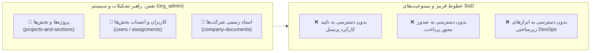

<div dir="rtl" align="right">

# طرح جامع و عمیق معماری: ممیزی، انتقال کدها و پالایش منوهای کارکرد و حسابداری

> [!IMPORTANT]
> **قانون اکید عدم اجرای خودکار (Auto-Approval Ban):**
> مطابق قوانین قطعی سامانه، تا زمان صدور دستور دستی و صریح («تایید» یا «شروع») توسط کاربر، هیچ کدی در سیستم تغییر نخواهد کرد.

---

## ۱. کالبدشکافی عمیق ۱۱ تب منوی «کارکرد و حسابداری» و دسته‌بندی عملیاتی

بر اساس بررسی موشکافانه خط‌به‌خط کدهای کامپوننت‌های فرانت‌اند و مسیرهای سیستم، این ۱۱ آیتم به **۴ دسته متمایز** تقسیم می‌شوند:

```mermaid
graph TD
    classDef del fill:#fee2e2,stroke:#ef4444,stroke-width:2px;
    classDef check fill:#fef3c7,stroke:#f59e0b,stroke-width:2px;
    classDef move fill:#e0e7ff,stroke:#6366f1,stroke-width:2px;
    classDef create fill:#dcfce7,stroke:#10b981,stroke-width:2px;

    M["۱۱ تب منوی عمومی کارکرد و حسابداری"] --> G1["دسته ۱: حذف فوری و کامل<br>(تکرار ۱۰۰٪ مرکز فرماندهی)"]:::del
    M --> G2["دسته ۲: ممیزی و انتقال کد قبل از حذف<br>(خطر از دست رفتن فیچر)"]:::check
    M --> G3["دسته ۳: انتقال قطعی به نقش مربوطه<br>(جا مانده از منوی اختصاصی)"]:::move
    M --> G4["دسته ۴: واگذاری به نقش جدید<br>(راهبر تشکیلات و سیستم)"]:::create

    G1 --> D1["۱۰. رهگیری و ممیزی مالی (finance-audit)"]
    G1 --> D2["۱۱. سلامت و تاب‌آوری سامانه (finance-health)"]

    G2 --> C1["۷. طرف‌حساب‌های مالی (counterparties)"]
    G2 --> C2["۲. پنل کارمند (employee-portal)"]
    G2 --> C3["۵. کارتابل مالی (finance-cartable)"]
    G2 --> C4["۶. کارتابل خزانه‌داری (treasury-cartable)"]

    G3 --> M1["۴. کارتابل تاییدات مدیر (manager-approvals)"]
    G3 --> M2["۸. بانک پرونده‌ها (profiles)"]
    G3 --> M3["۹. تنظیمات پایه حقوق (base-settings)"]
    G3 --> M4["۳. کارکرد پرسنل و ناوگان (attendance)"]

    G4 --> R1["۱. پروژه‌ها و بخش‌ها (projects-and-sections)"]
```



---

## ۲. جدول ممیزی جزئی کامپوننت‌ها، انتقال کدها و تعیین تکلیف نهایی

| # | نام تب جاری | کامپوننت و حجم کد | وضعیت در منوی نقش هدف | ارزیابی فنی و خلاءهای موجود | اقدام اجرایی دقیق و شروط حذف |
| :---: | :--- | :--- | :--- | :--- | :--- |
| **۱** | **پروژه‌ها و بخش‌ها** (`projects-and-sections`) | `ProjectsAndSectionsComponent`<br>۱۵۳۷ خط کد | هنوز نقش راهبر تشکیلات ساخته نشده است. | کامپوننت فوق‌العاده جامع با مدیریت پروژه‌ها، بخش‌ها و انتساب کاربران به بخش‌ها. | **انتقال به منوی جدید `ORG_ADMIN_NAV_ITEMS`** و سپس حذف از منوی عمومی حسابداری. |
| **۲** | **پنل ثبت کارمند** (`employee-portal`) | `EmployeePortalComponent`<br>۷۵۵ خط کد | در `EMPLOYEE_NAV_ITEMS` ۶ هاب مجزا وجود دارد. | این کامپوننت مونولیتیک است. ۶ هاب مجزا (`employee-attendance`، `employee-fleet`، `employee-invoices`، `employee-petty-cash`، `employee-new-vehicle`، `employee-new-personnel`) به صورت تخصصی تمام کار را انجام می‌دهند. | **بررسی ریدایرکت‌ها و حذف کامل از سایدبار** پس از اطمینان از این‌که هیچ دکمه‌ای به روت قدیمی `employee-portal` وابسته نمانده است. |
| **۳** | **ثبت کارکرد پرسنل و ناوگان** (`attendance`) | `WarehouseAttendance`<br>۲۹۳۸ خط کد | در کارمند، سرپرست و حسابدار هاب‌های تفکیک‌شده وجود دارد. | شامل تقویم ۳۱ روزه و جدول ماتریسی روزانه است. کدهای ۳۱ روزه در `employee-attendance` منتقل شده‌اند، اما سرپرست و حسابدار نیازمند دسترسی به تقویم مرجع هستند. | **حذف از منوی عمومی**؛ دسترسی کارمندان به `employee-attendance` و سرپرستان به `supervisor-attendance` تثبیت می‌شود. |
| **۴** | **کارتابل تاییدات مدیر** (`manager-approvals`) | `ManagerApprovals`<br>۸۹۱ خط کد | ❌ **در `MANAGER_NAV_ITEMS` وجود ندارد!** | **خلاء بزرگ:** مدیر ارشد برای تایید پرسنل، ناوگان، دوره‌ها، فاکتورها و تن‌خواه به این کامپوننت نیاز دارد، اما در سایدبار اختصاصی مدیر فراموش شده بود! | **انتقال قطعی به `MANAGER_NAV_ITEMS`** و بلافاصله حذف از منوی عمومی. |
| **۵** | **کارتابل مالی و حقوق** (`finance-cartable`) | `FinanceCartable`<br>۸۷۶ خط کد | در `ACCOUNTANT_NAV_ITEMS` دیسکت‌ها هست، اما روت `accountant-payroll` از سایدبار جا مانده بود! | موتور ۵۸ ستونه حقوق اکسل باید در دسترس حسابدار باشد. هاب `accountant-payroll` ساخته شده ولی در لیست منوی حسابدار لینک نشده است. | **افزودن `accountant-payroll` به `ACCOUNTANT_NAV_ITEMS`**، اعتبارسنجی محاسبه حقوق تیرماه، و سپس حذف `finance-cartable` از منوی عمومی. |
| **۶** | **کارتابل خزانه‌داری** (`treasury-cartable`) | `TreasuryCartable`<br>۱۵۹ خط کد | در `TREASURER_NAV_ITEMS` هاب پیشرفته `treasurer-disbursements` (۳۳۵ خط) وجود دارد. | کامپوننت جدید خزانه‌دار دارای صف پرداخت پایا/ساتنا و آرشیو واریز است و کامپوننت قدیمی را پوشش می‌دهد. | **حذف کامل از منوی عمومی** و هدایت خزانه‌دار به `treasurer-disbursements`. |
| **۷** | **مدیریت طرف‌حساب‌ها** (`counterparties`) | `CounterpartiesComponent`<br>۶۵۲ خط کد | ⚠️ در منوی حسابدار یک هاب بسیار ناقص ۱۱۰ خطی (`accountant-counterparties`) وجود دارد! | **نقطه بحرانی:** کامپوننت ۶۵۲ خطی دارای ورود اکسل، مودال‌های ۵ گانه انواع طرف‌حساب و استعلام شبا است. اگر صرفاً به هاب ۱۱۰ خطی تکیه شود، **فیچرهای اصلی نابود می‌شوند!** | **انتقال مستقیم کامپوننت کامل `CounterpartiesComponent` به منوی حسابدار** یا ادغام متدهای آن در هاب قبل از هرگونه حذف. |
| **۸** | **بانک پرونده‌های پرسنل و ناوگان** (`profiles`) | `PersonnelProfilesHub`<br>۱۱۹۷ خط کد | ❌ در `ACCOUNTANT_NAV_ITEMS` وجود ندارد! | حسابدار و کارگزینی برای مشاهده احکام، قراردادها، چاپ کارت و پرونده به این بانک جامع نیاز دارند. در حال حاضر حسابدار فقط کارتابل تایید دارد نه بانک پرونده‌ها! | **انتقال مستقیم به منوی حسابدار (`ACCOUNTANT_NAV_ITEMS`)** و حذف از منوی عمومی. |
| **۹** | **تنظیمات پایه حقوق** (`base-settings`) | `BaseSettings`<br>۵۵۷ خط کد | ❌ در هیچ منوی نقشی وجود ندارد! | ۶ تب حیاتی: نرخ‌های قانون کار، رتبه‌بندی، پنجره کارکرد، دیسکت و پله‌های مالیاتی ماده ۸۴. | **انتقال به منوی مدیر ارشد (`MANAGER_NAV_ITEMS`)** با دسترسی نظارتی برای حسابدار و حذف از منوی عمومی. |
| **۱۰** | **رهگیری و ممیزی مالی** (`finance-audit`) | `Audit`<br>(ریدایرکت ساده) | ✅ در `/app/operations/audit` دقیقاً همین کامپوننت با تمام ابزارهای ممیزی حضور دارد. | ابزار امنیتی و فنی اتاق فرماندهی پدافند سازمان است و هیچ ربطی به منوی بیزینسی ندارد. | **حذف ۱۰۰٪ فوری و کامل بدون نیاز به انتقال هیچ کدی.** |
| **۱۱** | **سلامت و تاب‌آوری** (`finance-health`) | `HealthDashboardComponent`<br>(ریدایرکت ساده) | ✅ در `/app/operations/health` دقیقاً همین کامپوننت مانیتورینگ حضور دارد. | ابزار مانیتورینگ سرور، پایگاه داده، ردیس و وب‌سوکت است. | **حذف ۱۰۰٪ فوری و کامل بدون نیاز به انتقال هیچ کدی.** |

---

## ۳. معماری نقش جدید «راهبر تشکیلات و سیستم» (Organization Administrator)



### ۱. تعریف در بک‌اند (Django):
- پرمیشن جدید: `can_act_as_org_admin` در `accounts/models.py`.
- ادغام در `seed_permissions.py` و ایجاد Migration رو به جلو.
- استخراج در `accounts/middleware.py`:
  ```python
  if user.has_perm('accounts.can_act_as_org_admin') or user.has_perm('accounts.perm_manage_projects_sections'):
      roles.append('org_admin')
  ```

### ۲. تعریف در فرانت‌اند (Angular):
- پرسونای سازمانی در `app-persona.service.ts`:
  ```typescript
  {
    code: 'org_admin',
    title: 'راهبر تشکیلات و سیستم',
    app: 'personnel',
    badgeColor: '#0284c7',
    bgClass: 'bg-sky-600',
    icon: '🏢',
    tierLevel: 4
  }
  ```
- آرایه اقلام ناوبری در `nav-items.ts`:
  ```typescript
  export const ORG_ADMIN_NAV_ITEMS: NavItem[] = [
    { id: 'projects-and-sections', label: '📂 پروژه‌ها و بخش‌ها', icon: 'folder', permission: 'perm_manage_projects_sections', module: 'accounting', isAccounting: true },
    { id: 'users', label: '👥 کاربران و انتساب بخش‌ها', icon: 'users', permission: 'view_sys_users', module: 'accounting', isAccounting: true },
    { id: 'company-documents', label: '📑 بایگانی اسناد و مدارک رسمی', icon: 'file-text', permission: 'view_sys_projects', module: 'accounting', isAccounting: true },
  ];
  ```

---

## ۴. طرح تفصیلی اصلاح منوهای حسابدار و مدیر (Fixing the Missing Hubs)

### منوی بازنگری‌شده حسابدار (`ACCOUNTANT_NAV_ITEMS`):
با توجه به ممیزی انجام شده، منوی حسابدار باید به صورت کامل اصلاح شود تا فیچرهای حیاتی از دست نروند:
1. `accountant-payroll` : 💳 محاسبه و کنترل حقوق و دستمزد (موتور ۵۸ ستونه اکسل) — *قبلاً جا افتاده بود*
2. `accountant-personnel` : 👥 کارتابل ممیزی پرسنل
3. `accountant-fleet` : 🚚 کارتابل ممیزی و تسویه ناوگان
4. `profiles` : 📇 بانک جامع پرونده‌های پرسنل و احکام — *قبلاً جا افتاده بود*
5. `counterparties` : 🤝 مدیریت جامع طرف‌حساب‌های مالی (با ایمپورت اکسل و مودال ۵ گانه) — *جلوگیری از حذف فیچرها*
6. `accountant-invoices` : 🧾 ممیزی فاکتورهای هزینه
7. `accountant-petty-cash` : 💰 کنترل تن‌خواه‌گردان
8. `accountant-diskettes` : 📑 دیسکت‌های بیمه و مالیات

### منوی بازنگری‌شده مدیر شرکت (`MANAGER_NAV_ITEMS`):
مدیر از فرم‌های تعریفی رها شده و صرفاً بر تصمیم‌گیری و تایید متمرکز می‌گردد:
1. `manager-dashboard` : 📊 داشبورد هوش مدیریتی و KPIها
2. `manager-approvals` : 👑 کارتابل تاییدات نهایی کارکرد و ارقام پرداختی — *قبلاً جا افتاده بود*
3. `manager-budget` : 📉 کنترل بودجه و انحراف هزینه‌ها
4. `manager-reports` : 📑 گزارشات جامع مدیریتی
5. `base-settings` : ⚙️ تصویب تنظیمات پایه حقوق و ضرایب سالانه

---

## ۵. پروتکل اجرای فازبندی‌شده و بدون ریسک (Execution Phases)

- **گام ۱ (حذف موارد DevOps بدون ریسک):** حذف `finance-audit` و `finance-health` از سایدبار حسابداری.
- **گام ۲ (ایجاد نقش راهبر تشکیلات):** ایجاد پرمیشن در بک‌اند، افزودن پرسونا در فرانت‌اند و انتقال `projects-and-sections`.
- **گام ۳ (پالایش منوی حسابدار):** اضافه کردن `accountant-payroll`، `profiles` و لینک کامپوننت جامع `CounterpartiesComponent`.
- **گام ۴ (پالایش منوی مدیر):** انتقال `manager-approvals` و `base-settings` به سایدبار مدیر.
- **گام ۵ (بازنشستگی پورتال‌های مونولیتیک قدیمی):** حذف `employee-portal`، `treasury-cartable` و `attendance` از سایدبار پس از اطمینان ۱۰۰٪ از کارکرد هاب‌های مجزا.
- **گام ۶ (تست و ارزیابی نهایی):** اجرای تست‌های DOM، نگهبان ۵۲ (عدم وجود SVG اینلاین)، رعایت هدر مرکز فرماندهی و بیلد بدون خطای فرانت‌اند.

</div>
