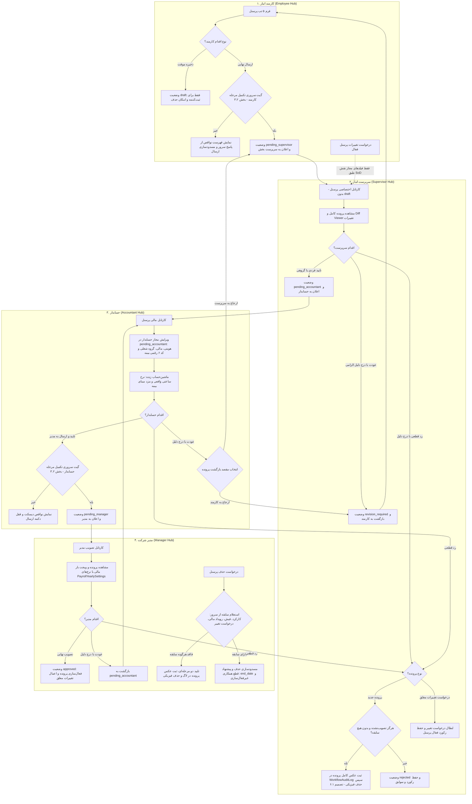

# طرح جامع و تدقیق‌شده بازمهندسی چرخه ثبت پرسنل تا تصویب مدیر
### (منطبق بر فایل اکسل مرجع TirSalary.xlsm، شیت‌های Emp_info، Settings و شیت تیر)

> [!IMPORTANT]
> **بازبینی ۹ مهر ۱۴۰۵:** این نسخه پس از تطبیق بندبه‌بند طرح با کد مخزن (commit `23ff13d`) و اکسل مرجع اصلاح شده است. در این بازبینی هیچ کدی تغییر نکرده و همهٔ تسک‌ها همچنان اجرانشده‌اند. ایرادهای یافته‌شده، شاهد هرکدام در کد و اصلاح متناظر در **بخش ۵** آمده است. پیش از شروع فاز ۱ باید تصمیم‌های **بخش ۶** با کاربر قطعی شود.

---

## ۱. بازنگری عمیق و اهداف کلان طرح (Audited Goal & Scope)
این طرح با بررسی موشکافانه مجدد کلیه بندهای پرامپت کاربر، اکسل مرجع ([TirSalary.xlsm](file:///e:/warehouse%20project/Documents/SalaryCalculation/TirSalary.xlsm)) و کدهای فعلی فرانت و بک‌اند، چرخه کامل ثبت پرسنل را از نقطه ورود اطلاعات توسط کارمند، تایید میدانی سرپرست، کنترل مالی و بیمه‌ای حسابدار تا تصویب نهایی و فعال‌سازی توسط مدیر بازمهندسی می‌کند.

ایرادهای سیستم فعلی که این طرح برطرف **خواهد کرد**:
- اختلاط نرخ ساعتی واقعی با مزد روزانهٔ قانون کار در نمایش و ماشین‌حساب (امروز `hourly_rate = مزد مبنا ÷ ۱۰`) و ناسازگاری فرمول «مزد مبنا» در `PersonnelProfile.save()` با اکسل مرجع و `payroll_engine`؛
- نشت پیش‌نویس ناقص به کارتابل سرپرست (فهرست سرپرست وضعیت `draft` را هم می‌گیرد و اکشن تایید سرپرست آن را می‌پذیرد)؛
- امکان تغییر مستقیم `approval_status` از API ویرایش پرسنل، یعنی دور زدن کل چرخهٔ تایید؛
- نبود گیت سروری «تکمیل اطلاعات» پیش از ارسال به هر مرحله؛
- ماندن پرونده‌های ردشده بدون قاعدهٔ امن پاک‌سازی؛
- فقدان مدل مستقل چندحسابی بانکی؛
- نبود تاریخ اعتبار با معیار ماه محاسباتی؛
- نبود استعلام پیش از حذف و ثبت ممیزی حذف.

---

## ۲. جدول جامع تطبیق ۱۰۰٪ الزامات پرامپت اولیه و راهکارهای اجرایی

| ردیف | موضوع و بند پرامپت | تحلیل وضعیت فعلی (تطبیق‌شده با کد) | راهکار دقیق مهندسی در طرح تدقیق‌شده |
| :---: | :--- | :--- | :--- |
| **۱.a** | **استخراج ۴۶ ستون شیت `Emp_info` و تفکیک از کارکرد `تیر`** | هر ۴۶ ستون (A تا AT) هم‌اکنون فیلد متناظر در `PersonnelProfile` دارند و داده‌های ماهانه در `MonthlyPayrollRecord` جداست. اما خروجی `export-excel` فقط ۱۲ ستون دارد. درون‌ریزی فعلی ستون‌های «ملیت»، «کشور محل تابعیت» و «کشور محل زندگی» را نمی‌خواند و تاریخ‌های عددی اکسل (مثل `13650308`) را بدون نرمال‌سازی ذخیره می‌کند. | مدل تازه لازم نیست. تطبیق ستون‌به‌ستون خروجی و ورودی با A تا AT در تسک‌های ۵.۳ و ۵.۴ انجام می‌شود. |
| **۱.b** | **مقادیر پیش‌فرض کدهای رسمی شیت `Settings` با امکان تغییر انفرادی** | ۱۵ کد از ۱۶ کد رسمی شیت Settings (۹ کد بخش WP و ۷ کد بخش WH) همین حالا پیش‌فرض مدل‌اند. استثنا «مدرک تحصیلی» است: مدل `'5'` دارد و Settings عدد ۲. فهرست قبلی طرح «۱۲گانه» نام داشت، ۱۳ قلم شمرده بود و «مدرک تحصیلی» و «نوع بیمه» را نداشت. | پیش‌فرض‌های موجود حفظ و فقط ممیزی می‌شود. در WP: ملیت ۱، مدرک تحصیلی ۲، نوع بیمه ۲، نام بیمه «تامین اجتماعی»، معافیت ۱، کشور تابعیت و زندگی ۱۰۳، رسته ۱۵، نوع استخدام ۲. در WH: نوع پرداختی ۱، محل خدمت ۱، استثنائات ۱، ارز ۸۴، نرخ تسعیر ۱، مسکن ۱، اتومبیل ۱. حسابدار هر کد را برای هر فرد تغییر می‌دهد. تغییر پیش‌فرض مدرک تحصیلی منوط به تصمیم ۶.۲ است. |
| **۲.a** | **تفکیک حالت پیش‌نویس از ارسال نهایی** | دکمه‌های «ذخیره پیش‌نویس» و «ارسال به سرپرست» هست (`savePersonnel(targetStatus)` و `submitDraftToSupervisor`)، ولی نه فرانت و نه سرور تکمیل بودن فیلدها را نمی‌سنجند. پیش‌نویسِ فقط نام و کد ملی هم ممکن نیست، چون `job_title` در مدل اجباری است. | ذخیرهٔ پیش‌نویس با حداقل نام، نام خانوادگی، کد ملی معتبر و بخش انجام می‌شود (تسک ۱.۹). ارسال به سرپرست از **گیت سروری** تکمیل می‌گذرد (تسک ۲.۶ و ماتریس §۳.۲) و فرانت همان فهرست نواقص را نشان می‌دهد. فیلدهای بیمه و مالیات در گیت حسابدار است، نه کارمند. |
| **۲.b** | **تقسیم‌بندی فرم کارمند در ۵ تب ارگونومیک** | فرم یک مودال با اسکرول عمودی بلند است و تب ندارد. | تقسیم فرم به ۵ تب: ۱) فردی/شناسنامه‌ای، ۲) شغلی/استخدامی، ۳) حساب‌های بانکی، ۴) نشانی/تماس/معرف، ۵) مدارک/یادداشت؛ تیک سبز هر تب از روی نواقص اعلام‌شدهٔ سرور. |
| **۲.c** | **فیلد تاریخ اعتبار با معیار آخرین روز ماه محاسباتی** | فیلد تاریخ اعتبار وجود ندارد. | افزودن `valid_until_date` (شمسی `YYYY/MM/DD`، ارقام نرمال‌شده). انقضا با آخرین روز ماه محاسباتی سنجیده می‌شود و پایان اسفند در سال کبیسه ۳۰ روزه است (`jdatetime`). خالی یعنی بی‌نهایت. نقاط اعمال در تسک ۲.۱ صریح آمده است. |
| **۲.d,e** | **فیلدهای معرف و یادداشت کارمند** | فیلد معرف وجود ندارد. فیلد `notes` («توضیحات و یادداشت تکمیلی») هست و فرم کارمند از آن استفاده می‌کند. یادداشت تایید هر مرحله هم با پارامتر `note` در `WorkflowAuditLog` ذخیره می‌شود. | افزودن `recommender`. همان `notes` یادداشت کارمند می‌ماند و ستون تکراری `employee_note` ساخته نمی‌شود. یادداشت سرپرست و حسابدار هم مثل امروز برای هر مرحله در `WorkflowAuditLog` ثبت و در تایملاین نشان داده می‌شود. |
| **۲.f** | **امکان حذف پیش‌نویس ناقص و ابطال درخواست تغییر توسط کارمند** | حذف پیش‌نویس هست: `deleteDraftPersonnel` و `destroy` برای وضعیت‌های `draft` و `revision_required`. ابطال درخواست تغییرات معلق توسط خود درخواست‌دهنده وجود ندارد، هرچند وضعیت `cancelled` در مدل تعریف شده است. | حذف پیش‌نویس با قاعدهٔ تسک ۲.۴ حفظ می‌شود. اکشن «ابطال درخواست تغییر» برای درخواست‌دهنده تا پیش از تایید سرپرست اضافه می‌شود (تسک‌های ۳.۴ و ۷.۲). |
| **۲.g** | **نشانگرهای رنگی وضعیت در منوی کارمند** | برچسب وضعیت و دلیل عودت یا رد همین حالا در فهرست کارمند نمایش داده می‌شود. | یکدست‌سازی با کامپوننت مشترک `status-badge` و `StatusLabelPipe`، به‌اضافهٔ تولتیپ دلیل و تایملاین (تسک ۷.۱). |
| **۲.h** | **درخواست تغییرات پرسنل فعال با اصل SoD** | ویرایش پرسنل تصویب‌شده درخواست تغییر می‌سازد (`PersonnelProfileViewSet.update`)، اما فیلدهای مالی برای کارمند قفل نیستند. `PersonnelChangeRequestViewSet` هم `ModelViewSet` کامل است و `status` و `proposed_changes` را مستقیم از API قابل نوشتن می‌گذارد. | فهرست سفید فیلد بر اساس نقش، هنگام ساخت درخواست و هنگام اعمال آن. نوشتن مستقیم روی API درخواست تغییرات بسته می‌شود و تغییرات با سریالایزر اعتبارسنجی و اعمال می‌شود (تسک ۳.۴). |
| **۲.i,j,k** | **چند حساب بانکی با اعتبارسنجی ایزو ۹۷ و تعیین حساب اصلی** | اطلاعات بانکی پرسنل تخت و تک‌حسابی است. ابزارهای شبا (Mod 97، تبدیل دوطرفهٔ حساب و شبا، دکمهٔ ⚡) در `sheba-utils.ts` و فرم موجودند. الگوی چندحسابی هم برای شرکت پیاده شده است (`CompanyBankAccount` همراه با ستون‌های آینهٔ حساب اصلی روی `Company`). | مدل `PersonnelBankAccount` با همان الگوی `CompanyBankAccount` ساخته می‌شود. حساب اصلی در ستون‌های فعلی `PersonnelProfile` آینه می‌شود تا مصرف‌کنندگان فعلی نشکنند (تسک ۱.۶). رابط کاربری طبق «استاندارد بانکی» `.agents/AGENTS.md` است. |
| **۲.l** | **دکمه‌های کپی یک‌کلیکه شماره حساب، شبا و موبایل** | `copyToClipboard` در فرم کارمند هست، اما در فهرست‌ها و کارتابل‌ها یکدست نیست. | دکمه‌های کپی با بازخورد ۲ ثانیه‌ای طبق استاندارد بانکی AGENTS.md در فهرست کارمند و کارتابل‌ها (تسک‌های ۷.۱ و ۹.۸). |
| **۲.m,n** | **اتوکامپلیت سمت شغلی و اتصال به کد ۶ رقمی شغل تامین اجتماعی** | اتوکامپلیت متنی (datalist) با اندپوینت موجود `/api/personnel/profiles/job-titles/` کار می‌کند. فیلد `job_code` در مدل هست ولی به سمت شغلی وصل نیست. در اکسل مرجع ۱۰ سمت و ۹ کد هست، با ۱۲ جفت «سمت-کد». دو سمت بیش از یک کد دارند، پس نگاشت یک‌به‌یک نیست. | مدل `InsuranceJobTitle`. همان اندپوینت موجود گسترش می‌یابد و مسیر موازی ساخته نمی‌شود. وقتی سمت فقط یک کد دارد، کد خودکار پر می‌شود و وقتی چند کد دارد، حسابدار انتخاب می‌کند (تسک‌های ۱.۲، ۵.۲ و ۶.۵). |
| **۲.o** | **ورود و خروج اکسل ۲ سطری (فریز A3)** | `download-template` دو سطر سرستون دارد (فارسی و کلید) با ۱۹ ستون. `export-excel` همین ساختار را با ۱۲ ستون دارد. `import-excel` سطر سرستون را خودکار پیدا می‌کند و فایل مرجع را هم می‌خواند. در اکسل مرجع، سطر ۱ عنوان گروه و سطر ۲ عنوان فارسی است، کلید انگلیسی ندارد و فریز آن AG3 است. | خروجی ۴۶ ستونی با ترتیب و عنوان فارسی عیناً مطابق A تا AT، سطر ۲ کلید دیتابیس و فریز A3 (طبق درخواست). ورودی هر دو قالب را می‌پذیرد، یعنی خروجی خود سامانه و فایل مرجع (تسک‌های ۵.۳ و ۵.۴). |
| **۲.p** | **وب‌سوکت بلادرنگ و نوتیفیکیشن اختصاصی با لینک** | رویداد وب‌سوکت `personnel_updated` همین حالا با `broadcast_personnel_update` به گروه شرکت فرستاده می‌شود و فرانت با آن فهرست را تازه می‌کند. رویداد بی‌شرکت به `global_notifications` (همهٔ کاربران) می‌رود. مدل `Notification` فیلد لینک ندارد (فقط `target_model` و `target_id`)، کانال وب‌سوکت مخصوص هر کاربر وجود ندارد و فرانت فهرست اعلان ماندگار (`/api/notifications/`) را مصرف نمی‌کند. | اعلان هدفمند با گیرندگان مشخص (تسک ۴.۱)، کانال اختصاصی هر کاربر، و لینکی که فرانت از `target_model` و `target_id` می‌سازد (تصمیم ۶.۷). مرکز اعلان در فرانت (تسک ۴.۴). رویداد بی‌شرکت دیگر سراسری پخش نمی‌شود (تسک ۴.۳). |
| **۲.q,r,s** | **پایداری آفلاین، امنیت RBAC و دیزاین سیستم** | آپلود `FormData` (پیوست) در حالت آفلاین پشتیبانی نمی‌شود (`offline.interceptor` خطای 503 برمی‌گرداند). صف آفلاین شناسهٔ موقت رکورد تازه را در درخواست‌های بعدی جایگزین نمی‌کند. `approval_status` از API ویرایش پرسنل قابل نوشتن است. برای این ردیف در طرح قبلی هیچ تسکی نبود. | **آفلاین:** وضعیت فرم پیش‌نویس هنگام قطعی سرور از دست نمی‌رود (تشخیص قطعی فقط با `isServerUnreachable()`). حساب‌های بانکی پروندهٔ جدید داخل همان payload ایجاد ارسال می‌شوند، نه با درخواست تودرتوی جداگانه. **RBAC:** قفل فیلدهای گردش کار و گذارها فقط از اکشن‌ها (تسک ۲.۷). **ظاهر:** `SKIP_GLOBAL_ERROR_TOAST` فقط برای فراخوانی‌های پس‌زمینه مثل استعلام و اتوکامپلیت، و قواعد اسکیل `design-system`. |
| **۲.t** | **اعتبارسنجی بلادرنگ کد ملی و استعلام سابقه قبلی** | فرانت رقم کنترلی را می‌سنجد و استعلام سابقه با `lookup-by-national-code` فعال است. اما سرور فقط ۱۰ رقمی بودن را می‌سنجد، چه در سریالایزر و چه در درون‌ریزی. استعلام بدون سربرگ شرکت هم در همهٔ شرکت‌ها جستجو می‌کند و اطلاعات بانکی برمی‌گرداند. | رقم کنترلی در سرور، با همان الگوریتم `UserSerializer.validate_national_code`. استعلام به شرکت‌های مجاز کاربر محدود می‌شود. پروندهٔ ردشده یا تکراری در همان شرکت «بازگشایی» می‌شود، نه ساخت رکورد تازه (تسک‌های ۲.۲ و ۶.۳). |
| **۲.u,v,w** | **نمای کارتی موبایل، تایملاین گردش کار، ولیدیشن کدپستی/موبایل و پیش‌نمایش مدارک** | نمای کارتی موبایل در فرم کارمند هست. تایملاین فقط در `supervisor-new-profiles` است. فرم کارمند فیلد کد پستی و نشانی ندارد و موبایل را اعتبارسنجی نمی‌کند. فقط یک پیوست (`attachment`) بدون پیش‌نمایش وجود دارد. | کارت‌ها با همان متدهای TS. تایملاین از لاگ یکدست‌شده (تسک ۳.۶). اعتبارسنجی موبایل (`09` به‌اضافهٔ ۹ رقم) و کد پستی (۱۰ رقم) در فرانت و سرور (تسک‌های ۲.۶ و ۶.۲). مدل مدارک چندگانه (تسک ۱.۱۱) و لایت‌باکس با `src` معمولی برای `blob:` (تسک ۶.۶). |
| **۳** | **کارتابل سرپرست (تفکیک از ناوگان، مشاهده پرونده، اختیارات ۳گانه، تایید گروهی)** | در منو، پرسنل و ناوگان سرپرست جدا هستند (`supervisor-personnel` و `supervisor-fleet`)، اما مسیر ترکیبی `supervisor-new-profiles` (پرسنل، خودرو و درخواست‌ها) هنوز فعال است. فهرست سرپرست پیش‌نویس‌ها را هم می‌گیرد (`approval_status: 'pending_supervisor,draft'`) و اکشن `approve-supervisor` وضعیت `draft` را می‌پذیرد. رد، پرونده را در وضعیت `rejected` نگه می‌دارد. | بازنشسته‌کردن مسیر ترکیبی. حذف `draft` هم از فهرست و هم از اکشن سرور. مودال مشاهدهٔ کامل پرونده. عودت با دلیل به کارمند. رد قطعی با **Purge مشروط** (§۳.۱-ب و تصمیم ۶.۱). تایید گروهی. |
| **۴** | **کارتابل حسابدار (تفکیک ناوگان، تفکیک نرخ ساعتی، ویرایش هویتی/مالی، ماشین‌حساب)** | در منو، پرسنل و ناوگان حسابدار جدا هستند، اما `accountant-new-profiles` هنوز مسیر فعال دارد. ماشین‌حساب موجود (`recalculatePersonnelRates`) نرخ ساعتی را «مزد مبنا ÷ ۱۰» می‌گیرد. `PersonnelProfile.save()` مزد مبنا را «مزد روزانه + پایهٔ سنواتی» ذخیره می‌کند، در حالی که اکسل و `payroll_engine` آن را «مزد روزانه + سال کارکرد × پایهٔ سنواتی» می‌گیرند. ذخیرهٔ حسابدار در وضعیت `pending_accountant` با خطای 400 رد می‌شود. | بازنشسته‌کردن مسیر ترکیبی. **تفکیک نرخ ساعتی واقعی ($\frac{\text{حقوق قرارداد}}{\text{ساعت قرارداد}}$) از مزد روزانهٔ بیمه** و یکسان‌سازی فرمول مزد مبنا (تسک ۱.۱۰). اجازهٔ ویرایش حسابدار در مرحلهٔ خودش (تسک ۳.۷). ماشین‌حساب زنده. گیت سروری ارسال. عودت با انتخاب مقصد (کارمند یا سرپرست). |
| **۵** | **کارتابل مدیر (تصویب نهایی، عودت به حسابدار، استعلام ۴گانه عدم سابقه برای حذف، ویجت بار مالی)** | `destroy` همین حالا کارکرد (حتی حذف‌نرم‌شده) و فیش حقوق را می‌سنجد و در صورت سابقه پرونده را غیرفعال می‌کند. اما مدیر پرونده را در هر وضعیتی حذف می‌کند، استعلام پیش از حذف و ثبت ممیزی حذف وجود ندارد و ویجت بار مالی هم نیست. | تصویب نهایی. عودت به حسابدار با دلیل. **استعلام سابقه پیش از حذف**: کارکرد، فیش حقوق، رویداد مالی و درخواست تغییر. جدول «لاگ دیسکت» وجود ندارد و دیسکت‌ها از فیش ساخته می‌شوند (تسک ۲.۳). مسدودسازی حذف در صورت سابقه و پیشنهاد «قطع همکاری». **ویجت بار مالی** با نرخ‌های `PayrollYearlySettings` (تسک ۱۰.۱). |

---

## ۳. معماری جامع جریان کار و انتقال حالات (Enterprise State Machine)

> [!NOTE]
> **عبور هوشمند (Auto-Pass):** اگر سرپرست، حسابدار یا مدیر خودش پرونده ثبت کند، `process_creation_with_auto_pass` مراحل قبلی را عبور می‌دهد. گیت تکمیل همهٔ مراحل عبورداده‌شده در همین مسیر هم اجرا می‌شود (تسک ۲.۶).

### ۳.۱ قواعد گذار وضعیت (سمت سرور، منبع واحد)

**الف) گذارهای مجاز**

| از وضعیت | به وضعیت | اقدام‌کننده و اکشن | گارد سروری |
| :--- | :--- | :--- | :--- |
| (جدید) | `draft` | ثبت‌کننده | حداقل‌های پیش‌نویس (§۳.۲) |
| `draft` یا `revision_required` | `pending_supervisor` | ثبت‌کننده، اکشن `submit` (تسک ۲.۷) | گیت مرحلهٔ کارمند |
| `pending_supervisor` | `pending_accountant` | سرپرست، `approve-supervisor` | فقط از `pending_supervisor`؛ `draft` و `revision_required` پذیرفته نمی‌شود |
| `pending_supervisor` | `revision_required` | سرپرست، `request-revision` | دلیل الزامی |
| `pending_accountant` | `pending_manager` | حسابدار، `approve-finance` | گیت مرحلهٔ حسابدار |
| `pending_accountant` | `revision_required` یا `pending_supervisor` | حسابدار، `request-revision` با مقصد | دلیل الزامی |
| `pending_manager` | `approved` | مدیر، `approve-manager` | — |
| `pending_manager` | `pending_accountant` | مدیر، `request-revision` | دلیل الزامی |
| `pending_*` یا `revision_required` | `rejected` یا Purge | سرپرست، حسابدار یا مدیر، `reject` | دلیل الزامی؛ Purge فقط با شرایط بند «ب» |
| `pending_supervisor` یا `pending_accountant` | `approved` | مدیر (پرش؛ رفتار فعلی) | گیت مرحلهٔ حسابدار؛ پرش از `draft` (ارسال‌نشده) ممنوع |
| `approved` | — | — | گذار گردش کار ندارد؛ تغییرات فقط از `PersonnelChangeRequest`. اکشن‌های `reject` و `request-revision` روی پروندهٔ تصویب‌شده رد می‌شوند (امروز گارد وضعیت ندارند). |

وضعیت‌های قدیمی `supervisor_approved`، `accountant_approved` و `manager_approved` در انتخاب‌های مدل باقی‌اند و درون‌ریزی امروزِ مدیر `manager_approved` ثبت می‌کند. تعیین تکلیف آن‌ها در تسک ۵.۴ است.

**ب) شرط Purge در رد قطعی** (منوط به تصمیم ۶.۱)

حذف فیزیکی فقط وقتی مجاز است که **همهٔ** شرایط زیر برقرار باشد. در غیر این صورت وضعیت `rejected` می‌شود و رکورد می‌ماند:
1. پرونده هرگز تصویب نشده است: `manager_approved_at` خالی است و لاگ تصویب نهایی ندارد.
2. استعلام سابقهٔ تسک ۲.۳ هیچ سابقه‌ای نشان نمی‌دهد. `DailyAttendance` و `MonthlyPayrollRecord` با `CASCADE` به پرسنل وصل‌اند و حذف بی‌استعلام آن‌ها را هم پاک می‌کند.
3. پیش از حذف، عکس کامل پرونده، حساب‌های بانکی و فهرست مدارک در `metadata` یک رکورد `WorkflowAuditLog` با `action='purge'` ثبت می‌شود.
4. فایل‌های پیوست حذف نمی‌شوند.

### ۳.۲ ماتریس فیلدهای الزامی هر مرحله (پیشنهادی؛ تصمیم ۶.۵)

| مرحله | فیلدهای الزامی |
| :--- | :--- |
| ذخیرهٔ پیش‌نویس | `first_name`، `last_name`، `national_code` (۱۰ رقم با رقم کنترلی معتبر)، `section` |
| ارسال کارمند به سرپرست | موارد بالا + `father_name`، `birth_date`، `id_number`، `gender`، `job_title`، `phone_number` (`09` + ۹ رقم)، `address` و `postal_code` (۱۰ رقم)، و یک حساب اصلی با شبای معتبر |
| ارسال حسابدار به مدیر | موارد بالا + `job_code` (۶ رقم)، `job_grade`، `contract_type`، `start_date`، `contract_hours` بزرگ‌تر از صفر، `daily_base_wage` یا `contract_base_salary` بزرگ‌تر از صفر، `insurance_type`، `insurance_name`، `exemption_type` و کدهای مالیاتی WH |

`insurance_number` الزامی نیست، چون فرد تازه‌استخدام ممکن است هنوز شمارهٔ بیمه نداشته باشد. این ماتریس فقط یک‌جا در سرور تعریف می‌شود (تسک ۲.۶) و فرانت همان را می‌خواند.

---

## ۴. برنامه فازبندی‌شده تدقیق‌شده در ۱۰ فاز و ۶۴ تسک اجرایی (64 Detailed Tasks)

برچسب **[جدید]** یعنی تسکی که در بازبینی اضافه شد. **[بازنویسی]** یعنی تسکی که هدف یا مسیر کدش پس از تطبیق با کد اصلاح شد. شاهدها در بخش ۵ آمده است.

**وابستگی‌های کلیدی:**
- ۲.۷ پیش‌نیاز ۶.۷ است.
- ۲.۶ پیش‌نیاز ۶.۱، ۶.۷، ۹.۴ و ۹.۵ است.
- ۳.۶ پیش‌نیاز ۷.۱ و ۸.۳ است.
- ۳.۷ پیش‌نیاز ۹.۳ است.
- ۱.۱۱ پیش‌نیاز ۶.۶ است.
- ۱.۱ و ۱.۶ پیش‌نیاز ۵.۱ و ۶.۴ هستند.

### فاز ۱: توسعه مدل‌های داده پایگاه داده و مایگریشن‌ها (Backend Models & Migrations)
- [ ] **تسک ۱.۱:** ایجاد مدل `PersonnelBankAccount` در `warehouse-backend/personnel/models.py` با همان الگوی `CompanyBankAccount`. فیلدها: `personnel` (FK)، `bank_name`، `account_number`، `sheba_number`، `card_number`، `is_primary`، `is_active`، `description` و زمان‌های ثبت و ویرایش. `sheba_number` با پیشوند `IR` نرمال‌سازی و در سریالایزر با `sheba_utils.validate_sheba` (Mod 97) اعتبارسنجی می‌شود. یکتایی حساب اصلی با `UniqueConstraint(fields=['personnel'], condition=Q(is_primary=True))` در خود دیتابیس تضمین می‌شود. تعویض حساب اصلی در یک تراکنش انجام می‌شود و اولین حساب خودکار اصلی می‌شود. <!-- id: 1.1 -->
- [ ] **تسک ۱.۲:** ایجاد مدل `InsuranceJobTitle` با فیلدهای `title`، `job_code` و `is_active` و ثبت در ادمین جنگو. `job_code` متنی است، صفر ابتدایی را نگه می‌دارد و دقیقاً ۶ رقم است. یکتایی روی جفت `(title, job_code)` است، نه روی هرکدام به‌تنهایی، چون در اکسل مرجع یک کد برای چند سمت و یک سمت با چند کد آمده است. <!-- id: 1.2 -->
- [ ] **تسک ۱.۳ [بازنویسی]:** افزودن `valid_until_date` (شمسی `YYYY/MM/DD`، مانند سایر تاریخ‌های مدل `CharField(max_length=10)` با اعتبارسنجی قالب و نرمال‌سازی ارقام) و `recommender` (مشخصات معرف) به `PersonnelProfile`. ستون `employee_note` ساخته نمی‌شود، چون فیلد موجود `notes` یادداشت کارمند است. ستون‌های `supervisor_note` و `accountant_note` هم ساخته نمی‌شوند: یادداشت هر گام با پارامتر موجود `note` در `WorkflowAuditLog` ثبت می‌شود، و ستون روی پرونده در هر چرخه بازنویسی و تاریخچه گم می‌شد. <!-- id: 1.3 -->
- [ ] **تسک ۱.۴ [بازنویسی]:** ممیزی ۱۶ پیش‌فرض رسمی شیت `Settings` (بند ۱.b) در `PersonnelProfile`، درون‌ریزی اکسل و فرم‌ها، همراه با آزمون واحد. ۱۵ مورد همین حالا درست است. پیش‌فرض `education_level` از `'5'` به `'2'` فقط پس از تصمیم ۶.۲ و فقط برای رکوردهای جدید عوض می‌شود و داده‌های موجود دست نمی‌خورند. <!-- id: 1.4 -->
- [ ] **تسک ۱.۵:** پراپرتی `real_hourly_rate` برابر $\frac{\text{contract\_base\_salary}}{\text{contract\_hours}}$ در `PersonnelProfile`، منطبق بر فرمول «حقوق ناخالص» شیت تیر و `payroll_engine`. اگر ساعت یا حقوق قرارداد صفر باشد، `None` برمی‌گرداند و تقسیم بر صفر رخ نمی‌دهد. پراپرتی موجود `hourly_rate` (مبنا ÷ ۱۰) برای سازگاری می‌ماند و در UI با برچسب «نرخ ساعتی مبنای بیمه» نمایش داده می‌شود. تبدیل اضافه‌کار در `payroll_engine` بدون تصمیم کاربر تغییر نمی‌کند. <!-- id: 1.5 -->
- [ ] **تسک ۱.۶ [بازنویسی]:** ستون‌های موجود `bank_name`، `account_number`، `sheba_number` و `card_number` روی `PersonnelProfile` حذف نمی‌شوند و به property هم تبدیل **نمی‌شوند**. این ستون‌ها در `payroll_engine` (ثبت حساب در فیش)، `tax_bank_exporter` (فایل بانک)، `treasury_engine` (پرداخت خزانه)، `update_or_create` درون‌ریزی، استعلام کد ملی، خروجی اکسل و سریالایزر `fields='__all__'` به کار رفته‌اند. property هم‌نام در فیلتر ORM کار نمی‌کند و نوشتن روی آن بی‌صدا نادیده گرفته می‌شود. این ستون‌ها مانند `Company.primary_*` آینهٔ حساب اصلی‌اند و در `save()` و `delete()` مدل `PersonnelBankAccount` همگام می‌شوند. نوشتن این فیلدها از API پرسنل به حساب اصلی منتقل می‌شود تا کلاینت‌های فعلی نشکنند. <!-- id: 1.6 -->
- [ ] **تسک ۱.۷:** مایگریشن اسکیما (شمارهٔ بعد از `0026`) و مایگریشن دادهٔ **افزایشی و برگشت‌پذیر**: برای هر پرسنل دارای شبا یا شماره حساب، یک `PersonnelBankAccount` با `is_primary=True` ساخته می‌شود. ستون‌های قبلی دست‌نخورده می‌مانند و رکورد بدون اطلاعات بانکی رد می‌شود. کار طبق اسکیل `safe-migration` انجام می‌شود. اجرای `migrate` روی همین ماشین، که دیتابیس عملیاتی است، فقط پس از پشتیبان `create_database_backup` و تایید بله/خیر کاربر انجام می‌شود (تسک ۱۰.۶). <!-- id: 1.7 -->
- [ ] **تسک ۱.۸ [بازنویسی]:** پیش‌بارگذاری سمت‌های شغلی با مایگریشن داده یا دستور مدیریتی **idempotent** (`get_or_create`)، از ۱۰ سمت و ۱۲ جفت «سمت-کد» شیت `Emp_info` اکسل مرجع. دو سمتی که بیش از یک کد دارند طبق تصمیم ۶.۴ تعیین تکلیف می‌شوند. عناوین ثابت فعلی اکشن `job-titles`، که از اکسل نیستند، با این فهرست ادغام می‌شوند. هیچ دادهٔ آزمایشی در دیتابیس عملیاتی ساخته نمی‌شود. <!-- id: 1.8 -->
- [ ] **تسک ۱.۹ [جدید]:** `job_title` برای پیش‌نویس اختیاری می‌شود (`blank=True` با مایگریشن غیرمخرب) و در گیت ارسال الزامی می‌ماند (تسک ۲.۶). امروز `job_title` در مدل اجباری است. مسیر `FormData` فرم کارمند (وقتی پیوست دارد) این فیلد را در صورت خالی بودن نمی‌فرستد و ذخیره با خطای 400 رد می‌شود. <!-- id: 1.9 -->
- [ ] **تسک ۱.۱۰ [جدید]:** یکسان‌سازی فرمول مزد مبنا. `PersonnelProfile.save()` امروز `base_daily_rate = daily_base_wage + daily_seniority_bonus` ذخیره می‌کند. اکسل مرجع (ستون AP) و `payroll_engine` آن را `daily_base_wage + base_years_experience × daily_seniority_bonus` می‌گیرند. `save()` مقدار «مزد مبنا»ی درون‌ریزی‌شده را هم بازنویسی می‌کند. فرمول مدل اصلاح می‌شود و ماشین‌حساب‌ها همان فرمول را به کار می‌برند. نحوهٔ به‌روزرسانی رکوردهای موجود طبق تصمیم ۶.۳ است. <!-- id: 1.10 -->
- [ ] **تسک ۱.۱۱ [جدید]:** مدل `PersonnelDocument` برای مدارک چندگانهٔ تسک ۶.۶. فیلدها: `personnel`، `doc_type` (کارت ملی، شناسنامه، قرارداد، سایر)، `file`، `uploaded_by` و `created_at`. فیلد فعلی `attachment` حذف نمی‌شود و به‌عنوان «سایر» نمایش داده می‌شود. <!-- id: 1.11 -->

### فاز ۲: موتورهای اعتبارسنجی، استعلام سابقه و امنیت داده در بک‌اند (Integrity & Validation Engines)
- [ ] **تسک ۲.۱:** سرویس `validate_personnel_validity(personnel, year_month)`: `valid_until_date` با آخرین روز ماه محاسباتی مقایسه می‌شود (ماه‌های ۱ تا ۶: ۳۱ روز، ۷ تا ۱۱: ۳۰ روز، اسفند ۲۹ یا ۳۰ روز با `jdatetime`). نقاط اعمال:
  - ثبت کارکرد روزانه (`bulk-save` و `bulk-save-monthly-grid`)؛
  - محاسبهٔ حقوق (`calculate_monthly_payroll_for_period`)؛
  - خروجی‌های دیسکت بیمه، مالیات و بانک (`dbf_generator` و `tax_bank_exporter`).

  رفتار در خروجی گروهی طبق تصمیم ۶.۶ است. پیشنهاد: همان فرد با گزارش کنار گذاشته شود و کل دیسکت متوقف نشود. <!-- id: 2.1 -->
- [ ] **تسک ۲.۲ [بازنویسی]:** اندپوینت تازه ساخته **نمی‌شود** و اکشن موجود `GET /api/personnel/profiles/lookup-by-national-code/` گسترش می‌یابد:
  - رقم کنترلی در سرور سنجیده می‌شود، هم در `PersonnelProfileSerializer.validate_national_code` و هم در `import-excel`. الگوریتم از `accounts.serializers.UserSerializer.validate_national_code` به یک تابع خالص در `common` استخراج و در هر دو جا استفاده می‌شود.
  - جستجو حتی بدون سربرگ `X-Company-ID` به شرکت‌های مجاز کاربر محدود می‌شود. امروز بدون این سربرگ در همهٔ شرکت‌ها می‌گردد.
  - پروندهٔ `rejected` همان شرکت برای «بازگشایی» برگردانده می‌شود، به‌جای ساخت رکورد تکراری که قید یکتایی `company + national_code` آن را رد می‌کند.
  - از شرکت دیگر هیچ اطلاعات شخصی یا بانکی برگردانده نمی‌شود. <!-- id: 2.2 -->
- [ ] **تسک ۲.۳ [بازنویسی]:** سرویس `check_personnel_history(personnel)` که فهرست سوابق را برمی‌گرداند، نه فقط بله/خیر. موارد بررسی:
  - `DailyAttendance`، شامل رکوردهای حذف‌نرم‌شده؛
  - `MonthlyPayrollRecord`: دیسکت‌های بیمه، مالیات و بانک از همین جدول ساخته می‌شوند و جدول «لاگ دیسکت» وجود ندارد؛
  - `AccountingEvent` با `source_model` و `source_id` خود پرونده یا فیش‌هایش، چون این مدل FK به پرسنل ندارد؛
  - `PersonnelChangeRequest` و `PersonnelSectionAssignment`؛
  - حساب کاربری متصل (`user`). <!-- id: 2.3 -->
- [ ] **تسک ۲.۴ [بازنویسی]:** بازنویسی `PersonnelProfileViewSet.destroy` با ماتریس مجوز:
  - **الف)** ثبت‌کننده یا هم‌بخشِ غیرمدیر فقط پرونده‌های `draft` و `revision_required` را حذف می‌کند. این رفتار فعلی است و تسک ۶.۷ به آن نیاز دارد.
  - **ب)** مدیر دارای مجوز حذف، هر پروندهٔ بدون سابقه را حذف می‌کند.
  - **ج)** برای پروندهٔ دارای سابقه، حذف فیزیکی مسدود است و «قطع همکاری» پیشنهاد می‌شود (`end_date` و `is_active=False`). این همان غیرفعال‌سازی فعلی است، ولی با اعلام صریح.

  مجوز حذف یا همان `perm_sys_hard_delete` موجود است یا مجوز تازهٔ `perm_delete_personnel_nomovement` (تصمیم ۶.۸). مجوز تازه باید در `Meta.permissions` کاربر در اپ `accounts` (با مایگریشن)، در `seed_permissions` و در فهرست مجوزهای نقش در فرانت (`users.ts`) ثبت شود. پیش از هر حذف، عکس کامل پرونده در `WorkflowAuditLog` با `action='delete'` ثبت می‌شود. حذف در صفحهٔ `personnel-profiles`، که امروز هم وجود دارد، با همین قاعده هماهنگ می‌شود. <!-- id: 2.4 -->
- [ ] **تسک ۲.۵ [بازنویسی]:** اکشن `GET /api/personnel/profiles/{id}/delete_impact/` مطابق قرارداد موجود `DeleteImpactMixin` (`common/mixins.py`) و کامپوننت مشترک `smart-delete-modal`، یعنی خروجی‌های `impact` و `total_affected`. خروجی سرویس ۲.۳ و فیلد `can_delete` هم به آن افزوده می‌شود. محدودهٔ دسترسی با `get_object()` به قلمرو کاربر محدود است. <!-- id: 2.5 -->
- [ ] **تسک ۲.۶ [جدید]:** گیت سروری تکمیل مرحله. یک ثابت واحد `REQUIRED_FIELDS_BY_STAGE` (ماتریس §۳.۲) و تابع `get_missing_fields(personnel, stage)` تعریف می‌شود. این گیت در این نقاط اجرا می‌شود:
  - ارسال کارمند (`submit`)؛
  - `approve-finance` و پرش مدیر در `approve-manager`؛
  - عبور هوشمند `process_creation_with_auto_pass`؛
  - درون‌ریزی اکسل.

  در صورت نقص، خطای 400 با فهرست فیلدها برمی‌گردد. همین فهرست با فیلد خواندنی `missing_fields` سریالایزر به فرانت داده می‌شود تا قفل دکمه‌ها (۶.۷ و ۹.۵) از همان منبع بیاید. اعتبارسنجی قالب موبایل (`09` + ۹ رقم) و کد پستی (۱۰ رقم) هم همین‌جاست. <!-- id: 2.6 -->
- [ ] **تسک ۲.۷ [جدید، امنیتی، پیش‌نیاز فازهای فرانت]:** در `PersonnelProfileSerializer` فیلدهای `approval_status`، `rejection_reason`، `has_pending_changes` و `is_active` فقط‌خواندنی می‌شوند. امروز در `PersonnelProfileViewSet.update` یک پروندهٔ `draft` با ارسال `{"approval_status": "approved"}` بی‌هیچ تاییدی تصویب‌شده ذخیره می‌شود. گذار وضعیت فقط از اکشن‌ها انجام می‌شود. اکشن تازهٔ `POST /api/personnel/profiles/{id}/submit/` جایگزین PATCH فعلی در `submitDraftToSupervisor` می‌شود. <!-- id: 2.7 -->

### فاز ۳: بازنگری موتور ماشین حالت و گردش کار پرسنل (Workflow & State Machine Core)

> [!IMPORTANT]
> کارتابل‌های پرسنل در فرانت فقط اکشن‌های `PersonnelProfileViewSet` را صدا می‌زنند: `/profiles/{id}/approve-supervisor|approve-finance|approve-manager|reject|request-revision/`. این کارتابل‌ها عبارت‌اند از `supervisor-personnel`، `supervisor-new-profiles`، `accountant-personnel`، `accountant-new-profiles` و `manager-personnel`.
>
> `workflow_engine.reject_workflow`، `request_workflow_revision` و `SupervisorCartableAPIView` در مسیر پرسنل نیستند. `getSupervisorCartable` و `getAccountantCartable` در فرانت هیچ مصرف‌کننده‌ای ندارند. `postCartableAction` فقط برای کارکرد، قفل دوره، حقوق، فاکتور و تنخواه به کار می‌رود.
>
> پس تغییرات این فاز روی مسیر پرسنل اعمال می‌شود و رفتار موتور مشترک برای مدل‌های دیگر تغییر نمی‌کند.

- [ ] **تسک ۳.۱ [بازنویسی]:** بازنویسی `PersonnelProfileViewSet.reject`:
  - دلیل الزامی است.
  - اکشن فقط روی پرونده‌های در جریان (`pending_*` و `revision_required`) کار می‌کند و پروندهٔ `approved` از این مسیر رد نمی‌شود.
  - Purge فقط با شرایط §۳.۱-ب انجام می‌شود و در غیر این صورت وضعیت `rejected` می‌شود.
  - برای درخواست تغییرات، فقط خود درخواست ابطال و `has_pending_changes` بازمحاسبه می‌شود.

  اجرای Purge منوط به تصمیم ۶.۱ است. <!-- id: 3.1 -->
- [ ] **تسک ۳.۲ [بازنویسی]:** بازنویسی `PersonnelProfileViewSet.request_revision` با پارامتر مقصد بر اساس نقش و وضعیت:
  - سرپرست: `revision_required` (بازگشت به کارمند)؛
  - حسابدار: `revision_required` یا `pending_supervisor`؛
  - مدیر: `pending_accountant`.

  دلیل الزامی است و `revision_requested_by/at` ثبت می‌شود. اکشن روی پروندهٔ `approved` مسدود است و تغییر پروندهٔ تصویب‌شده فقط از مسیر درخواست تغییرات انجام می‌شود. امروز این اکشن هیچ گارد وضعیتی ندارد و پروندهٔ تصویب‌شده را از چرخهٔ ثبت کارکرد خارج می‌کند، چون کارکرد فقط برای `approved` ثبت می‌شود. <!-- id: 3.2 -->
- [ ] **تسک ۳.۳ [بازنویسی]:** جلوگیری از نشت پیش‌نویس در سرور:
  - `approve-supervisor` فقط از `pending_supervisor` می‌پذیرد. امروز `draft` و `revision_required` را هم می‌پذیرد.
  - پرش مدیر در `approve-manager` از `draft` ممنوع است و از سایر وضعیت‌ها از گیت ۲.۶ می‌گذرد.
  - `SupervisorCartableAPIView` و `can_user_approve_stage` برای پرسنل هماهنگ می‌شوند.

  پاک‌سازی فیلتر فرانت در تسک ۸.۲ است. <!-- id: 3.3 -->
- [ ] **تسک ۳.۴ [بازنویسی]:** SoD درخواست تغییرات در سه نقطه:
  - **الف)** ساخت درخواست در `PersonnelProfileViewSet.update` با فهرست سفید فیلد بر اساس نقش. فیلدهای مالی، دستمزد و کدهای بیمه برای کارمند قفل‌اند.
  - **ب)** نوشتن مستقیم روی `PersonnelChangeRequestViewSet` بسته می‌شود. امروز این viewset یک `ModelViewSet` کامل است و `status` و `proposed_changes` از API قابل تغییرند. اکشن «ابطال» برای درخواست‌دهنده تا پیش از تایید سرپرست اضافه می‌شود.
  - **ج)** اعمال تغییرات در `approve-manager` و `_apply_personnel_changes` از طریق سریالایزر با اعتبارسنجی انجام می‌شود، نه `setattr` خام. امروز کلیدهای FK مثل `project` با مقدار شناسه خطا می‌دهند.

  تغییر حساب بانکی پرسنل تصویب‌شده هم فقط از همین مسیر انجام می‌شود. <!-- id: 3.4 -->
- [ ] **تسک ۳.۵:** اکشن تایید گروهی `POST /api/personnel/profiles/batch-approve/` با `ids`، مرحله و یادداشت اختیاری. هر رکورد با همان سرویس تایید تکی پردازش می‌شود، در تراکنش جدا و با `select_for_update()`، همراه با بررسی قلمرو، وضعیت و گیت ۲.۶. پاسخ نتیجهٔ تک‌تک رکوردهاست (موفق، یا رد با دلیل) و شکست یک رکورد بقیه را متوقف نمی‌کند. <!-- id: 3.5 -->
- [ ] **تسک ۳.۶ [جدید]:** یکدست‌سازی `WorkflowAuditLog` برای تایملاین:
  - `content_type` یکسان می‌شود. امروز اکشن‌های viewset مقدار `personnel` و `workflow_engine` مقدار `personnelprofile` می‌نویسند.
  - برای `reject`، `request-revision`، `submit`، اکشن‌های `PersonnelChangeRequestViewSet` و حذف یا Purge لاگ ثبت می‌شود. امروز این‌ها لاگ ندارند.
  - `from_status` در `request_workflow_revision` و `reject_workflow` اصلاح می‌شود. امروز بعد از تغییر وضعیت خوانده می‌شود و با `to_status` برابر است.
  - `WorkflowAuditLogViewSet` به قلمرو کاربر محدود می‌شود. امروز هر کاربر واردشده همهٔ لاگ‌ها را می‌خواند. <!-- id: 3.6 -->
- [ ] **تسک ۳.۷ [جدید]:** اجازهٔ ویرایش حسابدار در مرحلهٔ خودش. گارد فعلی `PersonnelProfileViewSet.update` ویرایش در `pending_accountant` را فقط برای سوپریوزر یا کاربری که هم‌زمان مدیر و حسابدار است باز می‌گذارد. به همین دلیل `savePersonnelFinancialChanges` حسابدار با خطای 400 رد می‌شود. پس از این تسک، حسابدار (`perm_approve_personnel_finance`) در `pending_accountant` فیلدهای هویتی و مالی را مستقیم ویرایش می‌کند و هر ویرایش با diff در `WorkflowAuditLog` ثبت می‌شود. <!-- id: 3.7 -->

### فاز ۴: پایپ‌لاین نوتیفیکیشن‌های هدفمند و وب‌سوکت بلادرنگ (Real-Time Notifications)
- [ ] **تسک ۴.۱:** تابع کمکی `dispatch_workflow_notification(personnel, stage, actor)` در بک‌اند:
  - **گیرندگان:** کاربران دارای مجوز مرحلهٔ مقصد که انتساب فعال به بخش پرونده با نقش متناظر در `UserSectionAssignment` یا دسترسی شرکت دارند. خود اقدام‌کننده و تکراری‌ها حذف می‌شوند.
  - **رکورد اعلان:** `Notification` با `notification_type='personnel_workflow'`، `target_model` و `target_id`. مدل فیلد لینک ندارد (تصمیم ۶.۷).
  - **وب‌سوکت:** ارسال به کانال **اختصاصی کاربر** `user_{id}`. این کانال امروز در `NotificationConsumer` وجود ندارد و باید اضافه شود.

  وابستگی `personnel` به `notifications` طبق قرارداد C1 مجاز است. <!-- id: 4.1 -->
- [ ] **تسک ۴.۲:** اتصال گذارهای گردش کار به `dispatch_workflow_notification` با متن فارسی و مقصدِ کارتابل گیرنده: ارسال کارمند، تایید سرپرست، تایید حسابدار، تصویب مدیر، عودت، رد و Purge. اعلان پس از commit تراکنش ارسال می‌شود (`transaction.on_commit`). <!-- id: 4.2 -->
- [ ] **تسک ۴.۳ [بازنویسی]:** بهینه‌سازی پی‌لود رویداد موجود وب‌سوکت `personnel_updated` برای به‌روزرسانی درجای سطر و شمارنده‌ها. نام `personnel_events` در کد وجود ندارد. رویداد پرسنلِ بدون شرکت دیگر به `global_notifications` (همهٔ کاربران همهٔ شرکت‌ها) فرستاده نمی‌شود. <!-- id: 4.3 -->
- [ ] **تسک ۴.۴ [جدید]:** مرکز اعلان در فرانت روی اندپوینت‌های موجود `/api/notifications/` (`unread-count`، `mark-read`، `mark-all-read`): نشان تعداد خوانده‌نشده در سربرگ، فهرست اعلان‌ها، علامت «خواندم» و رفتن به کارتابل از روی `target_model` و `target_id`. امروز فرانت این اندپوینت‌ها را مصرف نمی‌کند و اعلان ماندگار دیده نمی‌شود. <!-- id: 4.4 -->

### فاز ۵: استانداردسازی ایمپورت/اکسپورت اکسل ۲ سطری و اندپوینت‌ها (Excel & API Endpoints)
- [ ] **تسک ۵.۱:** سریالایزر `PersonnelBankAccount` و اکشن تودرتوی `/api/personnel/profiles/{id}/bank-accounts/` با `@action` روی `PersonnelProfileViewSet`، چون روتر فعلی تودرتو نیست. این اکشن فهرست، افزودن، ویرایش، حذف و تعیین حساب اصلی را پوشش می‌دهد و با `get_object()` به قلمرو کاربر محدود است.
  - پرونده‌های `draft` تا `pending_accountant` مستقیم ویرایش می‌شوند.
  - پروندهٔ `approved` فقط از مسیر درخواست تغییرات (۳.۴) ویرایش می‌شود تا حساب واریز حقوق بی‌صدا عوض نشود.
  - سریالایزر پرسنل حساب‌ها را به‌صورت تودرتو در خودِ ایجاد هم می‌پذیرد تا پروندهٔ جدید، حتی از صف آفلاین، در یک درخواست ثبت شود. <!-- id: 5.1 -->
- [ ] **تسک ۵.۲ [بازنویسی]:** اکشن موجود `GET /api/personnel/profiles/job-titles/`، که فرم کارمند از آن استفاده می‌کند، با جستجو و خروجی `{title, job_codes[]}` از `InsuranceJobTitle` گسترش می‌یابد. مسیر موازی `/api/personnel/job-titles/` ساخته نمی‌شود و خروجی قبلی `job_titles` برای سازگاری حفظ می‌شود. <!-- id: 5.2 -->
- [ ] **تسک ۵.۳:** بازنویسی `export-excel` پرسنل، که امروز ۱۲ ستون دارد:
  - ۴۶ ستون با ترتیب و عنوان فارسی عیناً مطابق A تا AT شیت `Emp_info`؛
  - سطر ۲ کلید دیتابیس؛
  - فریز A3 طبق درخواست کاربر (اکسل مرجع AG3 دارد)؛
  - تاریخ‌ها در قالب `YYYY/MM/DD` و کد شغل متنی با صفر ابتدایی.

  `download-template` هم همین ساختار را می‌گیرد. خروجی به قلمرو `get_queryset` محدود است. <!-- id: 5.3 -->
- [ ] **تسک ۵.۴:** به‌روزرسانی `import-excel` پرسنل:
  - هر دو قالب پذیرفته می‌شود: خروجی سامانه، و فایل مرجع که سطر ۱ آن عنوان گروه است.
  - ستون‌های «ملیت»، «کشور محل تابعیت» و «کشور محل زندگی» خوانده می‌شوند. امروز نادیده گرفته می‌شوند.
  - تاریخ‌های عددی `YYYYMMDD` به `YYYY/MM/DD` تبدیل می‌شوند. کد ملی با `zfill(10)` و رقم کنترلی سنجیده می‌شود و صفر ابتدایی موبایل و کد شغل حفظ می‌شود.
  - حساب اصلی در `PersonnelBankAccount` ساخته می‌شود.
  - وضعیت رکورد جدید طبق ماشین حالت تعیین می‌شود: کارمند `draft`؛ مدیر تصویب با ثبت لاگ و گیت ۲.۶. امروز درون‌ریزی مدیر وضعیت قدیمی `manager_approved` ثبت می‌کند که در هیچ کارتابلی دیده نمی‌شود و برای ثبت کارکرد هم «تاییدشده» نیست.
  - حفاظت SoD فعلی حفظ می‌شود: غیرمدیر دستمزد و شبای پروندهٔ تصویب‌شده را از اکسل تغییر نمی‌دهد. <!-- id: 5.4 -->

### فاز ۶: بازطراحی فرم ثبت پرسنل کارمند در فرانت‌اند (Employee Hub - Form & Tabs)
- [ ] **تسک ۶.۱:** بازطراحی فرم مودال در [employee-new-personnel.html](file:///e:/warehouse%20project/warehouse-front/src/app/components/finance/employee/employee-new-personnel/employee-new-personnel.html) در قالب ۵ تب ارگونومیک: هویتی، شغلی، بانکی، نشانی/تماس/معرف و مدارک/یادداشت. تب نشانی شامل فیلدهای `address` و `postal_code` است که امروز در فرم نیستند. تیک سبز هر تب از روی `missing_fields` سرور می‌آید و تب‌ها طبق الگوی ساب‌تب `.agents/AGENTS.md` و اسکیل `design-system` ساخته می‌شوند. <!-- id: 6.1 -->
- [ ] **تسک ۶.۲ [بازنویسی]:** تابع موجود `normalizeDigits` (`core/utils/date-utils.ts`) که امروز فقط در چند فیلد به کار رفته، یکدست برای همهٔ فیلدهای عددی فرم استفاده می‌شود. اعتبارسنجی موبایل (`09` + ۹ رقم) و کد پستی (۱۰ رقم) هم هم‌راستا با سرور (۲.۶) اضافه می‌شود. <!-- id: 6.2 -->
- [ ] **تسک ۶.۳ [بازنویسی]:** اعتبارسنجی رقم کنترلی و استعلام `lookupPersonnelByNationalCode` همین حالا در فرم هست. این تسک آن را به تب هویتی منتقل می‌کند، پیام خطای سرور (۲.۲) را نشان می‌دهد و گزینهٔ «بازگشایی» پروندهٔ ردشدهٔ همان شرکت را اضافه می‌کند. <!-- id: 6.3 -->
- [ ] **تسک ۶.۴:** کامپوننت مدیریت حساب‌های بانکی چندگانه با تعیین حساب اصلی، دقیقاً طبق «استاندارد بانکی» `.agents/AGENTS.md` و با ابزارهای موجود `sheba-utils.ts`: همگام‌سازی دوطرفهٔ شبا و حساب، دکمهٔ ⚡، ماسک IR، کپی با بازخورد ۲ ثانیه‌ای و کمبوباکس بانک. برای پروندهٔ جدید، حساب‌ها همراه payload ایجاد ارسال می‌شوند (۵.۱). <!-- id: 6.4 -->
- [ ] **تسک ۶.۵:** اتصال فیلد سمت شغلی به اتوکامپلیت گسترش‌یافته (۵.۲). اگر سمت یک کد دارد، کد ۶ رقمی بیمه خودکار پر می‌شود. اگر چند کد دارد، کاربر از فهرست انتخاب می‌کند. <!-- id: 6.5 -->
- [ ] **تسک ۶.۶:** آپلود مدارک چندگانه روی مدل `PersonnelDocument` (۱.۱۱) و لایت‌باکس پیش‌نمایش پیش از ارسال:
  - برای `blob:` و `data:` از `src` معمولی استفاده می‌شود، نه `NgOptimizedImage` (طبق `design-system`). PDF به‌صورت پیوند نمایش داده می‌شود.
  - در حالت آفلاین آپلود ممکن نیست، چون `offline.interceptor` برای `FormData` خطای 503 برمی‌گرداند. فرم پیام روشن می‌دهد و انتخاب‌ها را از دست نمی‌دهد. <!-- id: 6.6 -->
- [ ] **تسک ۶.۷ [بازنویسی]:** دکمه‌های «ذخیره پیش‌نویس» و «حذف پیش‌نویس» موجودند (`savePersonnel` و `deleteDraftPersonnel`). دکمهٔ «ارسال جهت تایید سرپرست» به اکشن `submit` (۲.۷) وصل می‌شود، با `missing_fields` سرور قفل یا باز می‌شود و نواقص را فهرست می‌کند. هنگام قطعی سرور، که فقط با `isServerUnreachable()` تشخیص داده می‌شود، دادهٔ فرم به‌صورت محلی حفظ می‌شود. <!-- id: 6.7 -->

### فاز ۷: تکمیل کارتابل و جدول کارمند در فرانت‌اند (Employee Hub - List, Mobile & SoD)
- [ ] **تسک ۷.۱:** بازطراحی جدول پرسنل بخش:
  - نشانگر وضعیت با `status-badge` و تولتیپ دلیل عودت یا رد؛
  - تایملاین بصری گردش کار از `WorkflowAuditLog` یکدست‌شده (۳.۶)؛
  - دکمه‌های کپی سریع شبا، حساب و موبایل با تیک سبز ۲ ثانیه‌ای. <!-- id: 7.1 -->
- [ ] **تسک ۷.۲:** فرم درخواست تغییرات پرسنل فعال، روی مسیر موجود `isApprovedRecord`:
  - فیلدهای مالیاتی، دستمزد و کد بیمه طبق فهرست سفید سرور (۳.۴) قفل‌اند؛
  - درخواست معلق نمایش داده می‌شود؛
  - دکمهٔ «ابطال درخواست» برای درخواست‌دهنده وجود دارد. <!-- id: 7.2 -->
- [ ] **تسک ۷.۳:** بازطراحی کارت‌های نمای موبایل بدون اسکرول افقی. دکمه‌های عملیاتی دست‌کم ۲۴ و ترجیحاً ۴۴ پیکسل‌اند، طبق قاعدهٔ اسکیل `design-system` برای صفحه‌های موبایل. <!-- id: 7.3 -->
- [ ] **تسک ۷.۴ [بازنویسی]:** فرم امروز رویداد `personnel_updated` را می‌شنود و کل فهرست را دوباره بارگذاری می‌کند. این تسک با پی‌لود ۴.۳، سطر و شمارنده‌ها را درجا به‌روز می‌کند. <!-- id: 7.4 -->

### فاز ۸: بازطراحی کارتابل سرپرست در فرانت‌اند (Supervisor Hub)
- [ ] **تسک ۸.۱ [بازنویسی]:** منو و مسیرهای [supervisor-personnel](file:///e:/warehouse%20project/warehouse-front/src/app/components/finance/supervisor/supervisor-personnel/supervisor-personnel.ts) و `supervisor-fleet` همین حالا جدا هستند. مسیر ترکیبی `supervisor-new-profiles` (پرسنل، خودرو و درخواست‌ها) که هنوز فعال است، بازنشسته و به `supervisor-personnel` هدایت می‌شود. قابلیت‌های پرسنلی آن، یعنی تایملاین، یادداشت تایید و تایید درخواست تغییرات، به `supervisor-personnel` و بخش خودرو به `supervisor-fleet` منتقل می‌شود. <!-- id: 8.1 -->
- [ ] **تسک ۸.۲:** `draft` از فیلتر کارتابل سرپرست حذف می‌شود. امروز فیلتر `approval_status: 'pending_supervisor,draft'` است. ساب‌تب‌ها شفاف می‌شوند: جدید، درخواست تغییرات و همه. <!-- id: 8.2 -->
- [ ] **تسک ۸.۳:** مودال مشاهدهٔ کامل پرونده، شامل همهٔ مشخصات، تاریخ اعتبار، معرف، حساب‌ها و مدارک، و Diff Viewer تغییرات با استفادهٔ مجدد از پیاده‌سازی موجود `openDiffModal` در `accountant-personnel`. <!-- id: 8.3 -->
- [ ] **تسک ۸.۴:** بازطراحی مودال‌های عملیاتی سرپرست:
  - تایید با یادداشت اختیاری، از طریق پارامتر موجود `note` که در `WorkflowAuditLog` ثبت می‌شود؛
  - عودت با الزام درج دلیل به کارمند؛
  - رد قطعی، با اخطار «حذف دائم» فقط وقتی سرور شرط Purge را تایید کند (پاسخ `delete_impact`). <!-- id: 8.4 -->
- [ ] **تسک ۸.۵:** تایید گروهی (Batch Approval) با چک‌باکس انتخاب سطرها و شمارنده، روی اکشن ۳.۵ و با نمایش نتیجهٔ تک‌تک رکوردها. <!-- id: 8.5 -->
- [ ] **تسک ۸.۶:** بهینه‌سازی نمای موبایل و اکشن‌های سریع در کارت‌های موبایلی سرپرست. <!-- id: 8.6 -->

### فاز ۹: بازطراحی کارتابل حسابدار در فرانت‌اند (Accountant Hub)
- [ ] **تسک ۹.۱ [بازنویسی]:** منو و مسیرهای [accountant-personnel](file:///e:/warehouse%20project/warehouse-front/src/app/components/finance/accountant/accountant-personnel/accountant-personnel.ts) و `accountant-fleet` همین حالا جدا هستند. مسیر ترکیبی `accountant-new-profiles` بازنشسته و به `accountant-personnel` هدایت می‌شود و قابلیت‌هایش منتقل می‌شود. ساب‌تب‌های کارتابل تنظیم می‌شوند. <!-- id: 9.1 -->
- [ ] **تسک ۹.۲:** ماشین‌حساب زنده در فرم بررسی مالی پرسنل:
  - نرخ ساعتی واقعی ($\frac{\text{حقوق}}{\text{ساعت}}$) در کنار مزد روزانه و مزد مبنای بیمه، با فرمول یکسان‌شدهٔ ۱.۱۰. ماشین‌حساب فعلی `recalculatePersonnelRates` نرخ ساعتی را مبنا ÷ ۱۰ می‌گیرد.
  - نرخ گروه شغلی از `JobGradeTier`، با `getJobGradeRate` موجود.
  - برآورد ناخالص حقوق. <!-- id: 9.2 -->
- [ ] **تسک ۹.۳:** ویرایش و اصلاح فیلدهای هویتی و مالی توسط حسابدار در `pending_accountant` (وابسته به ۳.۷)، با ثبت یادداشت حسابدار در `WorkflowAuditLog`. <!-- id: 9.3 -->
- [ ] **تسک ۹.۴:** کد ۶ رقمی شغل تامین اجتماعی در گیت حسابدار (۲.۶) الزامی می‌شود و به سمت شغلی وصل می‌شود. اگر سمت چند کد دارد، حسابدار انتخاب می‌کند. <!-- id: 9.4 -->
- [ ] **تسک ۹.۵:** دکمهٔ «ارسال به مدیر» با `missing_fields` سرور قفل می‌شود: نقص فیلدهای بیمه یا مالیات، یا نبود حساب اصلی. سرور همین قاعده را در `approve-finance` اعمال می‌کند. <!-- id: 9.5 -->
- [ ] **تسک ۹.۶:** مودال عودت با انتخاب مقصد بازگشت پرونده (کارمند: `revision_required`، سرپرست: `pending_supervisor`) و دلیل الزامی، روی اکشن ۳.۲. <!-- id: 9.6 -->
- [ ] **تسک ۹.۷:** تایید گروهی و بهینه‌سازی ارگونومی جدول و نمای موبایل حسابدار. <!-- id: 9.7 -->
- [ ] **تسک ۹.۸ [جدید]:** کپی یک‌کلیکهٔ شماره حساب، شبا و موبایل در همهٔ بخش‌های کارتابل حسابدار. این تسک پیش‌تر فقط در فهرست تسک‌ها بود و در طرح نبود. <!-- id: 9.8 -->

### فاز ۱۰: بازطراحی کارتابل مدیر و تست‌های جامع یکپارچگی (Manager Hub & Verification)
- [ ] **تسک ۱۰.۱:** ویجت تحلیل بار مالی (Financial Impact Widget) در مودال تایید مدیر [manager-personnel](file:///e:/warehouse%20project/warehouse-front/src/app/components/finance/manager/manager-personnel/manager-personnel.ts):
  - حقوق قرارداد و برآورد ناخالص؛
  - سهم بیمهٔ کارفرما **و** بیمهٔ بیکاری با نرخ‌های `PayrollYearlySettings.employer_insurance_rate` و `unemployment_insurance_rate` (امروز ۲۰ و ۳ درصد، نه ۲۰٪ ثابت)، روی «جمع حقوق و مزایای مشمول بیمه» مثل شیت تیر؛
  - مقایسه با میانگین شرکت از یک اندپوینت تجمیعی تازه در بک‌اند که به قلمرو کاربر محدود است و فقط اعداد تجمیعی برمی‌گرداند. <!-- id: 10.1 -->
- [ ] **تسک ۱۰.۲:** مودال تایید و مودال عودت مدیر، با بازگشت به `pending_accountant` روی اکشن ۳.۲ و درج دلیل الزامی. <!-- id: 10.2 -->
- [ ] **تسک ۱۰.۳:** ابزار حذف پرسنل بدون سابقه در منوی مدیر، با `smart-delete-modal` و `delete_impact` (۲.۵). در صورت سابقه، حذف مسدود و «قطع همکاری» پیشنهاد می‌شود. حذف در صفحهٔ `personnel-profiles` هم هماهنگ می‌شود. <!-- id: 10.3 -->
- [ ] **تسک ۱۰.۴:** آزمون‌های جامع چرخه.
  - **بک‌اند**، در `personnel/tests_personnel_cycle.py` و فایل‌های آزمون تازه در همان اپ:
    - گذارهای مجاز و غیرمجاز §۳.۱ و PATCH غیرمجاز `approval_status`؛
    - Purge مشروط و حفظ کارکرد و فیش؛
    - گیت تکمیل و SoD درخواست تغییر؛
    - محدودهٔ قلمرو در استعلام و لاگ؛
    - انقضای اعتبار، از جمله اسفند کبیسه؛
    - درون‌ریزی فایل مرجع.
  - **فرانت:** آزمون‌های فرم ۵ تب و کارتابل‌ها.

  دیتابیس تست postgres در دسترس نیست. هر آزمونی که اجرا نشد، صریح گزارش می‌شود. <!-- id: 10.4 -->
- [ ] **تسک ۱۰.۵:** اجرای بررسی‌ها و نگهبان‌ها:
  - `python scripts/e2e/guardian_all.py`. نگهبان‌های فاز ۱ تا ۵ دادهٔ E2E لازم دارند و روی دیتابیس عملیاتی رد می‌شوند. برای پاس‌شدنشان دادهٔ آزمایشی ساخته نمی‌شود.
  - `personnel/phase_guardian_approval.py`، نگهبان ۵۲ (آیکن)، و نگهبان ۲۹ (`lint-imports` با `PYTHONUTF8=1`).
  - `npx tsc --noEmit -p tsconfig.app.json` و `manage.py check`.
  - ساب‌ایجنت‌ها: `data-loss-reviewer` برای مایگریشن‌ها، Purge و صف آفلاین؛ `tenant-scope-reviewer` برای اندپوینت‌های تازه؛ و `ui-reviewer`.
  - بازبینی دیداری روی `ng serve` پورت 4300. <!-- id: 10.5 -->
- [ ] **تسک ۱۰.۶ [جدید]:** انتشار روی همین ماشین، که محیط عملیاتی است، طبق CLAUDE.md و فقط پس از تایید بله/خیر کاربر:
  1. پشتیبان با `create_database_backup` (نه `run_auto_backup`)؛
  2. `migrate`؛
  3. بیلد فرانت با `npx ng build --delete-output-path=false && node tools/patch-ngsw-530.js`؛
  4. ری‌استارت daphne؛
  5. بررسی پاسخ 200 برای `https://app.farsalish.ir/` و `/api/public/config/`. <!-- id: 10.6 -->

---

## ۵. ایرادهای یافته‌شده در بازبینی ۹ مهر ۱۴۰۵ و اصلاح هرکدام

### الف) ناسازگاری‌های درونی سند
1. **شمار تسک‌ها نادرست بود:** عنوان «۴۸ تسک» داشت، ولی ۵۴ تسک نوشته شده بود. فهرست کلان `Documents/task.md` و `Documents/implementation_plan.md` هم ۵۰ و ۴۰ می‌گوید. ← پس از اصلاح: ۶۴ تسک.
2. **شناسه‌های فاز ۹ ناهم‌تراز بود:** تسک‌های ۹.۳ تا ۹.۷ در طرح و فهرست تسک‌ها به کارهای متفاوتی اشاره داشتند. «کپی در کارتابل حسابدار» هم فقط در فهرست تسک‌ها بود. ← هم‌تراز شد و کپی تسک ۹.۸ شد.
3. **ادعای «برطرف شده» نادرست بود:** بخش ۱ ایرادها را «برطرف‌شده» می‌خواند، در حالی که طبق walkthrough هیچ تسکی اجرا نشده است. ← «برطرف خواهد شد».
4. **شمارش کدهای Settings اشتباه بود:** «کدهای ۱۲گانه» با ۱۳ قلم آمده بود و «مدرک تحصیلی» و «نوع بیمه» شیت Settings را نداشت. ← ۱۶ کد (۹ کد WP و ۷ کد WH).
5. **نمودار ناقص بود:**
   - گره D5 بن‌بست بود.
   - بازگشت از B5 به فرم کارمند وجود نداشت.
   - عبور هوشمند دیده نشده بود.
   - شرط Purge فقط «نوع پرونده» بود.

   ← نمودار و بخش ۳.۱ اصلاح شد.
6. **چند بند پرامپت تسک نداشت:** ۲.q (آفلاین)، ۲.r (RBAC)، ۲.w (کد پستی و موبایل) و «ابطال درخواست تغییر توسط کارمند» در ۲.f. ← تسک‌های ۲.۶، ۲.۷، ۶.۲، ۶.۷ و ۷.۲.
7. **ادعای انطباق اکسل نادرست بود:** «سطر ۱ فارسی، سطر ۲ کلید» به‌عنوان «منطبق بر Emp_info» آمده بود. اکسل مرجع سطر ۱ عنوان گروه، سطر ۲ عنوان فارسی و فریز AG3 دارد. ← تسک‌های ۵.۳ و ۵.۴.

### ب) ادعاهای نادرست دربارهٔ وضعیت فعلی (شاهد در کد)
8. **«برخی فیلدهای Emp_info در مدل نیست»:** هر ۴۶ ستون در `PersonnelProfile` فیلد دارند.
9. **«کدهای رسمی ناقص و هاردکد است»:** ۱۵ پیش‌فرض از ۱۶ در مدل درست است و فقط `education_level` متفاوت است. ← تسک ۱.۴ از «افزودن» به «ممیزی» تغییر کرد.
10. **«رقم کنترلی فقط سمت سرور است و استعلام سابقه نیست»:** برعکس است. فرانت رقم کنترلی و استعلام `lookup-by-national-code` را دارد و سرور رقم کنترلی ندارد. ← تسک‌های ۲.۲ و ۶.۳.
11. **«کارمند پیش‌نویس را حذف نمی‌کند»:** `deleteDraftPersonnel` و `destroy` همین حالا این کار را می‌کنند.
12. **«دلیل عودت نمایش داده نمی‌شود»:** در فهرست کارمند نمایش داده می‌شود.
13. **«تغییرات نیازمند رفرش است»:** رویداد `personnel_updated` و شنونده‌های آن در فرانت وجود دارند. نام `personnel_events` در کد نیست. ← تسک ۴.۳.
14. **«منو با ناوگان مخلوط است»:** `nav-items.ts` پرسنل و ناوگان را جدا دارد. مسیرهای ترکیبی `supervisor-new-profiles` و `accountant-new-profiles` هنوز فعال‌اند. ← تسک‌های ۸.۱ و ۹.۱.
15. **«ماشین‌حساب و Diff وجود ندارد»:** `recalculatePersonnelRates` و `openDiffModal` در `accountant-personnel` هستند. ← تسک‌های ۸.۳ و ۹.۲.
16. **«حذف فیزیکی بدون کنترل اسناد مالی است»:** `destroy` کارکرد و فیش را می‌سنجد و در صورت سابقه پرونده را غیرفعال می‌کند. ← تسک ۲.۴.

### ج) ایرادهای فنی راهکار
17. **تسک‌های ۳.۱ تا ۳.۳ مسیر اشتباهی را هدف گرفته بودند:** `workflow_engine` و `SupervisorCartableAPIView` در مسیر UI پرسنل نیستند (یادداشت فاز ۳). تغییر آن‌ها رفتار فاکتور، تنخواه، دوره و حقوق را عوض می‌کرد.
18. **تسک ۱.۶ (property هم‌نام ستون‌های بانکی) شدنی نیست.** ← الگوی آینهٔ `CompanyBankAccount`.
19. **تسک ۲.۴ با حذف پیش‌نویس توسط کارمند (۲.f و ۶.۷) تعارض داشت:** «فقط مدیر» حذف می‌کرد. مجوز `perm_delete_personnel_nomovement` هم هیچ‌جا ثبت نشده بود. ← ماتریس مجوز و تصمیم ۶.۸.
20. **استعلام ۴گانهٔ تسک ۲.۳ به منابع ناموجود تکیه داشت:** جدول «لاگ دیسکت» وجود ندارد و `AccountingEvent` FK به پرسنل ندارد. ← بازتعریف دقیق در تسک ۲.۳.
21. **تسک‌های ۲.۲ و ۵.۲ اندپوینت موجود را دوباره می‌ساختند:** `profiles/lookup-by-national-code/` و `profiles/job-titles/` همین حالا هستند. ← گسترش همان اندپوینت‌ها.
22. **تسک ۳.۴ جای اشتباهی را هدف گرفته بود:** درخواست تغییر در `update` ساخته می‌شود و API باز `PersonnelChangeRequestViewSet` دیده نشده بود. اعمال تغییر با `setattr` خام هم کلیدهای FK را می‌شکند.
23. **گیت تکمیل فقط در UI بود:** فهرست فیلدهای الزامی تعریف نشده بود. گیت کارمند فیلدهای بیمه و مالیات را می‌خواست که به حسابدار سپرده شده‌اند. ← تسک ۲.۶ و §۳.۲.
24. **پیش‌نویس با حداقل فیلدها ممکن نیست:** `job_title` اجباری است. ← تسک ۱.۹.
25. **تسک ۹.۳ بدون تغییر بک‌اند شدنی نیست:** گارد `pending_accountant` در `update` ذخیرهٔ حسابدار را رد می‌کند. ← تسک ۳.۷.
26. **فرمول مزد مبنا ناسازگار است:** فرمول مدل با اکسل (ستون AP) و `payroll_engine` یکی نیست. ← تسک ۱.۱۰ و تصمیم ۶.۳.
27. **ویجت مدیر نادرست بود:**
    - «بیمهٔ کارفرما ۲۰٪» ثابت بود.
    - بیمهٔ بیکاری ۳٪، نرخ‌های قابل تنظیم `PayrollYearlySettings` و پایهٔ «مشمول بیمه» دیده نشده بود.
    - اندپوینت میانگین شرکت وجود نداشت.

    ← تسک ۱۰.۱.
28. **طراحی اعلان‌ها ناقص بود:** فیلد لینک، کانال اختصاصی کاربر، تعیین گیرندگان و نمایش اعلان ماندگار در فرانت تعریف نشده بود. ← تسک‌های ۴.۱ تا ۴.۴.
29. **پر شدن خودکار کد شغل یک‌به‌یک فرض شده بود:** در اکسل مرجع، دو سمت چند کد دارند. ← تسک‌های ۱.۲، ۶.۵ و تصمیم ۶.۴.
30. **مدارک چندگانه مدل داده نداشتند:** پیش‌نمایش «کارت ملی، شناسنامه، قرارداد» مدل نداشت و فقط یک `attachment` هست. پیش‌نمایش `blob:` هم نباید با `NgOptimizedImage` باشد. ← تسک‌های ۱.۱۱ و ۶.۶.
31. **یادداشت‌های نقش روی پرونده تکراری بودند:** با `notes` موجود و یادداشت‌های لاگ تکرار می‌شدند و در هر چرخه بازنویسی می‌شدند. ← تسک ۱.۳.
32. **اندازهٔ دکمهٔ ۳۶ پیکسل با design-system ناهمخوان است:** اسکیل برای صفحه‌های موبایل ۴۴ پیکسل را ترجیح می‌دهد. ← تسک ۷.۳.
33. **تسک ۲.۱ ناقص بود:** نقاط اعمال انقضا، رفتار در خروجی گروهی و اسفند کبیسه مشخص نشده بود.
34. **تسک ۳.۵ معنای «شکست جزئی» در تایید گروهی را تعریف نکرده بود.**

### د) امنیت و از دست رفتن داده
35. **بحرانی، تصویب خودسرانهٔ پیش‌نویس:** `approval_status` از API ویرایش پرسنل قابل نوشتن است. ← تسک ۲.۷.
36. **Purge در رد قطعی مسیر از دست رفتن داده است:**
    - `DailyAttendance` و `MonthlyPayrollRecord` با `CASCADE` به پرسنل وصل‌اند.
    - `reject` و `request-revision` گارد وضعیت ندارند، پس پروندهٔ تصویب‌شدهٔ دارای کارکرد می‌تواند برگشت بخورد و سپس Purge شود.
    - طبق CLAUDE.md، هر مسیر از دست رفتن داده پیش از اجرا باید مطرح شود.

    ← §۳.۱-ب، تسک‌های ۳.۱ و ۳.۲، و تصمیم ۶.۱.
37. **API باز درخواست تغییرات:** تغییر مستقیم `status` و `proposed_changes` از API ممکن است. ← تسک ۳.۴.
38. **نشت اطلاعات بین شرکت‌ها در استعلام کد ملی:** استعلام بدون سربرگ شرکت در همهٔ شرکت‌ها می‌گردد و اطلاعات بانکی برمی‌گرداند. طرح قبلی هم استعلام «سیستمی» می‌خواست. ← تسک ۲.۲.
39. **تغییر بی‌صدای حساب واریز حقوق:** اندپوینت CRUD حساب‌ها می‌توانست حساب پرسنل تصویب‌شده را بی‌گذر از تایید عوض کند. ← تسک ۵.۱.
40. **از دست رفتن داده در صف آفلاین:**
    - درخواست تودرتوی حساب بانکی برای پرونده‌ای که آفلاین ساخته شده، با شناسهٔ موقت منفی ارسال می‌شود، 4xx می‌گیرد و از صف حذف می‌شود.
    - `FormData` آفلاین پشتیبانی نمی‌شود.

    ← تسک‌های ۵.۱، ۶.۴، ۶.۶ و ۶.۷.
41. **لاگ ممیزی ناقص و ناامن است:**
    - `content_type` ناهمسان است.
    - رد، عودت و درخواست تغییر لاگ ندارند.
    - `from_status` در موتور مشترک غلط ثبت می‌شود.
    - `WorkflowAuditLogViewSet` محدودیت قلمرو ندارد.

    ← تسک ۳.۶.
42. **رویداد پرسنلِ بی‌شرکت به همهٔ کاربران همهٔ شرکت‌ها پخش می‌شود.** ← تسک ۴.۳.
43. **مایگریشن روی دیتابیس عملیاتی بی‌پشتیبان بود:** طرح پشتیبان‌گیری و تایید کاربر پیش از `migrate`، بیلد و ری‌استارت را نداشت. ← تسک‌های ۱.۷ و ۱۰.۶.

---

## ۶. تصمیم‌های باز نیازمند تایید کاربر پیش از اجرا

| شناسه | پرسش | گزینه‌ها و اثر |
| :---: | :--- | :--- |
| **۶.۱** | Purge پروندهٔ ردشده | حذف فیزیکی پروندهٔ «هرگز تصویب‌نشده و بی‌سابقه»، با ثبت عکس کامل در لاگ و بدون حذف فایل‌ها (درخواست پرامپت)، **یا** رد نرم (`rejected`) با امکان بازگشایی. طبق قاعدهٔ «هیچ داده‌ای نباید از بین برود» تایید صریح لازم است. |
| **۶.۲** | پیش‌فرض مدرک تحصیلی | `'5'` فعلی مدل یا ۲ طبق شیت Settings. فقط روی رکوردهای جدید اثر دارد. |
| **۶.۳** | اصلاح فرمول مزد مبنا (۱.۱۰) | بازمحاسبهٔ مقدار ذخیره‌شدهٔ همهٔ پرونده‌ها با مایگریشن داده (پس از پشتیبان) **یا** فقط در ذخیرهٔ بعدی هر پرونده. `payroll_engine` امروز خودش درست حساب می‌کند. اثر روی نمایش، خروجی‌ها و ماشین‌حساب‌هاست. |
| **۶.۴** | کد شغل دو سمت دارای چند کد در اکسل مرجع | تعیین کد معتبر هر سمت یا نگه‌داشتن هر دو کد و انتخاب حسابدار. |
| **۶.۵** | ماتریس فیلدهای الزامی §۳.۲ | تایید یا اصلاح فهرست هر مرحله. |
| **۶.۶** | انقضای اعتبار در خروجی گروهی | کنار گذاشتن همان فرد با گزارش (پیشنهادی) **یا** توقف کل دیسکت یا فهرست. |
| **۶.۷** | لینک اعلان | ساخت مسیر در فرانت از `target_model` و `target_id`، بدون تغییر مدل پلتفرم (پیشنهادی)، **یا** افزودن فیلد `link` به `Notification` با مایگریشن اپ `notifications`. |
| **۶.۸** | مجوز حذف پرسنل | استفاده از `perm_sys_hard_delete` موجود **یا** مجوز تازهٔ `perm_delete_personnel_nomovement` که در چهار نقطه ثبت می‌شود (تسک ۲.۴). |
| **۶.۹** | دستمزد در فرم کارمند | فرم کارمند امروز `daily_base_wage` را می‌فرستد. این فیلد به‌عنوان پیشنهادی که حسابدار بازبینی می‌کند بماند، **یا** طبق SoD کامل از فرم کارمند حذف شود؟ |

