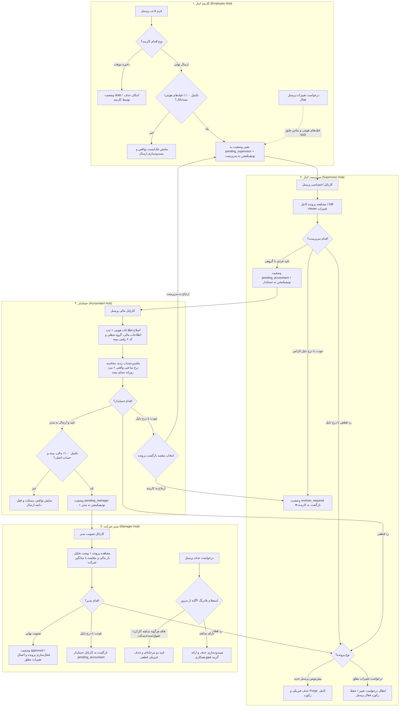

# طرح جامع و تدقیق‌شده بازمهندسی چرخه ثبت پرسنل تا تصویب مدیر
### (منطبق بر فایل اکسل مرجع TirSalary.xlsm، شیت‌های Emp_info، Settings و شیت تیر)

---

## ۱. بازنگری عمیق و اهداف کلان طرح (Audited Goal & Scope)
این طرح با بررسی موشکافانه مجدد کلیه بندهای پرامپت کاربر، اکسل مرجع ([TirSalary.xlsm](file:///e:/warehouse%20project/Documents/SalaryCalculation/TirSalary.xlsm)) و کدهای فعلی فرانت و بک‌اند، چرخه کامل ثبت پرسنل را از نقطه ورود اطلاعات توسط کارمند، تایید میدانی سرپرست، کنترل مالی و بیمه‌ای حسابدار تا تصویب نهایی و فعال‌سازی توسط مدیر بازمهندسی می‌کند.

کلیه ابهامات و ایرادات سیستم فعلی (اختلاط نرخ ساعتی واقعی با مزد روزانه قانون کار، نشت پیش‌نویس ناقص به کارتابل سرپرست، عدم حذف کامل پیش‌نویس در زمان رد، فقدان مدل مستقل چندحسابی، نبود تاریخ اعتبار با معیار ماه محاسباتی، و نقص استعلام عدم سابقه در حذف مدیر) در این طرح برطرف شده است.

---

## ۲. جدول جامع تطبیق ۱۰۰٪ الزامات پرامپت اولیه و راهکارهای اجرایی

| ردیف | موضوع و بند پرامپت | تحلیل وضعیت فعلی و نقص شناسایی‌شده | راهکار دقیق مهندسی در طرح تدقیق‌شده |
| :---: | :--- | :--- | :--- |
| **۱.a** | **استخراج ۴۶ ستون شیت `Emp_info` و تفکیک از کارکرد `تیر`** | ستون‌های هویتی و احکام با کارکرد ماهانه مخلوط شده بودند و برخی فیلدها در مدل وجود نداشتند. | تفکیک قطعی فیلدهای ثابت استخدامی/شناسنامه‌ای در مدل `PersonnelProfile` و فیلدهای متغیر در `DailyAttendance` و `MonthlyPayrollRecord`. |
| **۱.b** | **مقادیر پیش‌فرض کدهای رسمی ۱۲گانه شیت `Settings` با امکان تغییر انفرادی** | کدهای رسمی به صورت ناقص و هاردکد شده بودند. | تعریف مقادیر پیش‌فرض رسمی در مدل و فرم‌ها (ملیت ۱، تابعیت و زندگی ۱۰۳، رسته ۱۵، استخدام ۲، معافیت مالیاتی ۱، پرداختی ۱، محل خدمت ۱، ارز ۸۴، بیمه تامین اجتماعی، تسعیر ۱، استثنائات ۱، مسکن ۱، اتومبیل ۱) با امکان تغییر کامل توسط حسابدار. |
| **۲.a** | **تفکیک حالت پیش‌نویس از ارسال نهایی** | فرم کارمند بدون اعتبارسنجی ۱۰۰٪ ارسال می‌شد یا در صورت نقص ذخیره نمی‌شد. | دکمه «ذخیره موقت پیش‌نویس» (با حداقل نام، نام‌خانوادگی و کد ملی) و قفل شدن دکمه «ارسال به سرپرست» منوط به تکمیل ۱۰۰٪ فیلدهای اجباری بیمه، مالیات، تماس و حساب اصلی. |
| **۲.b** | **تقسیم‌بندی فرم کارمند در ۵ تب ارگونومیک** | فرم در یک اسکرول عمودی طولانی و بی‌پایان ریخته شده بود. | تقسیم فرم به ۵ تب: ۱) فردی/شناسنامه‌ای، ۲) شغلی/استخدامی، ۳) حساب‌های بانکی، ۴) نشانی/تماس/معرف، ۵) مدارک/یادداشت؛ همراه با نشانگر تیک سبز تکمیل هر تب. |
| **۲.c** | **فیلد تاریخ اعتبار با معیار آخرین روز ماه محاسباتی** | فیلد تاریخ اعتبار وجود نداشت و انقضا با تاریخ روز جاری سنجیده می‌شد. | افزودن فیلد شمسی `valid_until_date`؛ سنجش انقضا نسبت به آخرین روز ماه محاسباتی کارکرد یا دیسکت (مثلاً ۳۱ تیر)؛ خالی بودن به معنای بی‌نهایت. |
| **۲.d,e** | **فیلدهای معرف و یادداشت کارمند** | فیلد معرف وجود نداشت و یادداشت‌ها تفکیک نشده بودند. | افزودن فیلدهای `recommender` و `employee_note` به مدل داده و فرم‌ها. |
| **۲.f** | **امکان حذف پیش‌نویس ناقص توسط کارمند** | کارمند امکان حذف پیش‌نویس‌های ایجادشده یا ابطال درخواست تغییرات معلق خود را نداشت. | دکمه اختصاصی حذف پیش‌نویس در جدول و فرم برای خود کارمند در وضعیت `draft`. |
| **۲.g** | **نشانگرهای رنگی وضعیت در منوی کارمند** | وضعیت‌ها نامفهوم یا بدون ذکر دلیل عودت بودند. | نمایش بج‌های رنگی استاندارد (پیش‌نویس، در انتظار سرپرست، حسابدار، مدیر، تاییدشده، نیازمند بازنگری با تولتیپ دلیل، ردشده). |
| **۲.h** | **درخواست تغییرات پرسنل فعال با اصل SoD** | کارمند می‌توانست فیلدهای مالی را دستکاری کند یا تغییر مستقیم اعمال می‌شد. | ایجاد رکورد معلق `PersonnelChangeRequest` با ذخیره مقادیر قبلی/جدید، و قفل بودن فیلدهای مالی و دستمزد برای کارمند طبق SoD. |
| **۲.i,j,k** | **چند حساب بانکی با اعتبارسنجی ایزو ۹۷ و تعیین حساب اصلی** | اطلاعات بانکی تخت و تک‌حسابی در `PersonnelProfile` بودند. | ایجاد مدل رابطه‌ای `PersonnelBankAccount` با پرچم یکتای `is_primary=True`، پشتیبانی از چند رکورد، اعتبارسنجی Mod 97، پیشوند IR، گروه‌بندی ۴ رقمی، استخراج دوطرفه بانک و دکمه ⚡ تبدیل حساب به شبا. |
| **۲.l** | **دکمه‌های کپی یک‌کلیکه شماره حساب، شبا و موبایل** | کپی دستی دشوار بود و بازخورد مناسبی نداشت. | دکمه‌های کپی سریع با بازخورد بصری تیک سبز ۲ ثانیه‌ای در تمام سطرهای جدول و فرم‌ها. |
| **۲.m,n** | **اتوکامپلیت سمت شغلی و اتصال به کد ۶ رقمی شغل تامین اجتماعی** | سمت شغلی متنی آزاد بود و کدهای شغل استاندارد تامین اجتماعی وجود نداشتند. | ایجاد مدل `InsuranceJobTitle` و اندپوینت جستجوی زنده سمت‌ها به همراه پر شدن خودکار کد ۶ رقمی استاندارد بیمه. |
| **۲.o** | **ورود و خروج اکسل ۲ سطری (فریز A3)** | اکسل فاقد هدر ۲ سطری هماهنگ بود. | خروجی و ورودی منطبق بر شیت `Emp_info` اکسل مرجع با ۲ سطر هدر (فارسی و کلید انگلیسی) و فریز روی A3. |
| **۲.p** | **وب‌سوکت بلادرنگ و نوتیفیکیشن اختصاصی با لینک** | تغییرات نیازمند رفرش صفحه بود و اعلانی ارسال نمی‌شد. | برودکست رویدادهای پرسنل و ایجاد رکورد در جدول `Notification` با پیام فارسی و لینک مستقیم به کارتابل کاربر مقصد. |
| **۲.q,r,s** | **پایداری آفلاین، امنیت RBAC و دیزاین سیستم** | خطاهای قرمز مسدودکننده و ناهماهنگی گرافیکی وجود داشت. | اعمال `SKIP_GLOBAL_ERROR_TOAST: true`، هدر چسبان، فونت وزیرمتن محلی و آیکون‌های استاندارد appIcon. |
| **۲.t** | **اعتبارسنجی بلادرنگ کد ملی و استعلام سابقه قبلی** | کنترل رقم دهم صرفاً سمت سرور بود و استعلام سابقه‌ای وجود نداشت. | اعتبارسنجی الگوریتم ۱۰ رقمی در فرانت و استعلام بلادرنگ سابقه در دیتابیس شرکت/سیستم جهت بازیابی داده‌ها یا هشدار تکراری. |
| **۲.u,v,w** | **نمای کارتی موبایل، تایملاین گردش کار، ولیدیشن کدپستی/موبایل و پیش‌نمایش مدارک** | جدول در موبایل اسکرول افقی می‌خورد و مدارک پیش‌نمایش نداشتند. | کارت‌های ارگونومیک موبایل با همان متدهای TS، تایملاین بصری مراحل، پاکسازی ارقام فارسی/عربی، و لایت‌باکس پیش‌نمایش تصویر مدارک. |
| **۳** | **کارتابل سرپرست (تفکیک از ناوگان، مشاهده پرونده، اختیارات ۳گانه، تایید گروهی)** | منو با ناوگان مخلوط بود؛ پیش‌نویس‌ها نشت می‌کردند؛ رد پرونده منجر به حذف نمی‌شد. | تفکیک قطعی مسیر از ناوگان؛ حذف رکوردهای `draft` از کارتابل سرپرست؛ مودال مشاهده پرونده کامل؛ عودت با دلیل به کارمند؛ **رد قطعی با Purge کامل پیش‌نویس**؛ تایید گروهی (Batch Approval). |
| **۴** | **کارتابل حسابدار (تفکیک ناوگان، تفکیک نرخ ساعتی، ویرایش هویتی/مالی، ماشین‌حساب)** | نرخ ساعتی به اشتباه از مزد قانون کار مشتق می‌شد؛ منو با ناوگان مشترک بود؛ ماشین‌حسابی وجود نداشت. | تفکیک منو از ناوگان؛ **تفکیک مطلق نرخ ساعتی واقعی ($\frac{\text{حقوق قرارداد}}{\text{ساعت قرارداد}}$) از مزد روزانه بیمه**؛ دسترسی کامل به ویرایش هویتی/مالی؛ ماشین‌حساب زنده فرم؛ قفل ارسال تا تکمیل ۱۰۰٪؛ عودت با انتخاب مقصد (کارمند یا سرپرست). |
| **۵** | **کارتابل مدیر (تصویب نهایی، عودت به حسابدار، استعلام ۴گانه عدم سابقه برای حذف، ویجت بار مالی)** | حذف فیزیکی بدون کنترل اسناد مالی انجام می‌شد و ابزار تحلیلی وجود نداشت. | تصویب نهایی؛ عودت به حسابدار با درج دلیل؛ **استعلام بلادرنگ ۴گانه (تردد، فیش، سند مالی، دیسکت) پیش از حذف فیزیکی**؛ مسدودسازی حذف در صورت وجود سابقه؛ **ویجت تحلیل بار مالی پرسنل جدید** در مودال تایید. |

---

## ۳. معماری جامع جریان کار و انتقال حالات (Enterprise State Machine)

---

## ۴. برنامه فازبندی‌شده تدقیق‌شده در ۱۰ فاز و ۴۸ تسک اجرایی (48 Detailed Tasks)

### فاز ۱: توسعه مدل‌های داده پایگاه داده و مایگریشن‌ها (Backend Models & Migrations)
- [ ] **تسک ۱.۱:** ایجاد مدل رابطه‌ای `PersonnelBankAccount` در `warehouse-backend/personnel/models.py` با فیلدهای `personnel` (FK), `bank_name`, `account_number`, `sheba_number`, `card_number`, `is_primary` (BooleanField), `description` و متد اعتبارسنجی یکتایی حساب اصلی. <!-- id: 1.1 -->
- [ ] **تسک ۱.۲:** ایجاد مدل سمت‌های استاندارد `InsuranceJobTitle` با فیلدهای `title`, `job_code` (کد ۶ رقمی بیمه), `is_active` و ثبت در ادمین جنگو. <!-- id: 1.2 -->
- [ ] **تسک ۱.۳:** افزودن فیلدهای جدید `valid_until_date` (شمسی YYYY/MM/DD), `recommender` (مشخصات معرف), `employee_note`, `supervisor_note`, `accountant_note` به مدل `PersonnelProfile`. <!-- id: 1.3 -->
- [ ] **تسک ۱.۴:** افزودن مقادیر پیش‌فرض ۱۲گانه مالیاتی شیت `Settings` اکسل به `PersonnelProfile` (ملیت ۱، تابعیت و زندگی ۱۰۳، رسته ۱۵، استخدام ۲، معافیت ۱، پرداختی ۱، محل خدمت ۱، ارز ۸۴، بیمه تامین اجتماعی، تسعیر ۱، استثنائات ۱، مسکن ۱، اتومبیل ۱). <!-- id: 1.4 -->
- [ ] **تسک ۱.۵:** تفکیک و پیاده‌سازی پراپرتی `real_hourly_rate` برابر با $\frac{\text{contract\_base\_salary}}{\text{contract\_hours}}$ و تفکیک آن از مزد روزانه قانون کار در `PersonnelProfile`. <!-- id: 1.5 -->
- [ ] **تسک ۱.۶:** ایجاد پراپرتی‌های سازگاری رو به عقب روی `PersonnelProfile` (`primary_bank_account`, `sheba_number`, `account_number`, `bank_name`, `card_number`) جهت تضمین عدم شکست در سرویس‌های موجود. <!-- id: 1.6 -->
- [ ] **تسک ۱.۷:** ایجاد مایگریشن اسکیما (`makemigrations`) و مایگریشن داده‌ای خودکار برای انتقال اطلاعات بانکی تمام پرسنل موجود به جدول جدید با `is_primary=True`. <!-- id: 1.7 -->
- [ ] **تسک ۱.۸:** اسکریپت پیش‌بارگذاری داده‌های پایه ۱۰ سمت شغلی استاندارد استخراج‌شده از اکسل مرجع (`TirSalary.xlsm`). <!-- id: 1.8 -->

### فاز ۲: موتورهای اعتبارسنجی، استعلام سابقه و امنیت داده در بک‌اند (Integrity & Validation Engines)
- [ ] **تسک ۲.۱:** پیاده‌سازی سرویس اعتبارسنجی تاریخ انقضای شمسی (`validate_personnel_validity`): مقایسه `valid_until_date` با آخرین روز ماه محاسباتی کارکرد یا دیسکت و پرتاب خطای مانع صدور در صورت انقضا. <!-- id: 2.1 -->
- [ ] **تسک ۲.۲:** پیاده‌سازی اندپوینت و سرویس استعلام بلادرنگ کد ملی (`/api/personnel/lookup-national-code/`): اعتبارسنجی رقم دهم و استعلام سابقه قبلی در دیتابیس سیستم جهت بازیابی داده‌ها یا هشدار تکراری. <!-- id: 2.2 -->
- [ ] **تسک ۲.۳:** پیاده‌سازی سرویس جامع استعلام ۴گانه عدم سابقه پرسنل (`check_personnel_has_movements`): کنترل تردد در `DailyAttendance`، فیش در `MonthlyPayrollRecord`، سند در `AccountingEvent` و لاگ‌های دیسکت. <!-- id: 2.3 -->
- [ ] **تسک ۲.۴:** بازنویسی اکشن `destroy` در `PersonnelProfileViewSet` با پرمیشن مدیر (`perm_delete_personnel_nomovement`) و استعلام ۴گانه. <!-- id: 2.4 -->
- [ ] **تسک ۲.۵:** ایجاد اندپوینت اختصاصی استعلام قابلیت حذف برای فرانت‌اند مدیر (`/api/personnel/profiles/{id}/can-delete/`). <!-- id: 2.5 -->

### فاز ۳: بازنگری موتور ماشین حالت و گردش کار ۵ سطحی (Workflow & State Machine Core)
- [ ] **تسک ۳.۱:** اصلاح متد `reject_workflow` در `workflow_engine.py`: حذف فیزیکی و Purge کامل پیش‌نویس اولیه در برابر ابطال صرف برای درخواست‌های تغییرات معلق پرسنل فعال. <!-- id: 3.1 -->
- [ ] **تسک ۳.۲:** بازمهندسی متد `request_workflow_revision`: عودت مدیر به حسابدار، و عودت منعطف حسابدار به کارمند یا سرپرست همراه با ثبت لاگ ممیزی کامل در `WorkflowAuditLog`. <!-- id: 3.2 -->
- [ ] **تسک ۳.۳:** حذف قطعی وضعیت `WorkflowStatuses.DRAFT` از کوئری کارتابل سرپرست در `SupervisorCartableAPIView`. <!-- id: 3.3 -->
- [ ] **تسک ۳.۴:** اعمال محدودیت‌های تفکیک وظایف (SoD) در `PersonnelChangeRequestViewSet` جهت مسدودسازی دستکاری فیلدهای مالی توسط کارمند. <!-- id: 3.4 -->
- [ ] **تسک ۳.۵:** پیاده‌سازی متدهای تایید دسته‌جمعی (`batch_advance_workflow_step`) در `workflow_engine.py` با قفل اتمیک `select_for_update()`. <!-- id: 3.5 -->

### فاز ۴: پایپ‌لاین نوتیفیکیشن‌های هدفمند و وب‌سوکت بلادرنگ (Real-Time Notifications)
- [ ] **تسک ۴.۱:** پیاده‌سازی تابع کمکی `dispatch_workflow_notification` در بک‌اند با ایجاد رکورد در جدول `Notification` و ارسال پکت کانال لایر جنگو. <!-- id: 4.1 -->
- [ ] **تسک ۴.۲:** اتصال انتقال وضعیت‌های گردش کار (ارسال کارمند، تایید سرپرست، تایید حسابدار، تصویب مدیر، عودت، رد) به سیستم نوتیفیکیشن همراه با متن فارسی و لینک اختصاصی به کارتابل کاربر مقصد. <!-- id: 4.2 -->
- [ ] **تسک ۴.۳:** بهینه‌سازی پی‌لود برودکست وب‌سوکت `personnel_events` جهت بروزرسانی نرم جدول و شمارنده‌ها در کلاینت بدون رفرش کل صفحه. <!-- id: 4.3 -->

### فاز ۵: استانداردسازی ایمپورت/اکسپورت اکسل ۲ سطری و اندپوینت‌ها (Excel & API Endpoints)
- [ ] **تسک ۵.۱:** ایجاد ویوست و سریالایزر کامل برای `PersonnelBankAccount` (`/api/personnel/profiles/{id}/bank-accounts/`) با متدهای CRUD و تغییر حساب اصلی. <!-- id: 5.1 -->
- [ ] **تسک ۵.۲:** اندپوینت اختصاصی واکشی و جستجوی سمت‌های شغلی استاندارد (`/api/personnel/job-titles/`) با کد ۶ رقمی تامین اجتماعی. <!-- id: 5.2 -->
- [ ] **تسک ۵.۳:** بازنویسی اکشن `export-excel` پرسنل با هدر ۲ سطری (سطر ۱ فارسی، سطر ۲ کلید دیتابیس)، فریز A3 و پوشش تمام ۴۶ فیلد شیت `Emp_info`. <!-- id: 5.3 -->
- [ ] **تسک ۵.۴:** به‌روزرسانی اکشن `import-excel` پرسنل جهت پذیرش خروجی تولیدشده به عنوان فایل ورودی نمونه با پردازش ایمن حساب‌های بانکی. <!-- id: 5.4 -->

### فاز ۶: بازطراحی فرم ثبت پرسنل کارمند در فرانت‌اند (Employee Hub - Form & Tabs)
- [ ] **تسک ۶.۱:** بازطراحی فرم مودال در [employee-new-personnel.html](file:///e:/warehouse%20project/warehouse-front/src/app/components/finance/employee/employee-new-personnel/employee-new-personnel.html) در قالب ۵ تب ارگونومیک (هویتی، شغلی، بانکی، نشانی/معرف، مدارک/یادداشت) با نشانگر تیک سبز تکمیل هر تب. <!-- id: 6.1 -->
- [ ] **تسک ۶.۲:** پیاده‌سازی لاجیک تمیزکاری خودکار ارقام فارسی/عربی (`normalizeDigits`) برای تمام فیلدها. <!-- id: 6.2 -->
- [ ] **تسک ۶.۳:** اتصال فیلد کد ملی به سرویس اعتبارسنجی رقم دهم و استعلام بلادرنگ سابقه در دیتابیس با بازیابی سریع اطلاعات در صورت وجود پرونده قبلی. <!-- id: 6.3 -->
- [ ] **تسک ۶.۴:** کامپوننت مدیریت حساب‌های بانکی چندگانه با تعیین حساب اصلی، ماسک شبا، دکمه ⚡ تبدیل حساب به شبا و کپی یک‌کلیکه. <!-- id: 6.4 -->
- [ ] **تسک ۶.۵:** اتصال فیلد سمت شغلی به اندپوینت اتوکامپلیت سمت‌ها با پر شدن خودکار کد ۶ رقمی بیمه. <!-- id: 6.5 -->
- [ ] **تسک ۶.۶:** پیاده‌سازی لایت‌باکس پیش‌نمایش تصویر مدارک آپلودشده (کارت ملی، شناسنامه، قرارداد) قبل از ارسال. <!-- id: 6.6 -->
- [ ] **تسک ۶.۷:** تفکیک دکمه «ذخیره موقت پیش‌نویس» از «ارسال جهت تایید سرپرست» (منوط به اعتبارسنجی ۱۰۰٪ فیلدهای اجباری) و دکمه «حذف پیش‌نویس». <!-- id: 6.7 -->

### فاز ۷: تکمیل کارتابل و جدول کارمند در فرانت‌اند (Employee Hub - List, Mobile & SoD)
- [ ] **تسک ۷.۱:** بازطراحی جدول پرسنل بخش با نشانگرهای رنگی وضعیت، تایملاین بصری گردش کار، و دکمه‌های کپی سریع شبا، حساب و موبایل با تیک سبز ۲ ثانیه‌ای. <!-- id: 7.1 -->
- [ ] **تسک ۷.۲:** پیاده‌سازی فرم درخواست تغییرات پرسنل فعال با قفل بودن فیلدهای مالیاتی و دستمزد (پایبندی به SoD) و ارسال رکورد معلق به `PersonnelChangeRequest`. <!-- id: 7.2 -->
- [ ] **تسک ۷.۳:** بازطراحی کارت‌های نمای موبایل با دکمه‌های عملیاتی استاندارد ۳۶px بدون اسکرول افقی. <!-- id: 7.3 -->
- [ ] **تسک ۷.۴:** اتصال کامل به وب‌سوکت و بروزرسانی بلادرنگ جدول و شمارنده‌ها. <!-- id: 7.4 -->

### فاز ۸: بازطراحی کارتابل سرپرست در فرانت‌اند (Supervisor Hub)
- [ ] **تسک ۸.۱:** تفکیک قطعی روت و کامپوننت [supervisor-personnel](file:///e:/warehouse%20project/warehouse-front/src/app/components/finance/supervisor/supervisor-personnel/supervisor-personnel.ts) از کارتابل ناوگان. <!-- id: 8.1 -->
- [ ] **تسک ۸.۲:** پاکسازی رکوردهای `draft` از کارتابل سرپرست و نمایش ساب‌تب‌های شفاف. <!-- id: 8.2 -->
- [ ] **تسک ۸.۳:** پیاده‌سازی مودال مشاهده پرونده کامل پرسنل (شامل تمام مشخصات، تاریخ اعتبار، معرف و مدارک) و مودال Diff Viewer تغییرات. <!-- id: 8.3 -->
- [ ] **تسک ۸.۴:** بازطراحی مودال‌های عملیاتی سرپرست: تایید با یادداشت اختیاری (`supervisor_note`)، عودت با الزام درج دلیل به کارمند، و رد قطعی با اخطار حذف دائم رکورد. <!-- id: 8.4 -->
- [ ] **تسک ۸.۵:** پیاده‌سازی قابلیت تایید گروهی (Batch Approval) با چک‌باکس انتخاب سطرها و شمارنده. <!-- id: 8.5 -->
- [ ] **تسک ۸.۶:** بهینه‌سازی نمای موبایل و اکشن‌های سریع در کارت‌های موبایلی سرپرست. <!-- id: 8.6 -->

### فاز ۹: بازطراحی کارتابل حسابدار در فرانت‌اند (Accountant Hub)
- [ ] **تسک ۹.۱:** تفکیک کامل کامپوننت [accountant-personnel](file:///e:/warehouse%20project/warehouse-front/src/app/components/finance/accountant/accountant-personnel/accountant-personnel.ts) از اسناد ناوگان. <!-- id: 9.1 -->
- [ ] **تسک ۹.۲:** توسعه ماشین‌حساب آنلاین در فرم بررسی مالی پرسنل: نمایش زنده نرخ ساعتی واقعی ($\frac{\text{حقوق}}{\text{ساعت}}$) در کنار مزد روزانه قانون کار و برآورد ناخالص حقوق. <!-- id: 9.2 -->
- [ ] **تسک ۹.۳:** امکان ویرایش و اصلاح فیلدهای هویتی و مالی توسط حسابدار با ذخیره یادداشت حسابدار (`accountant_note`). <!-- id: 9.3 -->
- [ ] **تسک ۹.۴:** الزامی کردن کد ۶ رقمی شغل تامین اجتماعی و اتصال به سمت شغلی جهت سلامت دیسکت بیمه. <!-- id: 9.4 -->
- [ ] **تسک ۹.۵:** قفل شدن دکمه «ارسال به مدیر» در صورت نقص هر یک از فیلدهای الزامی بیمه/مالیات یا عدم وجود حساب اصلی. <!-- id: 9.5 -->
- [ ] **تسک ۹.۶:** بازطراحی مودال عودت با قابلیت انتخاب مقصد بازگشت پرونده (به کارمند یا به سرپرست) همراه با درج دلیل الزامی. <!-- id: 9.6 -->
- [ ] **تسک ۹.۷:** پشتیبانی از تایید گروهی و بهینه‌سازی ارگونومی جدول و نمای موبایل حسابدار. <!-- id: 9.7 -->

### فاز ۱۰: بازطراحی کارتابل مدیر و تست‌های جامع یکپارچگی (Manager Hub & Verification)
- [ ] **تسک ۱۰.۱:** پیاده‌سازی ویجت تحلیل بار مالی (Financial Impact Widget) در مودال تایید مدیر [manager-personnel](file:///e:/warehouse%20project/warehouse-front/src/app/components/finance/manager/manager-personnel/manager-personnel.ts) (نمایش حقوق، برآورد ناخالص، حق بیمه کارفرما ۲۰٪ و مقایسه با میانگین شرکت). <!-- id: 10.1 -->
- [ ] **تسک ۱۰.۲:** پیاده‌سازی مودال تایید و مودال عودت مدیر (با بازگشت به کارتابل حسابدار) همراه با درج دلیل. <!-- id: 10.2 -->
- [ ] **تسک ۱۰.۳:** پیاده‌سازی ابزار حذف پرسنل بدون سابقه در منوی مدیر با استعلام بلادرنگ ۴گانه و مسدودسازی هوشمند در صورت وجود سابقه. <!-- id: 10.3 -->
- [ ] **تسک ۱۰.۴:** تست جامع چرخه کامل گردش کار (End-to-End Workflow Verification) در تمام نقش‌ها و سناریوهای تایید، عودت، رد، انقضای تاریخ اعتبار و حذف. <!-- id: 10.4 -->
- [ ] **تسک ۱۰.۵:** اجرای اسکریپت‌های بررسی نگهبان‌ها (Guardian Test Suite) و ساخت بیلد نهایی بدون نقص فرانت‌اند. <!-- id: 10.5 -->

