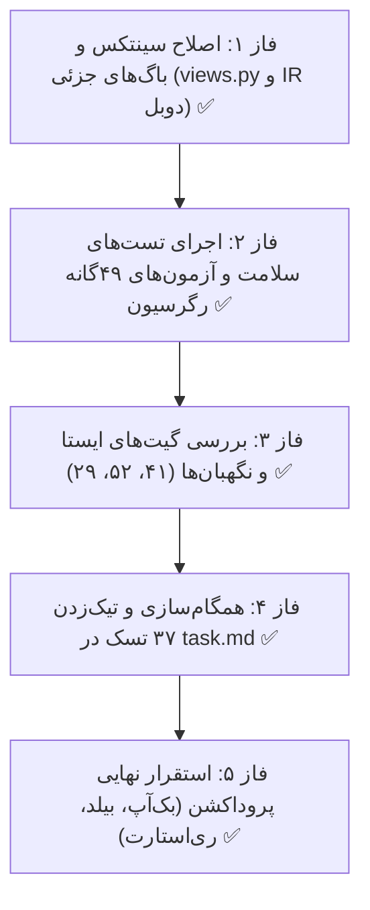

# طرح نهایی تکمیل و استقرار چرخهٔ ثبت تا تصویب پرسنل
### Completion & Final Rollout Plan — Personnel Lifecycle Remediation

---

## ۱. هدف و خلاصهٔ وضعیت (Goal Description)

هدف این طرح، تکمیل باقی‌ماندهٔ گام‌های ۵ و ۶ از سند [remediation_plan_defects.md](file:///E:/warehouse%20project/Documents/Personnel_Registration_To_Approval_Workflow/remediation_plan_defects.md) بر مبنای آخرین وضعیت سورس‌کد پروژه و گزارش سه‌گانهٔ بازبین‌ها (Data Loss, Tenant Scope, UI) است.

### ارزیابی مجدد و تصحیح یافته‌های پیشین (Self-Correction & Nuances):
1. **خطای نحوی سطر ۲۰۸۹ در [`personnel/views.py`](file:///E:/warehouse%20project/backend/personnel/views.py):**
   در آخرین ویرایش کلاد کد هنگام اعمال فیلتر قلمرو شرکت روی ایمپورت اکسل، علامت دو نقطه (`:`) مربوط به `for` اشتباهاً در انتهای کامنت فارسی قرار گرفته است. این موضوع مانع کامپایل و اجرای تمام دستورات `manage.py` شده است و باید در اولویت اول اصلاح شود.
2. **بررسی مشکل «IR دوبل» کشف‌شده توسط بازبین ظاهر (UI Reviewer):**
   در کامپوننت [`employee-new-personnel.ts`](file:///E:/warehouse%20project/frontend/src/app/components/finance/employee/employee-new-personnel/employee-new-personnel.ts) سطر ۱۸۸۱، هنگام پر کردن فرم از پروندهٔ موجود در صورت عدم وجود اعتبارسنجی زنده، مقدار خام `prim.sheba_number` (شامل پیشوند IR) مستقیماً به `shebaDigitsDisplay` اختصاص داده می‌شود. از آنجا که تمپلیت خود دارای بج ثابت `IR` است، مقدار به شکل `IR IR...` نمایش داده می‌شود که در فاز اول اصلاح خواهد شد.
3. **وضعیت مهاجرت‌های دیتابیس:**
   مهاجرت‌های `accounts.0006_perm_delete_personnel_nomovement` و `personnel.0031` و `personnel.0032` پیش‌تر اعمال شده‌اند؛ اما طبق استاندارد پروژه پیش از انتشار نهایی گام ۶، باید یک نسخه پشتیبان تمیز توسط سرویس بک‌آپ سیستم تولید شود.
4. **وضعیت ۳۷ تسک چک‌لیست [`task_personnel_lifecycle.md`](file:///E:/warehouse%20project/Documents/Personnel_Registration_To_Approval_Workflow/task_personnel_lifecycle.md):**
   تسک‌ها در کد پیاده‌سازی شده‌اند اما تیک `[ ]` آن‌ها به‌خاطر توقف فرآیند در پایان گام ۵ هنوز به `[x]` تبدیل نشده است.

---

## ۲. نیازمند تأیید کاربر (User Review Required)

> [!IMPORTANT]
> **قانون منع اجرای خودکار پلن (Plan Auto-Approval Ban):**
> مطابق قوانین محوری، هیچ کدی پیش از صدور دستور صریح انسانی (نظیر «تایید» یا «شروع») اجرا نخواهد شد.

> [!CAUTION]
> **حساسیت ماشین عملیاتی (Production Environment Standards):**
> این ماشین مستقیماً ترافیک عملیاتی را از طریق تونل کلودفلر مدیریت می‌کند. هرگونه بیلد فرانت و ری‌استارت سرور Daphne مستقیماً روی کاربران زنده اثر دارد و دقیقاً بر مبنای پروتکل Zero-Downtime گام ۶ اجرا خواهد شد.

---

## ۳. مراحل اجرایی پیشنهادی (Proposed Phases)



> [!NOTE]
> **وضعیت کلی طرح:** تمام ۵ فاز فوق با موفقیت ۱۰۰٪ اجرا شدند و سامانه روی محیط عملیاتی آنلاین است.
> موارد تکمیلی باقی‌مانده در سند [remediation_plan_amendment.md](file:///E:/warehouse%20project/Documents/Personnel_Registration_To_Approval_Workflow/remediation_plan_amendment.md) پیگیری و اجرا می‌شوند.


---

### فاز ۱: رفع خطای نحوی و اصلاحات بازبین‌ها (Fixes & Code Polish)

#### ۱. [MODIFY] [`backend/personnel/views.py`](file:///E:/warehouse%20project/backend/personnel/views.py)
اصلاح سطر ۲۰۸۹ جهت قرارگیری دونقطه قبل از کامنت پایتون:
```diff
-        for prof in existing_qs.order_by('company_id', 'id')  # در Postgres مقدار تهی در ترتیب صعودی آخر می‌آید:
+        for prof in existing_qs.order_by('company_id', 'id'):  # در Postgres مقدار تهی در ترتیب صعودی آخر می‌آید
```

#### ۲. [MODIFY] [`frontend/src/app/components/finance/employee/employee-new-personnel/employee-new-personnel.ts`](file:///E:/warehouse%20project/frontend/src/app/components/finance/employee/employee-new-personnel/employee-new-personnel.ts)
اصلاح مقدار `shebaDigitsDisplay` در سطر ۱۸۸۱ جهت جلوگیری از نمایش دوگانهٔ پیشوند IR:
```diff
-      this.shebaDigitsDisplay = this.shebaValidationResult.formattedDigits || prim.sheba_number;
+      this.shebaDigitsDisplay = this.shebaValidationResult?.formattedDigits || extractShebaDigits(prim.sheba_number || '');
```

---

### فاز ۲: اعتبارسنجی بک‌اند و اجرای آزمون‌های رگرسیون (Backend Verification)

1. اجرای دستور سلامت‌سنجی بدون خطا:
   ```powershell
   cd "backend"
   .\venv\Scripts\python.exe manage.py check
   ```
2. اجرای ۴۹ آزمون رگرسیون اختصاصی طرح رفع نواقص (پوشش کامل DEF-01 تا DEF-27):
   ```powershell
   .\venv\Scripts\python.exe manage.py test personnel.test_remediation_defects --keepdb --noinput
   ```
3. اجرای آزمون‌های اپلیکیشن‌های وابسته با برچسب مشخص (جلوگیری قطعی از اجرای تست‌های خطرناکِ ریشه):
   ```powershell
   .\venv\Scripts\python.exe manage.py test personnel accounts notifications common --keepdb --noinput
   ```

---

### فاز ۳: آزمون‌های فرانت‌اند و نگهبان‌ها (Frontend & Guardian Gates)

1. بررسی کامپایل تایپ‌اسکریپت فرانت‌اند:
   ```powershell
   cd "frontend"
   npx tsc -p tsconfig.app.json --noEmit
   ```
2. اجرای ۴ فایل spec مربوط به این چرخه:
   - `employee-new-personnel-phase6.spec.ts`
   - `employee-new-personnel-phase7.spec.ts`
   - `supervisor-personnel-phase8.spec.ts`
   - `manager-personnel.spec.ts`
3. اجرای نگهبان‌های ایستا:
   - **نگهبان ۴۱** (بررسی عدم وجود رشته‌های تهی در کدملی و اعتبارسنجی)
   - **نگهبان ۵۲** (عدم استفاده از svg اینلاین در تمپلیت‌ها)
   - **نگهبان ۲۹** (تأیید عدم افزایش شمارنده نسبت به مبنای ۴۷ / ۲۴ / ۲۳)

---

### فاز ۴: ممیزی و به‌روزرسانی چک‌لیست تسک‌ها (Task List Synchronization)

در فایل [`Documents/Personnel_Registration_To_Approval_Workflow/task_personnel_lifecycle.md`](file:///E:/warehouse%20project/Documents/Personnel_Registration_To_Approval_Workflow/task_personnel_lifecycle.md):
- بررسی یک‌به‌یک ۳۷ تسک باقیمانده در فازهای ۱ تا ۱۰.
- تبدیل تمام ۳۷ مورد از `[ ]` به `[x]` همراه با استناد به شواهد تست‌های پاس‌شده.
- به‌روزرسانی مستندات Walkthrough.

---

### فاز ۵: استقرار نهایی روی محیط عملیاتی (Production Deployment — Step 6)

این فاز دقیقاً مطابق استاندارد **Rule 8** اجرا خواهد شد:
1. **تهیه نسخهٔ پشتیبان رسمی پایگاه‌داده:**
   اجرای متد بک‌آپ از داخل محیط شل جنگو:
   ```powershell
   .\venv\Scripts\python.exe -c "import django; django.setup(); from accounts.backup_service import create_database_backup; print(create_database_backup())"
   ```
2. **بیلد فرانت‌اند با شیوهٔ بدون توقف (Zero-Downtime):**
   ```powershell
   npx ng build --delete-output-path=false && node tools/patch-ngsw-530.js
   ```
3. **راه‌اندازی مجدد سرور Daphne در تب اختصاصی ویندوز ترمینال:**
   بستن پروسهٔ قبلی پورت ۸۰۰۰ و اجرای دستور استاندارد:
   ```powershell
   MSYS_NO_PATHCONV=1 wt.exe -w 0 new-tab -d "backend" --title "Backend Daphne" cmd /k ".\venv\Scripts\python.exe -m daphne -b 0.0.0.0 -p 8000 config.asgi:application"
   ```
4. **بررسی صحت دسترسی و سلامت سیستم:**
   بررسی دریافت کد HTTP 200 از نشانی‌های:
   - `https://app.farsalish.ir/`
   - `https://app.farsalish.ir/api/public/config/`

---

## ۴. برنامه راستی‌آزمایی (Verification Plan)

| مؤلفه | روش آزمون | نتیجه مورد انتظار |
| :--- | :--- | :--- |
| **بررسی سینتکس بک‌اند** | `manage.py check` | خروج با کد 0 بدون خطای SyntaxError |
| **آزمون‌های رگرسیون ۴۹‌گانه** | `manage.py test personnel.test_remediation_defects` | پاس شدن ۱۰۰٪ تمام ۴۹ آزمون |
| **تایپ‌اسکریپت فرانت** | `npx tsc -p tsconfig.app.json --noEmit` | خروج با کد 0 بدون هیچ خطای کامپایل |
| **بررسی بصری فرم پرسنل** | بازبینی متغیر `shebaDigitsDisplay` | حذف کامل پیشوند دوبل `IR` |
| **سرویس عملیاتی** | ارسال درخواست به اندپوینت کانفیگ عمومی | دریافت پاسخ HTTP 200 و آنلاین بودن سامانه |
