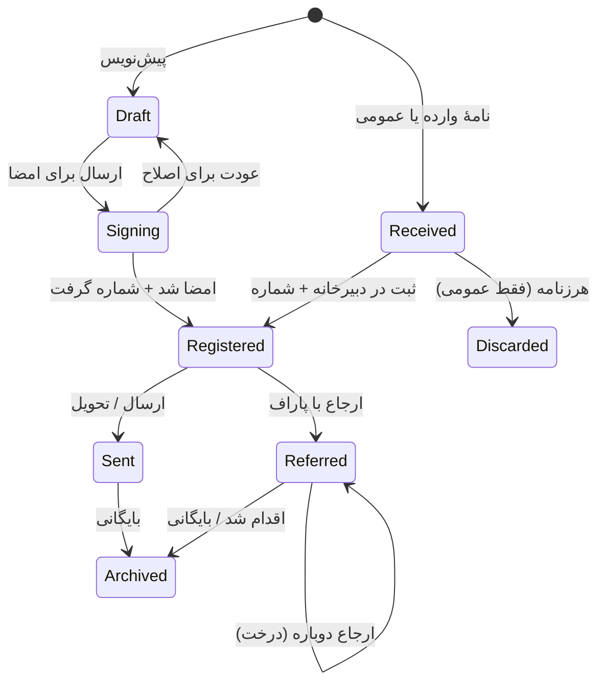

# نیازهای ماژول نامه‌ها از هسته (ورودی طرح‌های ۲.۶، ۲.۸ و بقیهٔ مرحلهٔ ۲)

- **تاریخ:** ۳ آبان ۱۴۰۵ (۲۵ اکتبر ۲۰۲۶)
- **نویسنده:** Antigravity، به درخواست کاربر.
- **وضعیت:** پیش‌نویس برای بررسی کاربر و Claude. **طرح اجرایی نیست** و هیچ کدی بر پایه‌اش تغییر نکرده است.
- **بررسی Claude (۳ آبان ۱۴۰۵):** پیشنهادهای بخش ۵ با اصلاح در طرح مادر آمد (جدول مرحلهٔ ۲ با ردیف تازهٔ ۲.۳-و، مرحلهٔ ۳، بخش ۵ و گزارش پیشرفت). هر جا این سند با طرح مادر فرق دارد، طرح مادر ملاک است.
- **مبنا:** طرح مادر ([release_v1_master_plan.md](../release_v1_master_plan.md))، بند ق۱ و بخش ۵؛ طرح ۲.۳ (بخش ۶، «بعد از نسخهٔ اول»)؛ کد فعلی هسته (`backend/core`)؛ پاسخ‌های کاربر در گفتگوی ۳ آبان ۱۴۰۵.

## ۰. این سند برای چیست

- طبق طرح مادر، ماژول نامه‌ها **بعد از نسخهٔ اول** ساخته می‌شود. اما ق۱ می‌گوید هسته باید طوری ساخته شود که این ماژول بعداً **بدون تغییر هسته** روی آن بنشیند.
- زیرمرحله‌های ۲.۵ تا ۲.۸ هنوز طرح جزئی ندارند. این سند فهرست می‌کند که نامه‌ها از هر بخش هسته چه می‌خواهند. هر طرح جزئی بند مربوط به خودش را از این‌جا برمی‌دارد.
- چیزهای خاص نامه، مثل دبیرخانه، قالب نامه، درخت ارجاع در صفحه و فرم عمومی، داخل خود ماژول ساخته می‌شوند و این‌جا فقط برای روشن شدن تصویر آمده‌اند.

## ۱. تصمیم‌های کاربر (۳ آبان ۱۴۰۵)

| موضوع | تصمیم |
|---|---|
| نوع نامه‌ها | همه: صادره، وارده (اسکن و ثبت)، داخلی، صورت‌جلسه، بخشنامه |
| دبیرخانه | هر شرکت یک دبیرخانه |
| شمارهٔ نامه | پیشوند + سال + شمارهٔ پشت‌سرهم، مثل `۱۴۰۵/ص/۱۲۳`؛ هر نوع نامه جدا شمرده می‌شود |
| ارجاع | آزاد: هر گیرنده با دستور (پاراف) به یک یا چند نفر ارجاع می‌دهد و درخت ارجاع ساخته می‌شود |
| امضا | برای هر نامه کاربر انتخاب می‌کند: **امضای الکترونیکی** (تصویر امضا و مهر روی PDF) یا **چاپ و امضا و مهر زنده** (نسخهٔ امضاشده اسکن و پیوست می‌شود) |
| قابلیت‌های نسخهٔ اول ماژول | همه: سربرگ و قالب چاپ PDF، رونوشت، سطح محرمانگی، «پیرو» و «بازگشت به»، پیوند به سند دیگر (فاکتور، قرارداد)، پیش‌نویس و ویرایش گروهی، مهلت پاسخ و یادآوری |
| مخاطبان بیرونی | کاربر در پاسخ این سؤال، قابلیت «ارسال نامهٔ عمومی از سایت» را مطرح کرد؛ پیشنهاد دفترچهٔ مخاطب مشترک در بند ۳-ی و طرح نامهٔ عمومی در بخش ۴ آمده است |
| نامهٔ عمومی از سایت | کاربر می‌خواهد مردم و شرکت‌ها از راه آدرس سایت به شرکت نامه بزنند. بررسی و طرح پیشنهادی در بخش ۴ آمده است |

## ۲. تصویر کوتاه ماژول

- شماره فقط هنگام **ثبت** داده می‌شود، نه در پیش‌نویس. پس نامهٔ پیش‌نویس می‌تواند آفلاین ساخته شود، ولی شماره هرگز آفلاین داده نمی‌شود.
- بعد از ثبت، متن و پیوست‌های اصلی نامه دیگر عوض نمی‌شوند. اصلاح فقط با نامهٔ تازه («پیرو» یا «اصلاحیه») انجام می‌شود.

## ۳. فاصلهٔ هستهٔ فعلی با نیاز نامه‌ها

ستون «وضعیت فعلی» از خواندن کد در ۳ آبان ۱۴۰۵ آمده است.

### ۳-الف. گردش کار (۲.۳، انجام‌شده)

نامه دو فاز متمایز دارد: **فاز ۱ (پیش از ثبت — امضا)** که خطی است و به صدور شماره و قفل شدن نامه می‌انجامد، و **فاز ۲ (پس از ثبت — درخت ارجاع)** که باز، موازی و چندشاخه‌ای است.

| نیاز نامه | وضعیت فعلی در کد (`core/workflow`) | فاصله |
|---|---|---|
| **امضاکنندهٔ انتخابی (شخص‌محور):** امضاکننده‌ها یا گیرندگان ارجاع برای هر نامه به‌صورت شخص انتخاب می‌شوند، نه با نقش ثابت بخش | `StepSpec` فقط `role` و `permission` دارد (`registry.py`) و `recompute_open_tasks` (`recompute.py`) در هر تغییر انتساب یا مجوز، دریافت‌کنندگان را از روی `(section, role, permission)` دوباره می‌سازد | **دارد**: کار باید بتواند `target_user` (دریافت‌کنندهٔ مشخص) داشته باشد و `recompute_open_tasks` آن شخص را حفظ کند (فقط عضویت فعال شرکت و جانشین را بسنجد) |
| **ارجاع آزاد، درختی و موازی** به یک یا چند نفر در بخش‌های مختلف همان شرکت، همراه با دستور (پاراف) | در طرح ۲.۳ بخش ۶ به «بعد از نسخهٔ اول» رفته است. `WorkflowInstance` تک‌مسیره است (`current_step` واحد) و `UniqueConstraint` روی `(workflow_key, entity_kind, entity_id)` دارد (`models.py:56`) | **دارد**، و موکول کردن تغییرات ساختاری آن به بعد از انتشار با ق۱ («بدون تغییر هسته») و ق۲ در تعارض است: نیاز به `parent_task`، متن دستور (`note`/`instruction`)، و امکان باز بودن چند شاخهٔ موازی بدون بسته شدن کل گردش با اقدام یک شاخه |
| **ارجاع «برای اطلاع» (رونوشت)** که اقدام اجرایی نمی‌خواهد و فقط با «رؤیت شد» بسته می‌شود | `STEP_KINDS = (APPROVE, REVIEW, EXECUTE)` (`registry.py:16`) | **دارد**: نوع مرحله/کار `inform` («برای اطلاع») لازم است |
| **مهلت پاسخ روی هر ارجاع** (تاریخ/زمان مشخص برای همان کار، نه فقط مدت ثابت مرحله) | زمان‌بند (`scheduler.py`) یادآوری را فقط از روی `opened_at + reminder_hours` شرکت یا مرحله حساب می‌کند | **دارد**: فیلد اختیاری `due_at` روی `WorkflowTask` که زمان‌بند در صورت پر بودن، یادآوری را بر اساس آن بفرستد |
| **محرمانگی و جانشین:** نامهٔ محرمانه نباید خودکار به جانشین موقت برسد | `_choose_substitutes` (`recipients.py:83`) برای همهٔ کارهای صاحب کار، ردیف جانشین (`on_behalf_of`) می‌سازد | **دارد**: پرچم `allow_substitute=False` روی نمونهٔ گردش یا کار (برای اسناد محرمانه) تا جانشین خودکار اضافه نشود |
| **بخش (`section`) در نامه‌های دبیرخانه و ارجاع بین‌بخشی** | `WorkflowInstance.section` اجباری است (`models.py:35`) و گیرندگان نقش‌محور از روی همان بخش محاسبه می‌شوند | کم: دبیرخانه طبق واژه‌نامه یک «بخش» زیر پروژهٔ «دفتر مرکزی» است، اما در کارهای شخص‌محور (`target_user`) ملاک باید عضویت کاربر در شرکت باشد، نه داشتن نقش در بخشِ آغازگر نامه |
| «کارهای من» نامه‌ها را نشان دهد، با خوانده و نخوانده | «کارهای من» و وب‌سوکت شخصی هست | کم: ثبت زمان «رؤیت» (`read_at`) روی ردیف دریافت‌کننده برای نمایش خوانده/نخوانده و بستن کار «اطلاع» |

> [!IMPORTANT]
> **تصمیم لازم:** اگر ارجاع آزاد و کار شخص‌محور بعد از انتشار به هسته اضافه شود، هم ق۱ شکسته می‌شود و هم migration روی جدول‌های اصلی گردش کار (`WorkflowInstance`، `WorkflowTask`، `WorkflowTaskRecipient`) با دادهٔ واقعی `soft` اجرا می‌شود؛ در حالی که طبق ق۲ هر تغییر بزرگ در ساختار پایگاه داده باید **پیش از انتشار** باشد.
> **پیشنهاد:** یک زیرمرحلهٔ کوچک «۲.۳-و» پیش از مرحلهٔ ۳ اضافه شود که فقط **ساختار جدول و قرارداد موتور** را برای این موارد آماده کند: فیلدهای `target_user`، `parent_task`، `instruction`، `due_at` روی `WorkflowTask`، نوع `inform`، فیلد `read_at` روی `WorkflowTaskRecipient`، پرچم `allow_substitute` روی `WorkflowInstance`، و پشتیبانی از چند کار باز موازی در `recompute` و `engine`. رابط کاربری درخت ارجاع بعداً داخل خود ماژول نامه ساخته می‌شود. فاکتور و تنخواه هم از «ارجاع برای اخذ نظر» سود می‌برند.

### ۳-ب. مجوز و دیدن سند (۲.۲، انجام‌شده)

- **وضعیت فعلی:** مجوزها بخشی‌اند (`can` و `sections_where`). `WorkflowSpec.view_permission` فقط به دارندهٔ مجوز در **بخش همان سند** اجازهٔ دیدن سابقه می‌دهد.
- **نیاز نامه:** هر کس در درخت ارجاع یا رونوشت آمده، نامه را می‌بیند، حتی اگر در بخش آغازگر نامه انتسابی نداشته باشد. از طرف دیگر، در نامهٔ «محرمانه» یا «سری»، حتی دارندگان مجوز عمومی دبیرخانه یا مدیران بخش دیگر نباید بدون حضور در فهرست مجاز، متن و پیوست نامه را ببینند.
- **فاصله:** هسته به یک **قلاب عمومی «چه کسی این سند را می‌بیند»** نیاز دارد که ماژول از راه رجیستری بدهد، مثلاً `can_view(user, entity)`. پیوست‌ها (۲.۶)، سابقهٔ تغییرات (۲.۶)، سابقهٔ گردش کار و جست‌وجو باید از همین قلاب پیروی کنند، نه فقط از مجوز بخش.

### ۳-ج. اعلان (۲.۴، در حال تکمیل)

- سرویس `notify_users` در هسته (`core/notifications/services.py`) ساخته شده و برای اعلان داخلی نامه‌ها کافی است.
- **فاصله:** نامه‌ها کانال بیرونی هم لازم دارند: پیامک برای فرستندهٔ نامهٔ عمومی (کد تأیید موبایل، کد پیگیری و اطلاع از پاسخ) و ایمیل برای ارسال نامهٔ صادره. طرح ۲.۴ بخش ۶ پیامک و ایمیل را به بعد از انتشار برده است. این برای انتشار حسابداری مشکلی نیست، فقط خوب است در طراحی سرویس پیامک/ایمیل آینده، «گیرندهٔ بیرونی» (شمارهٔ موبایل یا ایمیل بدون `CustomUser`) در نظر گرفته شود.

### ۳-د. پیوست و فایل (۲.۶، شروع‌نشده) — مهم

نیازهای نامه از پیوست هسته:

1. **پیوست عمومی برای هر سند در هسته** از راه `entity_kind` و `entity_id`، با چند فایل، ترتیب، برچسب نوع (پیوست اصلی، اسکن امضاشده، پیوست ارجاع) و توضیح.
   - *وضعیت فعلی در کد:* در هسته فقط `MessageAttachment` و `GenericComment.attachment` (`core/communications`) وجود دارد، و مدل‌های `CompanyDocument`، `PersonnelDocument` و `VehicleDocument` به همراه `CompanyGoogleDriveConfig` و `GoogleDriveSyncQueue` داخل ماژول حسابداری (`modules/accounting/personnel/models_domains/treasury_audit.py`) هستند، در حالی که `SystemGoogleDriveConfig` در `core/settings_core` است.
   - *نکتهٔ معماری برای ۲.۶:* سازوکار پیوست و صف گوگل درایوِ سطح شرکت (`CompanyGoogleDriveConfig` / `GoogleDriveSyncQueue`) باید در ۲.۶ به **هسته** منتقل یا در هسته یکپارچه شود تا ماژول نامه‌ها (و سایر ماژول‌ها) بدون وابستگی به `modules/accounting` از آن استفاده کنند (ق۱).
2. **دسترسی پیوست تابع دسترسی سند** (قلاب `can_view` در بند ۳-ب). برای نامهٔ محرمانه حیاتی است؛ دانلود یا پیش‌نمایش فایل باید از یک نمای محافظت‌شده در سرور رد شود و آدرس مستقیم `/media/...` بدون بررسی دسترسی باز نشود.
3. **قفل بعد از ثبت:** ماژول بتواند بگوید «این سند قفل است» (`is_locked(entity)`). بعد از قفل شدن نامه در زمان ثبت، پیوست‌های اصلی نه حذف می‌شوند و نه جایگزین؛ فقط پیوست تازه با برچسب «اسکن امضای زنده» یا «پیوست ارجاع (افزوده پس از ثبت)» اضافه می‌شود.
4. **اسکن با دوربین اندروید** و تبدیل چند عکس به یک PDF، برای نامهٔ وارده و نسخهٔ امضاشدهٔ زنده.
5. **پیش‌نمایش PDF** در برنامه (`pdfjs-dist` از قبل در `frontend/package.json` نصب است).
6. **جای نگه‌داری بر اساس حساسیت (سیاست ذخیره‌سازی):** طرح مادر گوگل درایو را برای پیوست‌ها گفته است. اما فرستادن نامهٔ «محرمانه» یا «سری» روی گوگل درایو هم از نظر امنیتی و هم از نظر در دسترس بودن در زمان قطعی اینترنت بین‌الملل در ایران ریسک دارد. **پیشنهاد:** در ۲.۶ سیاست ذخیره‌سازی (`local_only` در برابر `gdrive_sync`) برای هر پیوست یا بر اساس حساسیت سند قابل تعیین باشد تا پیوست محرمانه فقط روی دیسک سرور شرکت بماند.
7. **قرنطینه برای فایل ناشناس** (نامهٔ عمومی، بخش ۴): محدودیت سختگیرانهٔ پسوند، بررسی بایت‌های آغازین فایل (magic bytes) برای PDF و تصویر، سقف حجم، و نگه‌داری در پوشهٔ قرنطینه تا پیش از پذیرش دبیرخانه.
8. **آفلاین** (ق۳): پیوست پیش‌نویس یا ارجاع در صف آفلاین می‌ماند و پس از وصل شدن ارسال می‌شود؛ رکورد صف فقط با 2xx یا 4xx پاک می‌شود.

### ۳-ه. سابقهٔ تغییرات (۲.۶، شروع‌نشده)

- **وضعیت فعلی در کد:** مدل `AuditLog` در `core/accounts/models.py` (با فیلدهای `company_id`، `module`، `action`، `target_model`، `target_id`، `changes`) و `WorkflowStep` در `core/workflow/models.py` وجود دارند. (`WorkflowAuditLog` قدیمی در `modules/accounting` طبق طرح ۲.۳ در مرحلهٔ ۴ حذف می‌شود.)
- **نیازهای نامه در ۲.۶:**
  1. ثبت تغییرناپذیر رویدادهای ثبت شماره، امضا، ارجاع، ابطال شماره و بایگانی.
  2. **محرمانگی در سابقهٔ تغییرات:** اگر کاربری دسترسی دیدن یک نامهٔ محرمانه را ندارد (`can_view=False`)، نباید بتواند متن یا پیوست آن را از درون `AuditLog.changes` در صفحهٔ لاگ‌ها ببیند یا بازگردانی (rollback) کند.
  3. **سابقهٔ دیدن (`VIEW` / `read_log`):** برای نامهٔ محرمانه و همچنین برای «گزارش رؤیت ارجاع‌ها»، لازم است ثبت شود چه کسی و در چه زمانی نامه را باز کرده است (بهتر است در جدول سبکِ جدا یا با پرچم مشخص ذخیره شود تا جدول اصلی `AuditLog` از رویدادهای خواندن پر نشود).

### ۳-و. تنظیمات (۲.۶، شروع‌نشده)

- **وضعیت فعلی در کد:** مدل `SystemSetting` در `core/settings_core/models.py` بر اساس `warehouse_id` یکتا شده است (`unique_together = ('key', 'warehouse_id')`) و فیلد `company` ندارد. از سوی دیگر، مدل `Company` در `core/companies/models.py` از قبل فیلدهای `code` (کد یکتای شرکت)، `logo` (لوگوی شرکت) و `authorized_signers` را دارد.
- **نیازهای نامه در ۲.۶:**
  1. تنظیمات در هسته باید **به تفکیک شرکت (`company`) و ماژول** پشتیبانی شود (که هر ماژول کلیدها و طرح تنظیماتش را از راه رجیستری اعلام کند): تصویر سربرگ A4/A5، تصویر مهر دبیرخانه/شرکت، پیشوند شماره‌گذاری هر نوع نامه (`ص`، `و`، `د`، `صج`، `ب`)، و فعال بودن فرم نامهٔ عمومی شرکت.
  2. **دارایی امن هر کاربر (تصویر امضا و مهر شخصی):** فقط خود کاربر یا مدیر مجاز آن را بارگذاری می‌کند، فایل آن عمومی نیست، در APIهای عمومی کاربر (`UserDirectorySerializer` / `UserSerializer`) برگردانده نمی‌شود، و فقط در زمان درج امضای الکترونیکی روی نامه به کار می‌رود.

### ۳-ز. شماره‌گذاری اسناد (۲.۸، شروع‌نشده) — مهم‌ترین بند

1. **وابسته نبودن به سال مالی حسابداری:** طرح مادر در ردیف ۲.۸ گفته است «شمارهٔ پشت‌سرهم برای هر شرکت و سال مالی». اما مدل دورهٔ مالی (`CompanyFiscalPeriod`) داخل ماژول حسابداری است (`modules/accounting/personnel/models_domains/organization.py:232`) و طبق ق۱ هسته نباید به ماژول حسابداری وابسته شود. ضمن این‌که دبیرخانهٔ شرکت‌ها بر پایهٔ **سال تقویمی شمسی** (۱ فروردین تا پایان اسفند) شماره می‌دهد، حتی اگر سال مالی شرکت از ماه دیگری شروع شود (`Company.fiscal_year_start_month`). **پیشنهاد:** سرویس شماره‌گذاری هسته به جای شناختن مدل سال مالی، یک `series_key` (مثلاً `letters.outgoing` یا `accounting.invoice`) و یک رشتهٔ `period_key` (مثلاً `'1405'` برای نامه‌ها یا شناسهٔ دورهٔ مالی برای حسابداری) از ماژول بگیرد.
2. **سری جدا برای هر `(company, series_key, period_key)`**، با قالب قابل تنظیم برای نمایش رشتهٔ نهایی، مثلاً `{period}/{prefix}/{seq}` (مانند `1405/ص/123`). در پایگاه داده هم عدد ترتیب (`seq_number`) برای مرتب‌سازی و هم رشتهٔ قالب‌بندی‌شده با ارقام لاتین ذخیره شود و در رابط کاربری با ارقام فارسی نمایش یابد.
3. **همزمانی و تراکنش اتمی:** گرفتن شمارهٔ بعدی حتماً داخل `transaction.atomic()` با قفل ردیف شمارنده (`select_for_update()`) انجام شود تا در ثبت هم‌زمان هرگز دو نامه یک شماره نگیرند.
4. **بی‌فاصله و بی‌تکرار (ثبت شمارهٔ باطل):** شماره فقط در لحظهٔ ثبت نهایی داده می‌شود. اگر نامه‌ای پس از گرفتن شماره ابطال شد، شمارهٔ آن به چرخه برنمی‌گردد و ردیف آن با وضعیت «باطل‌شده» به همراه دلیل و تاریخ در دفتر شماره‌گذاری باقی می‌ماند.
5. **شروع سال شمسی:** برای سری‌های مبتنی بر سال شمسی، با رسیدن ۱ فروردین `period_key` جدید (`1406`) ساخته شده و شمارندهٔ آن از ۱ آغاز می‌شود.
6. **شمارهٔ نامهٔ وارده (فرستنده):** نامهٔ وارده علاوه بر شمارهٔ ثبت دبیرخانهٔ ما، «شماره و تاریخ نامهٔ فرستنده» را هم دارد. این دو فیلد داخل خود ماژول نامه است؛ هسته فقط نباید فرض کند یک سند تنها یک فیلد شماره دارد.
7. **شماره در حالت آفلاین داده نمی‌شود:** سند ایجادشده در حالت آفلاین شناسهٔ موقت محلی (`client_temp_id`) دارد و تنها پس از همگام‌سازی و رسیدن به مرحلهٔ ثبت در سرور شمارهٔ رسمی می‌گیرد.

### ۳-ح. اجزای مشترک صفحه و چاپ (۲.۷، شروع‌نشده)

- **ویرایشگر متن غنی فارسی و راست‌به‌چپ:** در `frontend/package.json` هنوز هیچ ویرایشگر متن غنی وجود ندارد. یک جزء مشترک سبک با پشتیبانی کامل از راست‌به‌چپ، فونت وزیرمتن، جدول ساده، تراز متن و چسباندن متن تمیز (بدون استایل‌های به‌هم‌ریختهٔ Word) لازم است.
- **موتور چاپ و PDF تک‌برگی فارسی با سربرگ و QR:**
  - *وضعیت فعلی در کد:* در بک‌اند کتابخانه‌های `reportlab==4.2.0`، `arabic-reshaper==3.0.0`، `python-bidi==0.6.3` و `qrcode==7.4.2` نصب هستند و فونت `Vazirmatn` در `backend/core/reports/fonts/` قرار دارد. اما `core/reports/pdf.py` فعلی فقط **جدول گزارش‌های ردیفی (`LongTable`)** می‌سازد. در فرانت هم `@capgo/capacitor-printer` نصب است.
  - *فاصله برای ۲.۷:* برای نامه (و همچنین فاکتور و رسید تنخواه در مرحلهٔ ۴) یک **قالب چاپ/PDF سند تک‌برگی (A4/A5)** لازم است که سربرگ شرکت، کادر شماره/تاریخ/پیوست در بالا-چپ، متن راست‌به‌چپ چندپاراگرافی، جایگاه امضا و مهر (الکترونیکی یا خالی برای امضای زنده)، و کد QR صحت‌سنجی را پشتیبانی کند.
- **اجزای رابط کاربری:** انتخابگر چندگانهٔ شخص/نقش (برای گیرندگان ارجاع و رونوشت)، نمایشگر درختی (برای درخت ارجاع) و بخش نظر روی سند (`GenericComment` در `core/communications` از قبل در بک‌اند هست).

### ۳-ی. مخاطبان بیرونی (مرحلهٔ ۳)

- **وضعیت فعلی در کد:** مدل «طرف حساب» (`Counterparty`) داخل ماژول حسابداری است (`modules/accounting/personnel/models_domains/treasury_audit.py:9`) و فیلدهای هویتی (`name`، `counterparty_type`، `national_id`، `phone`، `address`) را همراه با فیلدهای بانکی (`sheba_number`، `account_number`، `bank_name`) در یک جدول نگه می‌دارد.
- **مشکل:** اگر ماژول نامه‌ها به `Counterparty` در ماژول حسابداری وصل شود، قانون ق۱ (مستقل بودن ماژول‌ها و سبز ماندن `module_coupling_scan.py`) نقض می‌شود؛ و اگر جدول جدا بسازد، کاربر مجبور است هر شرکت یا اداره را یک‌بار در طرف حساب‌های مالی و یک‌بار در مخاطبان دبیرخانه تعریف کند.
- **پیشنهاد:** در مرحلهٔ ۳، بخش هویتی و تماسِ طرف حساب‌ها به یک مدل **«مخاطب / طرف بیرونی» در هسته** (مثلاً در `core/companies` یا اپ کوچک `core/contacts`) منتقل شود و حسابداری اطلاعات بانکی و مالیاتی را روی آن بگذارد (یا همان مدل هسته فیلدهای پایهٔ شبا/بانک را طبق استاندارد پروژه داشته باشد). به این ترتیب فاکتور، تنخواه، دبیرخانه و فرم عمومی نامه همگی از یک دفترچهٔ واحد استفاده می‌کنند.

## ۴. نظر دربارهٔ «نامهٔ عمومی از سایت»

**نظر کلی: قابلیت بسیار کاربردی و ارزشمندی است، به شرط این‌که به‌عنوان «صندوق دریافت دبیرخانه (پیش‌ثبت)» طراحی شود، نه «ثبت مستقیم در دفتر اندیکاتور».**

**فایده‌ها:**
- مشتریان، پیمانکاران و سازمان‌ها بدون مراجعهٔ حضوری یا ارسال پیک، نامه و مدارک خود را می‌فرستند.
- اطلاعات فرستنده، موضوع و فایل‌ها از همان ابتدا دیجیتال است و بار اسکن دبیرخانه کم می‌شود.
- فرستنده کد پیگیری می‌گیرد و بدون تماس تلفنی از وضعیت نامه باخبر می‌شود.

**خطرها:**
- هرزنامه (Spam) و پر کردن دیسک سرور؛ به‌ویژه که سرور تولیدی (`soft`) پشت Cloudflare نیست (طرح مادر، مرحلهٔ ۶).
- ارسال فایل‌های مخرب یا حجیم.
- جعل عنوان (کسی به نام یک شرکت یا سازمان دیگر نامه ثبت کند).
- نشت اطلاعات داخلی شرکت در صفحهٔ پیگیری.

**طرح پیشنهادی:**
1. **صفحهٔ عمومی بدون نیاز به ورود** به تفکیک هر شرکت با استفاده از فیلد موجود `Company.code` (`کد یکتای شرکت` در `core/companies/models.py:13`)، مثلاً `/public/letters/<company_code>`، شامل: نام فرستنده، نوع (حقیقی / حقوقی)، کد/شناسهٔ ملی (اختیاری)، شمارهٔ موبایل، شماره و تاریخ نامهٔ فرستنده (برای سازمان‌ها)، موضوع، متن و پیوست محدود.
2. **تأیید شمارهٔ موبایل با کد پیامکی یک‌بارمصرف (OTP):** مؤثرترین، بومی‌ترین و مطمئن‌ترین راه جلوگیری از هرزنامه در ایران است (چون سرویس‌های کپچای خارجی مثل Google reCAPTCHA در شبکهٔ ایران پایدار نیستند؛ کپچای تصویریِ داخلی سرور هم در کنار OTP قرار می‌گیرد).
3. **محدودیت نرخ درخواست (Rate Limit):** سقف مشخص در ساعت و روز به ازای هر IP و هر شمارهٔ موبایل تأییدشده.
4. **ورود به «صندوق دریافت دبیرخانه»، نه ثبت مستقیم:** نامه پس از ارسال در وضعیت «دریافت‌شده از درگاه عمومی» قرار می‌گیرد، **شمارهٔ اندیکاتور دبیرخانه را مصرف نمی‌کند** و فایل‌هایش در قرنطینه است. مسئول دبیرخانه آن را بررسی و یکی از دو کار را می‌کند:
   - **پذیرش و ثبت در دبیرخانه:** شمارهٔ رسمی وارده می‌گیرد، فرستنده به دفترچهٔ مخاطبان وصل می‌شود و نامه وارد درخت ارجاع می‌شود؛
   - **رد / هرزنامه:** بدون مصرف شدن ردیف شماره‌گذاری، بسته می‌شود.
5. **کد پیگیری عمومی و امن:** پس از ارسال، یک کد پیگیری غیرقابل حدس (مثلاً `TRK-9F4K2M`) پیامک می‌شود. صفحهٔ پیگیری فقط با **هر دو مقدار «کد پیگیری + شمارهٔ موبایل»** باز می‌شود و تنها وضعیت کلان را نشان می‌دهد («در انتظار بررسی دبیرخانه»، «ثبت شد به شمارهٔ ۱۴۰۵/و/۱۲۳ — در دست بررسی»، «پاسخ صادر شد»)، و هرگز نام کاربران داخلی، واحدها یا متن پاراف‌ها را افشا نمی‌کند.
6. **دریافت پاسخ رسمی:** وقتی نامهٔ صادره در پاسخ به این نامه ثبت و امضا شد، پیامکی برای فرستنده می‌رود و او می‌تواند با همان کد پیگیری و OTP، فایل PDF نامهٔ پاسخ (دارای امضا، مهر و QR صحت‌سنجی) را دانلود کند.
7. **ایزوله‌سازی امنیتی:** مسیرهای API عمومی کاملاً جدا از APIهای داخلی، فقط مجاز به دریافت `application/pdf` و تصاویر استاندارد (`image/jpeg`، `image/png`) با بررسی بایت‌های آغازین فایل و سقف حجم مشخص.

**ترتیب پیشنهادی ساخت:** ماژول نامه در دو گام ساخته شود:
- **گام ۱:** نامه‌های داخلی، صادره، واردهٔ دبیرخانه، صورت‌جلسه و بخشنامه؛
- **گام ۲:** درگاه عمومی ارسال و پیگیری نامه (پس از آماده شدن سرویس پیامک، قرنطینهٔ فایل و محدودیت نرخ).

**آنچه درگاه عمومی از هسته لازم دارد:**
- درگاه پیامک و سرویس OTP در هسته (که برای اعلان بیرونی و ورود پیامکی احتمالی آینده هم کاربرد دارد)؛
- محدودیت نرخ (Throttle) برای درخواست‌های ناشناس در تنظیمات DRF/سرور؛
- قرنطینهٔ فایل در سرویس پیوست (بند ۳-د-۷)؛
- دفترچهٔ مخاطب عمومی در هسته (بند ۳-ی).

## ۵. پیشنهاد تغییر در طرح مادر

این تغییرها **اعمال نشده‌اند**. تصمیم با کاربر است و نوشتن در طرح مادر با Claude.

| جا | پیشنهاد |
|---|---|
| ۲.۳ (تازه: ۲.۳-و) | پیش از مرحلهٔ ۳، ساختار جدول و قرارداد موتور برای کار شخص‌محور (`target_user` با حفظ در `recompute`)، کار والد (`parent_task`) و شاخه‌های موازی، دستور (`instruction`)، مهلت روی کار (`due_at`)، نوع `inform` با `read_at`، و پرچم `allow_substitute` اضافه شود (بند ۳-الف) |
| ۲.۲ / ۲.۶ | قلاب عمومی `can_view(user, entity)` از راه رجیستری؛ پیوست‌ها، سابقهٔ تغییرات (`AuditLog`)، سابقهٔ گردش و جست‌وجو از آن پیروی کنند (بند ۳-ب و ۳-ه) |
| ۲.۴ | در قرارداد اعلان‌های آینده، جای «گیرندهٔ بیرونی» (شمارهٔ موبایل یا ایمیل بدون حساب کاربری) دیده شود (بند ۳-ج) |
| ۲.۶ | یکپارچه‌سازی پیوست و صف گوگل درایوِ شرکت در هسته (خروج از `modules/accounting`)؛ دسترسی پیوست تابع `can_view`؛ قلاب قفل سند (`is_locked`)؛ سیاست نگه‌داری محلی برای اسناد محرمانه (`local_only`)؛ قرنطینهٔ فایل ناشناس؛ سابقهٔ دیدن (`read_log`)؛ شرکت‌محور شدن `SystemSetting`؛ نگه‌داری امن تصویر امضای کاربر (بندهای ۳-د تا ۳-و) |
| ۲.۷ | ویرایشگر متن غنی فارسی؛ ارتقای موتور PDF هسته (`core/reports/pdf.py`) از گزارش جدولی به قالب چاپ سند تک‌برگی (سربرگ، شماره/تاریخ، امضا/مهر، کد QR) مشترک بین فاکتور و نامه (بند ۳-ح) |
| ۲.۸ | حذف وابستگی مفهومی به «سال مالی حسابداری» و تعریف شمارنده بر پایهٔ `(company, series_key, period_key)`؛ قفل `select_for_update`؛ ثبت شمارهٔ باطل‌شده بدون استفادهٔ مجدد؛ پشتیبانی از سال شمسی (بند ۳-ز) |
| ۳ | انتقال/تفکیک بخش هویتی و تماسِ `Counterparty` از ماژول حسابداری به «مخاطب عمومی» در هسته تا حسابداری و دبیرخانه بدون وابستگی دوطرفه از آن استفاده کنند (بند ۳-ی) |
| ۵ (بعد از انتشار) | ساخت ماژول نامه در دو گام (گام ۱: داخلی/صادره/وارده/صورت‌جلسه/بخشنامه؛ گام ۲: درگاه عمومی ارسال و پیگیری نامه با OTP) (بخش ۴) |

## ۶. نکته‌های باز برای زمان نوشتن طرح ماژول نامه

- **ویرایش گروهی پیش‌نویس:** هم‌زمان (مثل گوگل داک) یا نوبتی با قفل؟ پیشنهاد: نوبتی با قفل و نمایش «در حال ویرایش توسط …»، چون هم‌زمانی آفلاین بسیار پرهزینه است.
- **امضای الکترونیکی:** فقط تصویر امضا یا امضای دیجیتال با گواهی؟ پیشنهاد: تصویر امضا همراه با کد QR صحت‌سنجی روی PDF که به صفحهٔ عمومی «این نامه معتبر است» می‌رسد.
- **بخشنامه:** «برای همه» یعنی همهٔ کاربران شرکت یا همهٔ اعضای یک یا چند بخش؟
- **بایگانی و پرونده:** نامه‌ها در پرونده‌های موضوعی (مثلاً پروژه یا قرارداد) دسته‌بندی شوند؟
- **مدت نگه‌داری** و حذف نامه‌ها: طبق ق۲ بعد از انتشار هیچ داده‌ای حذف نمی‌شود؛ فقط بایگانی.

