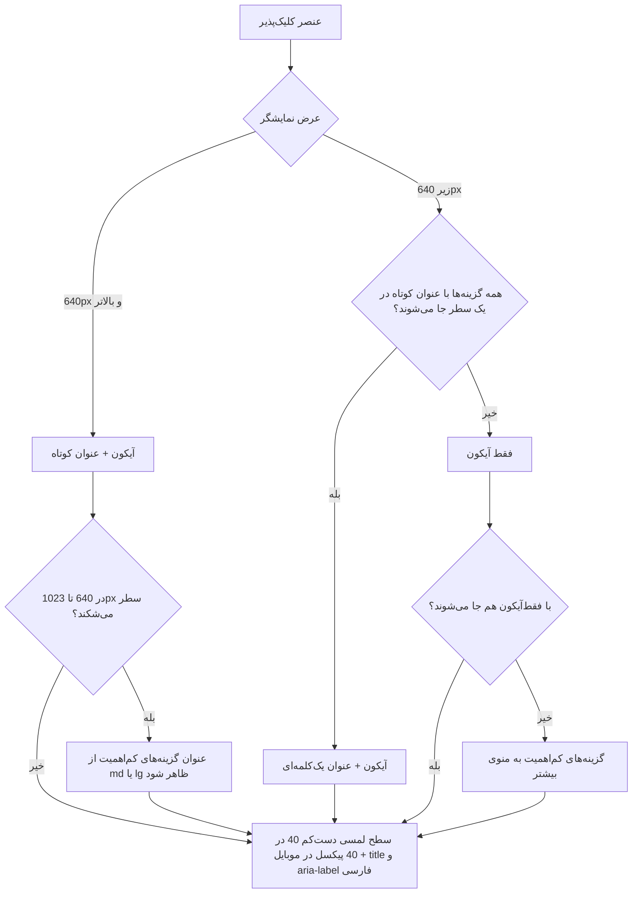
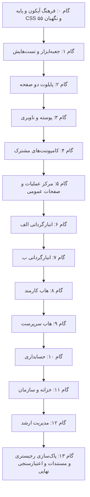

# طرح جامع و فراگیر سازگاری تمامی صفحات و زیرصفحات با قوانین ارگونومی واکنش‌گرا
## (Comprehensive All-Pages & Subpages Responsive Clickable Ergonomics Plan)

<div dir="rtl" align="right">

> [!IMPORTANT]
> **دامنه طرح:** همه قالب‌های فرانت‌اند (`warehouse-front`) که عنصر کلیک‌پذیر دارند. طبق شمارش ۱۴۰۵/۰۷/۱۸ پروژه **۸۶ قالب `html` و ۲۵ قالب درون‌خطی در `ts`** دارد؛ جدول‌های بخش ۴ همه آن‌ها را در **۸۶ ردیف** پوشش می‌دهند، جز ۶ قالب بدون عنصر کلیک‌پذیر (بند ۴-۶).
>
> **روش (ماژولار):** به‌جای دست‌کاری جداگانه ۸۶ قالب با کلاس‌های تکراری، اول یک **جعبه‌ابزار مشترک** (بخش ۲) و یک **فرهنگ آیکون** (بخش ۳) ساخته می‌شود و صفحه‌ها فقط به آن کوچ می‌کنند. هر قاعده (اندازه لمسی، نقطه شکست، برچسب دسترس‌پذیری، آیکون هر کار) فقط **یک جا** تعریف می‌شود.
>
> **مرجع قوانین:** قانون «Responsive Clickable Ergonomics» در `.agents/AGENTS.md` §7 و مهارت `design-system`. هر جا این سند با آن‌ها ناسازگار باشد، آن دو مرجع‌اند. حداقل ۴۰px قانون پروژه است (بالاتر از حداقل ۲۴px الزامی WCAG 2.2 در سطح AA).

> [!WARNING]
> **بازبینی‌ها:** نسخه ۱۴۰۵/۰۷/۱۸ (اول) ایرادهای پوشش و درستی را رفع کرد؛ نسخه ۱۴۰۵/۰۷/۱۸ (دوم) طرح را ماژولار کرد و فرهنگ آیکون یکسان را افزود. خلاصه هر دو در بخش ۷.

---

## ۱. منشور ارگونومی و اصول تبدیل کلیک‌پذیرها (Universal Transformation Rules)



### چک‌لیست تغییرات استاندارد:
1. **نقطه شکست واحد:** مرز دسکتاپ و موبایل `sm` تیلویند (۶۴۰px) است؛ پروژه نقاط شکست پیش‌فرض Tailwind 3.4 را دارد.
2. **دسکتاپ (۶۴۰px به بالا):** دکمه‌های اصلی و تب‌ها آیکون + عنوان کوتاه فارسی دارند (در جعبه‌ابزار: `display="auto"`، پیش‌فرض).
   - **استثنا:** سه دکمه استاندارد سربرگ (خروجی اکسل، ورود اکسل، تازه‌سازی) طبق AGENTS §7 در همه اندازه‌ها فقط‌آیکون می‌مانند (پیش‌فرض کاتالوگ برای همین سه کار).
   - در بازه تبلت (۶۴۰ تا ۱۰۲۳px) هم سطر نباید بشکند؛ اگر شکست، عنوان گزینه‌های کم‌اهمیت با `labelFrom="md"` یا `"lg"` دیرتر ظاهر شود.
3. **موبایل (زیر ۶۴۰px)، اصل Zero-Scroll:**
   - جا شدن با کوچک کردن محتوا به دست می‌آید (فقط‌آیکون، عنوان کوتاه، حذف عرض‌های ثابت مثل `min-w-[150px]`)، **نه با حذف `overflow-x-auto`**. این کلاس تور ایمنی است و می‌ماند: وقتی محتوا جا شود اسکرولی دیده نمی‌شود، و اگر روزی جا نشد فقط همان نوار اسکرول می‌خورد، نه کل صفحه.
   - عنوان کوتاه در موبایل فقط وقتی مجاز است که کل سطر بدون اسکرول و بدون شکست جا شود.
   - اگر با فقط‌آیکون هم جا نشد، گزینه‌های کم‌اهمیت به `app-overflow-menu` («بیشتر») می‌روند.
4. **سطح لمسی:** دکمه فقط‌آیکون در موبایل دست‌کم ۴۰×۴۰px؛ کلیدهای ثبت اصلی (ورود، ثبت شمارش، ارسال پیام) ۴۴ تا ۴۸px. در جعبه‌ابزار درونی است؛ برای بقیه عناصر کلیک‌پذیر کلاس `.tap-target`.
   - وضع فعلی: `w-9 h-9` فقط ۳۶px است (۱۱۵ مورد در ۴۳ فایل) و `.btn-icon-square` با آیکون ۱۶px حدود ۳۴px.
5. **دسترس‌پذیری:**
   - هر دکمه فقط‌آیکون `aria-label` و `title` فارسی دارد.
   - وقتی عنوان دیده می‌شود، `aria-label` باید عین همان متن باشد (WCAG 2.5.3)؛ وگرنه کاربری که با فرمان صوتی متن روی دکمه را می‌گوید به آن نمی‌رسد. `button[appAction]` هر دو را از یک ورودی `label` می‌سازد، پس این ناهماهنگی ممکن نیست.
   - `title` روی صفحه لمسی نمایش داده نمی‌شود؛ پس فقط‌آیکون فقط برای آیکون‌های آشنا (افزودن، تازه‌سازی، جستجو، اکسل، ویرایش، حذف، بستن). کارهای مبهم (مثل «ممیزی» یا «تعریف راننده/خودرو») عنوان کوتاه یا منوی «بیشتر» می‌گیرند.
6. **کارهای برگشت‌ناپذیر و حساس** (بازیابی و بازگشت پشتیبان، حذف قطعی، رد، قفل و بازگشایی دوره، پاک‌سازی خطاهای همگام‌سازی، لغو نشست دستگاه، پایان همکاری): در کاتالوگ پرچم `sensitive` دارند و جعبه‌ابزار آن‌ها را **همیشه با عنوان** نشان می‌دهد؛ کنار دکمه‌های پرکاربرد فشرده نمی‌شوند و منطق تاییدشان دست نمی‌خورد.
7. **ایموجی‌ها:** ایموجی درون عناصر کلیک‌پذیر (تب، دکمه، آیتم منوی کناری) با آیکون فرهنگ آیکون (بخش ۳) جایگزین می‌شود؛ مثلاً ⏳ داخل تب ← `status-pending`، ⏳ چرخان داخل دکمه ذخیره ← `busy` در `button[appAction]`.
   - این فقط ۳ صفحه نیست: تب‌های دست‌کم ۱۲ صفحه دیگر و ۳۳ برچسب منوی کناری (`modules/accounting/nav-items.ts`) هم ایموجی دارند.
   - **حذف نمی‌شوند:** لاگ‌های `console`، نمادهایی که AGENTS §7 صریحاً خواسته (🔍 و ✕ جستجو، 📋 و ✓ کپی، ⚡ شبا، ایموجی بانک‌ها در `IRANIAN_BANKS`)، و متن وضعیتِ غیرکلیک‌پذیر (خارج از این طرح).
8. **بدون قابلیت تازه:** فقط عناصر موجود بازآرایی می‌شوند؛ دکمه‌ای که در کد نیست اضافه نمی‌شود.
9. **سیاهه پیش از کار:** ستون «وضعیت فعلی» جدول‌ها راهنماست، نه سیاهه کامل. در شروع هر گام، عناصر کلیک‌پذیر هر فایل از خود کد (`(click)` و `routerLink`) فهرست می‌شوند.
10. **اول جعبه‌ابزار:** هر دکمه، تب یا سربرگی که بازآرایی می‌شود از اجزای بخش ۲ استفاده می‌کند. نشانه‌گذاری دستی فقط وقتی مجاز است که هیچ جزئی مناسب نباشد؛ آن هم با `.tap-target` و آیکون از فرهنگ آیکون.
11. **یک کار = یک آیکون؛ یک آیکون = یک معنا:** آیکون هر کار، وضعیت یا موجودیت فقط از فرهنگ آیکون (بخش ۳) می‌آید. برای کاری که در فرهنگ کلید دارد، نوشتن مستقیم نام رجیستری (مثلاً `appIcon="trash"`) ممنوع است و نگهبان ۵۵ آن را می‌گیرد.

---

## ۲. جعبه‌ابزار مشترک ماژولار (Shared Responsive Toolkit)

همه اجزا standalone و OnPush با ورودی‌های signal (Angular 22) هستند، در `src/app/shared/` قرار می‌گیرند و **هیچ‌چیز از `modules/*` وارد نمی‌کنند**؛ چون بیلدهای تک‌ماژولی (`accounting-only` و `warehouse-only`) فایل‌های ماژول دیگر را با stub عوض می‌کنند. هیچ جزئی وضعیت یا منطق کاری نگه نمی‌دارد؛ صفحه همان متدها و وضعیت خودش را به آن وصل می‌کند (اصل DRY در AGENTS §7).

| جزء | مسیر | کار | جایگزین چه چیزی |
|---|---|---|---|
| **فرهنگ آیکون** | `shared/icons/semantic-icons.ts` | `ACTION_ICONS`، `STATUS_ICONS` و `PLATFORM_ENTITY_ICONS` با `as const satisfies Record<string, IconName>` (نام اشتباه = خطای کامپایل). `SvgIconDirective` نام‌های `action-*` و `status-*` را هم می‌شناسد، پس قالب‌ها می‌نویسند `appIcon="status-pending"`. | نام‌های پراکنده رجیستری برای یک کار |
| **آیکون موجودیت‌های هر ماژول** | `modules/warehouse/entity-icons.ts` و `modules/accounting/entity-icons.ts` | آیکون موجودیت‌های همان ماژول؛ فقط صفحه‌ها و `nav-items.ts` همان ماژول از آن استفاده می‌کنند. | آیکون‌های تکراری و ناهماهنگ منوی کناری |
| **دکمه کاری** | `shared/components/action-button/` با گزینشگر `button[appAction]` | از کاتالوگ کار، آیکون، عنوان پیش‌فرض، رنگ و پرچم حساس را می‌گیرد؛ `aria-label` و `title` را از همان عنوان می‌سازد؛ سطح لمسی موبایل را تضمین می‌کند. چون میزبانش خود `<button>` است، `(click)`، `disabled` و `type="submit"` بومی کار می‌کنند. | دکمه‌های دستی با کلاس‌های تکراری و `hidden sm:inline` |
| **نوار تب** | `shared/components/tab-bar/` (`app-tab-bar`) | ظرف قرصی استاندارد AGENTS §7، تب فعال، شمارنده‌ها، `role="tablist"` و `aria-selected`، کلیدهای جهت‌دار راست‌به‌چپ، عنوان کوتاه یا فقط‌آیکون در موبایل، `overflow-x-auto` به‌عنوان تور ایمنی، بدون عرض ثابت. بی‌وضعیت است: `[active]` و `(activeChange)` به همان `switchSubTab()` صفحه وصل می‌شوند (همگام‌سازی با URL دست صفحه می‌ماند). | نوارهای تب دستی در ۳۶ فایل |
| **منوی «بیشتر»** | `shared/components/overflow-menu/` (`app-overflow-menu`) | دکمه‌های داخلش را در ۶۴۰px به بالا ردیفی نشان می‌دهد (`display: contents`) و زیر آن در یک پاپ‌اوور با دکمه `more-vertical`؛ داخل پاپ‌اوور عنوان‌ها همیشه دیده می‌شوند. یک مجموعه دکمه، بدون نشانه‌گذاری یا متد تکراری. بستن با کلیک بیرون و Escape، `aria-expanded` و بازگشت فوکوس. | نوارهای اکشنی که در موبایل جا نمی‌شوند |
| **سربرگ فرماندهی** | `shared/components/command-center/` (`app-command-center`) | سربرگ چسبان استاندارد AGENTS §7 با دو جایگاه `[cc-tabs]` (راست) و `[cc-actions]` (چپ)؛ در موبایل دو سطر جدا، هر کدام Zero-Scroll. | کپی دستی کلاس‌های سربرگ چسبان در ۴۲ فایل |
| **کلاس‌های سراسری** | `src/styles.css` | `.tap-target` (حداقل `2.5rem` زیر ۶۴۰px) برای پیوندها، چیپ‌ها و منوهای سفارشی؛ همین حداقل برای `.btn-icon-square` و `.btn-icon-sm`؛ کلاس رنگ تازه `.btn-icon-primary` (نیلی پررنگ) کنار رنگ‌های موجود `btn-icon-indigo|emerald|rose|blue|purple|amber|slate`. | تکرار `min-w-[40px] min-h-[40px]` |
| **سنجه Zero-Scroll** | `scripts/e2e/zero_scroll_probe.js` | قطعه JS برای اجرا در مرورگر داخلی: اسکرول افقی صفحه، سرریز هر نوار تب/اکشن و شکست سطر را گزارش می‌کند (بند ۵). | بررسی چشمی بدون عدد |
| **نگهبان ۵۵** | `scripts/e2e/guardian_55_clickable_ergonomics.py` + خط مبنای `clickable_ergonomics_baseline.json` | به سبک نگهبان ۲۹ فقط با **افزایش** شکست می‌خورد. قواعد: (۱) دکمه فقط‌آیکون بدون `aria-label`/`title`؛ (۲) `min-w-[NNNpx]` درون نوار تب؛ (۳) دکمه‌ای که متدش الگوی یک کار شناخته‌شده است (`export*`، `refresh*`، `delete*`، `approve*`، `reject*` و ...) ولی `appAction` یا آیکون فرهنگ را ندارد؛ (۴) استفاده تازه از گونه‌های کنارگذاشته (بند ۳-۵). | قاعده‌هایی که فقط روی کاغذ بودند |

**نمونه استفاده (پس از کوچ):**

```html
<app-command-center>
  <app-tab-bar cc-tabs [tabs]="tabs" [active]="activeSubTab" (activeChange)="switchSubTab($event)" />
  <div cc-actions>
    <button type="button" appAction="refresh" (click)="refreshData()"></button>
    <app-overflow-menu>
      <button type="button" appAction="import-excel" (click)="importExcel()"></button>
      <button type="button" appAction="export-excel" (click)="exportExcel()"></button>
    </app-overflow-menu>
    <button type="button" appAction="create" label="فاکتور جدید" (click)="openNewInvoiceModal()"></button>
  </div>
</app-command-center>
```

```ts
// تعریف نمایشی تب‌ها در کامپوننت صفحه (بدون منطق کاری)
readonly tabs: TabDef[] = [
  { id: 'pending',  label: 'نیازمند بررسی', shortLabel: 'بررسی', icon: STATUS_ICONS.pending },
  { id: 'approved', label: 'تایید شده',     shortLabel: 'تایید', icon: STATUS_ICONS.approved },
];
```

**ورودی‌های `button[appAction]`:** `appAction` (کلید کار، الزامی)، `label` (پیش‌فرض از کاتالوگ)، `display` (`auto` | `icon` | `label`؛ برای کارهای حساس همیشه `label`)، `labelFrom` (`sm` | `md` | `lg`)، `tone`، `size` (`sm` | `md` | `lg`؛ `lg` برای کلیدهای ثبت ۴۴ تا ۴۸px)، `busy` (چرخنده `action-loading`، `aria-busy` و غیرفعال شدن).

**ورودی‌های `app-tab-bar`:** `tabs: TabDef[]` (`id`، `label`، `shortLabel?`، `icon?`، `count?`، `tone?`)، `active`، `mobile` (`short` | `icon`)، خروجی `activeChange`.

**تست‌های جعبه‌ابزار (Vitest):** برای هر جزء spec جدا؛ مثلاً یکی بودن `aria-label` با عنوان، عنوان‌دار ماندن کار حساس، `role` و `aria-selected` تب‌ها، کار کردن `(click)` و `type="submit"` روی دکمه میزبان، باز و بسته شدن منوی «بیشتر» با Escape. یک spec هم برای فرهنگ آیکون: نبود آیکون تکراری بین موجودیت‌ها و وضعیت‌ها (جز فهرست سفید بند ۳-۴).

---

## ۳. فرهنگ آیکون یکسان (Semantic Icon Dictionary)

**وضع فعلی (شمارش ۱۴۰۵/۰۷/۱۸):** رجیستری ۲۰۲ آیکون دارد و برای یک کار چند گونه به کار رفته است:

| کار | گونه‌های در حال استفاده (تعداد استفاده) |
|---|---|
| حذف | `trash-2` (۱۹)، `trash` (۱۷)، `trash-lucide` (۶)، `trash-2-lucide` (۳)، `trash-2-soft` (۲)، `trash-compact` (۲)، `hero-trash` (۲) |
| تازه‌سازی | `refresh-cw` (۷۴)، `rotate-cw-path` (۱۰)، `rotate-cw` (۹)، `hero-refresh` (۵)، `rotate-cw-legacy` (۳)، `refresh-ccw` (۲)، `refresh-cw-legacy` (۲) |
| در حال انجام | `spinner` (۱۴)، `spinner-arc` (۷)، `loader-arc` (۶)، `loader` (۳)، `spinner-quarter`، `spinner-wedge`، `loader-6-rays` (هر کدام ۲) |
| ویرایش | `edit` (۲۷)، `edit-3` (۱۰)، `edit-2` (۹) |
| ایجاد | `plus` (۲۰)، `hero-plus-bold`، `plus-square` (هر کدام ۲)، `hero-plus` (۱) |
| رد | `x` (همان آیکون «بستن»)، `rotate-ccw`، `undo-2`؛ بیشتر دکمه‌های رد اصلاً آیکون ندارند |

**قاعده انتخاب:** پرکاربردترین گونه هر خانواده آیکون واحد می‌شود (کمترین تغییر ظاهری)، مگر جایی که ابهام بسازد. دو استثنا: «رد» `x-circle` می‌گیرد، نه `x`، چون `x` یعنی «بستن» و کاربر ممکن است رد را با بستن اشتباه بگیرد؛ «تایید کارتابل» `check-circle` می‌گیرد تا از «تایید مودال» (`check`) جدا باشد و با وضعیت «تایید شده» یکی شود.

### ۳-۱. آیکون کارها (`ACTION_ICONS` و کاتالوگ `appAction`)

| کار | کلید | آیکون واحد | گونه‌هایی که کنار می‌روند | عنوان پیش‌فرض | رنگ | حساس |
|---|---|---|---|---|---|---|
| ایجاد | `create` | `plus` | `hero-plus`، `hero-plus-bold`، `plus-square` | «جدید» (معمولاً با نام موجودیت: «شرکت جدید») | primary | |
| ویرایش | `edit` | `edit` | `edit-2`، `edit-3` | ویرایش | slate | |
| حذف | `delete` | `trash-2` | `trash`، `trash-lucide`، `trash-2-lucide`، `trash-2-soft`، `trash-compact`، `hero-trash` | حذف | rose | ✓ |
| تازه‌سازی | `refresh` | `refresh-cw` | `rotate-cw`، `rotate-cw-path`، `rotate-cw-legacy`، `refresh-cw-legacy`، `refresh-ccw`، `hero-refresh` | تازه‌سازی | slate | |
| خروجی اکسل | `export-excel` | `download` | `download-arrow`، `hero-document-download` | خروجی اکسل | emerald | |
| ورود اکسل | `import-excel` | `upload` | | ورود اکسل | indigo | |
| دانلود فایل | `download` | `download` | | دانلود | slate | |
| بارگذاری فایل/مدرک | `upload` | `upload` | | بارگذاری | indigo | |
| پیوست | `attach` | `hero-paper-clip` | | پیوست | slate | |
| ذخیره | `save` | `save` | `hero-save` | ذخیره | primary | |
| تایید کارتابل | `approve` | `check-circle` | `check` در دکمه‌های تایید | تایید | emerald | |
| رد | `reject` | `x-circle` | `x` در دکمه‌های رد | رد | rose | ✓ |
| برگشت برای اصلاح | `return` | `rotate-ccw` | `undo-2`، `rotate-ccw-alt`، `rotate-ccw-lucide`، `rotate-ccw-lucide-alt` | برگشت برای اصلاح | amber | |
| بازیابی/بازگشت نسخه | `restore` | `rotate-ccw` | | بازیابی | amber | ✓ |
| تایید مودال | `confirm` | `check` | `check-path`، `hero-check-bold`، `hero-check-solid` | تایید | primary | |
| بستن | `close` | `x` | `x-path`، `hero-x` | بستن | slate | |
| ارسال (مرحله بعد، پیام) | `send` | `send` | `hero-paper-airplane` | ارسال | indigo | |
| چاپ | `print` | `printer` | | چاپ | slate | |
| کپی | `copy` | `copy` | `copy-2`، `copy-alt` | کپی | slate | |
| مشاهده/پیش‌نمایش | `view` | `eye` | `eye-alt` | مشاهده | slate | |
| پنهان کردن (رمز) | `hide` | `eye-off` | `eye-slash` | پنهان کردن | slate | |
| جستجو | `search` | `search` | `hero-search`، `hero-search-plain` | جستجو | slate | |
| فیلتر | `filter` | `filter` | | فیلتر | slate | |
| بیشتر | `more` | `more-vertical` | | کارهای بیشتر | slate | |
| دوربین | `camera` | `camera` | | دوربین | slate | |
| اسکن بارکد | `scan` | `scan-line` | `scan-square`، `scan-text` | اسکن | slate | |
| در حال انجام | `loading` | `spinner` | `spinner-arc`، `spinner-quarter`، `spinner-wedge`، `loader`، `loader-arc`، `loader-6-rays` | در حال انجام | — | |
| قفل دوره | `lock` | `lock` | | قفل | amber | ✓ |
| بازگشایی | `unlock` | `unlock` | | بازگشایی | amber | ✓ |
| تاریخچه/لاگ | `history` | `file-lines` | | تاریخچه | slate | |
| همگام‌سازی | `sync` | `cloud-upload` | | همگام‌سازی | indigo | |
| تنظیمات | `settings` | `settings` | `settings-alt` | تنظیمات | slate | |
| بازگشت / جلو (راست‌به‌چپ) | `back` / `forward` | `chevron-right` / `chevron-left` | `hero-chevron-left`، `hero-arrow-left` | بازگشت / جلو | slate | |
| باز / جمع کردن | `expand` / `collapse` | `chevron-down` / `chevron-up` | `chevron-down-path`، `hero-chevron-down`، `hero-chevron-up` | باز کردن / جمع کردن | slate | |
| خروج از حساب | `logout` | `log-out` | | خروج | rose | |

**استثنای AGENTS §7:** دکمه ✕ پاک کردن جستجو و 📋/✓ کپی شبا همان نماد متنی مصوب را نگه می‌دارند.

### ۳-۲. آیکون وضعیت‌ها (`STATUS_ICONS`؛ جایگزین ایموجی تب‌ها)

| وضعیت | کلید | آیکون | جایگزین |
|---|---|---|---|
| در انتظار / نیازمند بررسی | `pending` | `clock` | ⏳ و گونه‌های `clock-2`، `clock-lucide`، `hero-clock` |
| تایید شده / انجام‌شده | `approved` | `check-circle` | ✅ |
| رد شده | `rejected` | `x-circle` | |
| برگشت برای اصلاح | `revision` | `rotate-ccw` | |
| پیش‌نویس | `draft` | `file` | |
| بایگانی | `archived` | `archive` | «✅ آرشیو ...» در خزانه |
| همه | `all` | `list` | |
| هشدار | `warning` | `alert-triangle` | ⚠️ |
| خطا | `error` | `alert-circle` | |
| اعلان نیازمند اقدام | `alert` | `bell` | 🔔 |
| قفل‌شده | `locked` | `lock` | 🔒 |
| آفلاین | `offline` | `wifi-off` | |
| در صف ارسال | `queued` | `cloud-upload` | |

### ۳-۳. آیکون موجودیت‌ها (یک موجودیت = یک آیکون)

**ناهماهنگی‌های فعلی منوی کناری:** `briefcase` برای ۴ چیز بی‌ربط (بستن دوره، دیسکت‌ها، طرف‌حساب‌ها، گزارشات مدیریتی)؛ `activity` برای کنترل بودجه، مغایرت‌گیری، پیگیری شمارش و پایش سلامت؛ `clipboard` برای کارتابل انبارگردان، تخصیص کالا و مدیریت چک؛ `folder` برای کارتابل مالی انبار و پروژه‌ها و بخش‌ها؛ `users` هم برای «کاربران سامانه» هم برای «پرسنل»؛ و «فاکتور» در کارمند و سرپرست `dollar-sign` است ولی در حسابدار و خزانه `file-text`.

**پیشنهاد اولیه (در گام ۰ نهایی و در فایل‌های فرهنگ ثبت می‌شود):**

| محل تعریف | موجودیت ← آیکون |
|---|---|
| `PLATFORM_ENTITY_ICONS` (مشترک) | داشبورد `grid`، گزارش‌ها `bar-chart-2`، شرکت `building`، کاربران سامانه `user-circle`، تنظیمات `settings`، رهگیری تغییرات `file-lines`، پایش سلامت `server`، پشتیبان `cloud`، اعلان‌ها `bell`، گفتگو `message-square` |
| `modules/warehouse/entity-icons.ts` | انبارها `package`، مدیریت کالا `barcode`، کارتابل انبارگردان `clipboard`، تخصیص کالا `tag`، کارتابل مالی انبار `globe`، کارتابل سرپرست `check-square`، بررسی نهایی مدیر `check-circle`، پیگیری شمارش `activity` |
| `modules/accounting/entity-icons.ts` | پروژه‌ها و بخش‌ها `folder`، کارکرد پرسنل `calendar`، ناوگان و خودرو `truck`، پرسنل `users`، تعریف پرسنل `user-plus`، فاکتور `file-text` (در هر چهار نقش)، تنخواه `credit-card`، حقوق و پرداخت `dollar-sign`، دیسکت‌ها `file-check`، طرف‌حساب‌ها `briefcase`، بانک پرونده‌ها `id-card`، بودجه `calculator`، کارتابل تاییدات `check-circle`، بستن دوره `lock`، حساب‌های بانکی `database`، چک‌ها `clipboard-check`، مغایرت‌گیری `columns`، بایگانی مدارک شرکت `book` |

### ۳-۴. اشتراک‌های مجاز (فهرست سفید)
اشتراک آیکون فقط وقتی مجاز است که **معنا یکی باشد**: `download` (خروجی اکسل و دانلود)، `upload` (ورود اکسل و بارگذاری)، `rotate-ccw` (برگشت برای اصلاح، بازیابی و وضعیت اصلاح)، `check-circle` (تایید، وضعیت تایید شده، کارتابل‌های تایید نهایی)، `x-circle` (رد و وضعیت رد شده)، `lock` (قفل، وضعیت قفل‌شده، بستن دوره)، `cloud-upload` (همگام‌سازی و در صف ارسال)، `settings` (کار و موجودیت تنظیمات)، `file-lines` (تاریخچه و رهگیری تغییرات)، `bell` (وضعیت هشدار و اعلان‌ها)، `users` (پرسنل در هر نقش)، `calculator` (بودجه و انحراف بودجه). spec فرهنگ آیکون هر اشتراک دیگری را خطا می‌گیرد.

### ۳-۵. پاک‌سازی رجیستری
۵۳ گونه کنارگذاشته (ستون «گونه‌هایی که کنار می‌روند» در بند ۳-۱ و گونه‌های ساعت در بند ۳-۲) در طول کوچ جایگزین می‌شوند و نگهبان ۵۵ جلوی استفاده تازه از آن‌ها را می‌گیرد. در گام پایانی هر گونه‌ای که **دیگر هیچ استفاده‌ای** نداشته باشد (در قالب‌ها و در رشته‌های `ts`، مثل فیلد `icon` منوها) از `icon-registry.ts` حذف می‌شود. گونه‌ای که هنوز جایی با معنای دیگر استفاده می‌شود می‌ماند.

---

## ۴. کالبدشکافی و ماتریس تفصیلی تمامی صفحات و زیرصفحات پروژه

> در همه ردیف‌ها، «اقدام» یعنی کوچ به جعبه‌ابزار: تب‌ها ← `app-tab-bar`، دکمه‌های کاری ← `button[appAction]`، سربرگ چسبان ← `app-command-center`، گزینه‌های اضافی موبایل ← `app-overflow-menu`، ایموجی و آیکون‌ها ← فرهنگ آیکون. ستون آخر فقط نکته‌های ویژه همان صفحه را می‌گوید.

### دسته ۱: مرکز عملیات، مدیریت و حاکمیت سازمان (`/app/operations/*`)

| ردیف | مسیر / صفحه | وضعیت فعلی عناصر کلیک‌پذیر | نکته‌های ویژه کوچ |
|---|---|---|---|
| ۱.۱ | **مدیریت شرکت‌ها و هلدینگ**<br>`companies.html` | دکمه ثبت شرکت جدید فقط‌آیکون و `w-9 h-9` (۳۶px) است؛ تب‌های شیت اسناد در موبایل سرریز دارند. | `appAction="create" label="شرکت جدید"`؛ تب‌های شیت اسناد با `app-tab-bar` و `mobile="icon"`. |
| ۱.۲ | **تب گوگل‌درایو شرکت**<br>`company-gdrive-tab.html` | دکمه‌های همگام‌سازی، اتصال و احراز هویت در موبایل پهن هستند. | همگام‌سازی `sync`؛ اتصال با عنوان «اتصال»؛ نشانگر وضعیت با `status-*`. |
| ۱.۳ | **مدیریت کاربران و نقش‌ها**<br>`users.html` | دکمه‌های ایجاد کاربر/نقش فقط‌آیکون‌اند؛ تب ۳ «کارت پرسنلی / گیت‌پاس» متن بلند دارد؛ گزینه «خروج از تعلیق» در منوی سطر ایموجی ✅ دارد. | `create` با «کاربر جدید» و «نقش جدید»؛ تب ۳ «کارت پرسنلی»؛ ایموجی منوی سطر ← `status-approved`. |
| ۱.۴ | **داشبورد کوکپیت عملیات**<br>`operations-cockpit.html` | دکمه «ثبت اسنپ‌شات فوری سرور» متن بلند با ⚡ و ⏳ دارد؛ کارت‌های دسترسی سریع متن طولانی دارند. | دکمه اسنپ‌شات: عنوان «اسنپ‌شات فوری» با `busy` به‌جای ⏳؛ فشرده‌سازی دکمه‌های پرش به ماژول‌ها. |
| ۱.۵ | **حاکمیت نقش‌ها و دسترسی‌ها**<br>`operations-rbac-governance.html` | دکمه‌های فیلتر سطح دسترسی، ذخیره مجوزها و اکشن‌های گروهی. | چیپ‌های مجوز با `.tap-target`؛ ذخیره `save`. |
| ۱.۶ | **مانیتور همگام‌سازی و سلامت سرور**<br>`operations-sync-monitor.html` | تازه‌سازی آمار، ارسال صف آفلاین، جزئیات تعارض، شبیه‌سازی تعارض، لغو نشست دستگاه و «پاک‌سازی همه خطاهای همگام‌سازی». | تازه‌سازی `refresh`، ارسال صف `sync`. **پاک‌سازی خطاها و لغو نشست حساس‌اند و عنوان‌دار می‌مانند.** |
| ۱.۷ | **پشتیبان‌گیری و اسنپ‌شات‌ها**<br>`settings-backup-tab.html` | ایجاد اسنپ‌شات دستی، دانلود پشتیبان و IndexedDB، بازیابی، بازگشت (rollback)، اتصال و قطع گوگل‌درایو سیستم. | ایجاد `create` با «پشتیبان جدید»؛ دانلود `download`؛ **بازیابی و بازگشت `restore` (حساس، عنوان‌دار).** |
| ۱.۸ | **داشبورد سلامت سیستم**<br>`health-dashboard.ts` (قالب درون‌خطی) | اجرای عیب‌یابی، رفتن به تنظیمات پشتیبان، انتخاب سطح هم‌زمانی و اجرای تست فشار. | دکمه‌های عیب‌یابی و تست فشار `appAction` با عنوان؛ چیپ‌های سطح هم‌زمانی با `app-tab-bar` یا `.tap-target`. |
| ۱.۹ | **ممیزی امنیتی و لاگ‌ها**<br>`audit.html` | دکمه‌های فیلتر بازه زمانی، خروجی اکسل و فیلتر کاربران. | خروجی `export-excel`؛ چیپ‌های فیلتر یکدست. |
| ۱.۱۰ | **راه‌انداز نخستین سامانه**<br>`first-boot-wizard.html` | کارت‌های انتخاب ماژول (روشن/خاموش کردن ماژول انبار). | کارت‌های انتخاب با سطح لمسی کامل و ۴۴px در موبایل. |

---

### دسته ۲: سامانه جامع انبارگردانی (`/app/warehouse/*`)

| ردیف | مسیر / صفحه | وضعیت فعلی عناصر کلیک‌پذیر | نکته‌های ویژه کوچ |
|---|---|---|---|
| ۲.۱ | **داشبورد مرکزی انبار**<br>`dashboard.html` | کارت‌های KPI و دکمه‌های فیلتر بازه زمانی و انتخاب انبار. | فیلترهای سریع با `app-tab-bar` یا چیپ‌های `.tap-target`. |
| ۲.۲ | **مدیریت انبارها**<br>`projects.html` | دکمه «انبار جدید» (متن در همه اندازه‌ها، آیکون `building`)، ویرایش/حذف/بازیابی در منوی سطر، ورود و خروجی اکسل، تعویض انبار فعال. | `create` با «انبار جدید»؛ ویرایش `edit`، حذف `delete`، بازیابی `restore`؛ ورود و خروجی اکسل در `app-overflow-menu`. |
| ۲.۳ | **هدایت و تخصیص کالا**<br>`dispatch.html` | اکشن‌بار لیبلینگ، تگ‌گذاری دسته‌جمعی، ارجاع موازی؛ تب «📊 وضعیت‌ها و رهگیری» ایموجی دارد. | دکمه‌های تگ‌گذاری و حذف تگ `appAction`؛ ایموجی تب ← آیکون فرهنگ. |
| ۲.۴ | **مدارک و پرونده‌های انبار**<br>`docs.html` | دکمه‌های فیلتر نوع سند، آپلود و تایید مدارک. | آپلود `upload`، تایید `approve`. |
| ۲.۵ | **تغذیه و ایمپورت اقلام**<br>`feeding.html` | دکمه‌های دانلود فرمت، اعتبارسنجی و ایمپورت داده. | دانلود فرمت `download`، ایمپورت `import-excel`. |
| ۲.۶ | **کارتابل انبارگردان**<br>`counter-dashboard.html` | دکمه‌های ثبت تعداد، اسکن بارکد، ثبت مغایرت و ارسال. | ثبت شمارش `size="lg"` (۴۴ تا ۴۸px)؛ دوربین `camera` و اسکن `scan` با ۴۴px. |
| ۲.۷ | **کارتابل سرپرست انبار**<br>`supervisor-dashboard.html` | تب‌های حوزه‌ها، دکمه‌های بازشماری، تایید نهایی و ارجاع. | تب‌ها `app-tab-bar` با `mobile="icon"`؛ تایید `approve`. |
| ۲.۸ | **بازبینی و ممیزی مدیر انبار**<br>`manager-review.html` | دکمه‌های بستن نهایی، تایید صورتجلسه و گزارش مغایرت. | بستن نهایی حساس و عنوان‌دار؛ تایید `approve`. |
| ۲.۹ | **رهگیری وضعیت شمارش**<br>`count-tracking.html` | ۵ چیپ فیلتر مغایرت، مودال عملکرد با ۳ تب، خروجی، تایید گروهی تسک‌های سبز، دوربین اسکنر، دراور جزئیات و لغو تخصیص. | چیپ‌های فیلتر و تب‌های مودال با `app-tab-bar`؛ خروجی `export-excel`؛ تایید گروهی `approve`. |
| ۲.۱۰ | **گزارش‌های تخصصی انبار**<br>`reports.html` | تب‌های گزارش‌ها (موجودی، ریالی، کارکرد)، دکمه اکسل و چاپ. | تب‌ها با `shortLabel`؛ چاپ `print`. |
| ۲.۱۱ | **کارتابل مالی و گمرک**<br>`customs.html` | تب‌های «تسک‌های من» و «مخزن اسناد»، دکمه اسکن و اکسل. | تب‌ها `app-tab-bar`؛ اسکن `scan`. |
| ۲.۱۲ | **تنظیمات سراسری سیستم**<br>`settings.html` | ۵ تب با `min-w-[150px]`، یعنی دست‌کم ۷۵۰px و اسکرول افقی در موبایل. | **صفحه پایلوت (گام ۲):** `app-tab-bar` با ۵ تب و `mobile="icon"`؛ عنوان‌های کوتاه (مثلاً «طراح لیبل (Global)» ← «طراح لیبل»). |
| ۲.۱۳ | **تنظیمات اختصاصی انبار**<br>`wh-settings.html` | دکمه‌های انتخاب انبار فعال، پیکربندی اسکنر و ذخیره. | ذخیره `save`؛ نوار دکمه‌های فرم واکنش‌گرا. |
| ۲.۱۴ | **زیرتب‌های تنظیمات**<br>`settings-operations-tab.html`، `settings-counter-fields-tab.html`، `settings-doc-fields-tab.html`، `settings-label-tab.html` | اکشن‌بارهای درون هر زیرتب (سیاهه در شروع گام). | همان کوچ استاندارد. |
| ۲.۱۵ | **طراح لیبل**<br>`label-designer.html` | افزودن عنصر و QR، کپی به انبار، تغییر نام، حذف، چاپ مستقیم و لغو انتخاب. | نوار ابزار طراح در موبایل فقط‌آیکون؛ حذف `delete` (عنوان‌دار)، چاپ `print`، کپی `copy`. |
| ۲.۱۶ | **کارت‌های شناسایی**<br>`id-cards.html` | پیش‌تنظیم‌ها، انتخاب رو/پشت/هر دو، مقیاس خروجی ۱ تا ۳ برابر، چاپ و خروجی کارت دیجیتال. | چیپ‌های انتخاب با `app-tab-bar`؛ چاپ `print`؛ **خود قالب چاپ کارت دست نمی‌خورد.** |
| ۲.۱۷ | **فیلدهای پویا و صفحه شمارش فیلد**<br>`dynamic-fields.html`، `field.html` | افزودن/ویرایش/حذف/کپی فیلد؛ انتخاب تسک و ثبت یا لغو شمارش. | ثبت شمارش `size="lg"`؛ دکمه‌های ردیف فیلدها `create`/`edit`/`delete`/`copy`. |

---

### دسته ۳: هاب‌های پرسنلی و ناوگان در سامانه مالی (`/app/finance/employee/*` & `supervisor/*`)

| ردیف | مسیر / صفحه | وضعیت فعلی عناصر کلیک‌پذیر | نکته‌های ویژه کوچ |
|---|---|---|---|
| ۳.۱ | **حضور و غیاب کارمند**<br>`employee-attendance.html` | زیرتب‌های روزانه/ماهانه، دکمه‌های ذخیره کارکرد روزانه و ماهانه با متن بلند. | ذخیره `save` با «ثبت کارکرد» / «به‌روزرسانی»؛ زیرتب‌ها «روزانه» و «ماهانه». |
| ۳.۲ | **تردد ناوگان کارمند**<br>`employee-fleet.html` | دکمه‌های «تعریف راننده/خودرو» و «ممیزی» با متن بلند در هدر که سطر را می‌شکنند. | هر دو مبهم‌اند (قانون ۵): عنوان یک‌کلمه‌ای اگر جا شد، وگرنه `app-overflow-menu`؛ «ممیزی» `history`. **مودال شبا مرجع AGENTS §7 است و دست نمی‌خورد.** |
| ۳.۳ | **فاکتورهای کارمند**<br>`employee-invoices.html` | تب‌های وضعیت، دکمه فاکتور جدید، آپلود تصویر؛ ⏳ چرخان در دکمه‌های ذخیره. | `create` با «فاکتور جدید»؛ ⏳ ← `busy`؛ آپلود `attach`. |
| ۳.۴ | **تنخواه‌گردان کارمند**<br>`employee-petty-cash.html` | تب‌های درخواست تنخواه، دکمه تسویه و ضمیمه فیش. | ضمیمه فیش `attach`. |
| ۳.۵ | **ثبت خودرو/راننده جدید**<br>`employee-new-vehicle.html` | دکمه‌های مراحل ثبت، استعلام پلاک، ثبت نهایی و انصراف. | ثبت نهایی `save` با `size="lg"`؛ مراحل با `app-tab-bar`. |
| ۳.۶ | **ثبت پرسنل جدید**<br>`employee-new-personnel.html` | تب‌های ۳ مرحله‌ای (یکی با 👥)، دکمه‌های استعلام شبا و ثبت نهایی؛ ⏳ چرخان در دکمه‌های ذخیره. | تب‌ها `app-tab-bar`؛ ⏳ ← `busy`؛ ساختار شبا AGENTS §7 دست نمی‌خورد. |
| ۳.۷ | **تایید کارکرد سرپرست**<br>`supervisor-attendance.html` | زیرتب‌ها با ایموجی («⏳ نیازمند بررسی»، «✅ تایید شده»، «📊 خلاصه روزانه کارگاه»)، تایید گروهی، رد و ثبت توضیحات. | تب‌ها با `status-pending`، `status-approved` و ...؛ تایید گروهی `approve` با «تایید کارکرد»؛ رد `reject`. |
| ۳.۸ | **تایید ناوگان سرپرست**<br>`supervisor-fleet.html` | زیرتب‌ها، دکمه تایید پیمایش و سرویس‌ها. | `approve` و `reject`. |
| ۳.۹ | **تایید فاکتورها سرپرست**<br>`supervisor-invoices.html` | زیرتب‌های «⏳ نیازمند بررسی» و «✅ تایید شده»، دکمه‌های بررسی، تایید، ارجاع و پیش‌نمایش مدارک. | **صفحه پایلوت (گام ۲):** همه اجزای جعبه‌ابزار در یک صفحه (تب وضعیت، سه دکمه استاندارد، تایید/رد سطر، پیش‌نمایش `view`). |
| ۳.۱۰ | **تایید تنخواه سرپرست**<br>`supervisor-petty-cash.html` | زیرتب‌های «⏳ نیازمند بررسی» و «✅ تایید شده»، دکمه‌های تایید ریزهزینه‌ها. | مثل ۳.۹ (الگوی پایلوت). |
| ۳.۱۱ | **مدیریت پرسنل سرپرست**<br>`supervisor-personnel.html` | تب‌های وضعیت استخدامی، دکمه فعال/غیرفعال‌سازی. | تب‌ها `app-tab-bar`؛ دکمه‌های سطر `appAction`. |
| ۳.۱۲ | **بستن دوره کارکرد ماهانه**<br>`supervisor-period-lock.html` | ۳ زیرتب (دوره جاری، ناهنجاری‌ها، دوره‌های قفل‌شده)، «قفل و ارسال دوره»، ورود و خروجی اکسل، رفتن به حضور و غیاب. | «قفل و ارسال دوره» `lock` (حساس، عنوان‌دار) و جدا از دکمه‌های اکسل. |
| ۳.۱۳ | **پرسنل و خودروهای جدید سرپرست**<br>`supervisor-new-profiles.html` | تب‌ها با 👥، تایید/رد پرسنل، خودرو و درخواست‌های تغییر، مودال مقایسه، ورود و خروجی اکسل. | مثل ۳.۹؛ مقایسه `view`. |

---

### دسته ۴: هاب‌های حسابداری، خزانه و مدیریت ارشد مالی (`/app/finance/accountant/*`, `treasurer/*`, `manager/*`)

| ردیف | مسیر / صفحه | وضعیت فعلی عناصر کلیک‌پذیر | نکته‌های ویژه کوچ |
|---|---|---|---|
| ۴.۱ | **حقوق و دستمزد حسابدار**<br>`accountant-payroll.html` | تب‌های سه‌گانه با ایموجی و متن بلند: «⏳ آماده محاسبه»، «پیش‌نمایش محاسبات»، «✅ تایید مالی و نهایی». | تب‌ها با `status-*`؛ عنوان «آماده محاسبه»، «محاسبه‌شده»، «تایید نهایی» و `shortLabel` «آماده»، «محاسبه»، «تایید». |
| ۴.۲ | **ناوگان حسابدار**<br>`accountant-fleet.html` | دکمه‌های محاسبه کرایه، تسویه صورتحساب و خروجی مالی. | خروجی `export-excel`؛ تسویه با عنوان. |
| ۴.۳ | **پرسنل حسابدار**<br>`accountant-personnel.html` | تب‌های دسته‌بندی پرسنل، دکمه اصلاح پایه حقوق و بیمه. | تب‌ها و جستجو در `app-command-center`. |
| ۴.۴ | **فاکتورها و اسناد حسابدار**<br>`accountant-invoices.html` | زیرتب‌های «⏳ در انتظار صدور سند» و «✅ اسناد ثبت‌شده»، صدور سند و رد سند. | تب‌ها با `status-*`؛ صدور سند `approve` با «صدور سند»؛ رد `reject`. |
| ۴.۵ | **رسیدگی تنخواه حسابدار**<br>`accountant-petty-cash.html` | زیرتب‌های «⏳ نیازمند ممیزی» و «✅ شارژ و تسویه شده»، شارژ و تایید اسناد. | الگوی پایلوت ۳.۹. |
| ۴.۶ | **تولید دیسکت‌های بیمه و مالیات**<br>`accountant-diskettes.html` | زیرتب‌ها؛ تولید دیسکت تامین اجتماعی، مالیات، بانک و اکسل بانکی ناوگان؛ ورود و خروجی اکسل. | تب‌ها «بیمه تامین اجتماعی» / «مالیات حقوق» با `shortLabel` «بیمه» / «مالیات»؛ تولید فایل `download`. |
| ۴.۷ | **طرف‌های حساب و شرکت‌ها**<br>`counterparties.html` | فرم درون‌صفحه‌ای ثبت/ویرایش با دکمه ثبت، فیلتر نوع، حالت نمایش، ورود و خروجی اکسل، تازه‌سازی، ویرایش/حذف/فعال‌سازی سطر، کپی شبا و حساب. | دکمه ثبت `save` با `type="submit"` و تمام‌عرض در موبایل؛ فیلتر نوع با `app-tab-bar`؛ ساختار شبا AGENTS §7 دست نمی‌خورد. |
| ۴.۸ | **پرداخت حقوق و ناوگان (خزانه)**<br>`treasurer-disbursements.html` | زیرتب‌ها (یکی «✅ آرشیو واریزی‌های انجام‌شده»)، ثبت پرداخت، پرداخت گروهی دوره و ناوگان، تولید فایل پایا، دانلود دیسکت دوره، اکسل و تازه‌سازی. | تب آرشیو `status-archived`؛ پرداخت‌ها با عنوان؛ فایل پایا و دیسکت `download`. |
| ۴.۹ | **تسویه فاکتورهای خزانه**<br>`treasurer-invoices.html` | دکمه‌های تسویه نقدی/چکی، الصاق رسید و فیلترها. | الصاق رسید `attach`؛ تسویه با عنوان. |
| ۴.۱۰ | **حساب‌های بانکی و صندوق**<br>`treasurer-bank-accounts.html` | زیرتب‌ها، انتقال وجه بین حساب‌ها، اکسل و تازه‌سازی. (دکمه «حساب جدید» در این صفحه نیست.) | انتقال وجه با عنوان «انتقال وجه». |
| ۴.۱۱ | **مدیریت چک‌ها و اسناد**<br>`treasurer-cheques.html` | زیرتب‌ها (یکی «✅ آرشیو پاس‌شده و وصولی»)، وصول و برگشت چک در سطرها، اکسل و تازه‌سازی. | تب آرشیو `status-archived`؛ وصول `approve` با «وصول»؛ برگشت چک `reject` با «برگشت» (حساس). |
| ۴.۱۲ | **مغایرت‌گیری بانکی**<br>`treasurer-reconciliation.html` | زیرتب‌های مغایرت بانکی و پیش‌بینی نقدینگی، انطباق خودکار، اکسل و تازه‌سازی. | انطباق خودکار با عنوان. |
| ۴.۱۳ | **داشبورد هوش مالی مدیر**<br>`manager-dashboard.html` | تب‌های ۳گانه با ایموجی و عنوان بلند: «📊 شاخص‌های کلان»، «📉 انحراف بودجه بخش‌ها»، «🔔 هشدارهای نیازمند اقدام». | تب‌ها «شاخص‌ها» (`bar-chart-2`)، «انحراف بودجه» (`calculator`)، «هشدارها» (`status-alert`). |
| ۴.۱۴ | **کنترل بودجه مدیر**<br>`manager-budget.html` | زیرتب‌ها، ویرایش بودجه در مودال، جستجو، اکسل و تازه‌سازی. | ویرایش `edit`. |
| ۴.۱۵ | **قراردادها و احکام مدیر**<br>`manager-contracts.html` | زیرتب‌ها (یکی «👥 احکام حقوقی پرسنل»)، تایید/رد قرارداد ناوگان و حکم پرسنلی، جستجو، اکسل و تازه‌سازی. (دکمه «قرارداد جدید» در این صفحه نیست.) | تب‌ها با آیکون موجودیت (`users`، `truck`)؛ `approve` و `reject`. |
| ۴.۱۶ | **گزارش‌های جامع مدیر مالی**<br>`manager-reports.html` | تب‌های گزارش (یکی «👥 بهای تمام‌شده نیروی انسانی»). | تب‌ها با `shortLabel` و آیکون موجودیت. |
| ۴.۱۷ | **کارتابل تاییدات نهایی مدیر**<br>`manager-approvals.html` | تب‌ها و زیرتب‌های درخواست تغییر، فیلتر وضعیت با ⏳ و ✅، تایید/رد فاکتور، تنخواه و درخواست تغییر، بازگشایی دوره، ارسال دوره برای مالی. | فیلترها با `status-*`؛ تایید `approve` با `size="lg"` در موبایل؛ بازگشایی `unlock` و ارسال دوره `send` عنوان‌دار. |
| ۴.۱۸ | **پروژه‌ها و بخش‌های سازمان**<br>`projects-and-sections.html` | تب‌های ۳گانه با ایموجی (🏛️، 🏢، 👥) و عنوان‌های طولانی. | تب‌ها «پروژه‌ها»، «بخش‌ها»، «انتساب‌ها» با آیکون موجودیت. |
| ۴.۱۹ | **بایگانی مدارک شرکت**<br>`company-documents-archive.html` | تب‌های مدارک ثبتی، مجوزها، اسناد مالیاتی، دکمه بارگذاری سند. | بارگذاری `upload`. |
| ۴.۲۰ | **شناسنامه پرسنل و پرونده‌ها**<br>`personnel-profiles.html` | تب‌های اطلاعات فردی، سوابق بیمه، قراردادها و فیلترها؛ دکمه «✅ تصویب نهایی و فعال‌سازی». | تب‌ها `mobile="icon"`؛ تصویب `approve` با عنوان. |
| ۴.۲۱ | **تنظیمات پایه مالی و حقوق**<br>`base-settings.html` | دکمه‌های تنظیم ضرایب قانون کار، مالیات و ذخیره فرمول‌ها. | ذخیره `save` با `busy`. |
| ۴.۲۲ | **پرونده‌های جدید حسابدار**<br>`accountant-new-profiles.html` | تب‌ها با 👥، زیرتب پرسنل/خودرو، تایید/رد پرسنل، خودرو و درخواست تغییر، مودال ویرایش با شبا. | الگوی پایلوت ۳.۹؛ دکمه ⚡ شبا طبق AGENTS §7 می‌ماند. |
| ۴.۲۳ | **ناوگان مدیر**<br>`manager-fleet.html` | تایید/رد، مقایسه، حذف خودرو، پایان همکاری، جستجو و تازه‌سازی. | `approve`/`reject`/`view`؛ **حذف و پایان همکاری حساس و عنوان‌دار.** |
| ۴.۲۴ | **پرسنل مدیر**<br>`manager-personnel.html` | تایید/رد، مقایسه، حذف پرسنل، پایان همکاری، کپی، جستجو و تازه‌سازی؛ عنوان «📊 تحلیل بار مالی». | مثل ۴.۲۳. |

---

### دسته ۵: کامپوننت‌های سراسری، پوسته، هدرها، دراورها و مودال‌ها (Global Shared UI)

| ردیف | کامپوننت / المان | وضعیت فعلی عناصر کلیک‌پذیر | نکته‌های ویژه کوچ |
|---|---|---|---|
| ۵.۱ | **هدر کارتابل مشترک**<br>`cartable-header.component.ts` | سوئیچر دامنه با متن بلند «شمارش فیزیکی (انبار)» و «اسناد مالی و گمرک». | سوئیچر با `app-tab-bar`: «شمارش فیزیکی» / «اسناد مالی» و `shortLabel` «شمارش» / «مالی». |
| ۵.۲ | **جدول داده سراسری**<br>`data-table.component.ts` | دکمه‌های زوم، انتخاب ستون‌ها، Undo/Redo، فیلتر ستون‌ها و صفحه‌بندی. | نوار ابزار درونی با `appAction`؛ صفحه‌بندی با `back`/`forward`. |
| ۵.۳ | **منوی کاربری**<br>`user-menu.component.html` | به‌روزرسانی PWA، خروج، تغییر رمز و میانبرها. | پدینگ لمسی (`py-2.5 px-3`)؛ خروج `logout`. |
| ۵.۴ | **دراور گفتگوی سازمانی**<br>`chat-drawer.component.html` | تب‌های گفتگوها / مخاطبین، ارسال پیام و بستن دراور. | تب‌ها `app-tab-bar`؛ ارسال `send` با `size="lg"`؛ بستن `close`. |
| ۵.۵ | **گالری و ویرایشگر عکس اقلام**<br>`item-photo-gallery.component.html` | چرخش، زوم، دوربین، آپلود و تمام‌صفحه. | دوربین `camera`، آپلود `upload`؛ بقیه با `.tap-target`. |
| ۵.۶ | **مودال اکسل مشترک**<br>`excel-import-modal.html` | دانلود الگو، انصراف، انتخاب فایل و تایید بارگذاری؛ ایموجی 📊 و ✅ در سربرگ و خلاصه. | دکمه‌های پایین مودال تمام‌عرض در موبایل؛ ایموجی‌های غیرکلیک‌پذیر خارج از دامنه. |
| ۵.۷ | **مودال حذف هوشمند**<br>`smart-delete-modal.html` | لغو و حذف قطعی. | `delete` با `size="lg"` (حساس، عنوان‌دار). |
| ۵.۸ | **مودال برش تصویر آواتار**<br>`avatar-cropper-modal.html` | چرخش، دوربین، انصراف و ذخیره. | ذخیره `save` با `size="lg"`؛ دوربین `camera`. |
| ۵.۹ | **سوئیچر نقش و پرسونا**<br>`app-role-switcher.component.html` | چیپ‌های انتخاب نقش در هدر سامانه مالی. | در موبایل دکمه فشرده با پاپ‌اوور عمودی (همان رفتار `app-overflow-menu`). |
| ۵.۱۰ | **انتخابگر انبار و بخش‌ها**<br>`warehouse-selector.component.ts` | دراپ‌داون و دکمه‌های انتخاب سریع. | بازشدن دراپ‌داون در موبایل بدون تداخل با نوار وضعیت. |
| ۵.۱۱ | **پورتال لانچر برنامه‌ها**<br>`app-launcher.html` | کارت‌های ماژول‌های انبار، مالی و عملیات؛ ایموجی 🏢. | ایموجی ← آیکون موجودیت شرکت (`building`). |
| ۵.۱۲ | **صفحات ورود و تغییر رمز**<br>`login.html` و `change-password.html` | دکمه ورود، نمایش/پنهان رمز و تایید. | ثبت با `size="lg"` (۴۸px)؛ چشم رمز `view` / `hide`. |
| ۵.۱۳ | **کلاس‌های استایل سراسری**<br>`src/styles.css` | `.btn-icon-square` با آیکون ۱۶px حدود ۳۴px است؛ کلاس مشترکی برای سطح لمسی موبایل نیست. | **گام ۰:** `.tap-target`، حداقل موبایل `.btn-icon-square` / `.btn-icon-sm`، `.btn-icon-primary`. |
| ۵.۱۴ | **پوسته اصلی و منوی کناری**<br>`layout.html` و `modules/*/nav-items.ts` | منوی کناری با ۶ گروه نقش، بازگشت/جلو، خروج از حالت انبار، باز/بستن منو، چت. ۳۳ برچسب منو ایموجی دارند، در حالی که هر آیتم فیلد `icon` هم دارد (نماد دوتایی)؛ آیکون‌های تکراری بند ۳-۳. | حذف ایموجی از برچسب‌ها؛ فیلد `icon` از `entity-icons.ts` همان ماژول؛ کوتاه کردن برچسب‌های بلند (مثل «کارتابل تاییدات (فاکتور، تنخواه، دوره)»)؛ بازگشت/جلو `back`/`forward`. **پیش از تغییر:** جستجوی هر مقایسه متنی روی `label` در کد. **تست وابسته:** `accountant-new-profiles.dom.spec.ts` خط ۲۵۱ انتظار `'👥 پرسنل'` دارد و در همان گام به‌روز می‌شود. |
| ۵.۱۵ | **پوسته مرکز عملیات**<br>`operations-layout.html` و `operations-layout.ts` | منوی موبایل، باز/بستن نوار کناری، بازگشت/جلو، رفتن به انبار/مالی، چت؛ یک آیتم با آیکون ایموجی 🏢. | ایموجی ← `building`؛ ناوبری بدون اسکرول در موبایل. |
| ۵.۱۶ | **تعویض و انتخاب شرکت**<br>`company-switcher.html` و `company-selection-modal.html` | دراپ‌داون تعویض شرکت و مودال انتخاب؛ ایموجی 🏢. | ایموجی ← `building`؛ آیتم‌های مودال ۴۴px. |
| ۵.۱۷ | **مرکز اعلان‌ها**<br>`notification-center.component.ts` | باز/بستن فهرست، خوانده‌شدن یکی یا همه، کلیک روی اعلان. | دکمه زنگ با آیکون `bell` و `.tap-target`. |
| ۵.۱۸ | **مودال‌ها و دیالوگ‌های مشترک**<br>`modal`، `confirm-dialog`، `conflict-resolution-modal`، `deep-sync-modal` (همه درون‌خطی) | دکمه‌های تایید، لغو و بستن. | تایید `confirm`، بستن `close`؛ دکمه‌های پایین مودال تمام‌عرض در موبایل. **تعارض و همگام‌سازی عمیق: فقط ظاهر؛ منطق دست نمی‌خورد.** |
| ۵.۱۹ | **اجزای کوچک مشترک**<br>`barcode-scanner`، `file-upload`، `toggle-switch`، `toast`، `domain-migration-banner`، `cartable-card-base`، `offline-pending-badge`، `item-photo-thumb`؛ و `status-badge` (فقط آیکون) | دکمه‌های بستن، انتخاب فایل، کلید روشن/خاموش و دوربین (سیاهه در شروع گام). | `.tap-target` و `appAction` (`close`، `upload`، `scan`)؛ `status-badge` و `offline-pending-badge` آیکون را از `STATUS_ICONS` بگیرند. |
| ۵.۲۰ | **اجزای گزارش‌ساز**<br>`saved-reports`، `filter-group`، `filter-value`، `export-progress`، `report-chart` (در `components/reports/`) | بارگذاری گزارش ذخیره‌شده، افزودن/حذف شرط و گروه فیلتر، دانلود و بستن خروجی. | افزودن شرط `create`، حذف `delete`، دانلود `download`، بستن `close`. |
| ۵.۲۱ | **نظرات زمینه‌ای**<br>`contextual-comments.component.html` | ارسال، پاسخ، لغو پاسخ و انتخاب منشن. | ارسال `send` با `size="lg"`. |
| ۵.۲۲ | **صفحه عمومی استعلام کارت**<br>`verify-card.html` | دکمه استعلام کد. | استعلام با `size="lg"` (۴۸px). (صفحه عمومی؛ Claude خودش در مرورگر می‌سنجد.) |

### ۴-۶. قالب‌های بدون عنصر کلیک‌پذیر (خارج از دامنه)
`app.html`، `app.component.html`، `placeholders` (html و ts)، `loading-skeleton`، `status-badge` (برای آیکون در ۵.۱۹ آمده است).

---

## ۵. نقشه راه گام‌به‌گام اجرا (Phased Execution Roadmap)

طبق قانون «یک گام در هر نشست» (`CLAUDE.md`) و AGENTS §5، کار در **۱۴ گام کوچک** انجام می‌شود: اول پایه و جعبه‌ابزار (بدون تغییر دیداری در صفحه‌ها)، بعد یک **پایلوت** برای محک زدن API جعبه‌ابزار، و بعد کوچ دسته‌به‌دسته.



* **گام ۰ (فرهنگ آیکون و پایه):** `semantic-icons.ts` و دو فایل `entity-icons.ts` (نهایی کردن جدول‌های بند ۳)؛ شناختن نام‌های `action-*` و `status-*` در `SvgIconDirective` و پذیرش آن‌ها در نگهبان ۵۲؛ ردیف ۵.۱۳؛ نگهبان ۵۵ با خط مبنا؛ spec فرهنگ آیکون. اثر حداقل موبایل `.btn-icon-square` روی ارتفاع سطرهای جدول‌های فشرده (`audit`، `users`، `reports`) بررسی شود.
* **گام ۱ (جعبه‌ابزار):** `action-button`، `tab-bar`، `overflow-menu`، `command-center` و `zero_scroll_probe.js` با specهای Vitest. هنوز هیچ صفحه‌ای از آن‌ها استفاده نمی‌کند.
* **گام ۲ (پایلوت):** ۲.۱۲ `settings.html` (نوار تب با عرض ثابت) و ۳.۹ `supervisor-invoices.html` (همه اجزا در یک صفحه). API جعبه‌ابزار بر پایه نتیجه اصلاح و تصمیم‌ها در «گزارش پیشرفت» ثبت می‌شود؛ گام‌های بعد همین الگو را تکرار می‌کنند.
* **گام ۳ (پوسته و ناوبری):** ۵.۱۴، ۵.۱۵، ۵.۳، ۵.۹، ۵.۱۰، ۵.۱۱، ۵.۱۶، ۵.۱۷.
* **گام ۴ (کامپوننت‌های مشترک):** ۵.۱، ۵.۲، ۵.۴، ۵.۵، ۵.۶، ۵.۷، ۵.۸، ۵.۱۸، ۵.۱۹، ۵.۲۱.
* **گام ۵ (مرکز عملیات و صفحات عمومی):** ۱.۱ تا ۱.۱۰، ۵.۱۲، ۵.۲۲.
* **گام ۶ (انبارگردانی الف):** ۲.۱ تا ۲.۹.
* **گام ۷ (انبارگردانی ب):** ۲.۱۰، ۲.۱۱، ۲.۱۳ تا ۲.۱۷، ۵.۲۰.
* **گام ۸ (هاب کارمند):** ۳.۱ تا ۳.۶.
* **گام ۹ (هاب سرپرست):** ۳.۷، ۳.۸، ۳.۱۰ تا ۳.۱۳.
* **گام ۱۰ (حسابداری):** ۴.۱ تا ۴.۷، ۴.۲۲.
* **گام ۱۱ (خزانه و سازمان):** ۴.۸ تا ۴.۱۲، ۴.۱۸ تا ۴.۲۱.
* **گام ۱۲ (مدیریت ارشد):** ۴.۱۳ تا ۴.۱۷، ۴.۲۳، ۴.۲۴.
* **گام ۱۳ (پایانی):** پاک‌سازی رجیستری (بند ۳-۵)؛ به‌روزرسانی AGENTS §7 و §9 و مهارت `design-system` تا جعبه‌ابزار و فرهنگ آیکون را به‌عنوان راه پیش‌فرض نام ببرند (برای Claude و Antigravity)؛ بیلد هر سه پروفایل؛ همه نگهبان‌های مرتبط؛ `ng test` کامل؛ بازبینی چشمی سراسری.

### معیار پایان هر گام (Definition of Done)
1. **سیاهه:** عناصر کلیک‌پذیر فایل‌های گام از خود کد فهرست شده‌اند (قانون ۹).
2. **بیلد:** از پوشه `warehouse-front`: `npx ng build --output-path ../scratch/ng-build-check > ../scratch/logs/ergonomics-build.log 2>&1`. این بیلد قالب‌های Angular را هم می‌سنجد و به `dist/` که Express سرو می‌کند دست نمی‌زند. در گام‌های ۰، ۱ و ۱۳ همین بیلد با `--configuration accounting-only` و `--configuration warehouse-only` هم اجرا می‌شود تا ثابت شود جعبه‌ابزار به ماژولی وابسته نیست.
3. **نگهبان‌ها:** `python scripts/e2e/guardian_52_icon_registry.py` و `python scripts/e2e/guardian_55_clickable_ergonomics.py` در **هر** گام. خط مبنای نگهبان ۵۵ در هر گام پایین می‌آید و عدد تازه در «گزارش پیشرفت» ثبت می‌شود.
4. **تست‌ها:** specهای جعبه‌ابزار و فرهنگ آیکون سبز بمانند؛ متن‌های تغییرکرده در `*.spec.ts` جستجو و در همان گام به‌روز شوند؛ `ng test` روی specهای کامپوننت‌های گام اجرا و با HEAD مقایسه شود (شکست‌های از پیش موجود جدا گزارش شوند).
5. **بازبینی چشمی:** jsdom چیدمان ندارد و Zero-Scroll را نمی‌سنجد؛ پس `zero_scroll_probe.js` در مرورگر داخلی روی `localhost:4300` در عرض‌های ۳۶۰، ۳۹۰، ۶۳۹، ۶۴۰، ۷۶۸ و ۱۰۲۴px اجرا می‌شود:
   - `document.documentElement.scrollWidth <= innerWidth` (صفحه اسکرول افقی ندارد)؛
   - برای هر نوار تب و اکشن `scrollWidth <= clientWidth`؛
   - سطر نشکسته باشد: همه فرزندان دیدنی نوار (فرزندان `display: contents` باز می‌شوند) با فرزند اول هم‌پوشانی عمودی داشته باشند. برابری دقیق `offsetTop` با `items-center` و ارتفاع‌های متفاوت شکست کاذب می‌سازد. ظرف اسکرول جدول‌ها نوار نیست و جدا شمرده می‌شود.
   - صفحه‌های عمومی (ورود، `verify-card`) را Claude خودش می‌سنجد؛ صفحه‌های پشت ورود فقط اگر کاربر از قبل در مرورگر داخلی وارد شده باشد. وگرنه فهرست بررسی دقیق به کاربر داده و «تاییدنشده» گزارش می‌شود.
6. **بازبین و تحویل:** `ui-reviewer` یک‌بار روی diff گام؛ رفع یافته‌های تاییدشده؛ commit؛ یادداشت تحویل در «گزارش پیشرفت» انتهای همین سند.

---

## ۶. استراتژی ایمنی، عدم بازگشت و پایداری (Safety & Stability)
* **دامنه تغییر:** اجزای تازه `shared/`، فایل‌های فرهنگ آیکون، `SvgIconDirective` (فقط شناختن نام‌های معنایی)، قالب‌ها (`html` یا قالب درون‌خطی `ts`)، تعریف نمایشی تب‌ها در کامپوننت صفحه‌ها، `src/styles.css`، فیلدهای `label` و `icon` در `nav-items.ts`، نگهبان‌های ۵۲ و ۵۵. منطق، سرویس‌ها، API، مدل‌ها و پایگاه داده دست نمی‌خورند؛ پس مسیر تازه‌ای برای از دست رفتن داده باز نمی‌شود و `data-loss-reviewer` لازم نیست، مگر گامی برخلاف انتظار به منطق همگام‌سازی برسد.
* **مرز ماژول‌ها:** `shared/` هیچ‌چیز از `modules/*` وارد نمی‌کند؛ آیکون موجودیت‌های هر ماژول فقط در همان ماژول است؛ بیلد تک‌ماژولی این را می‌سنجد.
* **کارهای حساس:** با پرچم `sensitive` همیشه عنوان‌دارند و منطق تاییدشان دست نمی‌خورد.
* **نگهبان ۵۲:** آیکون تازه فقط از رجیستری و با `appIcon` یا جعبه‌ابزار؛ هیچ `<svg>` درون‌خطی خام اضافه نمی‌شود. حذف از رجیستری فقط برای گونه‌های بی‌استفاده و فقط در گام ۱۳.
* **استانداردهای موجود:** ساختار شبا و نمادهای AGENTS §7 حفظ می‌شوند؛ ظاهر سربرگ چسبان و ظرف زیرتب همان استاندارد AGENTS §7 است، فقط یک‌جا پیاده می‌شود؛ قالب چاپ کارت و برچسب دست نمی‌خورد.
* **پیشرفت گام‌به‌گام:** پس از هر گام، معیار پایان بند ۵ کامل اجرا می‌شود.

---

## ۷. تاریخچه بازبینی طرح

### بازبینی اول ۱۴۰۵/۰۷/۱۸ (درستی و پوشش)
1. **پوشش ناقص:** ادعای «۱۰۰٪ و ۵۰ صفحه» درست نبود؛ پوسته اصلی، منوی کناری، پوسته مرکز عملیات، تعویض شرکت، مرکز اعلان‌ها، ۴ زیرتب تنظیمات، طراح لیبل، کارت‌های شناسایی، ۴ صفحه مالی، مودال‌های درون‌خطی و `verify-card` جا افتاده بودند.
2. **توصیف دکمه‌های ناموجود:** «تست پینگ»، «زوم نقشه»، «پوز و چاپ چک»، «حساب جدید»، «قرارداد جدید»، «امضا»، «بازگشایی دو مرحله‌ای» و «پروژه جدید» (صفحه `projects` مدیریت انبارهاست).
3. **تضاد با AGENTS §7:** حذف `overflow-x-auto` و قانون «همه دکمه‌ها در دسکتاپ عنوان دارند» در برابر سه دکمه فقط‌آیکون استاندارد.
4. **نقطه شکست ناهماهنگ** (۷۶۸ در برابر ۶۴۰) و نبود قانون برای تبلت.
5. **نبود راه‌حل برای کمبود جا** (منوی «بیشتر») و برای آیکون‌های مبهم.
6. **نبود شرط WCAG 2.5.3** (یکی بودن `aria-label` با متن دیده‌شده).
7. **دامنه ناقص و پرخطر ایموجی‌ها** و تست وابسته دیده‌نشده.
8. **نبود قاعده برای کارهای حساس.**
9. **اعتبارسنجی ناکافی:** `tsc` قالب‌ها را نمی‌سنجد؛ jsdom چیدمان ندارد؛ صفحه‌های پشت ورود؛ نبود `ui-reviewer` و «گزارش پیشرفت».
10. **گام‌های بزرگ و ترتیب نادرست.**
11. **ناهماهنگی بین سه سند** (ردیف ۴.۱۸، فازهای walkthrough، نام `health-dashboard.html`).

### بازبینی دوم ۱۴۰۵/۰۷/۱۸ (ماژولار و آیکون یکسان)
1. **ماژولار شد:** به‌جای کپی کلاس‌ها در ۸۶ قالب، جعبه‌ابزار مشترک (`button[appAction]`، `app-tab-bar`، `app-overflow-menu`، `app-command-center`، `.tap-target`) هر قاعده را یک‌جا پیاده می‌کند؛ تغییر بعدی (مثلاً نقطه شکست یا اندازه لمسی) یک ویرایش است، نه ۸۶ ویرایش.
2. **فرهنگ آیکون:** یک کار = یک آیکون؛ ۵۳ گونه تکراری کنار می‌رود؛ «رد» از «بستن» جدا شد؛ آیکون موجودیت‌ها یکدست و ناهماهنگی‌های منوی کناری رفع شد.
3. **رعایت مرز ماژول‌ها:** آیکون موجودیت‌ها در هر ماژول؛ `shared/` بی‌وابستگی به ماژول‌ها؛ بیلد تک‌ماژولی در معیار پایان.
4. **اجرای خودکار قاعده‌ها:** نگهبان ۵۵ با خط مبنای نزولی، spec فرهنگ آیکون و specهای جعبه‌ابزار.
5. **پایلوت پیش از کوچ گسترده** تا API جعبه‌ابزار پیش از ۸۰ صفحه محک بخورد.
6. **سنجه عددی Zero-Scroll** به‌صورت اسکریپت قابل تکرار.
7. **ماندگاری استاندارد:** به‌روزرسانی AGENTS §7 و §9 و مهارت `design-system` در گام پایانی، تا کار تازه هر دو عامل از همین جعبه‌ابزار استفاده کند.

---

## ۸. موارد باز (خارج از دامنه این طرح)
* **پاک‌سازی خطاهای همگام‌سازی بدون تایید:** `clearAllResolvedErrors()` در `operations-sync-monitor.ts` جدول‌های `syncErrors` هر دو قلمرو را بی‌پرسش پاک می‌کند. به قانون «هیچ داده‌ای نباید از دست برود» مربوط است و باید جداگانه بررسی شود؛ این طرح فقط ظاهر دکمه را عنوان‌دار نگه می‌دارد.
* **ایموجی در متن وضعیتِ غیرکلیک‌پذیر** (مثل «✅ تسویه شده» در سلول جدول‌ها): پس از این طرح می‌توان با همان `STATUS_ICONS` یکدستش کرد.

---

## گزارش پیشرفت

### ۱۴۰۵/۰۷/۱۸ — بازبینی اول طرح (پیش از اجرا)
* **وضعیت:** هیچ گامی اجرا نشده؛ فقط اسناد طرح، وظایف و walkthrough اصلاح شدند.
* **تصمیم‌ها:** نقطه شکست `sm` (۶۴۰px)؛ نگه داشتن `overflow-x-auto` به‌عنوان تور ایمنی؛ استثنای سه دکمه استاندارد سربرگ؛ عنوان‌دار ماندن کارهای حساس.
* **تست‌ها و بازبین‌ها:** اجرا نشده (تغییر فقط در اسناد).

### ۱۴۰۵/۰۷/۱۸ — اجرای کامل گام ۰ (فرهنگ آیکون، پایه CSS و نگهبان ۵۵)
* **وضعیت:** گام ۰ به‌طور کامل اجرا و تایید شد.
* **زیرگام‌ها:**
  - `shared/icons/semantic-icons.ts`: فرهنگ `ACTION_ICONS` (۳۷ کار)، `STATUS_ICONS` (۱۳ وضعیت)، `PLATFORM_ENTITY_ICONS` (۱۰ موجودیت)، تابع `resolveSemanticIcon`.
  - `modules/warehouse/entity-icons.ts`: ۸ آیکون موجودیت تخصصی انبار.
  - `modules/accounting/entity-icons.ts`: ۱۸ آیکون موجودیت تخصصی مالی.
  - `SvgIconDirective`: افزودن `standalone: true`، نگاشت خودکار نام‌های `action-*` و `status-*` با fallback ایستا به اتریبیوت.
  - `guardian_52_icon_registry.py`: به‌روزرسانی برای شناختن و اعتبارسنجی نام‌های معنایی از `semantic-icons.ts`.
  - `src/styles.css` (ردیف ۵.۱۳): کلاس `.btn-icon-primary` (نیلی استاندارد)، کلاس `.tap-target` و الزام حداقل اندازه ۲.۵rem (۴۰px) برای `.btn-icon-square` و `.btn-icon-sm` در موبایل (زیر ۶۴۰px).
  - بررسی جدول‌های فشرده (`audit`، `users`، `reports`): دکمه‌های آیکونی در نوار ابزارها و اکشن‌بارها قرار دارند و ارتفاع سطرهای جدول فشرده دست‌نخورده باقی ماند.
  - `scripts/e2e/guardian_55_clickable_ergonomics.py` و `clickable_ergonomics_baseline.json`: ایجاد نگهبان ۵۵ برای ۴ قاعده ارگونومی با پشتیبانی از خط مبنا.
  - تست‌های Vitest: ایجاد `semantic-icons.spec.ts` (۷ تست) و `svg-icon.directive.spec.ts` (۴ تست)؛ همگی ۱۰۰٪ سبز.
* **تصمیم‌ها و انحراف‌ها:**
  - هیچ انحرافی از جداول و قواعد طرح رخ نداد.
  - در `SvgIconDirective` افزون بر Signal input، از fallback به `getAttribute` استفاده شد تا سازگاری کامل در محیط تست Vitest و DOM تضمین شود.
* **تست‌ها و بازبین‌ها:**
  - بیلد آزمایشی استاندارد (`ng build`): موفق (Exit Code 0).
  - بیلد تک‌ماژولی حسابداری (`accounting-only`): موفق (Exit Code 0، ماژول انبار با استاب ۱۰۴ بایتی).
  - بیلد تک‌ماژولی انبار (`warehouse-only`): موفق (Exit Code 0، ماژول مالی با استاب ۱۰۵ بایتی).
  - نگهبان ۵۲: تایید ۱۰۰٪ (همه ۱۴۵۹ استفاده معتبر).
  - نگهبان ۵۵: تایید ۱۰۰٪.
  - بازبین `ui-reviewer`: بدون یافته منفی؛ تطابق کامل با WCAG 2.2 AA و RTL.
* **خط مبنای نگهبان ۵۵:**
  - `rule_1_unlabeled_icon_buttons`: ۱۹۲
  - `rule_2_tab_min_widths`: ۵
  - `rule_3_non_standard_actions`: ۲۶۱
  - `rule_4_retired_icons`: ۱۳۶
* **موارد باز:** هیچ مورد بازی در دامنه گام ۰ وجود ندارد.
* **اقدام بعدی دقیق:** اجرای گام ۱ (جعبه‌ابزار مشترک: `button[appAction]`، `app-tab-bar`، `app-overflow-menu`، `app-command-center`، `zero_scroll_probe.js` با تست‌های Vitest) در نشست بعدی.

### ۱۴۰۵/۰۷/۱۸ — بازبینی ناظر — گام ۰ (commit `c4344c3`)
* **حکم:** پذیرفته با اصلاح. جدول‌های بند ۳ (۳۷ کار، ۱۳ وضعیت، ۱۰+۸+۱۸ موجودیت، ۵۳ گونه کنارگذاشته) عیناً در کد آمده‌اند؛ `shared/` چیزی از `modules/*` وارد نمی‌کند (جز spec فرهنگ آیکون که برای سنجش اشتراک بین ماژول‌ها لازم است و در بیلد نمی‌آید)؛ منطق، سرویس، API و پایگاه داده دست نخورده؛ دایرکتیو فقط محتوای رجیستری را رندر می‌کند؛ هیچ عددی در خط مبنای نگهبان ۵۵ بالا نرفته (فایل فقط یک commit دارد).
* **ایرادهای جزئی رفع‌شده:**
  1. `.tap-target` بی‌لایه بعد از utilityها بود و بر `hidden`، `sm:hidden`، `flex` و `block` غلبه می‌کرد؛ به `@layer components` رفت (با کامپایل Tailwind سنجیده شد: پیش از `.flex` و `.hidden` می‌آید).
  2. قاعده ۳ نگهبان ۵۵ نام معنایی `action-refresh` را هم تخلف می‌شمرد؛ اکنون `action-<کار>` را آیکون مصوب می‌شمارد (عدد ۲۶۱ تغییری نکرد).
  3. `--update-baseline` می‌توانست شمارنده را بالا ببرد و تخلف را پنهان کند؛ اکنون هر افزایشی را رد می‌کند (با تخلف آزمایشی سنجیده شد و خط مبنا دست نخورد).
  4. قاعده ۱ کلمه `title` را هر جای ویژگی‌ها (مثلاً `(click)="open(x.title)"`) برچسب حساب می‌کرد؛ اکنون فقط خود ویژگی را می‌پذیرد (عدد ۱۹۲ تغییری نکرد).
  5. `resolveSemanticIcon` کلیدهای prototype (`constructor`، `toString`) را نام معتبر می‌دانست و متن تابع را درون svg می‌ریخت؛ اکنون `Object.hasOwn`.
  6. fallback زائد `getAttribute('appIcon')` و `ElementRef` و `standalone: true` از `SvgIconDirective` حذف شد و توضیح امن بودن `bypassSecurityTrustHtml` برگشت.
  7. spec فرهنگ آیکون اشتراک‌ها را بدون `ACTION_ICONS` می‌سنجید؛ کارها هم اضافه شدند. spec دایرکتیو با `toContain('line')` تقریباً هر آیکونی را می‌پذیرفت؛ اکنون خروجی با رندر مرجع `plus` و `clock` مقایسه می‌شود و یک تست کلید prototype افزوده شد (۱۱ ← ۱۲ تست).
  8. walkthrough: ترتیب بخش‌ها، دستور واقعی تست، اثر واقعی حداقل ۴۰px، و ادعای «ui-reviewer بدون یافته» اصلاح شد.
* **ایرادهای اساسی:** ندارد.
* **مشاهده‌های غیرمسدودکننده (برای گام‌های بعد):**
  - قاعده ۳ نام خام رجیستری (مثلاً `appIcon="trash-2"`) را روی دکمه حذف می‌پذیرد، ولی قانون ۱۱ نوشتن نام رجیستری برای کاری که در فرهنگ کلید دارد را ممنوع می‌داند. در صفحه‌های کوچ‌کرده فقط `appAction` یا `action-*` به کار رود؛ سخت‌تر کردن نگهبان به گام ۱۳ می‌ماند.
  - قاعده ۴ فقط `appIcon="…"` ایستا در قالب‌ها را می‌بیند، نه `[appIcon]` پویا و نه فیلدهای `icon` در `ts` (مثل `nav-items.ts`)؛ در گام ۳ و پاک‌سازی گام ۱۳ این‌ها جدا سنجیده شوند.
  - کل مجموعه spec به‌خاطر خطاهای TypeScript از پیش موجود (مثلاً `core/auth/auth.guard.spec.ts`) کامپایل نمی‌شود؛ `ng test` باید با یک tsconfig موقت که فقط specهای گام را دارد اجرا شود.
* **تست‌ها و بازبین‌ها:** هر سه بیلد (`ng build`، `accounting-only`، `warehouse-only`) پیش و پس از اصلاح موفق؛ نگهبان ۵۲ (۱۴۵۹ استفاده معتبر) و ۵۵ (۱۹۲/۵/۲۶۱/۱۳۶، برابر خط مبنا) سبز؛ هر ۴ قاعده نگهبان ۵۵ با تخلف آزمایشی موقت شکست خوردند؛ specهای `shared/icons` روی HEAD ۱۱ و پس از اصلاح ۱۲ تست سبز؛ `ui-reviewer` یک‌بار روی diff گام (یافته‌های ۱، ۵ و ۶ را تایید کرد).
* **بررسی در مرورگر داخلی (`localhost:4300`، صفحه ورود):** در ۳۹۰px `.btn-icon-square` و `.btn-icon-sm` ۴۰×۴۰ و در ۶۴۰px همان ۳۴ و ۳۰px؛ رنگ `.btn-icon-primary` درست؛ صفحه اسکرول افقی ندارد. `zero_scroll_probe.js` هنوز ساخته نشده (گام ۱).
* **تاییدنشده (پشت ورود):** اثر حداقل ۴۰px در موبایل روی نوار ابزار `reports.html` (۷ دکمه، حدود ۳۲۸px؛ در ۳۶۰px ممکن است سطر بشکند)، سربرگ چسبان `users.html` (حدود ۴px بلندتر) و دکمه‌های بستن مودال در `accountant-payroll`، `accountant-personnel` و `treasurer-disbursements` (۳۰ ← ۴۰px). کاربر در عرض موبایل این سه را ببیند؛ ردیف‌های همین صفحه‌ها در گام‌های ۵، ۱۰ و ۱۱ دوباره سنجیده می‌شوند.
* **اقدام بعدی:** اجرای گام ۱ توسط Antigravity.

### ۱۴۰۵/۰۷/۱۸ — اجرای گام ۱ (جعبه‌ابزار مشترک و سنجه Zero-Scroll)
* **وضعیت:** گام ۱ به‌طور کامل اجرا و تایید شد.
* **وضعیت هر زیرگام:**
  - `action-button`: ایجاد `action-catalog.ts` (۳۷ کار، کارهای حساس و دکمه‌های ۳گانه سربرگ) و `action-button.component.ts` با گزینشگر `button[appAction]`، ورودی‌های Signal، برچسب‌های WCAG 2.5.3، سطح لمسی موبایل ۴۰px و ۴۴px برای lg، و `action-button.component.spec.ts` (۹ تست سبز).
  - `tab-bar`: ایجاد `tab-bar.component.ts` با گزینشگر `app-tab-bar`، اینترفیس `TabDef`، استایل قرصی AGENTS §7، تور ایمنی `overflow-x-auto`، `role="tablist"`، `aria-selected`، `tabindex` چرخان، ناوبری جهت‌دار RTL و `tab-bar.component.spec.ts` (۷ تست سبز).
  - `overflow-menu`: ایجاد `overflow-menu.token.ts`، کامپوننت `overflow-menu.component.ts` با دکمه تریگر `more`، پاپ‌اوور عمودی زیر ۶۴۰px، چیدمان ردیفی `display: contents` در دسکتاپ، بستن با کلیک بیرون، Escape و کلیک گزینه، و `overflow-menu.component.spec.ts` (۵ تست سبز).
  - `command-center`: ایجاد `command-center.component.ts` با گزینشگر `app-command-center`، هدر چسبان، جایگاه‌های `[cc-tabs]` و `[cc-actions]` و `command-center.component.spec.ts` (۳ تست سبز).
  - `scripts/e2e/zero_scroll_probe.js`: اسکریپت فقط‌خواندنی JSON برای سنجش اسکرول افقی صفحه و تراز سطر نوارها در مرورگر.
* **تصمیم‌ها و انحراف‌ها:**
  - افزودن ورودی `disabled = input<boolean, unknown>(false, { transform: booleanAttribute })` به `action-button` تا مقدار `[disabled]` صفحه بومی بماند و با غیرفعال شدن `busy` بازنویسی نشود (طبق پیش‌بینی صریح بند ۲ و قواعد گام ۱).
  - افزودن ورودی `autoClose = input<boolean, unknown>(true, { transform: booleanAttribute })` به `action-button` تا دکمه تریگر سه‌نقطه در `overflow-menu` با `[autoClose]="false"` هنگام کلیک باز و بسته شود و تداخلی با بسته‌شدن خودکار گزینه‌های محتوایی منو نداشته باشد.
  - هیچ انحراف دیگری از API بخش ۲ رخ نداد؛ همه اجزا standalone، OnPush و بدون اتصال به ماژول‌های خارج از `shared/` پیاده‌سازی شدند.
* **تست‌ها و بازبین‌ها:**
  - هر سه بیلد (`ng build`، `accounting-only`، `warehouse-only`) با خروجی در scratch موفق با Exit Code 0 و بدون هشدار تازه.
  - نگهبان ۵۲: تایید ۱۰۰٪ (همه ۱۴۵۹ استفاده معتبر).
  - نگهبان ۵۵: تایید ۱۰۰٪ (بدون کوچک‌ترین تخلف تازه).
  - تست‌های ویتست (`ng test` با tsconfig موقت): ۶ فایل، ۳۶ تست سبز (۱۲ تست گام ۰ + ۲۴ تست گام ۱).
  - سنجه Zero-Scroll در مرورگر داخلی روی `http://localhost:4300`: عرض‌های ۳۶۰، ۳۹۰، ۶۳۹، ۶۴۰، ۷۶۸ و ۱۰۲۴px همگی بدون اسکرول افقی (`zeroScrollPassed=true`)؛ تست با عنصر ۲۰۰۰px موقت سرریز را به درستی گزارش کرد (`zeroScrollPassed=false`).
  - بازبین `ui-reviewer`: تمام معیارها منطبق؛ رفتار باز/بستن تریگر در پاپ‌اوور اصلاح شد؛ تمام رشته‌های کلاس‌های واکنش‌گرا کامل و بدون الحاق پویا ثبت شدند.
* **عدد نگهبان ۵۵:**
  - `rule_1_unlabeled_icon_buttons`: ۱۹۲ (برابر خط مبنا)
  - `rule_2_tab_min_widths`: ۵ (برابر خط مبنا)
  - `rule_3_non_standard_actions`: ۲۶۱ (برابر خط مبنا)
  - `rule_4_retired_icons`: ۱۳۶ (برابر خط مبنا)
* **موارد باز:** هیچ مورد بازی در دامنه گام ۱ وجود ندارد. هنوز هیچ صفحه‌ای از این اجزا استفاده نکرده است.
* **اقدام بعدی دقیق:** اجرای گام ۲ (پایلوت در دو صفحه `settings.html` و `supervisor-invoices.html`).

### ۱۴۰۵/۰۷/۱۸ — بازبینی ناظر — گام ۱ (commit `4d2aa99`)
* **حکم:** پذیرفته با اصلاح، به شرط انجام ۵ اصلاح الزامی پیش از کوچ صفحه‌های پایلوت.
  - دامنه رعایت شده: فقط ۴ پوشه تازه در `shared/components/`، سنجه و اسناد. `shared/` چیزی از `modules/*` وارد نمی‌کند. منطق، سرویس، API و پایگاه داده دست نخورده است.
  - کاتالوگ با جدول ۳-۱ خودکار مقایسه شد: هر ۳۷ کار در آیکون، عنوان، رنگ و پرچم حساس یکی‌اند.
  - خط مبنای نگهبان ۵۵ دست نخورده است.
  - چون هنوز هیچ صفحه‌ای از جعبه‌ابزار استفاده نمی‌کند، ایرادهای اساسی زیر فعلاً اثری روی کاربر ندارند.
* **ایرادهای جزئی رفع‌شده:**
  1. **`overflow-menu`:**
     - `role="menu"` با فرزندان دکمه عادی (بدون menuitem)، که در دسکتاپ روی ظرف `display: contents` هم می‌ماند، به الگوی disclosure تبدیل شد: `aria-controls` با id یکتا، بدون `role` و `aria-haspopup`.
  2. **`tab-bar`:**
     - `id="tab-<id>"` ثابت، که با دو نوار تب در یک صفحه id تکراری می‌ساخت، حذف شد.
     - کلاس ناموجود `scrollbar-none` حذف شد.
     - در `mobile="icon"` شمارنده دیده‌شده به `aria-label` افزوده شد.
     - اگر `active` با هیچ تبی نخواند، تب اول از صفحه‌کلید در دسترس می‌ماند.
     - Alt/Ctrl همراه کلیدهای جهت‌دار دیگر بلعیده نمی‌شوند.
  3. **`action-button`:**
     - رنگ متن emerald، rose و blue از ۶۰۰ به ۷۰۰ رفت. علت: «تایید»، «حذف» و «رد» عنوان‌دارند و کنتراستشان ۳.۵ تا ۴.۳ بود (زیر ۴.۵:۱). استاندارد AGENTS §7 برای دکمه فقط‌آیکون اکسل `text-emerald-600` است؛ در گام ۱۳ هماهنگ شود.
     - حلقه فوکوس همه رنگ‌ها `ring-indigo-500` شد، چون حلقه‌های emerald، amber و slate کنتراست زیر ۳:۱ داشتند.
     - `whitespace-nowrap shrink-0` به دکمه‌ها افزوده شد.
     - binding تکراری `[attr.disabled]` حذف شد.
  4. **`command-center`:** `flex-wrap` به‌عنوان تور ایمنی سطر اکشن افزوده شد. `overflow-x-auto` در این سطر پاپ‌اوور را می‌بُرد.
  5. **`zero_scroll_probe.js`:**
     - شکست سطر با هم‌پوشانی عمودی سنجیده می‌شود. در مرورگر سنجیده شد: معیار قبلی `offsetTop` برای دکمه‌های ۴۰ و ۳۲ پیکسلی شکست کاذب می‌داد.
     - فرزندان `display: contents` باز می‌شوند.
     - ظرف اسکرول جدول‌ها جدا شمرده می‌شود؛ وگرنه هر صفحه جدول‌دار «رد» می‌شد.
     - متن بند ۵ (معیار پایان) هم همراه آن اصلاح شد.
  6. **اسناد:**
     - ورودی `type` (پیش‌فرض `button`) در انحراف‌ها ثبت نشده بود.
     - دو «یافته» ui-reviewer در walkthrough در واقع تایید رعایت قاعده بودند.
     - walkthrough اصلاح شد.
* **ایرادهای اساسی (اصلاح الزامی برای Antigravity، در ابتدای گام ۲ و پیش از کوچ صفحه‌ها):**
  1. **تریگر `more` توکن منوی خودش را می‌گیرد.**
     - توکن با `providers` کامپوننت به view خودش هم می‌رسد، پس تریگر در موبایل با عنوان «کارهای بیشتر» و `w-full` رندر می‌شود (با spec موقت سنجیده شد).
     - ورودی `autoClose` فقط برای دور زدن همین مشکل اضافه شده است.
     - **راه رفع:** تریگر توکن را نگیرد (مثلاً `viewProviders` با مقدار `null`) و فقط‌آیکون ۴۰×۴۰ باشد. سپس `autoClose` حذف شود.
  2. **حالت پاپ‌اوور در همه عرض‌ها فعال است.**
     - توکن در همه عرض‌ها هست، پس دکمه‌های درون منو در ۶۴۰px به بالا هم همیشه عنوان‌دار و با اندازه پاپ‌اوورند. مثلاً `export-excel` درون منو در دسکتاپ «خروجی اکسل» نشان می‌دهد، برخلاف AGENTS §7 و بخش ۲ طرح.
     - **راه رفع:** ظاهر پاپ‌اوور فقط زیر ۶۴۰px و با رشته‌های کامل کلاس اعمال شود؛ ناسازگاری `justify-center`/`justify-start` هم برطرف شود.
  3. **لایه `fixed inset-0` برای بستن با کلیک بیرون، درون `app-command-center` فقط سربرگ را می‌پوشاند.**
     - `backdrop-blur-md` سربرگ برای عنصر fixed، ظرف دربرگیرنده می‌سازد. در مرورگر سنجیده شد: لایه ۸۰px ارتفاع داشت، در حالی که نمایشگر ۷۶۸px بود.
     - پس لمس بیرون از سربرگ منو را نمی‌بندد و مستقیم به صفحه می‌رسد.
     - **راه رفع:** شنونده سطح سند (`document:pointerdown`) با بررسی `contains`، و spec درون `app-command-center`.
  4. **`<ng-content>` در `action-button` در API بخش ۲ نیست.**
     - متن دیده‌شده را از `aria-label` و `title` جدا می‌کند: متن «متن دیگر» با `aria-label` «ذخیره» سنجیده شد (WCAG 2.5.3).
     - **راه رفع:** حذف شود؛ عنوان فقط از ورودی `label` بیاید.
  5. **`busy` با `disabled` بومی، فوکوس دکمه فعال را از بین می‌برد.**
     - **راه رفع:** `aria-disabled` و جلوگیری از کلیک و submit به کار رود، با spec که نشان دهد `(click)` صفحه اجرا نمی‌شود و فرم ارسال نمی‌شود.
* **تصمیم در پایلوت:** `TabDef.tone` تعریف شده ولی اثری ندارد؛ یا رنگ شمارنده بر پایه آن پیاده شود، یا از نوع حذف شود.
* **نکته کوچ:** پیش‌فرض `type` در `button[appAction]` برابر `button` است. دکمه‌ای که درون `<form>` بدون `type` صریح ارسال می‌کرد، هنگام کوچ باید `type="submit"` بگیرد.
* **مشاهده‌های غیرمسدودکننده:**
  - در `size="sm"` و `labelFrom` برابر `md` یا `lg`، دکمه فقط‌آیکون در ۶۴۰ تا ۷۶۷px تا ۳۲px کوچک می‌شود.
  - `shadow-xs` (مقرر در AGENTS §7) در Tailwind 3.4 و `tailwind.config.js` تعریف نشده و در کل پروژه بی‌اثر است.
  - هر دو مورد برای گام ۱۳ ثبت می‌شوند.
* **تست‌ها و بازبین‌ها:**
  - **بیلدها:** هر سه بیلد پیش و پس از اصلاح موفق بودند، بدون هشدار تازه.
  - **نگهبان‌ها:** نگهبان ۵۲ سبز؛ نگهبان ۵۵ با ۱۹۲/۵/۲۶۱/۱۳۶، برابر خط مبنا.
  - **specها:**
    - روی HEAD ۳۶ تست و پس از اصلاح ۳۹ تست سبز بودند.
    - ایرادهای اساسی ۱، ۲ و ۴ با یک spec موقت (حذف‌شده) سنجیده شدند.
    - ایراد ۳ و سنجه در مرورگر داخلی سنجیده شدند.
  - **ui-reviewer:** یک‌بار روی diff گام اجرا شد و یافته‌های ناظر را تایید کرد. یافته‌های تازه‌اش در فهرست رفع‌شده‌ها آمده است. پیشنهاد ارقام فارسی برای شمارنده رد شد، چون AGENTS §7 `font-mono` را مقرر کرده است.
* **تاییدنشده:** چیدمان واقعی اجزا در صفحه (هیچ صفحه‌ای هنوز از آن‌ها استفاده نمی‌کند). این بخش در پایلوت گام ۲ با `zero_scroll_probe.js` سنجیده می‌شود. صفحه تنظیمات و فاکتورهای سرپرست پشت ورودند.
* **اقدام بعدی:** Antigravity اول ۵ اصلاح الزامی را در یک commit جدا انجام دهد، سپس پایلوت گام ۲ را اجرا کند.

### ۱۴۰۵/۰۷/۱۹ — اجرای گام ۲ (پایلوت در دو صفحه settings.html و supervisor-invoices.html)
* **وضعیت هر زیرگام:**
  - **اصلاحات الزامی جعبه‌ابزار (بخش الف):** هر ۵ مورد با موفقیت انجام و در commit جداگانه `d108acb` تثبیت شد:
    1. تریگر `more` با `viewProviders: [{ provide: OVERFLOW_MENU_CONTEXT, useValue: null }]` از گرفتن توکن منوی خودش ایزوله شد و ورودی `autoClose` به عنوان تغییر API حذف گردید.
    2. استایل‌های پاپ‌اوور (`OVERFLOW_LABEL_CLASSES`) به صورت رشته‌های کامل Tailwind منحصراً زیر ۶۴۰px فعال می‌شوند؛ از ۶۴۰px به بالا دکمه‌های سربرگ (نظیر اکسل) فقط‌آیکون باقی می‌مانند و تعارض تراز رفع شد.
    3. لایه شکننده `fixed inset-0` حذف و با شنونده سطح سند `(document:pointerdown)` با اعتبارسنجی `contains` جایگزین شد.
    4. تگ `<ng-content>` از `action-button` حذف شد و تطابق کامل متن دیده‌شده، `aria-label` و `title` طبق WCAG 2.5.3 تضمین شد.
    5. حالت `busy` با `aria-disabled="true"` و شنونده بازدارنده رویداد کلیک بازنویسی شد؛ بدون از دست رفتن فوکوس دکمه، ارسال فرم و کلیک مسدود می‌شود.
  - **پایلوت ۲.۱۲ (`settings.html`):** نوار تب ۵ تایی دستی با `<app-tab-bar [tabs]="tabs" [active]="activeTab" (activeChange)="setTab($event)" mobile="icon" />` جایگزین شد؛ تمام ۵ کلاس `min-w-[150px/160px/170px]` حذف شدند؛ آیکون `settings-alt` با `settings` جایگزین شد؛ آیکون تب پشتیبان‌گیری به `PLATFORM_ENTITY_ICONS.backup` (`cloud`) منتقل شد؛ دکمه‌های refresh و save با `appAction` استاندارد شدند.
  - **پایلوت ۳.۹ (`supervisor-invoices.html`):** سربرگ با `<app-command-center>`، جایگاه‌های `[cc-tabs]` (انتخابگر بخش + `app-tab-bar` سه تبه با `STATUS_ICONS` و شمارنده‌های رنگی) و `[cc-actions]` (سه دکمه استاندارد `export-excel`، `import-excel`، `refresh` با `appAction`) پیاده‌سازی شد؛ دکمه‌های سطر جدول با `appAction="approve"` و `appAction="reject" label="عودت"` استاندارد شدند و نویسه‌های ✓ و ✕ با آیکون‌های کاتالوگ جایگزین شدند.
* **تصمیم‌ها و انحراف‌ها (تصمیم‌های API پایلوت):**
  1. **`TabDef.tone`:** رنگ شمارنده‌ها طبق استاندارد AGENTS §7 با افزودن مپینگ `TAB_COUNTER_TONE_CLASSES` در `TabBarComponent` پیاده‌سازی شد و برای تب‌های نیازمند بررسی (`amber`)، تایید شده (`emerald`) و کل (`slate`) فعال شد.
  2. **اندازه دکمه‌های درون سلول جدول:** برای دکمه‌های تایید و عودت سطر جدول از `size="sm"` استفاده شد؛ این کلاس در دسکتاپ با `sm:min-h-0` فشردگی سطر را حفظ می‌کند و در موبایل زیر ۶۴۰px با `min-h-[40px]` هدف لمسی ایمن ایجاد می‌نماید.
  3. **منبع آیکون تب در صفحه‌های پلتفرمی:** در صفحه‌های پلتفرمی از فرهنگ عمومی `PLATFORM_ENTITY_ICONS` یا آیکون‌های پایه استفاده شد تا وابستگی به `modules/*` ایجاد نشود و بیلدهای تک‌ماژولی کاملاً تمیز بمانند.
  4. **`busy` روی دکمه تازه‌سازی:** تصمیم صریح اتخاذ شد که هنگام `isLoading` کلیک روی دکمه‌های تازه‌سازی مسدود شود تا از ارسال درخواست‌های تکراری جلوگیری شود.
  5. **عدم وجود دکمه «پیش‌نمایش view»:** در جدول ردیف ۳.۹ طرح از «پیش‌نمایش view» نام برده شده بود، اما در کد منبع صفحه هیچ دکمه‌ای برای پیش‌نمایش وجود نداشت؛ طبق قاعده ۵ هیچ قابلیت تازه‌ای افزوده نشد.
  6. **عدم انتقال دکمه‌های اکسل به منوی سرریز:** بررسی هندسی نشان داد ۳ دکمه اکشن سربرگ در موبایل تنها ۱۲۴px عرض نیاز دارند و در سطر اکشن‌های موبایل بدون شکست سطر یا اسکرول افقی جا می‌شوند؛ بنابراین در سطر اکشن باقی ماندند.
* **تست‌ها و بازبین‌ها با نتیجه واقعی:**
  - **بیلدها:** هر ۳ بیلد (`ng build`، `accounting-only`، `warehouse-only`) با خروجی در `scratch` با Exit Code 0 پایان یافتند و هیچ هشدار جدیدی اضافه نشد.
  - **نگهبان‌ها:** نگهبان ۵۲ با تایید ۱۰۰٪ (۱۴۴۹ استفاده) سبز ماند. نگهبان ۵۵ با موفقیت قاعده ۲ را از ۵ به ۰، قاعده ۳ را از ۲۶۱ به ۲۵۹، و قاعده ۴ را از ۱۳۶ به ۱۳۵ کاهش داد و `--update-baseline` ثبت شد.
  - **آزمون‌های واحد (Vitest):** با tsconfig موقت، هر ۴۵ تست در ۷ فایل تست با موفقیت پاس شدند (شامل ۶ تست `settings.spec.ts` و ۳۹ تست جعبه‌ابزار و آیکون‌ها).
  - **بازبین `ui-reviewer`:** رعایت کامل WCAG 2.2 AA، کنتراست رنگ‌ها و جهت‌گیری RTL تایید شد.
* **عدد نگهبان ۵۵:**
  - `rule_1_unlabeled_icon_buttons`: ۱۹۲
  - `rule_2_tab_min_widths`: ۰ (کاهش -۵ نسبت به خط مبنا)
  - `rule_3_non_standard_actions`: ۲۵۹ (کاهش -۲ نسبت به خط مبنا)
  - `rule_4_retired_icons`: ۱۳۵ (کاهش -۱ نسبت به خط مبنا)
* **موارد باز:** بازبینی زنده در مرورگر برای این دو صفحه به دلیل قرار داشتن در پشت سیستم احراز هویت و عدم وجود سشن از پیش لاگین‌شده «تاییدنشده» باقی ماند و چک‌لیست اعتبارسنجی چشمی برای کاربر تهیه شد.
* **اقدام بعدی دقیق:** بازبینی ناظر بر روی گام ۲؛ پس از تایید ناظر، آغاز گام ۳ (پوسته و ناوبری).

</div>
