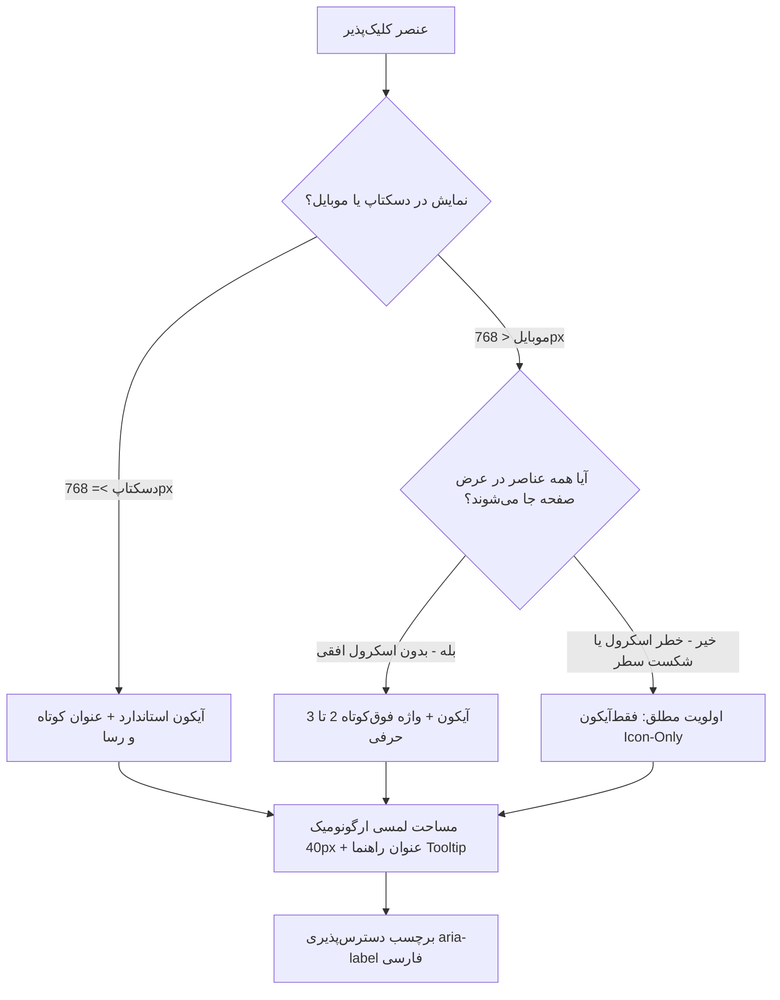
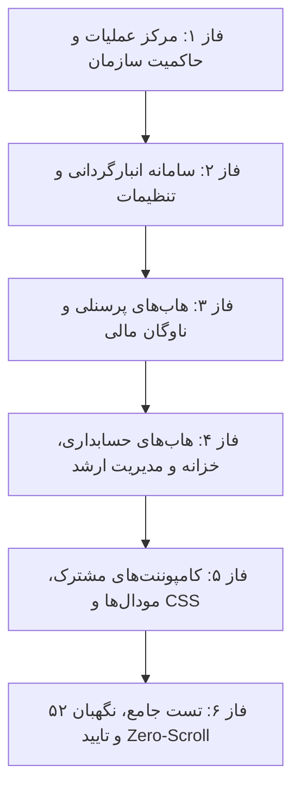

# طرح جامع و فراگیر سازگاری تمامی صفحات و زیرصفحات با قوانین ارگونومی واکنش‌گرا
## (Comprehensive All-Pages & Subpages Responsive Clickable Ergonomics Plan)

> [!IMPORTANT]
> **دامنه طرح:** این طرح به صورت ۱۰۰٪ فراگیر، **تمامی ۵۰ صفحه، زیرصفحه، کارتابل، ماژول، دراور و مودال** فرانت‌اند سامانه یکپارچه انبار و حسابداری (`warehouse-front`) را تحت پوشش قرار می‌دهد تا هرگونه ناهماهنگی در دکمه‌ها، تب‌ها و عناصر کلیک‌پذیر مرتفع شده و تجربه کاربری در دسکتاپ، تبلت و موبایل به سطح استانداردهای تراز اول بین‌المللی (Apple HIG, Google Material 3, WCAG 2.2) ارتقا یابد.

---

## ۱. منشور ارگونومی و اصول تبدیل کلیک‌پذیرها (Universal Transformation Rules)

### چک‌لیست تغییرات استاندارد:
1. **دسکتاپ:** دکمه‌های اصلی و تب‌ها الزاماً باید ترکیب آیکون + عنوان فارسی کوتاه باشند (`عنوان`). هیچ دکمه عملیاتی اصلی نباید بدون عنوان در دسکتاپ رها شود.
2. **موبایل (اصل Zero-Scroll):** در تمام تب‌بارها و اکشن‌بارها، اسکرول افقی مزاحم (`overflow-x-auto`) حذف شده یا در صورت لزوم به ساختار متناسب آیکونی تبدیل می‌شود تا کاربر بدون نیاز به لغزش دست، تمام گزینه‌ها را در یک قاب ببیند.
3. **مساحت لمسی (Touch Targets):** اندازه کلیک‌خور تمامی کلیدها در موبایل حداقل ۴۰×۴۰ تا ۴۴×۴۴ پیکسل (`min-w-[40px] min-h-[40px]` یا `w-10 h-10` یا `.btn-icon-square`).
4. **دسترس‌پذیری و راهنما:** کلیه دکمه‌های آیکونی دارای `aria-label` شفاف فارسی و `title` خواهند شد.
5. **یکپارچگی بصری:** حذف تمام ایموجی‌های متنی (`🏛️`, `🏢`, `👥`, `⏳`, `✅`, `📊`, `📉`, `🔔`) و جایگزینی با آیکون‌های SVG ثبت‌شده در رجیستری مشترک با دایرکتیو `appIcon` (نگهبان ۵۲).

---

## ۲. کالبدشکافی و ماتریس تفصیلی تمامی صفحات و زیرصفحات پروژه

### دسته ۱: مرکز عملیات، مدیریت و حاکمیت سازمان (`/app/operations/*`)

| ردیف | مسیر / صفحه | وضعیت فعلی عناصر کلیک‌پذیر | اقدامات اصلاحی واکنش‌گرا (دسکتاپ و موبایل) |
|---|---|---|---|
| ۱.۱ | **مدیریت شرکت‌ها و هلدینگ** `companies.html` | دکمه ثبت شرکت جدید فقط‌آیکون است؛ تب‌های شیت اسناد در موبایل سرریز دارند. | **دسکتاپ:** افزودن متن «شرکت جدید» به دکمه افزودن. **موبایل:** آیکون ۴۰px با `aria-label`؛ خلاصه کردن تب‌های شیت اسناد بدون اسکرول. |
| ۱.۲ | **تب گوگل‌درایو شرکت** `company-gdrive-tab.html` | دکمه‌های همگام‌سازی، اتصال و احراز هویت در موبایل پهن هستند. | **دسکتاپ:** «همگام‌سازی ابری» / «اتصال». **موبایل:** تبدیل به دکمه‌های آیکونی همراه با نشانگر وضعیت. |
| ۱.۳ | **مدیریت کاربران و نقش‌ها** `users.html` | دکمه‌های ایجاد کاربر/نقش فقط‌آیکون هستند؛ تب ۳ «کارت پرسنلی / گیت‌پاس» متن بلند دارد. | **دسکتاپ:** «کاربر جدید» و «نقش جدید» همراه با آیکون؛ تب ۳ به «کارت پرسنلی» خلاصه شود. **موبایل:** تب‌ها و دکمه‌ها کاملاً آیکونی جهت جا شدن ۱۰۰٪ در یک سطر. |
| ۱.۴ | **داشبورد کوکپیت عملیات** `operations-cockpit.html` | دکمه‌های کارت‌های دسترسی سریع متون طولانی دارند. | ارگونومی کارت‌ها و فشرده‌سازی دکمه‌های پرش به ماژول‌ها برای تبلت و موبایل. |
| ۱.۵ | **حاکمیت نقش‌ها و دسترسی‌ها** `operations-rbac-governance.html` | دکمه‌های فیلتر سطح دسترسی، دکمه‌های ذخیره مجوزها و اکشن‌های گروهی. | تنظیم حداقل اندازه لمسی ۴۰px برای چیپ‌های مجوزی و دکمه‌های ذخیره با آیکون در موبایل. |
| ۱.۶ | **مانیتور همگام‌سازی و سلامت سرور** `operations-sync-monitor.html` | دکمه‌های رفرش صف، پاک‌سازی صف‌های معلق و عیب‌یابی. | تبدیل اکشن‌های سربرگ به دکمه‌های واکنش‌گرا (متن در دسکتاپ، آیکون در موبایل). |
| ۱.۷ | **پشتیبان‌گیری و اسنپ‌شات‌ها** `settings-backup-tab.html` | دکمه‌های ایجاد پشتیبان، بازیابی اسنپ‌شات، دانلود فایل و حذف. | دکمه ایجاد نسخه: در دسکتاپ «پشتیبان جدید»، در موبایل آیکون با `aria-label`. دکمه‌های جدول با کلاس `btn-icon-square`. |
| ۱.۸ | **داشبورد سلامت سیستم** `health-dashboard.html` | دکمه‌های تست پینگ، پاک‌سازی کش و گزارش‌ها. | بهینه‌سازی دکمه‌های ابزار به آیکون‌های استاندارد در موبایل. |
| ۱.۹ | **ممیزی امنیتی و لاگ‌ها** `audit.html` | دکمه‌های فیلتر بازه زمانی، خروجی اکسل و فیلتر کاربران. | استانداردسازی چیپ‌های فیلتر و اکشن‌بار بالای جدول لاگ‌ها. |

---

### دسته ۲: سامانه جامع انبارگردانی (`/app/warehouse/*`)

| ردیف | مسیر / صفحه | وضعیت فعلی عناصر کلیک‌پذیر | اقدامات اصلاحی واکنش‌گرا (دسکتاپ و موبایل) |
|---|---|---|---|
| ۲.۱ | **داشبورد مرکزی انبار** `dashboard.html` | کارت‌های KPI و دکمه‌های فیلتر بازه زمانی و انتخاب انبار. | بهینه‌سازی دکمه‌های فیلتر سریع به چیپ‌های ارگونومیک ۴۰px. |
| ۲.۲ | **پروژه‌های انبارگردانی** `projects.html` | دکمه ایجاد پروژه، دکمه‌های فعال‌سازی/بستن و فیلتر وضعیت. | **دسکتاپ:** «پروژه جدید». **موبایل:** آیکون ۴۰px. دکمه‌های جدول بهینه شوند. |
| ۲.۳ | **هدایت و تخصیص کالا** `dispatch.html` | اکشن‌بار لیبلینگ، تگ‌گذاری دسته‌جمعی و ارجاع موازی. | ارتقای دکمه‌های تگ‌گذاری و حذف تگ به اندازه لمسی استاندارد؛ دکمه‌های هدر ریسپانسیو. |
| ۲.۴ | **مدارک و پرونده‌های انبار** `docs.html` | دکمه‌های فیلتر نوع سند، آپلود و تایید مدارک. | تنظیم دکمه‌های آپلود با متن در دسکتاپ و آیکون در موبایل. |
| ۲.۵ | **تغذیه و ایمپورت اقلام** `feeding.html` | دکمه‌های دانلود فرمت، اعتبارسنجی و ایمپورت داده. | ارتقای نوار دکمه‌های استپ‌بای‌استپ ایمپورت به ارگونومی واکنش‌گرا. |
| ۲.۶ | **کارتابل انبارگردان** `counter-dashboard.html` | دکمه‌های ثبت تعداد، اسکن بارکد، ثبت مغایرت و دکمه ارسال. | دکمه ثبت شمارش: در موبایل کلید بزرگ ارگونومیک لمسی؛ دکمه دوربین ۴۴px. |
| ۲.۷ | **کارتابل سرپرست انبار** `supervisor-dashboard.html` | تب‌های حوزه‌ها، دکمه‌های بازشماری، تایید نهایی و ارجاع. | تب‌ها به صورت آیکونی در موبایل و متون کوتاه در دسکتاپ. |
| ۲.۸ | **بازبینی و ممیزی مدیر انبار** `manager-review.html` | دکمه‌های بستن نهایی، تایید صورتجلسه و گزارش مغایرت. | تبدیل دکمه‌های عملیاتی به الگوی واکنش‌گرا همراه با رنگ‌های معنایی. |
| ۲.۹ | **رهگیری وضعیت شمارش** `count-tracking.html` | دکمه‌های رفرش برخط، فیلتر قفسه‌ها/راهروها و زوم نقشه. | ارگونومی کلیدهای نوار ابزار در نمایشگرهای لمسی تبلت و موبایل. |
| ۲.۱۰ | **گزارش‌های تخصصی انبار** `reports.html` | تب‌های گزارش‌ها (موجودی، ریالی، کارکرد)، دکمه اکسل و چاپ. | خلاصه کردن تب‌های گزارش به عناوین کوتاه و بدون اسکرول در موبایل. |
| ۲.۱۱ | **کارتابل مالی و گمرک** `customs.html` | تب‌های «تسک‌های من» و «مخزن اسناد»، دکمه اسکن و اکسل. | تب‌ها فشرده و بهینه‌سازی دکمه اسکن و اکشن‌های جدول. |
| ۲.۱۲ | **تنظیمات سراسری سیستم** `settings.html` | تب‌های ۵گانه با `min-w-[150px]` و ایجاد اسکرول ۷۵۰px در موبایل! | **اصلاح حیاتی:** حذف `min-w-[150px]`؛ نمایش ۵ تب در موبایل به صورت آیکون‌های هم‌عرض در یک خط (عرض زیر ۳۰۰px و صفر اسکرول)؛ دسکتاپ عناوین کوتاه. |
| ۲.۱۳ | **تنظیمات اختصاصی انبار** `wh-settings.html` | دکمه‌های انتخاب انبار فعال، تغییر پیکربندی اسکنر و ذخیره. | ریسپانسیو کردن نوار دکمه‌های فرم تنظیمات انبار. |

---

### دسته ۳: هاب‌های پرسنلی و ناوگان در سامانه مالی (`/app/finance/employee/*` & `supervisor/*`)

| ردیف | مسیر / صفحه | وضعیت فعلی عناصر کلیک‌پذیر | اقدامات اصلاحی واکنش‌گرا (دسکتاپ و موبایل) |
|---|---|---|---|
| ۳.۱ | **حضور و غیاب کارمند** `employee-attendance.html` | زیرتب‌های روزانه/ماهانه، دکمه‌های ذخیره کارکرد روزانه و ماهانه با متون بلند. | **دسکتاپ:** «ثبت کارکرد» / «به‌روزرسانی». **موبایل:** دکمه ذخیره آیکونی با نشانگر پالس؛ زیرتب‌ها: «روزانه» و «ماهانه». |
| ۳.۲ | **تردد ناوگان کارمند** `employee-fleet.html` | دکمه‌های «تعریف راننده/خودرو» و «ممیزی» با متون بلند در هدر که باعث شکست خط می‌شوند. | **دسکتاپ:** «تعریف راننده» / «ممیزی». **موبایل:** تبدیل هر دو به دکمه فقط‌آیکون ۴۰px؛ زیرتب‌ها: «روزانه» و «ماهانه» بدون اسکرول. |
| ۳.۳ | **فاکتورهای کارمند** `employee-invoices.html` | تب‌های وضعیت فاکتورها، دکمه ثبت فاکتور جدید، آپلود تصویر. | دکمه فاکتور جدید: در دسکتاپ «فاکتور جدید»، در موبایل آیکون ۴۰px. |
| ۳.۴ | **تنخواه‌گردان کارمند** `employee-petty-cash.html` | تب‌های درخواست تنخواه، دکمه تسویه و دکمه ضمیمه فیش. | بهینه‌سازی دکمه‌های اکشن به الگوی آیکونی در موبایل. |
| ۳.۵ | **ثبت خودرو/راننده جدید** `employee-new-vehicle.html` | دکمه‌های مراحل ثبت، استعلام پلاک، ثبت نهایی و انصراف. | دکمه‌های مرحله‌بندی شده با متون رسا در دسکتاپ و آیکون/متن کوتاه در موبایل. |
| ۳.۶ | **ثبت پرسنل جدید** `employee-new-personnel.html` | تب‌های ۳ مرحله‌ای ثبت، دکمه‌های استعلام شبا و ثبت نهایی. | تب‌ها و اکشن‌بارهای پایین فرم به صورت واکنش‌گرا و دکمه شبا ارگونومیک. |
| ۳.۷ | **تایید کارکرد سرپرست** `supervisor-attendance.html` | زیرتب‌ها، دکمه تایید گروهی کارکرد، دکمه رد و ثبت توضیحات. | دکمه تایید گروهی در دسکتاپ «تایید کارکرد»، در موبایل آیکون ۴۰px با رنگ سبز. |
| ۳.۸ | **تایید ناوگان سرپرست** `supervisor-fleet.html` | زیرتب‌ها، دکمه تایید پیمایش و سرویس‌ها. | ارگونومی کلیدهای تایید/رد در تبلت و موبایل بدون اسکرول. |
| ۳.۹ | **تایید فاکتورها سرپرست** `supervisor-invoices.html` | دکمه‌های بررسی فاکتور، تایید، ارجاع و پیش‌نمایش مدارک. | بهینه‌سازی دکمه‌های جدول و اکشن‌های سریع به چیپ‌های لمسی استاندارد. |
| ۳.۱۰ | **تایید تنخواه سرپرست** `supervisor-petty-cash.html` | دکمه‌های تایید ریزهزینه‌ها و گزارش صورت وضعیت. | استانداردسازی دکمه‌های بررسی و تایید به الگوی ریسپانسیو. |
| ۳.۱۱ | **مدیریت پرسنل سرپرست** `supervisor-personnel.html` | تب‌های وضعیت استخدامی پرسنل، دکمه فعال/غیرفعال‌سازی. | تب‌ها بدون اسکرول و دکمه‌های درون سطور جدول با اندازه استاندارد. |
| ۳.۱۲ | **قفل دوره‌های مالی سرپرست** `supervisor-period-lock.html` | دکمه قفل دوره، بازگشایی دوره با تایید دو مرحله‌ای. | ارگونومی دکمه‌های حساس با پاپ‌آپ تاییدیه و استایل شفاف. |

---

### دسته ۴: هاب‌های حسابداری، خزانه و مدیریت ارشد مالی (`/app/finance/accountant/*`, `treasurer/*`, `manager/*`)

| ردیف | مسیر / صفحه | وضعیت فعلی عناصر کلیک‌پذیر | اقدامات اصلاحی واکنش‌گرا (دسکتاپ و موبایل) |
|---|---|---|---|
| ۴.۱ | **حقوق و دستمزد حسابدار** `accountant-payroll.html` | تب‌های سه‌گانه با ایموجی (`⏳`, `✅`) و متون بلند («پیش‌نمایش محاسبات»، «تایید مالی و نهایی»). | **حذف ایموجی‌ها**؛ اتصال آیکون‌های SVG استاندارد؛ دسکتاپ: «آماده محاسبه»، «محاسبه‌شده»، «تایید نهایی»؛ موبایل: «آماده»، «محاسبه»، «تایید» بدون اسکرول افقی. |
| ۴.۲ | **ناوگان حسابدار** `accountant-fleet.html` | دکمه‌های محاسبه کرایه، تسویه صورتحساب و خروجی مالی. | بهینه‌سازی نوار فرماندهی و دکمه‌های تسویه به الگوی دسکتاپ/موبایل. |
| ۴.۳ | **پرسنل حسابدار** `accountant-personnel.html` | تب‌های دسته‌بندی پرسنل، دکمه اصلاح پایه حقوق و بیمه. | تب‌ها و ابزارهای جستجو در هدر کاملاً ریسپانسیو شوند. |
| ۴.۴ | **فاکتورها و اسناد حسابدار** `accountant-invoices.html` | تب‌های ممیزی اسناد، دکمه صدور سند حسابداری و رد سند. | بهینه‌سازی دکمه صدور سند: دسکتاپ «صدور سند»، موبایل آیکون ۴۰px. |
| ۴.۵ | **رسیدگی تنخواه حسابدار** `accountant-petty-cash.html` | دکمه‌های شارژ تنخواه، تایید اسناد هزینه و بایگانی. | اکشن‌بار بالای صفحه به الگوی واکنش‌گرا مجهز شود. |
| ۴.۶ | **تولید دیسکت‌های بیمه و مالیات** `accountant-diskettes.html` | تب‌های دیسکت تامین اجتماعی و دیسکت مالیات حقوق، دکمه تولید فایل. | تب‌ها: «بیمه تامین اجتماعی» و «مالیات حقوق» در دسکتاپ، «بیمه» و «مالیات» در موبایل؛ دکمه تولید فایل آیکونی در موبایل. |
| ۴.۷ | **طرف‌های حساب و شرکت‌ها** `counterparties.html` | تب‌های اشخاص/شرکت‌ها، دکمه ثبت طرف حساب جدید، خروجی اکسل. | دکمه ثبت جدید: دسکتاپ «طرف حساب جدید»، موبایل آیکون ۴۰px. |
| ۴.۸ | **دستور پرداخت‌های خزانه** `treasurer-disbursements.html` | تب‌های دستور پرداخت، دکمه ثبت پرداخت، اتصال پوز و چاپ چک. | بهینه‌سازی دکمه ثبت پرداخت و خروجی بانک به الگوی واکنش‌گرا. |
| ۴.۹ | **تسویه فاکتورهای خزانه** `treasurer-invoices.html` | دکمه‌های تسویه نقدی/چکی، الصاق رسید و فیلترها. | دکمه‌های تسویه در سطور جدول به چیپ‌های ارگونومیک تبدیل شوند. |
| ۴.۱۰ | **حساب‌های بانکی و پوزها** `treasurer-bank-accounts.html` | دکمه افزودن حساب بانکی جدید، تنظیم پوز پیش‌فرض و ریفرش موجودی. | دکمه حساب جدید: دسکتاپ «حساب جدید»، موبایل آیکون ۴۰px با `aria-label`. |
| ۴.۱۱ | **مدیریت چک‌ها و اسناد** `treasurer-cheques.html` | تب‌های چک‌های دریافتی / پرداختی، دکمه ثبت چک، وصول و واگذاری. | تب‌ها فشرده و بدون اسکرول؛ دکمه‌های واگذاری با ابعاد لمسی استاندارد. |
| ۴.۱۲ | **مغایرت‌گیری بانکی** `treasurer-reconciliation.html` | دکمه بارگذاری صورتحساب بانکی، انطباق هوشمند و ثبت سند مغایرت. | بهینه‌سازی نوار ابزار انطباق صورتحساب بانکی در موبایل. |
| ۴.۱۳ | **داشبورد هوش مالی مدیر** `manager-dashboard.html` | تب‌های ۳گانه با ایموجی (`📊`, `📉`, `🔔`) و عناوین بلند. | **حذف ایموجی‌ها**؛ اتصال آیکون‌های SVG؛ خلاصه به «شاخص‌ها»، «انحراف بودجه»، «هشدارها»؛ جای‌گیری کامل در موبایل بدون اسکرول. |
| ۴.۱۴ | **کنترل و تخصیص بودجه مدیر** `manager-budget.html` | دکمه‌های تخصیص سرفصل، ویرایش بودجه و هشدارهای سرریز. | دکمه‌های تغییر سقف بودجه ارگونومیک و واکنش‌گرا شوند. |
| ۴.۱۵ | **قراردادها و پیمانکاران مدیر** `manager-contracts.html` | دکمه ثبت قرارداد جدید، تمدید، الحاقیه و بارگذاری PDF. | دکمه قرارداد جدید: دسکتاپ «قرارداد جدید»، موبایل آیکون ۴۰px. |
| ۴.۱۶ | **گزارش‌های جامع مدیر مالی** `manager-reports.html` | تب‌های گزارش تراز، گردش نقدینگی و تحلیل بهای تمام‌شده. | تب‌ها به عناوین کوتاه و بدون اسکرول در موبایل خلاصه شوند. |
| ۴.۱۷ | **کارتابل تاییدات نهایی مدیر** `manager-approvals.html` | دکمه‌های تایید نهایی لیست حقوق، دستور پرداخت‌های کلان و امضا. | دکمه‌های امضا و تایید با رنگ‌های سبز و مساحت لمسی ۴۴px در موبایل. |
| ۴.۱۹ | **پروژه‌ها و بخش‌های سازمان** `projects-and-sections.html` | تب‌های ۳گانه با ایموجی متنی (`🏛️`, `🏢`, `👥`) و عناوین طولانی. | **حذف ایموجی‌ها**؛ اتصال `appIcon`؛ کوتاه کردن به «پروژه‌ها»، «بخش‌ها»، «انتساب‌ها» (صفر اسکرول در موبایل). |
| ۴.۲۰ | **بایگانی مدارک شرکت** `company-documents-archive.html` | تب‌های مدارک ثبتی، مجوزها، اسناد مالیاتی، دکمه بارگذاری سند. | تب‌ها و دکمه بارگذاری مدارک به صورت واکنش‌گرا بازطراحی شوند. |
| ۴.۲۱ | **شناسنامه پرسنل و پرونده‌ها** `personnel-profiles.html` | تب‌های اطلاعات فردی، سوابق بیمه، قراردادها و فیلترها. | تب‌های ناوبری پرونده پرسنل در موبایل به صورت آیکونی بدون اسکرول. |
| ۴.۲۲ | **تنظیمات پایه مالی و حقوق** `base-settings.html` | دکمه‌های تنظیم ضرایب قانون کار، مالیات و ذخیره فرمول‌ها. | دکمه‌های ذخیره فرمول‌ها با بازخورد دیداری مناسب و ارگونومی لمسی. |

---

### دسته ۵: کامپوننت‌های سراسری، هدرها، دراورها و مودال‌ها (Global Shared UI)

| ردیف | کامپوننت / المان | وضعیت فعلی عناصر کلیک‌پذیر | اقدامات اصلاحی واکنش‌گرا (دسکتاپ و موبایل) |
|---|---|---|---|
| ۵.۱ | **هدر کارتابل مشترک** `cartable-header.component.ts` | سوئیچر دامنه‌ها متون طولانی «شمارش فیزیکی (انبار)» و «اسناد مالی و گمرک» دارد. | **دسکتاپ:** «شمارش فیزیکی» / «اسناد مالی». **موبایل:** «شمارش» / «مالی» یا فقط‌آیکون؛ دکمه انتخاب همه و چیپ‌های وضعیت ریسپانسیو. |
| ۵.۲ | **جدول داده سراسری** `data-table.component.ts` | دکمه‌های زوم، انتخاب ستون‌ها، Undo/Redo، فیلتر ستون‌ها و صفحه‌بندی. | در موبایل متون دکمه‌های نوار ابزار پنهان شده و دکمه‌ها به ابعاد حداقل ۴۰px با آیکون تبدیل شوند؛ کلیدهای صفحه‌بندی ارگونومیک شوند. |
| ۵.۳ | **منوی کاربری** `user-menu.component.html` | دکمه‌های بروزرسانی PWA، خروج، تغییر رمز و میانبرها. | ارگونومی آیتم‌های کلیک‌پذیر منو با پدینگ مناسب لمسی (`py-2.5 px-3`) و آیکون‌های شارپ. |
| ۵.۴ | **دراور گفتگوی سازمانی** `chat-drawer.component.html` | تب‌های گفتگوها / مخاطبین، دکمه ارسال پیام و بستن دراور. | تب‌ها در بالای دراور به حالت فشرده و کلید ارسال پیام با ابعاد لمسی ۴۴px. |
| ۵.۵ | **گالری و ویرایشگر عکس اقلام** `item-photo-gallery.component.html` | دکمه‌های چرخش، زوم، دوربین، آپلود و تمام‌صفحه. | ارتقای مساحت لمسی دکمه‌های گالری در حالت تبلت و موبایل به ۴۰×۴۰px. |
| ۵.۶ | **مودال اکسل مشترک** `excel-import-modal.html` | دکمه‌های دانلود الگو، انصراف، انتخاب فایل و تایید بارگذاری. | دکمه‌های پایین مودال در موبایل به صورت تمام‌عرض (Full-Width) ارگونومیک شوند. |
| ۵.۷ | **مودال حذف هوشمند** `smart-delete-modal.html` | دکمه‌های لغو و حذف قطعی. | کلیدهای اکشن با فونت برجسته، حداقل ارتفاع ۴۴px و دسترسی‌پذیری کامل. |
| ۵.۸ | **مودال برش تصویر آواتار** `avatar-cropper-modal.html` | دکمه‌های چرخش، فعال‌سازی دوربین، انصراف و ذخیره. | کلیدهای ابزار به آیکون‌های استاندارد و کلید ذخیره به اندازه لمسی مناسب. |
| ۵.۹ | **سوئیچر نقش و پرسونای فعال** `app-role-switcher.component.html` | چیپ‌های انتخاب نقش در هدر سامانه مالی. | در موبایل تبدیل به دکمه فشرده با پاپ‌اوور عمودی بدون اسکرول افقی. |
| ۵.۱۰ | **انتخابگر انبار و بخش‌ها** `warehouse-selector.component.ts` | دراپ‌داون و دکمه‌های انتخابگر سریع. | ارگونومی بازشدن دراپ‌داون در موبایل و جلوگیری از تداخل با نوار وضعیت. |
| ۵.۱۱ | **پورتال لانچر برنامه‌ها** `app-launcher.component.html` | کارت‌های کلیک‌پذیر ماژول‌های انبار، مالی و عملیات. | ارگونومی کلیک روی کارت‌ها و دکمه‌های ورود سریع در صفحات باریک. |
| ۵.۱۲ | **صفحات ورود و تغییر رمز** `login.html` & `change-password.html` | دکمه ورود، نمایش/پنهان‌سازی رمز عبور و دکمه تایید. | ارتفاع کلیدهای سابمیت حداقل ۴۸px و دکمه چشم رمزعبور با پدینگ لمسی مناسب. |
| ۵.۱۳ | **کلاس‌های استایل سراسری** `src/styles.css` | کلاس `.btn-icon-square` در برخی شرایط اندازه زیر ۳۶px پیدا می‌کند. | افزودن قوانین قطعی ریسپانسیو: `min-width: 2.5rem; min-height: 2.5rem;` (۴۰px) در موبایل. |

---

## ۳. نقشه راه فازبندی‌شده اجرا (Phased Execution Roadmap)

طرح تفصیلی در **۶ فاز متوالی و خودبسنده** پیاده‌سازی خواهد شد:

* **فاز ۱ (مرکز عملیات و حاکمیت - ۹ صفحه):** `companies`, `company-gdrive-tab`, `users`, `operations-cockpit`, `operations-rbac-governance`, `operations-sync-monitor`, `settings-backup-tab`, `health-dashboard`, `audit`.
* **فاز ۲ (سامانه جامع انبارگردانی - ۱۳ صفحه):** `dashboard`, `projects`, `dispatch`, `docs`, `feeding`, `counter-dashboard`, `supervisor-dashboard`, `manager-review`, `count-tracking`, `reports`, `customs`, `settings` (۵ زیرتب), `wh-settings`.
* **فاز ۳ (هاب‌های پرسنلی و ناوگان مالی - ۱۲ صفحه):** `employee-attendance`, `employee-fleet`, `employee-invoices`, `employee-petty-cash`, `employee-new-vehicle`, `employee-new-personnel`, `supervisor-attendance`, `supervisor-fleet`, `supervisor-invoices`, `supervisor-petty-cash`, `supervisor-personnel`, `supervisor-period-lock`.
* **فاز ۴ (هاب‌های حسابداری، خزانه و مدیریت ارشد - ۲۱ صفحه):** `accountant-payroll`, `accountant-fleet`, `accountant-personnel`, `accountant-invoices`, `accountant-petty-cash`, `accountant-diskettes`, `counterparties`, `treasurer-disbursements`, `treasurer-invoices`, `treasurer-bank-accounts`, `treasurer-cheques`, `treasurer-reconciliation`, `manager-dashboard`, `manager-budget`, `manager-contracts`, `manager-reports`, `manager-approvals`, `projects-and-sections`, `company-documents-archive`, `personnel-profiles`, `base-settings`.
* **فاز ۵ (کامپوننت‌های مشترک، مودال‌ها و CSS - ۱۳ کامپوننت):** `cartable-header`, `data-table`, `user-menu`, `chat-drawer`, `item-photo-gallery`, `excel-import-modal`, `smart-delete-modal`, `avatar-cropper-modal`, `app-role-switcher`, `warehouse-selector`, `app-launcher`, `login/change-password`, `src/styles.css`.
* **فاز ۶ (اعتبارسنجی جامع، نگهبان ۵۲ و سنجش Zero-Scroll):** تست کامپایل `tsc`، پاس ۱۰۰٪ نگهبان ۵۲ آیکون‌ها، تست‌های DOM با Vitest، و تست دیداری در ویوپورت‌های ۳۶۰px، ۳۹۰px، ۷۶۸px و ۱۰۲۴px.

---

## ۴. استراتژی ایمنی، عدم بازگشت و پایداری (Safety & Stability)
* **پرهیز از شکست کارکردی:** کلیه تغییرات صرفاً در لایه الگوهای HTML و کلاس‌های Tailwind انجام می‌پذیرد و هیچ تغییری در متدهای بیزنسی، مدل‌ها، یا پایگاه داده اعمال نمی‌گردد.
* **پایبندی به نگهبان ۵۲:** تمامی آیکون‌های جدید صرفاً از طریق رجیستری مشترک با دایرکتیو `appIcon` اضافه می‌شوند و هیچ تگ `<svg>` درون‌خطی خام اضافه نخواهد شد.
* **پیشرفت گام‌به‌گام:** پس از پایان هر فاز، سلامت بیلد پروژه با `tsc --noEmit` سنجیده خواهد شد.

