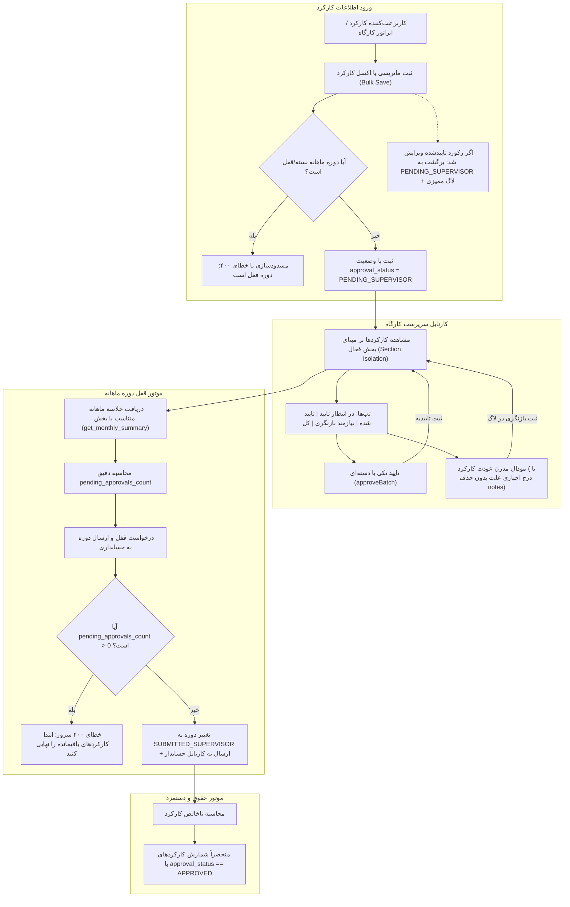

<div dir="rtl" align="right">

# سند طرح جامع بازطراحی منوها و کارتابل‌های نقش‌محور (نسخه به‌روزشده با استراتژی هم‌زیستی و عدم بازنویسی)

این سند معماری فنی، ساختار تفکیک منوها و کارتابل‌های نقش‌محور بخش **«منابع انسانی، ناوگان و حسابداری مالی»** را تعریف کرده و شامل دو شرط راهبردی جدید: **۱) عدم حذف منوهای قبلی تا زمان تایید نهایی کاربر** و **۲) ایجنت نگهبان سخت‌گیر عدم بازنویسی کد و حفظ ۱۰۰٪ ساختار قبلی** می‌باشد.

---

## ۱. اصول راهبردی دوگانه جدید (Two Critical Strategic Invariants)

### ۱. استراتژی هم‌زیستی منوها (Non-Destructive Coexistence)
* منوهای فعلی سایدبار و مسیرهای گذشته (`/personnel`، `/payroll`، `/fleet-settlement`، `/attendance`، `/fleet`) به هیچ وجه حذف نمی‌شوند.
* منوها و کارتابل‌های جدید در کنار منوهای قبلی (با عنوان مشخص یا نشانگر نوین) در دسترس قرار می‌گیرند تا کاربر بتواند عملکرد هر دو را هم‌زمان مقایسه و تست کند.
* حذف و پاک‌سازی منوهای قدیمی **صرفاً پس از تایید نهایی و رضایت کامل کاربر** در یک گام مستقل انجام خواهد شد.

### ۲. قانون طلایی عدم بازنویسی و حفظ ساختار (Zero-Rewrite & Code Preservation)
* **هیچ کدی از نو بازنویسی نمی‌شود.**
* تمامی لاجیک‌ها، توابع محاسباتی ۵۸ ستونه حقوق، تسویه ناوگان، فرمول‌های دیسکت، ماژول‌های شبا، مودال‌ها، ساختار فرم‌ها و استایل‌های موجود، به صورت ۱۰۰٪ دست‌نخورده از کامپوننت‌های معتبر فعلی کپی و منتقل (Clone & Reuse) می‌شوند.
* ایجنت نگهبان سخت‌گیر اختصاصی برای اعتبارسنجی عدم دستکاری فرمول‌ها و ساختارها ایجاد می‌شود.

---

## ۲. ساختار معماری منوهای جدید و تب‌های بالای صفحه

```mermaid
graph TD
    subgraph منوهای جدید (۴ پرتال در کنار منوهای فعلی)
        M1[📋 ۱. ثبت کارکرد <br/> /attendance]
        M2[👑 ۲. کارتابل مدیر <br/> /manager-approvals]
        M3[💳 ۳. کارتابل مالی <br/> /finance-cartable]
        M4[⚙️ ۴. تنظیمات پایه <br/> /base-settings]
    end

    subgraph تب‌های بالای صفحه: ثبت کارکرد
        M1 --> T1_1[👤 پرسنل: ثبت روزانه و ۳۱ روزه]
        M1 --> T1_2[🚛 ناوگان: ثبت سرویس و ۳۱ روزه]
    end

    subgraph تب‌های بالای صفحه: کارتابل مدیر
        M2 --> T2_1[👤 پرسنل جدید]
        M2 --> T2_2[🚛 ناوگان جدید]
        M2 --> T2_3[📋 کارتابل ویرایش‌ها Diff]
        M2 --> T2_4[📅 دوره‌های کارکرد]
    end

    subgraph تب‌های بالای صفحه: کارتابل مالی
        M3 --> T3_1[💳 تایید نهایی مالی]
        M3 --> T3_2[💰 محاسبه حقوق ۵۸ ستونه]
        M3 --> T3_3[🚛 تسویه ناوگان پایا/شبا]
        M3 --> T3_4[📁 دیسکت‌های قانونی بیمه/مالیات]
        M3 --> T3_5[📊 گزارشات مالی]
    end

    subgraph تب‌های بالای صفحه: تنظیمات پایه
        M4 --> T4_1[💼 تنظیمات حقوق و دستمزد]
        M4 --> T4_2[📆 تقویم و تردد]
        M4 --> T4_3[⚙️ تنظیمات عمومی و سیستم]
    end
```

---

## ۳. ماتریس ۷ ایجنت نگهبان مستقل و سخت‌گیر (Strict Phase Guardians Matrix)

| شناسه | نام ایجنت نگهبان | مسئولیت و آزمون اعتبارسنجی سختگیرانه |
| :---: | :--- | :--- |
| **🛡️ G0** | **Code Preservation & Zero-Rewrite Guardian** | **(جدید)** اعتبارسنجی تطابق ۱۰۰٪ خطوط کدهای کپی‌شده؛ تضمین عدم بازنویسی توابع محاسباتی، شیت ۵۸ ستونه، دیسکت‌ها و حفظ ساختار فعلی. |
| **🛡️ G1** | **Sidebar Coexistence & Taxonomy Guardian** | اعتبارسنجی در دسترس بودن هم‌زمان منوهای قبلی و منوهای جدید بدون ایجاد تداخل در سایدبار. |
| **🛡️ G2** | **URL & Filter Sync Guardian** | تست سینک دوطرفه URL Query Params با تمام تب‌ها، فیلترهای وضعیت، انبارها و حفظ State هنگام Refresh. |
| **🛡️ G3** | **Manager Approval Hub Guardian** | آزمون ۴ تب کارتابل مدیر، دسترسی‌های مدیر و کارکرد دکمه‌های تایید مرحله اول (`manager_approved`). |
| **🛡️ G4** | **Finance & Payroll Guardian** | آزمون ۵ تب کارتابل مالی، تایید مرحله دوم (`approved`)، موتور ۵۸ ستونه، دیسکت‌های قانونی و تسویه شبا. |
| **🛡️ G5** | **Base Settings Extensibility Guardian** | آزمون ۳ تب تنظیمات پایه، جداول ۲۰ گروه شغلی و معماری توسعه‌پذیر برای تنظیمات آتی. |
| **🛡️ G6** | **Zero-Regression & Build Guardian** | اعتبارسنجی کامپایل کامل تایپ‌اسکریپت (`npx tsc --noEmit`)، سبز بودن تست‌های بک‌اند و سلامت دیتابیس. |

---

## ۴. فازبندی اجرایی و مراحل پیاده‌سازی (Phased Roadmap)

### فاز ۱: زیرساخت مسیردهی هم‌زمان (Routing Coexistence & URL Sync)
* افزودن مسیرهای جدید به `app.routes.ts` بدون حذف یا تغییر مسیرهای قبلی.
* پیاده‌سازی همگام‌ساز دوطرفه تب‌ها و فیلترها با URL Query Params.
* **بررسی نگهبان:** ایجنت نگهبان G2 و G1.

---

### فاز ۲: استقرار منوهای جدید در سایدبار با حفظ منوهای قبلی (Sidebar Coexistence)
* نمایش منوهای جدید در بخش «منابع انسانی، ناوگان و حسابداری» در کنار منوهای قبلی.
* **بررسی نگهبان:** ایجنت نگهبان G1.

---

### فاز ۳: پیاده‌سازی کارتابل اختصاصی تاییدات مدیر بر پایه کپی ساختار (Manager Approval Hub)
* ساخت کامپوننت `ManagerApprovals` با ۴ تب بالای صفحه.
* کپی دقیق و ماژولار جداول، مودال مقایسه تغییرات (Diff Viewer)، متدهای تایید/رد و استایل‌ها بدون بازنویسی کد.
* **بررسی نگهبان:** ایجنت نگهبان G0 و G3.

---

### فاز ۴: پیاده‌سازی کارتابل جامع مالی و حسابداری بر پایه کپی ساختار (Finance Cartable)
* ساخت کامپوننت `FinanceCartable` با ۵ تب استاندارد بالای صفحه.
* کپی دقیق شیت ۵۸ ستونه حقوق، محاسبات تسویه ناوگان، صدور دیسکت‌های بیمه و مالیات و گزارشات مالی بدون هیچ‌گونه تغییر در فرمول‌ها.
* **بررسی نگهبان:** ایجنت نگهبان G0 و G4.

---

### فاز ۵: پیاده‌سازی پورتال مستقل تنظیمات پایه بر پایه کپی ساختار (Base Settings Portal)
* ساخت کامپوننت `BaseSettings` با ۳ تب ماژولار.
* کپی فرم‌ها و جداول ۲۰ گروه شغلی، ضرایب بیمه، سقف مالیاتی و تقویم کاری.
* **بررسی نگهبان:** ایجنت نگهبان G0 و G5.

---

### فاز ۶: آزمون‌های جامع ۷ ایجنت نگهبان، اعتبارسنجی Build و تحویل جهت بررسی کاربر
* اجرای ارزیابی تمامی ۷ ایجنت نگهبان.
* تست کامپایل کامل فرانت‌اند (`npx tsc --noEmit`).
* **مرحله اختیاری پس از تایید کاربر:** حذف و پاک‌سازی منوهای قدیمی (در صورت اعلام رضایت نهایی کاربر).

---

# 🏛️ طرح جامع، فازبندی‌شده و استاندارد ارتقای تمامی ۳۱ صفحه سامانه (Global UI/UX Master Implementation Plan)
* **سند تفصیلی:** `Documents/Global_UI_UX_Standardization/implementation_plan_global_ui_ux.md`
* **پوشش:** ۱۰۰٪ صفحات موجود در کل سامانه (۳۱ صفحه در ۶ ماژول)
* **قانون تخطی‌ناپذیر:** عدم تغییر هیچ خط کدی تا زمان دریافت تاییدیه صریح کاربر

## خلاصه ۱۲ الگوی استاندارد مرجع
1. **P-01 (Icon-Square Actions):** دکمه‌های آیکونی هدر با نشانگر زنده
2. **P-02 (Header Consolidation):** تجمیع هدر و عنوان واحد صفحه
3. **P-03 (Multi-Criteria Filter Bar):** نوار فیلتر چندمعیاره بالای جداول
4. **P-04 (Bulk Selection & Floating Bar):** انتخاب گروهی با `Set` و نوار اقدام شناور تیره
5. **P-05 (Selective Excel Export):** خروجی اکسل و دیسکت انتخابی در بک‌اند با پارامتر `ids`
6. **P-06 (Compact Modern Pagination):** صفحه‌بندی مدرن، متراکم و استاندارد ۳ بخشی
7. **P-07 (3-Column Studio):** معماری استودیو ۳ ستونه هم‌عرض و هم‌ارتفاع
8. **P-08 (In-Card Segmented Control):** تب‌بندی خرد سگمنتد داخل فرم‌ها
9. **P-09 (Visual KPI Mini-Bar):** نوارهای پیشرفت بصری شاخص‌های پیشرفت
10. **P-10 (Quick Inspection Popover):** پاپ‌اور پیش‌نمایش سریع داده‌ها بدون ترک صفحه
11. **P-11 (Defensive Safety Timeout):** لودینگ دفاعی تصاویر با سقف ۱۵۰۰ms و فال‌بک امن
12. **P-12 (Persistent Dual View):** سوئیچ دوگانه نمای کارت/جدول با ذخیره در حافظه محلی

## ۶ فاز اجرایی
* **فاز ۱: کارتابل‌های عملیاتی انبارگردانی (صفحات ۱ تا ۵)** - روت‌های Counter, Supervisor, Manager Review, Count Tracking, Dispatch
* **فاز ۲: کارتابل‌های اسناد، کالا، گمرک و لیبل (صفحات ۶ تا ۱۰)** - روت‌های Docs, Customs, Feeding, Label Studio, Placeholders
* **فاز ۳: کارکرد پرسنل، ناوگان و پرونده‌ها (صفحات ۱۱ تا ۱۴)** - روت‌های Attendance, Fleet, Profiles Hub, Base Settings
* **فاز ۴: کارتابل‌های مالی، حقوق و خزانه‌داری (صفحات ۱۵ تا ۱۹)** - روت‌های Payroll, Fleet Settlement, Manager Approvals, Treasury, Projects & Sections
* **فاز ۵: داشبوردها، گزارش‌ساز و سلامت (صفحات ۲۰ تا ۲۶)** - روت‌های Wh Dashboard, Dynamic Reports Builder, Wh/Fin/Ops Health, Ops Cockpit, Sync Monitor
* **فاز ۶: زیرساخت، حاکمیت RBAC و پورتال‌ها (صفحات ۲۷ تا ۳۱)** - روت‌های Projects, Settings/Backup, Audit Trail, RBAC Governance, Auth Portals

---

# 👤 طرح جامع مهندسی انتقال ماژولار کارکرد و ناوگان به منوی کارمند (Employee Portal Modular Migration Plan)
* **سند تفصیلی:** `Documents/Employee_Portal_Modular_Migration/implementation_plan_employee_modular_migration.md`
* **هدف:** تفکیک قطعات بالغ و پایدار صفحه `WarehouseAttendance` به ۵ زیرمنوی مستقل پنل کارمند بدون کمترین دستکاری در کدهای مبدا.
* **۵ زیرمنوی هدف:**
  1. 📋 **کارکرد پرسنل** (`/app/finance/employee-attendance`): ماتریس روزانه، تقویم ۳۱ روزه، پیست اکسل، اعمال دسته‌ای و پرینت
  2. 🚚 **کارکرد ماشین‌آلات** (`/app/finance/employee-fleet`): ثبت تردد روزانه، تقویم ۳۱ روزه، پیست اکسل، پرینت و لاگ ممیزی
  3. 🧾 **ثبت فاکتور هزینه** (`/app/finance/employee-invoices`): ثبت سند با تصویر، مودال طرف‌حساب، تحمیل قطعی وضعیت draft
  4. 🚗 **تعریف خودرو جدید** (`/app/finance/employee-new-vehicle`): مشخصات خودرو، اعتبارسنجی آنلاین شبا و بانک‌ها، تحمیل draft
  5. 👥 **تعریف پرسنل جدید** (`/app/finance/employee-new-personnel`): پرونده هویتی، اعتبارسنجی کد ملی، انتساب بخش، تحمیل draft
* **نگهبانان سخت‌گیر:** G1 (ایزولاسیون قلمرو بخش)، G2 (تحمیل وضعیت پیش‌نویس)، G3 (مصونیت کدهای مبدا)، G4 (انطباق محاسبات تیرماه)، G5 (سلامت بیلد و تایپ‌سیفتی).

---

# 🛡️ طرح جامع سطوح دسترسی و تفکیک وظایف (Strict RBAC & Segregation of Duties)
* **سند تفصیلی:** `Documents/RBAC_Access_Control/implementation_plan_rbac_access_control.md`
* **لیست تسک‌ها:** `Documents/RBAC_Access_Control/task_rbac_access_control.md`
* **اصل بنیادین:** ایزولاسیون صددرصدی نقش فعال؛ کاربری که صرفاً نقشی مانند «حسابدار» دارد، فقط و فقط منوی اختصاصی حسابدار را مشاهده می‌کند و به سایر منوهای کارکرد (کارمند، سرپرست، مدیر، خزانه‌دار) یا نرم‌افزار و کارتابل‌های انبارداری دسترسی نخواهد داشت.
* **پوشش:** تمامی نقش‌ها در ۳ حوزه (مالی و کارکرد، انبارداری و انبارگردانی، پدافند و زیرساخت).
* **لایه‌های چهارگانه ایمن‌سازی:** ۱) فیلتر سایدبار، ۲) گارد مسیرها، ۳) ایزولاسیون ماژول و کارت انبار، ۴) اعتبارسنجی وب‌سرویس و SoD بک‌اند.

---

# 🚚 طرح جامع بازطراحی و ارتقای ناوگان جدید (Vehicle New Fleet Refactor Plan)
* **سند تفصیلی طرح:** [`Documents/Vehicle_New_Fleet_Refactor/implementation_plan_vehicle_refactor.md`](file:///e:/warehouse%20project/Documents/Vehicle_New_Fleet_Refactor/implementation_plan_vehicle_refactor.md)
* **سند مرجع ۲۴ گانه:** [`Documents/plan_employee_new_vehicle_comprehensive.md`](file:///e:/warehouse%20project/Documents/plan_employee_new_vehicle_comprehensive.md)
* **هدف:** ارتقای کیفی، بصری و امنیتی صفحه تعریف ناوگان جدید (`/app/finance/employee-new-vehicle`) بر پایه ۲۴ دستاورد و تجربه موفق صفحه پرسنل جدید (`employee-new-personnel`).
* **محورهای کلیدی پنج‌گانه:**
  1. 📱 **انتقال فرم به مودال و هدر چسبان:** حذف فرم درون‌خطی ۵۰۰ پیکسلی، افزودن دکمه‌های آیکونی، مودال شناور و Bottom Sheet موبایل، بازطراحی پلاک ۴ قسمتی ایران و شبا با پیشوند LTR.
  2. 🔄 **چرخه تاییدات دوگانه و ویرایش مصوب:** امکان ثبت پیش‌نویس یا ارسال مستقیم به سرپرست، ارسال با یک کلیک (آیکون موشک)، ثبت درخواست تغییرات (`VehicleChangeRequest`) برای ناوگان مصوب، تب عودت و باکس علت ارجاع.
  3. 🛡️ **رفع باگ تنزل رتبه و امنیت قلمرو در بک‌اند:** رفع باگ بازگشت خودروی مصوب به پیش‌نویس در متد `approve_manager`، اعمال فیلتر سفت‌وسخت بر اساس انتساب بخش‌ها (`UserSectionAssignment`) و تبدیل حذف فیزیکی به آرشیو نرم (`is_active = False`).
  4. 📊 **ورود اکسل و ارتباط زنده وب‌سوکت:** اندپوینت و مودال ایمپورت دسته‌ای اکسل ناوگان، برودکست رویدادهای تغییر وضعیت ناوگان از سرور، دی‌بانس ۳۰۰ میلی‌ثانیه در سرچ جدول.
  5. 🧪 **آزمون‌های خودکار و تایپ‌سیفتی:** پوشش تست سریع DOM و کامپوننت با Vitest/jsdom و تضمین سلامت بیلد فرانت‌اند با صفر خطا.

---

# 🏢 طرح جامع استقرار معماری چندشرکتی (Multi-Tenant Company Architecture)
* **سند تفصیلی طرح:** [`Documents/Company_Multi_Tenant_Architecture/implementation_plan_company_architecture.md`](file:///e:/warehouse%20project/Documents/Company_Multi_Tenant_Architecture/implementation_plan_company_architecture.md)
* **چک‌لیست وظایف:** [`Documents/Company_Multi_Tenant_Architecture/task_company_architecture.md`](file:///e:/warehouse%20project/Documents/Company_Multi_Tenant_Architecture/task_company_architecture.md)
* **هدف:** استقرار سطح عالی «شرکت» در رأس هرم سازمانی سیستم، تفکیک کامل تراز مالی و داده‌ها، و حفظ ۱۰۰٪ رکوردهای عملیاتی قبلی با تجربه کاربری مدرن ورود و تعویض شرکت.
* **ارکان پنج‌گانه استقرار:**
  1. 🔑 **ورود هوشمند و سوئیچر سریع (Smart Login & Header Switcher):** ورود خودکار برای کاربران تک‌شرکتی، نمایش مودال شکیل «انتخاب شرکت کاری» برای کاربران چندشرکتی، و سوئیچر سریع در هدر با استمرار وضعیت در `localStorage`.
  2. 🗄️ **مدل‌سازی دیتابیس و مایگریشن بدون ریسک (Safe Migration):** تعریف مدل‌های `Company` و `UserCompanyAccess`، افزودن `company_id` به `FinancialProject` با `null=True`، اجرای اسکریپت مایگریشن خودکار داده‌ها جهت اتصال پروژه‌های دالان و پارسیان به شرکت «پاینده توان ساینا» و پروژه انبارداری به شرکت «فارس عالیش» بدون تغییر هیچ شناسه‌ای.
  3. 🛡️ **عایق‌سازی دسترسی و وب‌سرویس (Multi-Tenant RBAC & APIs):** تزریق خودکار هدر `X-Company-ID` در فرانت‌اند، فیلتر سراسری کوئری‌های پروژه‌ها و پرسنل در بک‌اند، و اعتبارسنجی ترکیبی دسترسی کاربران.
  4. 📋 **پورتال مستقل مدیریت شرکت‌ها (`/app/finance/companies`):** صفحه اختصاصی ذیل تنظیمات پایه مطابق با استاندارد Unified Sticky Command Center با هدر شیشه‌ای، دکمه‌های ۳ گانه اکسل و رفرش، جدول با سرچ زنده و مودال ثبت شرکت همراه با آپلود لوگو.
  5. ⚖️ **ارث‌بری قوانین و استقلال دیسکت‌ها:** قوانین پایه در سطح شرکت تعریف شده و پروژه‌ها می‌توانند آن را بازنویسی کنند؛ دیسکت‌های قانونی بیمه و مالیات کماکان در سطح پروژه و با تجمیع تمام بخش‌های پروژه صادر می‌شوند.

---

# 📦 طرح جامع اتصال سامانه انبارداری به سطح شرکت، ماژولار بودن انبار و انتقال به مرکز عملیات
* **سند تفصیلی طرح:** [`Documents/Company_Multi_Tenant_Architecture/company_warehouse_multitenant_plan.md`](file:///e:/warehouse%20project/Documents/Company_Multi_Tenant_Architecture/company_warehouse_multitenant_plan.md)
* **چک‌لیست وظایف:** [`Documents/Company_Multi_Tenant_Architecture/task_company_warehouse_multitenant.md`](file:///e:/warehouse%20project/Documents/Company_Multi_Tenant_Architecture/task_company_warehouse_multitenant.md)
* **هدف:** ایزولاسیون کامل انبارها به تفکیک شرکت مالک، ماژولار ساختن سامانه انبارداری (`has_warehouse_module`)، انتقال پورتال مدیریت شرکت‌ها به مرکز عملیات (`/app/operations/companies`) و هدایت سوپریوزر با ویزارد راه‌اندازی اول.
* **ارکان پنج‌گانه طرح:**
  1. 🏢 **ایزولاسیون کامل شرکتی انبارها:** افزودن `company_id` به مدل `Warehouse` و عایق‌سازی کامل کاردکس و موجودی به تفکیک شرکت؛ انتساب بدون ریسک تمامی ۹ انبار موجود در سیستم به شرکت «فارس عالیش» (FA).
  2. 🎛️ **ماژولار بودن انبارداری (`has_warehouse_module`):** تعریف فلگ ماژول در مدل `Company` و پنهان‌سازی خودکار تب انبارداری در هدر/سوئیچر سامانه‌ها و حفاظت با گارد روتینگ برای شرکت‌های فاقد انبار.
  3. 🏛️ **انتقال پورتال شرکت‌ها به مرکز عملیات:** جابه‌جایی مدیریت شرکت‌ها از ماژول مالی به `/app/operations/companies` به عنوان هویت حاکمیتی سطح صفر سازمان، با ریدایرکت خودکار مسیر قدیمی و تعبیه چک‌باکس ماژول انبار در فرم ثبت شرکت.
  4. 🚀 **ویزارد راه‌اندازی در اجرای اول (First-Boot Wizard):** هدایت سوپریوزر به ثبت اولین شرکت حقوقی سیستم در هنگام راه‌اندازی اولیه و خام برنامه جهت جلوگیری از سردرگمی.
  5. 🧪 **آزمون‌های یکپارچگی و سلامت بیلد:** پوشش تست‌های بک‌اند ایزولاسیون انبارها، آزمون‌های سریع Vitest DOM و تایید عدم وجود هرگونه خطای کامپایل فرانت‌اند (`tsc --noEmit`).

---

# 🏛️ طرح جامع ارتقای شرکت‌ها، هیئت‌مدیره پویا، اصلاح تقویم و معماری اسناد (نسخه ۳.۰)
* **سند تفصیلی طرح:** [`Documents/Company_Multi_Tenant_Architecture/implementation_plan_company_architecture_v3.md`](file:///e:/warehouse%20project/Documents/Company_Multi_Tenant_Architecture/implementation_plan_company_architecture_v3.md)
* **چک‌لیست وظایف:** [`Documents/Company_Multi_Tenant_Architecture/task_company_architecture_v3.md`](file:///e:/warehouse%20project/Documents/Company_Multi_Tenant_Architecture/task_company_architecture_v3.md)
* **سند آزمون‌ها (Walkthrough):** [`Documents/Company_Multi_Tenant_Architecture/walkthrough_company_architecture_v3.md`](file:///e:/warehouse%20project/Documents/Company_Multi_Tenant_Architecture/walkthrough_company_architecture_v3.md)
* **هدف:** ارتقای سطح بلوغ ساختار حقوقی شرکت‌ها با افزودن هیئت‌مدیره پویا و نامحدود، الصاق مدارک شناسایی، رفع باگ تقویم شمسی جلالی، تفکیک فیلدهای بیمه‌ای پروژه و رفع مشکل N+1 Query.
* **ارکان شش‌گانه طرح:**
  1. 📅 **اصلاح ریشه‌ای تقویم:** کپسوله‌سازی صحیح تگ `<input>` درون `<ng-persian-datepicker>` و بایندینگ دوطرفه `[(uiIsVisible)]` جهت باز شدن بی‌درنگ پاپ‌اور تقویم.
  2. 👥 **ساختار پویای ارکان هیئت‌مدیره:** مدل رابطه‌ای `CompanyBoardMember` با فیلدهای سمت، شخص حقیقی/حقوقی، حق امضا، دوره تصدی و فایل‌های پیوست مدارک هویتی و احکام.
  3. ⚖️ **تفکیک فیلدهای کارگاهی:** حذف ردیف پیمان و شعبه تأمین اجتماعی از سطح شرکت و تثبیت آن در سطح پروژه‌ها و کارگاه‌ها (`FinancialProject` و `WorkshopInsuranceSettings`).
  4. ⚡ **بهینه‌سازی دیتابیس (حذف N+1):** پیش‌واکشی `prefetch_related('documents', 'bank_accounts', 'board_members')` در کوئری‌ست شرکت‌ها.
  5. 📁 **یکپارچه‌سازی و نسخه‌گذاری اسناد:** حذف فیلدهای تکراری اساسنامه و روزنامه از مدل شرکت، مدیریت در `CompanyDocument` و افزودن فیلدهای `version` و `is_superseded`.
  6. 🔢 **اعتبارسنجی چکسام شناسه ملی:** پیاده‌سازی فرمول ریاضی رقم کنترلی ۱۱ رقمی شناسه ملی اشخاص حقوقی در بک‌اند و فرانت‌اند.

---

# 🏢 طرح جامع اصلاح و تحکیم معماری چندمستأجری سطح شرکت (نسخه ۴.۰)
* **سند تفصیلی طرح:** [`Documents/Company_Multi_Tenant_Architecture/comprehensive_multi_tenant_remediation_plan.md`](file:///e:/warehouse%20project/Documents/Company_Multi_Tenant_Architecture/comprehensive_multi_tenant_remediation_plan.md)
* **چک‌لیست وظایف:** [`Documents/Company_Multi_Tenant_Architecture/task_multi_tenant_remediation.md`](file:///e:/warehouse%20project/Documents/Company_Multi_Tenant_Architecture/task_multi_tenant_remediation.md)
* **هدف:** گذار کامل و ریشه‌ای سامانه از معماری تک‌شرکتی انبار-محور به یک معماری اصولی و ایزوله چندشرکتی سازمانی (Enterprise Multi-Tenancy).
* **ارکان شش‌گانه طرح:**
  1. 🗄️ **تصحیح مدل‌ها و قیود یکتا:** تبدیل قیدهای سراسری کد پروژه (`FinancialProject.code`) و کدملی پرسنل (`PersonnelProfile.national_code`) به قیدهای یکتا به تفکیک شرکت (`unique_together`)؛ افزودن مستقیم کلید خارجی شرکت به مدل‌های `VehicleDriverProfile`، `ItemFieldDefinition` و ستون ایندکس‌شده `company_id` به `AuditLog`.
  2. 🛡️ **ارتقای میان‌افزار به نگهبان چندمستأجری (Tenant Guard Middleware):** اعتبارسنجی قطعی دسترسی کاربر در لحظه ورود درخواست به سرور و قطع دسترسی با پاسخ ۴۰۳ در صورت جعل هدر یا تلاش برای دسترسی به شرکت غیرمجاز.
  3. 📦 **ایزولاسیون کامل کاردکس و کارتابل‌های انبار:** اعمال فیلتر دوگانه شرکت فعال و انبارهای مجاز در `ItemViewSet`، `CountTaskViewSet` و `DocTaskViewSet`، و رفع نشت داده‌های مالی و قیمتی به سایر شرکت‌ها.
  4. ⚡ **ایمن‌سازی کانال‌های بلادرنگ وب‌سوکت:** جداسازی روم‌های عمومی به کانال‌های اختصاصی هر شرکت (`company_{cid}_notifications`) جهت حفاظت از کدملی و نام پرسنل در برابر کلاینت‌های سایر شرکت‌ها.
  5. 💼 **انعطاف در محاسبات حقوق و مالیات:** حذف شرط اجباری بودن انبار فیزیکی در بستن دوره کارکرد ماهانه و محاسبه حقوق ۵۸ ستونه، و ایزوله کردن کامل کوئری فیش‌های حقوقی.
  6. 🌐 **فرانت‌اند، هماهنگی URL و واکنش‌پذیری عمومی:** همگام‌سازی دوطرفه شرکت فعال با کوئری‌پارامترهای URL (`?cid=...`) جهت قطعیت پیوندها و اتصال مستقیم کامپوننت‌ها به سیگنال تغییر شرکت بدون نیاز به رفرش دستی.

---

# 🏢 طرح جامع یکپارچگی چندشرکتی: فرم کاربر، ایزولاسیون کش آفلاین و سوییچر سراسری هدر (نسخه ۴.۱)
* **سند تفصیلی طرح:** [`Documents/Company_Multi_Tenant_Architecture/implementation_plan_company_architecture_v4.md`](file:///e:/warehouse%20project/Documents/Company_Multi_Tenant_Architecture/implementation_plan_company_architecture_v4.md)
* **چک‌لیست وظایف:** [`Documents/Company_Multi_Tenant_Architecture/task_company_architecture_v4.md`](file:///e:/warehouse%20project/Documents/Company_Multi_Tenant_Architecture/task_company_architecture_v4.md)
* **هدف:** حل ریشه‌ای مشکلات فرم کاربر، عایق‌سازی کش IndexedDB در فرانت‌اند و در دسترس قرار دادن سوئیچر شرکت روی نوار بالای صفحه.
* **ارکان پنج‌گانه طرح:**
  1. 👤 **انتساب شرکت در فرم تعریف کاربر:** افزودن چک‌باکس چندانتخابی شرکت‌های مجاز و رادیوباتن شرکت پیش‌فرض در فرم کاربر و ثبت تراکنشی `UserCompanyAccess`.
  2. ⚡ **عایق‌سازی کلید کش آفلاین:** الصاق شناسه شرکت به کلید کش در `offline.interceptor.ts` و ارسال `company_id` در `whService.getAll()` جهت جلوگیری قطعی از تداخل انبارها میان شرکت‌ها.
  3. 🏬 **وابستگی پویای انبارها به شرکت انتخابی:** فیلتر آنی لیست انبارها در فرم کاربر بر مبنای شرکت‌های تیک‌خورده در همان فرم.
  4. 🏢 **سوییچر شکیل شرکت در نوار بالای صفحه (Navbar):** تعبیه دکمه و منوی کشویی مدرن انتخاب شرکت روی هدر اصلی صفحه با نمایش آیکون و نام شرکت.
  5. 🛡️ **فیلترینگ و اعتبارسنجی بک‌اند کاربران:** اعمال فیلتر شرکت در `UserViewSet` و جلوگیری از انتساب انبار نامرتبط با شرکت کاربر.

---

# 🔄 طرح جامع و گزارش ممیزی عمیق چرخه گردش‌کار سازمانی (از کارمند تا مدیر)
* **سند تفصیلی طرح:** [`Documents/Workflow_Lifecycle_Audit/implementation_plan_workflow_lifecycle_audit.md`](file:///e:/warehouse%20project/Documents/Workflow_Lifecycle_Audit/implementation_plan_workflow_lifecycle_audit.md)
* **چک‌لیست وظایف:** [`Documents/Workflow_Lifecycle_Audit/task_workflow_lifecycle_audit.md`](file:///e:/warehouse%20project/Documents/Workflow_Lifecycle_Audit/task_workflow_lifecycle_audit.md)
* **هدف:** بررسی کالبدشکافانه و خط‌به‌خط تمامی فرایندهای سازمانی که از ثبت اولیه توسط کارمند (اپراتور) آغاز شده و با عبور از سرپرست و حسابدار به تصویب نهایی مدیر و تسویه خزانه‌داری ختم می‌شوند، شناسایی انقطاع‌های استاب در کامپوننت‌های فرانت‌اند و ارائه راهکارهای جامع معماری.
* **ارکان چهارگانه اصلاحات پیشنهادی:**
  1. 🔌 **اتصال واقعی کامپوننت‌های استاب به دیتابیس:** جایگزینی آرایه‌های خالی و `setTimeout` در پرتال‌های کارکرد، ناوگان، فاکتور و تن‌خواه سرپرست، حسابدار و خزانه‌دار با سرویس‌های واقعی دیتابیس.
  2. ⚙️ **یکپارچه‌سازی بک‌اند و ماشین حالت ۵ سطحی:** افزودن فاکتورها و تن‌خواه به موتور کارتابل ۵ سطحی، حذف محدودیت غیرمنطقی سوپریوزر در ویوست فاکتورها، و فعال‌سازی سراسری عبور هوشمند (Auto-Pass).
  3. 📜 **سیستم ممیزی پایدار تاریخچه رد و اصلاح (Audit Trail):** پیاده‌سازی مدل لاگ تاریخچه تغییرات و مکاتبات به جای فیلد منفرد `rejection_reason`.
  4. 🎯 **شفاف‌سازی و رفع کوری دید در کارتابل‌ها:** بارگذاری مشتاقانه شمارنده‌ها در بدو ورود کاربر، تفکیک برجسته درخواست‌های ویرایش از پرسنل جدید، و اعمال استاندارد Unified Sticky Command Center.

---

# 🏢 طرح ارتقای پنل ثبت و چرخه تایید پرسنل و ناوگان (حل خطای شرکت و ثبت توضیحات تایید)
* **سند تفصیلی طرح:** [`Documents/Personnel_Vehicle_Registration_Approval/implementation_plan_personnel_registration_approval.md`](file:///e:/warehouse%20project/Documents/Personnel_Vehicle_Registration_Approval/implementation_plan_personnel_registration_approval.md)
* **چک‌لیست وظایف:** [`Documents/Personnel_Vehicle_Registration_Approval/task_personnel_registration_approval.md`](file:///e:/warehouse%20project/Documents/Personnel_Vehicle_Registration_Approval/task_personnel_registration_approval.md)
* **هدف:** حل قطعی خطای ۴۰۰ اعتبارسنجی فیلد شرکت (`company: This field is required`)، پشتیبانی از ثبت یادداشت‌ها و شروط تایید توسط کلیه نقش‌ها (`approval_note`) در `WorkflowAuditLog`، و تفکیک وظایف ثبت هویتی از تکمیل احکام مالی و استخدامی در کارتابل مدیریت و حسابداری.

---

# 👥 طرح جامع پیاده‌سازی کارتابل «تایید پرسنل و ناوگان» در منوی حسابدار (Accountant New Profiles Hub)
* **سند تفصیلی طرح:** [`Documents/Accountant_New_Profiles/implementation_plan_accountant_new_profiles.md`](file:///e:/warehouse%20project/Documents/Accountant_New_Profiles/implementation_plan_accountant_new_profiles.md)
* **چک‌لیست وظایف:** [`Documents/Accountant_New_Profiles/task_accountant_new_profiles.md`](file:///e:/warehouse%20project/Documents/Accountant_New_Profiles/task_accountant_new_profiles.md)
* **هدف:** ایجاد آیتم هفتم در منوی حسابدار تحت عنوان «👥 تایید پرسنل و ناوگان» با دسترسی به کامپوننت اختصاصی هماهنگ، بازاستفاده حداکثری از موتور محاسباتی مزد ۲۰ گانه، مودال ۴ تبِ احکام مالی، بیمه و شبا، و فراهم آوردن اختیارات کامل ویرایش و تایید مالی برای حسابدار.

---

# 🗂️ طرح جامع پیاده‌سازی معماری دو هاب بنیادین «پرسنل» و «ناوگان» در منوی سمت راست برای ۳ نقش سرپرست، حسابدار و مدیر (Triple-Role Dual-Hub Architecture)
* **سند تفصیلی طرح:** [`Documents/Profiles_DualTab_Architecture/implementation_plan_profiles_dualtab.md`](file:///e:/warehouse%20project/Documents/Profiles_DualTab_Architecture/implementation_plan_profiles_dualtab.md)
* **چک‌لیست وظایف:** [`Documents/Profiles_DualTab_Architecture/task_profiles_dualtab.md`](file:///e:/warehouse%20project/Documents/Profiles_DualTab_Architecture/task_profiles_dualtab.md)
---

# 🛡️ طرح جامع تفکیک چندشرکتی و ایزولاسیون کارتابل‌های ۵ سطحی (Cartable Multi-Tenant Security)
* **سند تفصیلی طرح:** [`Documents/Cartable_Multitenant_Security/implementation_plan_cartable_multitenant.md`](file:///e:/warehouse%20project/Documents/Cartable_Multitenant_Security/implementation_plan_cartable_multitenant.md)
* **چک‌لیست وظایف:** [`Documents/Cartable_Multitenant_Security/task_cartable_multitenant.md`](file:///e:/warehouse%20project/Documents/Cartable_Multitenant_Security/task_cartable_multitenant.md)
* **هدف:** رفع کامل آسیب‌پذیری نشت داده‌ها (Data Leak) و کنترل دسترسی در سطح شیء (BOLA) در کارتابل‌های ۵ سطحی پرسنلی (`cartable_views.py`) و موتور خزانه‌داری (`treasury_engine.py`). محدودسازی صف‌های سرپرست، حسابدار، مدیر و خزانه‌دار به شرکت کاربر مجاز، اعتبارسنجی تاییدات و پرداخت‌ها، و افزودن سوئیت آزمون‌های جامع امنیتی چندشرکتی.

---

# طرح جامع، بازنویسی‌شده و عمیق ممیزی چرخه گردش‌کار کارکرد و واقعی‌سازی قفل دوره (Attendance Workflow Audit & Period Lock Realization v2.0)


## ۱. خلاصه اجرایی و فلسفه معماری (Executive Summary)

این طرح بر اساس تحلیل جامع ریشه‌ای و بازبینی موشکافانه کل چرخه کارکرد، خزانه‌داری، حقوق و دستمزد و کارتابل‌های پنج‌سطحی بازنویسی شده است. هدف طرح، تبدیل فرآیند صوری تایید کارکرد سرپرست و قفل دوره ماهانه به یک سیستم واقعی، استاندارد، ایمن و غیرمخرب است.

با بررسی عمیق پایگاه کد، **۸ چالش و نقص اساسی** شناسایی و در این طرح حل شده‌اند:
1. **تداخل وضعیت حضور با تایید:** فیلد `DailyAttendance.status` صرفاً نوع فیزیکی حضور (`PRESENT_10H`, `ABSENT`, `LEAVE`) را نگه می‌دارد و فیلد مستقل چرخه تایید وجود نداشت.
2. **تب‌های خالی کارتابل سرپرست:** فیلترهای فرانت‌اند بر روی رشته‌های ناموجود `approved` و `pending_supervisor` مقایسه می‌کردند.
3. **تایید صوری و تخریب یادداشت‌ها:** تاییدیه به رشته `notes` الحاق می‌شد و عودت با `window.prompt` کل توضیحات قبلی را رونویسی و نابود می‌کرد.
4. **کد مرده در قفل دوره:** متغیر `pending_approvals: summaryRes?.is_locked ? 0 : 0` هاردکد برابر صفر بود و هشدار سرور هیچ‌گاه کار نمی‌کرد.
5. **ارسال اشتباه شناسه پروژه به عنوان انبار:** در قفل دوره، `project_id` به عنوان `warehouse_id` فرستاده می‌شد که ناقض قاعده ۶ (جداسازی پرسنل از انبار) بود.
6. **شکاف محاسباتی موتور حقوق (`payroll_engine.py`):** موتور حقوق بدون چک کردن وضعیت تایید کارکرد، ساعات کارکرد تاییدنشده یا عودت‌داده‌شده را مستقیماً در فیش حقوقی محاسبه می‌کرد!
7. **نادیده گرفته شدن بخش فعال در خلاصه ماهانه:** اندپوینت `monthly-summary` و متد کلاینت `getAttendanceMonthlySummary` پارامتر `section_id` را فیلتر نمی‌کردند و داده‌های بخش فعال ایزوله نبودند.
8. **امکان دور زدن و ویرایش کارکرد در دوره‌های بسته:** در صورت ثبت نهایی دوره توسط سرپرست، کنترل سخت‌گیرانه‌ای برای جلوگیری از تغییر ماتریسی یا اکسل روزهای گذشته وجود نداشت.

---

## ۲. معماری جامع و جریان داده (End-to-End Architectural Flow)



---

## ۳. تغییرات ساختار مدل‌های پایگاه داده (Data Model Specifications)

### ۱. مدل `DailyAttendance` در [models.py](file:///e:/warehouse%20project/warehouse-backend/personnel/models.py#L2020)
* **افزودن گزینه‌های وضعیت تایید:**
  ```python
  APPROVAL_STATUS_CHOICES = (
      ('DRAFT', 'پیش‌نویس اولیه'),
      ('PENDING_SUPERVISOR', 'در انتظار بررسی و تایید سرپرست'),
      ('APPROVED', 'تایید نهایی سرپرست کارگاه'),
      ('REVISION_REQUIRED', 'عودت داده‌شده جهت اصلاح و بازنگری'),
  )
  ```
* **افزودن فیلدهای پایگاه داده:**
  * `approval_status`: فیلد `CharField(max_length=25, choices=APPROVAL_STATUS_CHOICES, default='PENDING_SUPERVISOR', db_index=True)`
  * `supervisor_approved_by`: کلید خارجی `ForeignKey(User, null=True, blank=True, on_delete=models.SET_NULL, related_name='approved_daily_attendances')`
  * `supervisor_approved_at`: فیلد `DateTimeField(null=True, blank=True)`
  * `revision_reason`: فیلد متنی `TextField(null=True, blank=True)`
  * `revision_requested_by`: کلید خارجی `ForeignKey(User, null=True, blank=True, on_delete=models.SET_NULL, related_name='revised_daily_attendances')`
  * `revision_requested_at`: فیلد `DateTimeField(null=True, blank=True)`
* **استراتژی مایگریشن داده‌های تاریخی (Data Migration):**
  * رکوردهای متصل به دوره‌های قفل‌شده (`status__in=['LOCKED', 'FINALIZED', 'PAID']`) به صورت خودکار مقدار `approval_status='APPROVED'` دریافت می‌کنند.
  * رکوردهای متعلق به دوره‌های جاری یا باز مقدار `approval_status='PENDING_SUPERVISOR'` دریافت می‌کنند.

### ۲. مدل `MonthlyWorkPeriod` در [models.py](file:///e:/warehouse%20project/warehouse-backend/personnel/models.py#L1834)
* **افزودن فیلدهای اسکوپ سازمانی بدون نقض انبار:**
  * `project`: کلید خارجی `ForeignKey(FinancialProject, null=True, blank=True, on_delete=models.SET_NULL, related_name='monthly_work_periods')`
  * `section`: کلید خارجی `ForeignKey(ProjectSection, null=True, blank=True, on_delete=models.SET_NULL, related_name='monthly_work_periods')`
* **اصلاح اعتبارسنجی یکتایی:** پشتیبانی از یکتایی دوره در سطح `[company, section, year_month]` یا `[company, project, year_month]`.

---

## ۴. فازهای تفصیلی پیاده‌سازی (Detailed Execution Phases)

### 🔹 فاز ۱: لایه دیتابیس، مایگریشن و سریالایزرها (Backend Core)
1. **ویرایش مدل `DailyAttendance`:** درج فیلدهای `approval_status`, `supervisor_approved_by`, `supervisor_approved_at`, `revision_reason`, `revision_requested_by`, `revision_requested_at`.
2. **ویرایش مدل `MonthlyWorkPeriod`:** افزودن فیلدهای `project` و `section`.
3. **تولید مایگریشن و اجرای آن:** اجرای `makemigrations` و `migrate` با مقداردهی ایمن داده‌های گذشته.
4. **به‌روزرسانی `DailyAttendanceSerializer`:** افزودن فیلدهای جدید وضعیت تایید و عناوین فارسی (`approval_status_display`).
5. **به‌روزرسانی `MonthlyWorkPeriodSerializer`:** اکسپوز کردن فیلدهای پروژه، بخش و شمارنده کارکردهای معلق.

### 🔹 فاز ۲: قوانین تجاری، محاسبات حقوق و ایمن‌سازی کارکرد (Backend Engine & Logic)
1. **ایمن‌سازی ثبت و ویرایش کارکرد در `DailyAttendanceViewSet`:**
   - در `bulk_save_matrix` و `bulk_save_monthly_grid`:
     - بررسی وضعیت دوره: اگر دوره در وضعیت‌های `['SUBMITTED_SUPERVISOR', 'SUBMITTED_ACCOUNTANT', 'READY_TO_PAY', 'PAID', 'LOCKED']` باشد، ویرایش بدون مجوز ادمین بلافاصله با خطای ۴۰۰ مسدود گردد.
     - ابطال تاییدیه در صورت ویرایش (State Invalidation): در صورت تغییر ساعات یا وضعیت رکوردی که قبلاً `APPROVED` بوده، وضعیت آن به `PENDING_SUPERVISOR` برگردد و لاگ ممیزی در `AttendanceAuditLog` با فیلد `approval_status` ثبت شود.
2. **اصلاح موتور محاسبه حقوق ([payroll_engine.py](file:///e:/warehouse%20project/warehouse-backend/personnel/payroll_engine.py)):**
   - در خط ۱۲۶، اعمال شرط `approval_status='APPROVED'` روی کوئری `DailyAttendance`، به طوری که رکوردهای در انتظار یا عودت‌داده‌شده وارد محاسبات مالی حقوق نشوند.
3. **ارتقای اندپوینت `monthly-summary`:**
   - پشتیبانی از فیلتر بر اساس `section_id` و `project_id` علاوه بر `warehouse_id`.
   - محاسبه دقیق و ارسال فیلد `pending_approvals_count = attendances.exclude(approval_status='APPROVED').count()`.
   - ارسال سرجمع کارکردهای نیازمند بررسی، تاییدشده و نیازمند بازنگری.
4. **اکشن‌های کارتابل سرپرست در `cartable_views.py`:**
   - پشتیبانی از `model: 'attendance'` در `SupervisorCartableAPIView.post()`:
     - اکشن `approve`: تنظیم `approval_status = 'APPROVED'`، ثبت کاربر و زمان تایید و لاگ در `AttendanceAuditLog`.
     - اکشن `reject` یا `revision`: دریافت اجباری پارامتر `reason`، تنظیم `approval_status = 'REVISION_REQUIRED'`، ذخیره در `revision_reason`، بدون دستکاری یا حذف فیلد `notes`، و ثبت لاگ ممیزی.
     - بررسی دسترسی بخش: اطمینان از اینکه سرپرست جاری در `UserSectionAssignment` دسترسی فعال به بخش آن کارکرد را دارد (دفاع BOLA / Section Isolation).
5. **سد اعتبارسنجی سروری قفل دوره در `cartable_views.py`:**
   - در اکشن `approve` برای `model: 'period'`، قبل از انتقال به `SUBMITTED_SUPERVISOR`:
     - جستجوی کارکردهای ثبت‌شده در آن دوره ماهانه و آن بخش/پروژه.
     - در صورت وجود رکوردی با `approval_status != 'APPROVED'`، صدور خطای قطعی `HTTP 400 Bad Request` با پیام: «امکان قفل و ارسال دوره وجود ندارد. تعداد X کارکرد در انتظار تایید سرپرست باقی مانده است.»
   - ایجاد یا بازیابی دوره با انتساب به `section_id` و `project_id` واقعی به جای قرار دادن شناسه پروژه در `warehouse_id`.

### 🔹 فاز ۳: ارتقای کامپوننت کارتابل کارکرد سرپرست در فرانت‌اند (`supervisor-attendance`)
1. **اصلاح تب‌ها و فیلترهای نمایش:**
   - تب «⏳ نیازمند بررسی»: `it.approval_status === 'PENDING_SUPERVISOR' || it.approval_status === 'DRAFT' || !it.approval_status`
   - تب «✅ تایید شده»: `it.approval_status === 'APPROVED'`
   - تب «⚠️ نیازمند بازنگری»: `it.approval_status === 'REVISION_REQUIRED'`
   - تب «📋 کل کارکردها»: نمایش همه اقلام همراه با شمارنده‌های دقیق در کپسول هدر.
2. **تفکیک بصری نشان‌های حضور و تایید در جدول:**
   - ستون وضعیت حضور: نمایش برچسب‌های رنگی استاندارد (حاضر کامل ۱۰ ساعت، نیمه‌وقت، مرخصی و...).
   - ستون وضعیت تایید: نمایش بج کوچک تایید سرپرست، در انتظار یا عودت‌داده‌شده با قابلیت نمایش تولتیپ علت عودت.
3. **طراحی مودال مدرن و ارگونومیک عودت کارکرد:**
   - حذف کامل `window.prompt` قدیمی.
   - پیاده‌سازی مودال اختصاصی با پس‌زمینه محو (`backdrop-blur`)، فیلد متنی `textarea` برای درج دقیق علت عودت، دکمه‌های انصراف و ثبت عودت، و بازخورد لحظه‌ای.
4. **تایید تکی و دسته‌ای ساختاریافته:**
   - فراخوانی متد رسمی کارتابل `postCartableAction('supervisor', { action: 'approve', model: 'attendance', id: item.id })`.
   - در تایید دسته‌ای: فراخوانی تجمیعی و به‌روزرسانی ردیف‌ها و شمارنده‌ها بدون رفرش کل صفحه.

### 🔹 فاز ۴: ارتقای کامپوننت قفل دوره ماهانه در فرانت‌اند (`supervisor-period-lock`)
1. **ارتقای سرویس API فرانت‌اند (`personnel-api.service.ts`):**
   - افزودن پارامترهای اختیاری `sectionId?: number` و `projectId?: number` به متد `getAttendanceMonthlySummary`.
2. **اتصال شمارنده زنده و ایزوله به بخش:**
   - ارسال `section_id: this.selectedSectionId` در فراخوانی خلاصه ماهانه.
   - خواندن مقدار واقعی `pending_approvals = summaryRes?.pending_approvals_count ?? 0`.
3. **ارگونومی و کنترل سد قفل دوره:**
   - غیرفعال‌سازی دکمه قفل دوره در صورت `pending_approvals > 0`.
   - نمایش بنر هشدار واضح در بالای کارت: «⚠️ امکان قفل دوره وجود ندارد: تعداد X کارکرد تاییدنشده در این بخش وجود دارد. [مشاهده کارکردها ◀]».
4. **اصلاح پارامترهای ارسالی قفل دوره:**
   - ارسال `section_id: this.selectedSectionId` و `project_id: this.selectedSection?.project_id` به همراه `year_month` به جای ارسال مقدار در قالب `warehouse_id`.

### 🔹 فاز ۵: تست‌های جامع، رگرسیون و راستی‌آزمایی بیلد (Quality Assurance)
1. **سوئیت آزمون اختصاصی بک‌اند (`test_attendance_approval_workflow.py`):**
   - آزمون تایید تکی، تایید دسته‌ای و عودت با لاگ ممیزی.
   - آزمون بازگشت وضعیت به در انتظار در صورت تغییر رکورد تاییدشده.
   - آزمون سد قفل دوره (مسدودسازی قفل در حضور کارکرد معلق با خطای ۴۰۰).
   - آزمون محاسبه حقوق منحصراً برای کارکردهای تاییدشده در `payroll_engine`.
   - آزمون امنیت BOLA و عدم امکان تایید کارکرد بخش‌های غیرمجاز.
2. **سوئیت آزمون‌های DOM فرانت‌اند با Vitest:**
   - راستی‌آزمایی فیلتر تب‌ها، شمارنده‌ها، باز شدن مودال عودت و عملکرد دکمه تایید.
   - راستی‌آزمایی رفتار مسدودکننده دکمه قفل دوره در حضور اقلام معلق.
3. **تست‌های رگرسیون کل ماژول پرسنل:**
   - اجرای `test_company_multitenant`, `test_role_based_cartables`, `test_cartable_multitenant`.
4. **اجرای بیلد نهایی پروژه فرانت‌اند:**
   - اجرای `npm run build` با خروجی Exit code 0.

---

## ۵. جدول مقایسه‌ای پیش و پس از اجرای طرح بازنویسی‌شده

| بخش / فرآیند | وضعیت فعلی (دارای نقص) | وضعیت پس از اجرای طرح بازنویسی‌شده |
| :--- | :--- | :--- |
| **وضعیت کارکرد** | یک فیلد واحد `status` برای نوع حضور فیزیکی | دو فیلد کاملاً مستقل: `status` (حضور) و `approval_status` (چرخه تایید) |
| **تب‌های کارتابل** | مقایسه با مقادیر ناموجود که منجر به خالی بودن تب‌ها می‌شد | فیلتر دقیق بر اساس `approval_status` سرور و پر شدن صحیح لیست‌ها |
| **تایید و عودت** | الحاق متن به `notes` یا رونویسی و حذف یادداشت قبلی با `prompt` | اکشن ساختاریافته کارتابل، مودال زیبا، لاگ در `AttendanceAuditLog` و حفظ کامل یادداشت‌ها |
| **ویرایش مجدد** | اگر کارکرد تاییدشده ویرایش می‌شد، تاییدیه همچنان معتبر می‌ماند | ابطال خودکار تاییدیه (`PENDING_SUPERVISOR`) و اجبار به تایید مجدد قبل از قفل دوره |
| **قفل دوره ماهانه** | شمارنده صفر هاردکد شده و عدم ممانعت از قفل دوره ناقص | محاسبه دقیق سروری `pending_approvals_count` و سد امنیتی نفوذناپذیر در بک‌اند و فرانت‌اند |
| **اسکوپ دوره کارکرد** | ارسال `project_id` به عنوان `warehouse_id` | انتساب مستقیم و تفکیک‌شده به `section_id` و `project_id` و حفظ استقلال از انبار |
| **محاسبه حقوق** | جمع زدن تمام کارکردها حتی موارد پیش‌نویس، تاییدنشده یا عودتی | فیلتر قطعی کارکردهای `approval_status == 'APPROVED'` در موتور حقوق |
| **ایزولاسیون سرپرست** | عدم چک کردن بخش کارکرد در زمان تایید کارتابل | اعتبارسنجی تطابق بخش کارکرد با `UserSectionAssignment` سرپرست (دفاع BOLA) |

---

## ۶. ماتریس کامل فایل‌های تحت تاثیر و نیازمند ویرایش

| ردیف | مسیر فایل | لایه | شرح دقیق تغییرات |
| :---: | :--- | :---: | :--- |
| **۱** | [warehouse-backend/personnel/models.py](file:///e:/warehouse%20project/warehouse-backend/personnel/models.py) | دیتابیس | افزودن `approval_status` و ۵ فیلد ممیزی سرپرست به `DailyAttendance`، و فیلدهای بخش/پروژه به `MonthlyWorkPeriod` |
| **۲** | [warehouse-backend/personnel/serializers.py](file:///e:/warehouse%20project/warehouse-backend/personnel/serializers.py) | سریالایزر | اکسپوز فیلدهای وضعیت تایید در `DailyAttendanceSerializer` و سازگاری سریالایزرهای ماتریسی |
| **۳** | [warehouse-backend/personnel/views.py](file:///e:/warehouse%20project/warehouse-backend/personnel/views.py) | کنترلر / API | پشتیبانی از `section_id` در `monthly-summary`، محاسبه `pending_approvals_count`، ابطال تاییدیه در ویرایش، و قفل ویرایش دوره‌های بسته |
| **۴** | [warehouse-backend/personnel/cartable_views.py](file:///e:/warehouse%20project/warehouse-backend/personnel/cartable_views.py) | کارتابل | تایید و عودت کارکرد در `SupervisorCartableAPIView.post` با لاگ ممیزی، سد امنیتی قفل دوره، و تطبیق دوره با بخش/پروژه |
| **۵** | [warehouse-backend/personnel/payroll_engine.py](file:///e:/warehouse%20project/warehouse-backend/personnel/payroll_engine.py) | موتور حقوق | فیلتر منحصراً کارکردهای `approval_status='APPROVED'` در محاسبه ناخالص و ساعات کارکرد پرسنل |
| **۶** | [personnel-api.service.ts](file:///e:/warehouse%20project/warehouse-front/src/app/core/api/personnel-api.service.ts) | سرویس فرانت‌اند | افزودن پارامتر `section_id` و `project_id` به متد `getAttendanceMonthlySummary` و اصلاح اینترفیس خروجی |
| **۷** | [supervisor-attendance.ts](file:///e:/warehouse%20project/warehouse-front/src/app/components/finance/supervisor/supervisor-attendance/supervisor-attendance.ts) | کامپوننت | فیلتر تب‌ها بر اساس `approval_status`، اتصال تایید و عودت به کارتابل، مودال عودت و حفظ یادداشت‌ها |
| **۸** | [supervisor-attendance.html](file:///e:/warehouse%20project/warehouse-front/src/app/components/finance/supervisor/supervisor-attendance/supervisor-attendance.html) | قالب فرانت‌اند | نمایش ستون‌های تفکیک‌شده حضور و تایید، مودال ارگونومیک عودت کارکرد |
| **۹** | [supervisor-period-lock.ts](file:///e:/warehouse%20project/warehouse-front/src/app/components/finance/supervisor/supervisor-period-lock/supervisor-period-lock.ts) | کامپوننت | اتصال `pending_approvals` به شمارنده واقعی بخش، غیرفعال‌سازی قفل، و ارسال پارامترهای صحیح بخش/پروژه |
| **۱۰** | [supervisor-period-lock.html](file:///e:/warehouse%20project/warehouse-front/src/app/components/finance/supervisor/supervisor-period-lock/supervisor-period-lock.html) | قالب فرانت‌اند | دکمه غیرفعال قفل در صورت وجود کارکرد معلق و بنر راهنمای بصری ارگونومیک |
| **۱۱** | `warehouse-backend/personnel/test_attendance_approval_workflow.py` | آزمون بک‌اند | سوئیت تست اختصاصی جامع برای کلیه سناریوهای تایید، عودت، ممیزی، سد قفل و حقوق |

</div>
